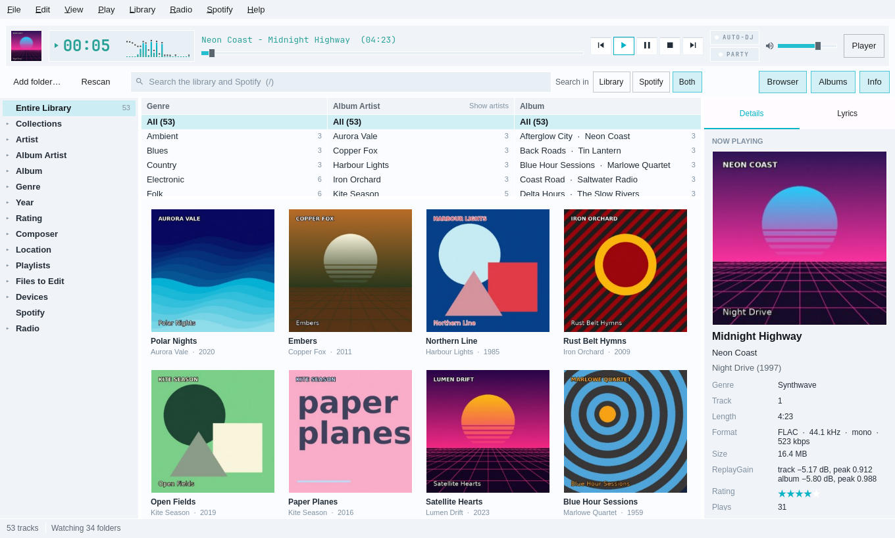
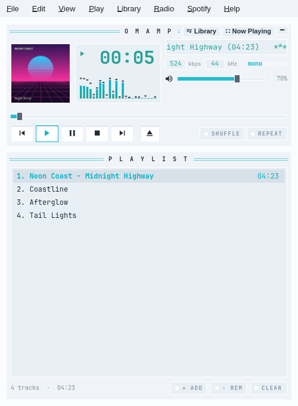
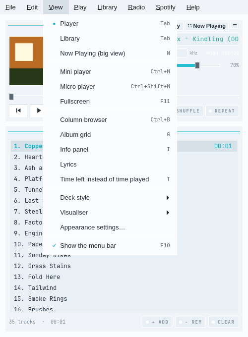
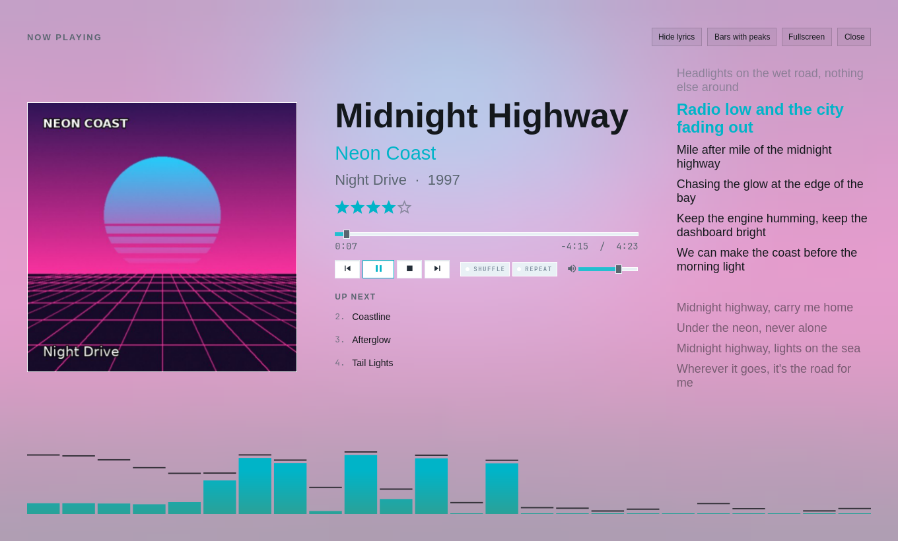
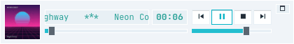
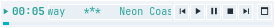
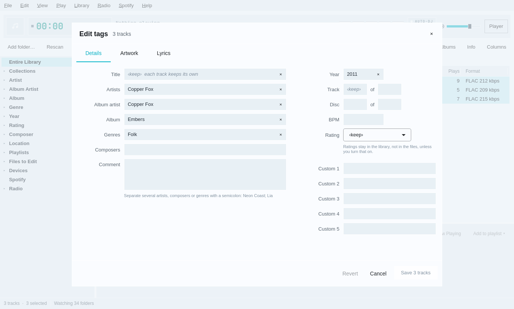
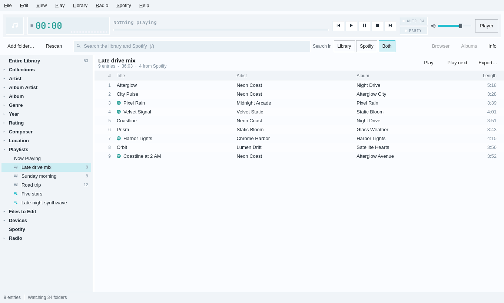
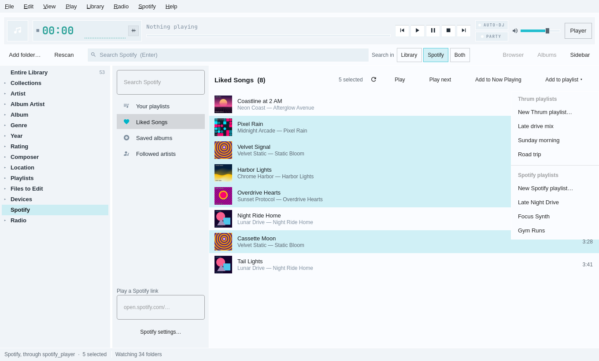
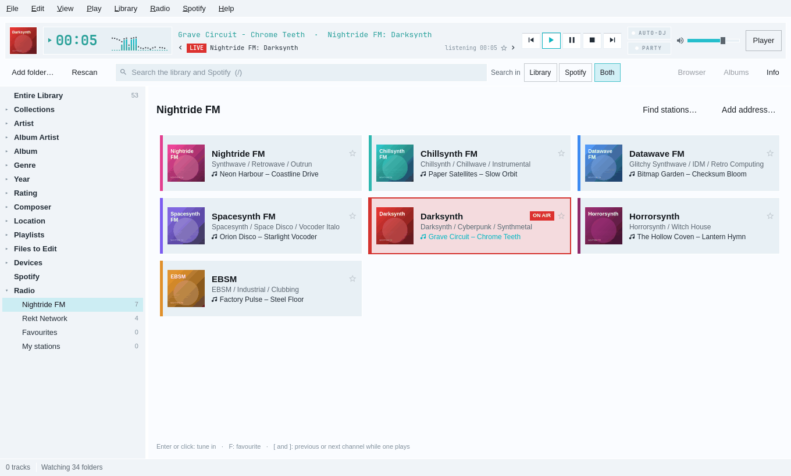

<div align="center">


# Omamp

**A Winamp-style music player and MediaMonkey-style library manager for Omarchy and Hyprland.**

[](LICENSE)
[](CHANGELOG.md)
[](https://github.com/basecamp/omarchy)
[](https://www.qt.io)

[Why Omamp](#why-omamp) · [Tour](#a-tour) · [Install](#install) · [Quick start](#quick-start) · [Keys](#keys) · [Guides](#guides) · [Status](#status-and-honest-limits)

</div>

<picture>
  <source media="(prefers-color-scheme: dark)" srcset="docs/hero-dark.png">
  
</picture>

<p align="center"><sub>Every picture here is the real app, drawn offscreen with a made-up library. They follow GitHub's light or dark mode, as Omamp follows the Omarchy theme.</sub></p>

## Why Omamp

Omamp is built for Omarchy first. Every colour comes from the current Omarchy
theme and changes the moment the theme does, window corners match Hyprland's,
and the media keys, `playerctl` and the Omarchy bar all control it. It is
driven from the keyboard, installs as an Arch package, and runs on any Linux
desktop, but Omarchy is where it looks right.

Underneath is a library manager in the spirit of MediaMonkey, for people with
big collections who care about their tags. It has a library tree, a column
browser, a tag editor with undo, file organising with a preview, auto-playlists,
duplicate finding, MusicBrainz tagging, and libraries that live on a NAS or a
Navidrome server.

On top sits Winamp's soul: a green clock, a bouncing analyser, a scrolling
title and Winamp's own keys. Internet radio and Spotify sit beside your own
files, so one playlist can hold a FLAC from your shelf, a Spotify track and a
Nightride FM channel.

## A tour

### The deck

The player is a Winamp 2–style deck with the playing track's cover. `Tab`
switches to the library, and the menu bar across the top shows every command
with its key.

<table>
  <tr>
    <td width="50%" align="center">
      <picture>
        <source media="(prefers-color-scheme: dark)" srcset="docs/deck-dark.png">
        
      </picture>
    </td>
    <td width="50%" align="center">
      <picture>
        <source media="(prefers-color-scheme: dark)" srcset="docs/menu-open-dark.png">
        
      </picture>
    </td>
  </tr>
</table>

### The library

Press `Tab` for the library: a tree on the left, a column browser of genres,
album artists and albums, the tracks or an album grid, and a sidebar with the
cover, lyrics, notes about the artist and the album, credits and what plays
next. Search takes plain words or a query such
as `artist:"neon coast" year:1990..1999 rating:4..`, and stays quick with
200,000 tracks.

<picture>
  <source media="(prefers-color-scheme: dark)" srcset="docs/library-dark.png">
  
</picture>

### Your layout

The library is laid out the way you like it. A small cover starts each row
of every track list; rows come compact, comfortable or large, and columns
move when you drag their headers. The sidebar's sections fold, hide and
change order. The now playing bar can be the slim strip or a large bar like
Spotify's, at the top or the bottom. **Settings → Appearance → Layout** has
all of it, and **Reset layout** puts it back. See
[docs/library.md](docs/library.md#the-art-column).

<picture>
  <source media="(prefers-color-scheme: dark)" srcset="docs/sidebar-dark.png">
  
</picture>

<picture>
  <source media="(prefers-color-scheme: dark)" srcset="docs/big-bar-bottom-dark.png">
  
</picture>

### Now Playing, big and small

`N` opens the big view: the cover, the rating, what's next, timed lyrics and a
visualiser, with `F11` for fullscreen. `Ctrl+M` and `Ctrl+Shift+M` shrink
Omamp to a mini player or to Winamp's windowshade.

<picture>
  <source media="(prefers-color-scheme: dark)" srcset="docs/now-playing-big-dark.png">
  
</picture>

<p align="center">
  <picture>
    <source media="(prefers-color-scheme: dark)" srcset="docs/mini-player-dark.png">
    
  </picture>
  &nbsp;&nbsp;
  <picture>
    <source media="(prefers-color-scheme: dark)" srcset="docs/micro-player-dark.png">
    
  </picture>
</p>

### Tags and files

Edit the tags of one track or a hundred, rename and move files by a mask with
a preview of every change, fill tags from file names, and identify albums with
MusicBrainz. Every change can be undone. Files to Edit lists the tracks with
missing or inconsistent tags, and the duplicate finder can match an MP3 and a
FLAC of the same recording by how they sound.

<picture>
  <source media="(prefers-color-scheme: dark)" srcset="docs/tag-editor-dark.png">
  
</picture>

### Playlists that mix your files and Spotify

Playlists, auto-playlists that update themselves, collections, Auto-DJ and
party mode. With Spotify switched on, a playlist can hold Spotify tracks
beside your own files; they play on Spotify when their turn comes.

<picture>
  <source media="(prefers-color-scheme: dark)" srcset="docs/mixed-playlist-dark.png">
  
</picture>

### Spotify

Your Spotify playlists, Liked Songs, saved albums, followed artists and search
sit in the library tree. Choose several tracks and play them, queue them, or
add them to an Omamp or a Spotify playlist. Omamp never sees your Spotify
password: it drives [spotify_player](https://github.com/aome510/spotify-player),
which keeps its own sign-in. Playing needs Spotify Premium.

<picture>
  <source media="(prefers-color-scheme: dark)" srcset="docs/spotify-multiselect-dark.png">
  
</picture>

### Internet radio

Every Nightride FM and Rekt Network channel is built in, each showing the song
on air now. `Shift+R` opens the picker and `[` `]` change channel. Any other
station can be found on radio-browser.info or added by its address.

<picture>
  <source media="(prefers-color-scheme: dark)" srcset="docs/radio-channels-dark.png">
  
</picture>

### In the Omarchy bar

A bar plugin shows a small cover, the play state and the track. Click it for a
panel led by a large cover, with seek, transport, shuffle, repeat and volume.

<p align="center">
  <picture>
    <source media="(prefers-color-scheme: dark)" srcset="docs/omarchy-plugin-dark.png">
    
  </picture>
</p>

There is more in the guides: [device sync](docs/sync.md) to a phone, a USB
drive or a Syncthing folder, [reports](docs/sync.md#reports) as CSV or a web
page, [NAS and Navidrome](docs/nas.md) libraries, and the
[MediaMonkey import](docs/mediamonkey-import.md).

## Install

Omamp is not in the AUR yet; the package files are ready in [aur/](aur/).
For now, build it from source on Arch or Omarchy.

1. Install what it builds against:

   ```sh
   sudo pacman -S --needed base-devel qt6-base qt6-declarative qt6-multimedia qt6-wayland \
       taglib sqlite ffmpeg pkgconf ttf-jetbrains-mono-nerd
   ```

2. Clone it and install it, either as a package or into your home folder:

   ```sh
   git clone https://github.com/matt-shearing/omamp.git
   cd omamp
   bin/install          # builds an Arch package and installs it (asks for sudo)
   bin/install-user     # or: installs into ~/.local, no sudo
   ```

   Omamp then appears in the app launcher (`Super + Space`).

3. Optional extras:

   - **The bar plugin:** `omarchy-plugin/install`, then `omarchy-restart-shell`.
     See [its README](omarchy-plugin/README.md).
   - **Spotify:** `omarchy-pkg-add spotify-player`. The build also makes a small
     helper, `omamp-spotify-session`, when Rust's `cargo` is installed; it reads
     the playlists Spotify makes and artists' top tracks.
   - `chromaprint` finds duplicates by sound, `libsecret` keeps NAS and
     Navidrome passwords in the keyring, and `xdg-desktop-portal` gives the
     file pickers.

## Quick start

1. **Open Omamp.** The first time, it adds `~/Music` to the deck. Drop files or
   folders on the window, or press `O` to add a folder.
2. **Open the library** with `Tab`, **View → Library**, or the **Library**
   button on the deck. Choose **Add folder…** to add your music folders. The
   scan runs in the background, with its progress and a Cancel button in the
   status line.
3. **Find things** with the search box (`/`), the column browser (`Ctrl+B`),
   the album grid (`G`) or the command palette (`Ctrl+K`).
4. **Spotify:** open **Settings → Spotify**, switch on **Show Spotify in
   Omamp**, and press **Sign in…**. Spotify limits how often a shared app may
   ask, so lists can be slow; [your own Spotify client ID](docs/spotify.md#rate-limits-and-your-own-client-id)
   takes five minutes to set up and fixes most of it.
5. **Radio:** press `Shift+R` and pick a Nightride FM channel.

## Keys

Omamp keeps Winamp's keys and adds its own. These are the ones to learn
first; [docs/keys.md](docs/keys.md) has them all, and `?` shows them in the
window.

| Key | Does |
| --- | --- |
| `Space` | Play or pause |
| `Z` `X` `C` `V` `B` | Previous, play, pause, stop, next |
| `Tab` | Switch between the deck and the library |
| `N` | The big Now Playing view |
| `Ctrl+M` / `Ctrl+Shift+M` | The mini player / the micro player |
| `/` | Search the library |
| `Ctrl+K` | The command palette |
| `Ctrl+E` | Edit the tags of the chosen tracks |
| `Ctrl+Z` | Undo the last tag edit or organise |
| `Shift+R` | Internet radio |
| `?` | Every key |

## Command line

The library also works from a terminal, sharing one library with the window.
Every command takes `--json` for scripts.

```sh
omamp scan ~/Music                       # add a folder and scan it
omamp query 'artist:"neon coast" rating:4..'
omamp radio play darksynth               # tune the running Omamp in
omamp sync run Phone --dry-run           # what a sync would copy, convert and delete
```

[docs/command-line.md](docs/command-line.md) lists the commands, and
`omamp help` prints them all.

## Guides

| Guide | What it covers |
| --- | --- |
| [The library](docs/library.md) | Getting around, the library window, tags, organising, Files to Edit and duplicates |
| [Keys](docs/keys.md) | Every key, in the deck and the library |
| [Command line](docs/command-line.md) | The `omamp` commands, for people and scripts |
| [Now playing](docs/now-playing.md) | Covers, the big view, the mini players, visualisers and deck styles |
| [Query language](docs/query-language.md) | Searches and auto-playlists |
| [Masks](docs/masks.md) | File names and folders for organising, and tags from file names |
| [Playlists](docs/playlists.md) | Playlists, mixed playlists, auto-playlists, collections, statistics, Auto-DJ and party mode |
| [Web metadata](docs/web-metadata.md) | MusicBrainz, covers, lyrics and scrobbling, and what leaves your machine |
| [Music on a NAS](docs/nas.md) | SMB and NFS shares, Navidrome, and what happens when the NAS is off |
| [Device sync and reports](docs/sync.md) | Copying to a phone, a USB drive or Syncthing, and CSV or web-page reports |
| [Internet radio](docs/radio.md) | Nightride FM, other stations, and song names |
| [Spotify](docs/spotify.md) | Signing in, your own client ID, and what Spotify allows |
| [MediaMonkey import](docs/mediamonkey-import.md) | Bringing ratings, play counts, history and playlists across |
| [The bar plugin](omarchy-plugin/README.md) | The Omarchy bar widget and its settings |

What changed in each release is in [CHANGELOG.md](CHANGELOG.md), and the
plan and the detailed progress log are in [docs/plan/](docs/plan/).

## Status and honest limits

Omamp is young (0.3.0) and changes quickly. It has a large automated test
suite (`bin/test`), but the tests run against made-up music, pretend web
services and simulated network shares. Some things have not been tried for
real yet:

- **Big real libraries.** Speed was measured on 200,000 generated tracks, not
  on a real collection.
- **A real NAS and a real Navidrome server.** Both were tested against
  stand-ins.
- **The MediaMonkey import** has never been run on a real MediaMonkey
  database.
- **Device sync** has not been tried on a real phone or a real Syncthing
  folder.
- **Spotify** was tested against a pretend spotify_player. Playing needs
  Spotify Premium (a Free account can browse and search), and gapless joins,
  crossfade, the equaliser and the visualiser work only on your own files.
- **The native engine** (gapless playback, crossfade, ReplayGain and the
  equaliser) is still marked experimental; Qt Multimedia plays by default.
- **English only** for now, though every string is ready for translation.
- **Last.fm** needs your own API key; Omamp doesn't ship one.

If something breaks, please [open an issue](https://github.com/matt-shearing/omamp/issues).

## Credits and licence

Omamp is MIT-licensed. Theme following and the project layout come from
Omacut and Monologue by David Heinemeier Hansson, also MIT.

Spotify works through [spotify_player](https://github.com/aome510/spotify-player),
and the session helper is built on [librespot](https://github.com/librespot-org/librespot).
The radio channels are [Nightride FM](https://nightride.fm)'s and the Rekt
Network's; Omamp plays their public streams.

Omamp is inspired by Winamp and MediaMonkey, and is not affiliated with
either, nor with Spotify or Nightride FM.
