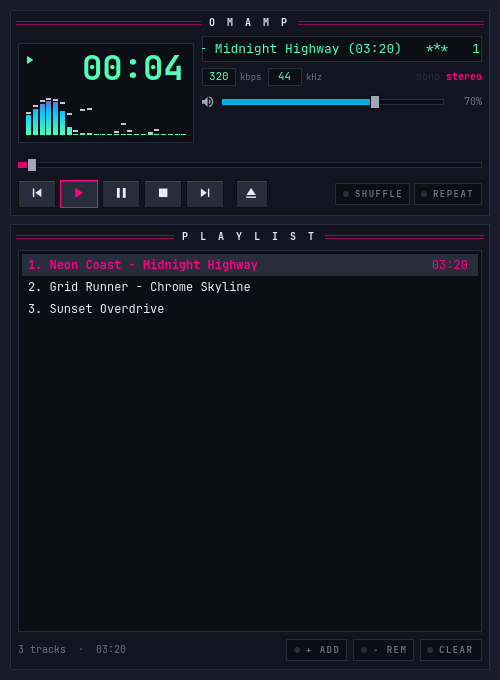
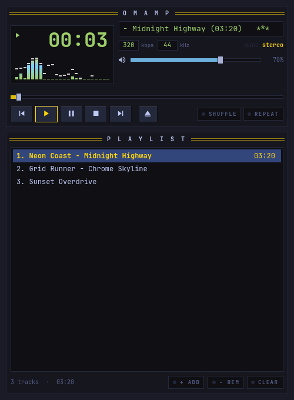
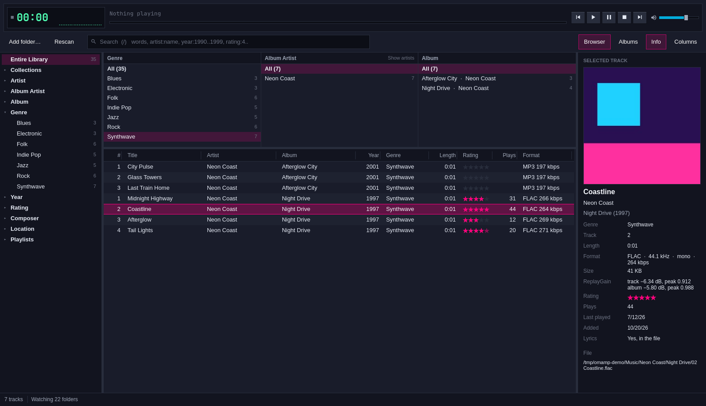
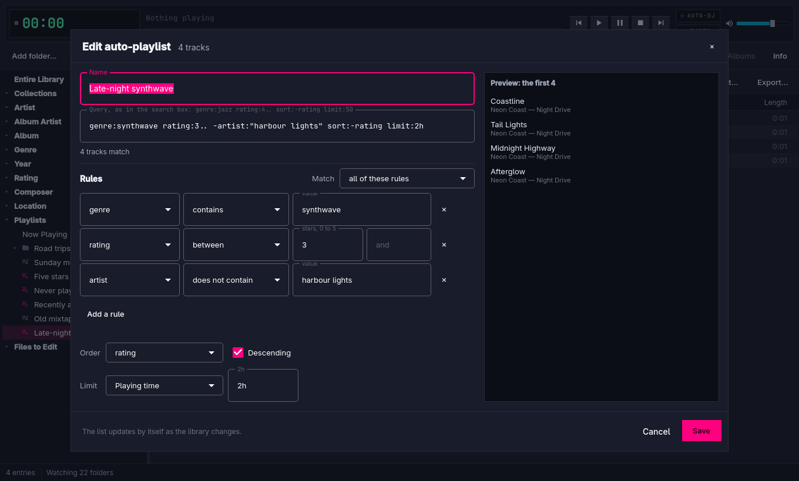
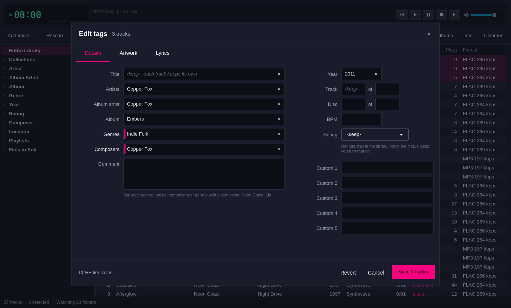
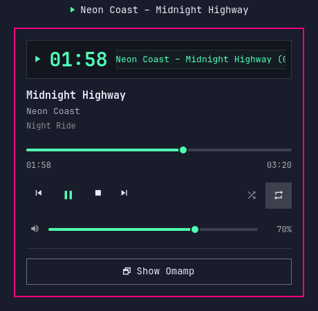

# Omamp

**A music player and library manager for Arch Linux, built for Omarchy and Hyprland first.**

Omamp has two sides. The player is a Winamp 2–style deck: a green clock, a
bouncing analyser, a scrolling title and a playlist, all in your Omarchy
theme. The library manager is coming next. It brings back the big local
libraries of the 2000s, MediaMonkey-style, with modern tools on top: tagging
from MusicBrainz, smart playlists, file organising with a preview, and
libraries that live on a NAS.

> **Status:** early. The player works today. So does the library window
> (advanced mode): the tree, the track list, search, the column browser, the
> album grid, the info panel, the command palette, and folders that keep
> themselves up to date. Tagging and the rest are planned in
> [docs/plan/](docs/plan/). Expect breaking changes.

## Why Omarchy first

Omamp follows the desktop instead of fighting it. Every colour comes from the
current Omarchy theme and changes when the theme does. Window corners match
Hyprland's rounding. Media keys, `playerctl` and the Omarchy bar control it
over MPRIS. Everything works from the keyboard. It builds and installs as an
Arch package. It runs on any Linux desktop, but Omarchy is where it looks right.

## The player



It plays local files: MP3, FLAC, Ogg, Opus, M4A/AAC, WAV and the rest of
what FFmpeg reads. Drop files or folders on the window, press `O` to pick a
folder, or pass them on the command line (`omamp ~/Music/Album`). The first
time it starts with nothing to play, it adds `~/Music`. The playlist, the
track you were on, the volume, shuffle and repeat come back the next time
you open it.

Omamp speaks MPRIS, so the media keys, `playerctl` and the Omarchy bar can
see and control it.



## Advanced mode: the library

Press `Tab` to switch between the deck and advanced mode. In advanced mode the
deck folds into a strip across the top, and the library fills the rest of the
window: a tree on the left, the tracks on the right, a search box above them,
and a status line below. Omamp remembers which mode you left it in and the
window size for each.



- **Add folder…** adds a music folder to the library and scans it. **Rescan**
  (or `F5`) checks every library folder again. Scans run in the background,
  with their progress and a Cancel button in the status line.
- **The tree** works like MediaMonkey's: Entire Library, Collections, Artist,
  Album Artist, Album (by first letter), Genre, Year (by decade), Rating,
  Composer, Location (disks and shares, then folders) and Playlists. Disks and
  shares that aren't connected show dimmed; their tracks stay in the library.
- **The track list** shows every track under the chosen node that matches the
  search. Click a column header to sort, again to reverse, and a third time
  for the library order. Drag a header's edge to resize a column. Right-click
  a header, or press **Columns**, to choose the columns.
- **Search** uses the same query language as `omamp query`: plain words,
  `artist:"neon coast"`, `year:1990..1999`, `rating:4..`, `-genre:christmas`.
  A query with a mistake in it says what is wrong and leaves the list as it was.
- Double-click a track or press `Enter` to play the list from that track.
  Right-click for Play next, Add to Now Playing and Show in folder.
- **The column browser** (`Ctrl+B`, or **Browser**) puts three lists above
  the tracks: Genre, Album Artist and Album, as in foobar2000 and
  MediaMonkey. Each lists its values with their number of tracks, within the
  tree node and the search. Choosing a genre narrows the artists, the albums
  and the tracks; `Ctrl`+click picks several, and **All** goes back. The
  middle list can show every artist instead of album artists.
- **The album grid** (`G`, or **Albums**) shows the albums of the list as
  covers. Double-click or `Enter` plays an album; right-click or
  `Ctrl+Enter` for **Show tracks**. Covers come from `cover.jpg`, `folder.jpg`
  or `front.jpg` beside the music, or from the files' own tags, and fill in
  while you look.
- **The info panel** (`I`, or **Info**) shows the cover and everything the
  library knows about the chosen track, or the one playing: tags, format,
  ReplayGain, rating, plays, when it last played, whether it has lyrics, and
  where the file is.
- **The command palette** (`Ctrl+K`) finds actions, artists, albums and
  tracks as you type. `Enter` runs the action or goes to the artist, album or
  track. Start with `>` for actions only.
- **Folders keep themselves up to date.** Omamp watches the library folders
  on local disks and rescans only the folders that change; the list keeps
  your selection and your place. Shares on the network are checked every 15
  minutes. The status line says what is watched.

### Tags, files and tidying up

- **Edit tags** (`Ctrl+E`, or right-click **Edit tags…**) opens the tag
  editor for the selected tracks: title, artists, album artist, album,
  genres, composers, year, track and disc numbers, BPM, comment, rating and
  five custom fields, with tabs for the artwork and the lyrics. With several
  tracks chosen, a field they disagree on shows **‹keep›**: each track keeps
  its own value unless you type a new one, and the **✕** empties it in all of
  them. Edited fields are marked. **Save** (`Ctrl+Enter`) writes only what you
  changed, safely (to a copy that replaces the file only once it checks
  out), and any file that fails is listed with the reason. The artwork tab
  shows the picture in the file, or the folder's `cover.jpg`, and takes a
  new one from a file, from the clipboard, or removes it.
- **`F2`** edits the title of the track under the cursor in place.
- **Organise files** (`Ctrl+Shift+O`) renames and moves the selected files by
  a mask such as `<Album Artist>/<Album> (<Year>)/<Track#:2> <Title>`, with a
  preview of every old and new place before anything moves. Type `<` or `$`
  for a list of fields and functions; a mistake in the mask says where it is.
  Double-click a new place to change it by hand. A name that is taken shows
  as a conflict and that file is left where it is; existing files are never
  replaced. Pictures and cue sheets can go with their folder, and folders
  left empty can be removed. [docs/masks.md](docs/masks.md) has the mask
  language.
- **Tag from file names** (right-click) reads tags out of the files' names
  and folders with a pattern such as `<Track#> - <Title>`, showing what each
  file would get before it writes anything.
- **Undo** (`Ctrl+Z`) takes back the last tag edit, tags from file names or
  organise, files and library together, and says what it undid; `Ctrl+Shift+Z`
  does it again. **Undo history** (from `Ctrl+K`) lists every change with
  what it changed, and can undo any of them.
- **Files to Edit**, at the bottom of the tree, lists the checks MediaMonkey
  has, with how many tracks each finds: unknown title, artist, album, genre
  or year, missing artwork, album artist, year or genre differing within an
  album, track-number gaps, not levelled, dead links, offline and more.
  Choose one to see its tracks.
- **Duplicates**, under Files to Edit, finds the same song more than once:
  by artist and title, by identical files, or by how it sounds (Chromaprint's
  `fpcalc`, so an MP3 and a FLAC of one recording match). Each group
  suggests the copy to keep and says why. Tick the others to take them out
  of the library, or move their files to the desktop's trash, after asking.
  Nothing is ever deleted outright.
- Dates read the same everywhere: "12 Jul 2026", not "7/12/26".

### Playlists, Auto-DJ and party mode

- **Playlists** live in the tree under Playlists: folders, playlists in your
  own order, and auto-playlists, nested as deep as you like. Right-click
  Playlists or a folder for **New playlist**, **New auto-playlist**, **New
  folder**, **Import playlists** (M3U, M3U8 and PLS, through the desktop's
  file picker) and **Save Now Playing as a playlist**; right-click a playlist
  to play it, rename it, move it into a folder, export it as M3U8 or delete
  it. Everything is in the palette (`Ctrl+K`) too.
- Drag tracks from the list onto a playlist in the tree, or use **Add to
  playlist** in a track's menu. A playlist shows in its own order:
  `Alt+↑` and `Alt+↓` (or a drag) move the chosen entries, `Delete` takes
  them out. A track that is in the list twice is marked **repeat**; an entry
  whose file isn't in the library stays, marked **not in library**, so an
  exported playlist is never shorter than the one you imported.
- **Auto-playlists** are a query that updates by itself
  ([docs/query-language.md](docs/query-language.md)). The editor checks the
  query as you type, says how many tracks it picks and shows them. Below
  the query, rules build the same text from rows of field, operator and
  value, matching all or any, with an order and a limit by tracks, playing
  time or size. The text is what is saved; a query the rows can't show (with
  brackets, say) is marked as advanced and edited as text. A random one
  keeps its order until **New shuffle**.
- **Collections** (right-click Collections) are a saved query with their
  own tree nodes (Artist, Album, Genre…) and their own columns; columns
  hidden or shown while a collection is open are remembered for it.
- **Play counts** go up as you listen: a track counts once you have heard
  half of it or four minutes, and pressing Next before a tenth of it counts
  as a skip. Seeking forward is not listening. Plays and Last played update
  in the list as they happen, and listens queue for ListenBrainz or Last.fm
  when one is set up.
- **Auto-DJ** (`Ctrl+J`, or the **AUTO-DJ** lamp in the deck strip) keeps a
  number of tracks queued after the one playing, from the whole library, a
  collection, a playlist or a query, without repeating an artist too soon or
  a track heard lately, favouring higher ratings. **Auto-DJ settings…** in
  the palette sets all that.
- **Party mode** (palette) lets guests use the player without touching your
  library: tag editing, playlists, organising, settings and quitting are
  locked, with an optional PIN to leave, and an optional big now-playing
  display. The **PARTY** lamp shows it is on; click it to leave.
- **Settings** (`Ctrl+,`): the playback engine, crossfade, ReplayGain with
  preamp and clip prevention, a 10-band equaliser with presets; library
  folders, watching and the network rescan interval, ratings in files;
  ListenBrainz (paste a token and check it) and Last.fm; the AcoustID key,
  MusicBrainz preferences and cover size.








It stays quick with big libraries. With 200,000 tracks, advanced mode opens
in about a third of a second. A search, a sort, a choice in the column
browser and the album grid all reach the screen in under 150 ms, most in
under 100 ms.


## Omarchy bar plugin

`omarchy-plugin/` adds Omamp to the Omarchy bar: the track and play state in the bar, and a panel with seek, transport, shuffle, repeat and volume. Install it with `omarchy-plugin/install`. See [its README](omarchy-plugin/README.md).



## Keys

| Key | Does |
| --- | --- |
| `Space` | Play or pause |
| `Z` `X` `C` `V` `B` | Previous, play, pause, stop, next (Winamp's own keys) |
| `←` `→` | Back or forward 5 seconds |
| `↑` `↓` | Move through the playlist |
| `Enter` | Play the selected track |
| `Delete` | Remove the selected track |
| `-` `+` | Volume down or up |
| `S` | Shuffle on or off |
| `R` | Repeat on or off |
| `O` | Add a music folder |
| `T` | Show time left or time played (or click the clock) |
| `Tab` | Switch between the deck and advanced mode |
| `?` | Show every key |
| `Q` | Quit |

Double-click a track to play it.

In advanced mode, the arrow keys move through the tree and the track list
instead of the playlist, and these keys work too:

| Key | Does |
| --- | --- |
| `Ctrl+K` | The command palette (on the deck too) |
| `/` or `Ctrl+F` | Search. `Esc` clears the search; `Enter` or `↓` goes to the list |
| `↑` `↓` `Page Up` `Page Down` `Home` `End` | Move through the tree or the list |
| `→` `←` in the tree | Open or close a node, or step into it or out to its parent |
| `Enter` in the tree, `←` in the list | Go from the tree to the list, and back |
| `Shift+↑` `Shift+↓` | Select a range of tracks |
| `Ctrl+Space` | Select or unselect the track under the cursor |
| `Ctrl+A` | Select every track in the list |
| `Enter` | Play the list from the selected track (or play the selected tracks) |
| `Menu` | Play next, add to Now Playing or show in folder |
| `O` | Add a folder to the library |
| `F5` | Rescan the library |
| `Ctrl+B` | Show or hide the column browser (`B` stays Winamp's next track) |
| `↑` `↓` in the browser | Choose a value; `Shift` for a range, `Ctrl+Space` for one more |
| `←` `→` in the browser | Move between its lists and to the tree; `Enter` goes to the tracks |
| `G` | Album covers instead of the track list, and back |
| `Enter`, `Ctrl+Enter` in the grid | Play the album; show its tracks |
| `I` | Show or hide the info panel |
| `Ctrl+E` | Edit the tags of the selected tracks (in the grid, the chosen album's) |
| `F2` | Edit the title of the track under the cursor; `Enter` saves, `Esc` leaves it |
| `Ctrl+Shift+O` | Organise files: rename and move the selected tracks by a mask |
| `Ctrl+Z` | Undo the last tag edit or organise |
| `Ctrl+Shift+Z` or `Ctrl+Y` | Redo what was undone |
| `Ctrl+Enter` or `Ctrl+S` in an editor | Save, organise or tag |
| `Esc` in an editor | Close it (asking first if there are unsaved changes) |
| `Menu` in the tree | New playlist, auto-playlist or folder; rename, move, export or delete |
| Drag from the list | Add the selected tracks to a playlist in the tree |
| `Alt+↑` `Alt+↓` in a playlist | Move the chosen entries up or down |
| `Delete` in a playlist | Remove the chosen entries from the playlist |
| `Delete` in the tree | Delete the chosen playlist, folder or collection (asks first) |
| `Ctrl+J` | Auto-DJ on or off (on the deck too) |
| `Ctrl+,` | Settings (on the deck too) |

## Build and install

```sh
bin/build          # build/omamp
bin/test           # tests, offscreen (needs ffmpeg for the library tests)
bin/bench          # times the library on 200,000 synthetic tracks
bin/install        # makepkg -fsi: the package, system-wide (needs sudo)
bin/install-user   # ~/.local only, no sudo
```

Built with C++ and Qt Quick (Qt Multimedia for playback), the same way
Omarchy's own apps are built.

## Coming next

The full plan is in [docs/plan/](docs/plan/). In short:

- **Tagging:** MusicBrainz and AcoustID lookups, and lyrics from the web.
- **NAS libraries:** SMB, NFS or a Navidrome/Subsonic server, with offline tracks kept in the library.
- **Web in the window:** identify, covers and lyrics from MusicBrainz, AcoustID and LRCLIB (the command line has them now).

## The library from the command line

The library manager's core also works from the command line, and the
window and the command line share one library.

```sh
omamp scan ~/Music                       # add a folder to the library and scan it
omamp scan                               # rescan every library folder; unchanged files are only stat'ed
omamp query 'artist:"neon coast" year:1997..2001'
omamp query 'rating:4.. -genre:christmas' --json
omamp stats
omamp scan --quick                       # rescan, skipping folders whose modification time is unchanged
omamp watch                              # watch the library folders and rescan what changes (Ctrl+C stops)
omamp locate /mnt/usb/Music              # find missing tracks that were moved there
omamp art album 12 --size 256            # print the path of an album's picture, made if needed
```

A file moved or renamed inside the library keeps its rating, play count,
history and playlists: a scan recognises it by its size, length and tags, or
by its contents. Folders on network shares are never watched (a share's
changes made by other machines can't be seen); `omamp watch` rescans them
every 15 minutes instead, by folder modification time.

Every command takes `--json` and `--db <path>`, and exits 0 or 1. The library
is `~/.local/share/omamp/library.db`. Run `omamp help` for the query syntax.
Tracks on a disk or share that isn't mounted show as offline and are never
removed.

## Known gaps today

- Translations. Every string goes through `qsTr()`, but only English ships.
- Tags for tracks added from a folder or by dropping files (rather than
  from the library) that haven't played yet. Until such a track plays, the
  playlist shows a tidied file name and no length.
- Searching inside a playlist, and dragging tracks from the album grid.
- Logging in to Last.fm from the window (`omamp scrobble login lastfm` works).
- A change of playback engine takes effect at the next start.

## Licence

MIT. Theme following and the project layout come from Omacut and Monologue
by David Heinemeier Hansson, also MIT.

Omamp is inspired by Winamp and MediaMonkey. It is not affiliated with either.
