# The library

Press `Tab` and the deck becomes a library manager in the spirit of
MediaMonkey. This guide walks through the window: getting around, the
library itself, tags and files, and settings. The keys are in
[keys.md](keys.md).

## Getting around

Everything Thrum does is in the **menu bar** across the top of the window:
File, Edit, View, Play, Library, Radio, Spotify and Help. Each entry shows
its key, so the menus also teach the shortcuts. An entry is greyed out when
it can't run yet, for example Edit tags before you have chosen any tracks,
or anything party mode has locked.

<picture>
  <source media="(prefers-color-scheme: dark)" srcset="menu-deck-dark.png">
  
</picture>

Thrum has three views, and **View** switches between them:

- **Player** is the Winamp-style deck.
- **Library** is the MediaMonkey-style library manager.
- **Now Playing** is the big cover view.

You can also switch without the menu. On the deck, the **Library** and
**Now Playing** buttons sit in the deck's title bar. In the library, the
**Player** button at the right of the top strip goes back to the deck. `Tab`
switches between the deck and the library, and `N` opens Now Playing.

<picture>
  <source media="(prefers-color-scheme: dark)" srcset="menu-library-dark.png">
  
</picture>

To search Spotify, choose **Spotify → Search Spotify…**. It opens the
library on Spotify with the search box ready. In the library, the
**Library**, **Spotify** and **Both** buttons beside the search box choose
where a search looks.

`Ctrl+K` opens the command palette, which finds any command, artist, album or
track by typing part of its name. `?` lists every key. To hide the menu bar,
untick **View → Show the menu bar**. `F10` or `Alt` brings it back for a
moment, and the same View entry turns it back on.

## The library window

Press `Tab` to switch between the deck and the library. In the library the
deck folds into a strip across the top, and the library fills the rest of the
window: a tree on the left, the tracks on the right, a search box above them,
and a status line below. Thrum remembers which mode you left it in and the
window size for each.

<picture>
  <source media="(prefers-color-scheme: dark)" srcset="library-dark.png">
  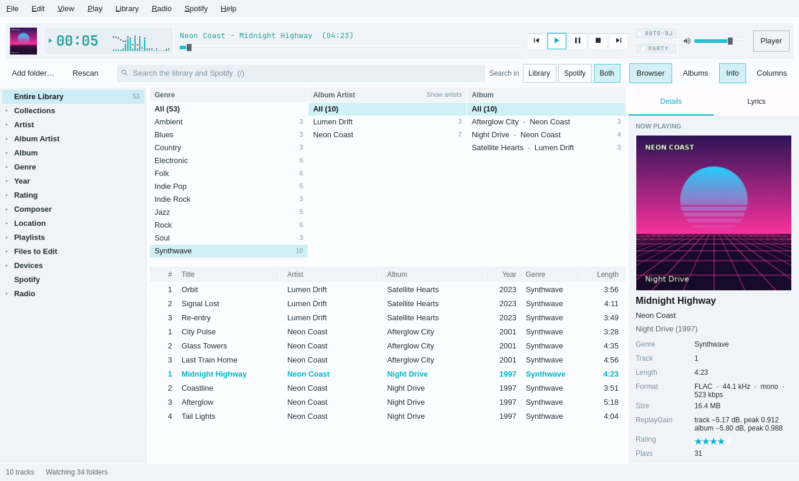
</picture>

- **Add folder…** adds a music folder to the library and scans it. **Rescan**
  (or `F5`) checks every library folder again. Scans run in the background,
  with their progress and a Cancel button in the status line.
- **The tree** works like MediaMonkey's: Entire Library, Collections, Artist,
  Album Artist, Album (by first letter), Genre, Year (by decade), Rating,
  Composer, Location (disks and shares, then folders), Playlists, Files to
  Edit and Devices, then Spotify (when it is on) and Radio. Disks and
  shares that aren't connected show dimmed; their tracks stay in the library.
- **The track list** shows every track under the chosen node that matches the
  search. Click a column header to sort, again to reverse, and a third time
  for the library order. Drag a header's edge to resize a column. Right-click
  a header, or press **Columns**, to choose the columns.
- **Search** uses the same query language as `thrum query`: plain words,
  `artist:"neon coast"`, `year:1990..1999`, `rating:4..`, `-genre:christmas`.
  A query with a mistake in it says what is wrong and leaves the list as it was.
- Double-click a track or press `Enter` to play the list from that track.
  Right-click for Play next, Add to Now Playing and Show in folder.
- **The column browser** (`Ctrl+B`, or **Browser**) puts three lists above
  the tracks: Genre, Album Artist and Album, as in foobar2000 and
  MediaMonkey. Each lists its values with their number of tracks, within the
  tree node and the search. Choosing a genre narrows the artists, the albums
  and the tracks; `Ctrl`+click picks several, and **All** goes back. The
  middle list can show every artist instead of album artists.
- **The album grid** (`G`, or **Albums**) shows the albums of the list as
  covers. Double-click or `Enter` plays an album; right-click or
  `Ctrl+Enter` for **Show tracks**. Covers come from `cover.jpg`, `folder.jpg`
  or `front.jpg` beside the music, or from the files' own tags, and fill in
  while you look.
- **The sidebar** (`I`, or **Sidebar**) shows the chosen track, or the one
  playing. See [The sidebar](#the-sidebar) below.
- **The command palette** (`Ctrl+K`) finds actions, artists, albums and
  tracks as you type. `Enter` runs the action or goes to the artist, album or
  track. Start with `>` for actions only.
- **Folders keep themselves up to date.** Thrum watches the library folders
  on local disks and rescans only the folders that change; the list keeps
  your selection and your place. Shares on the network are checked every 15
  minutes. The status line says what is watched.

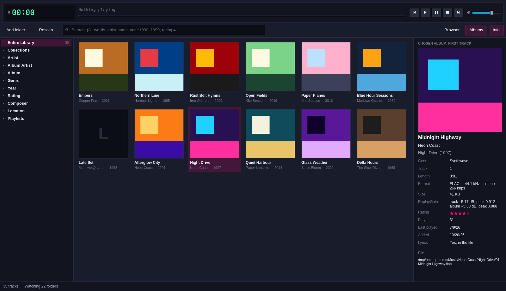

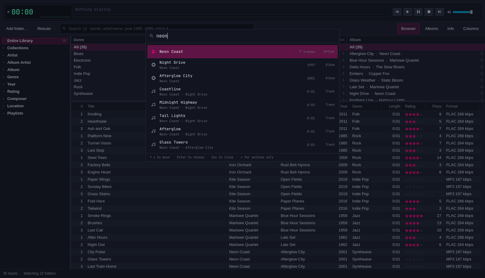

### The Art column

Every track list starts with a small cover of the track's album: the
library, playlists, Now Playing and the Spotify lists. In a playlist, a
Spotify track shows its Spotify cover and a radio station shows its tile.
Covers load in the background, one per album, so the list scrolls at full
speed while they arrive.

Drag any column's header sideways to move the column; Thrum remembers the
order. Right-click a header, or press **Columns**, to hide the Art column.
**View → Row height** offers Compact, Comfortable and Large rows; taller
rows show bigger covers.

<picture>
  <source media="(prefers-color-scheme: dark)" srcset="art-column-dark.png">
  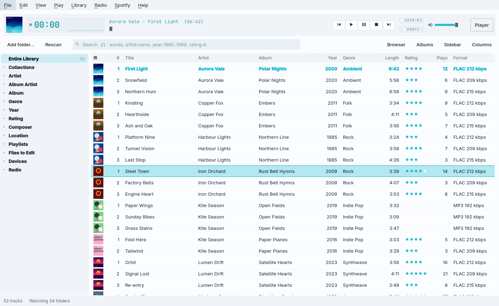
</picture>

### The sidebar

The sidebar sits on the right, as in Spotify's desktop app, and is on until
you switch it off. Press `I`, click
**Sidebar**, or use **View → Sidebar** to show or hide it, and drag its edge
to change its width. It has these sections:

- **Cover**: click it for the big Now Playing view.
- **Title, artist and rating**: click a star to rate the track.
- **Lyrics**: timed lyrics follow the song and light the line being sung.
  Lyrics come from a `.lrc` file beside the track, from the file's tags, or
  from LRCLIB when you press **Fetch from LRCLIB**.
- **About the artist** and **About the album**: notes packaged with the
  album come first, then a summary from Wikipedia with a **Read more** link.
- **Credits**: composer, label, year and ISRC from the tags, then producers,
  engineers, ISRCs and labels from MusicBrainz when the track carries its
  MusicBrainz IDs.
- **Up next**: the next five tracks in Now Playing.
- **Track details**: format, bitrate, ReplayGain, plays and where the file is.

Click a section's heading to fold it away. The **⋮** button lists the
sections: untick one to hide it, or choose **Order the sections…** to move
them up and down. **Following selection** shows the track under the cursor;
click it to show the track that is playing instead.

The sidebar also works for Spotify tracks, radio stations (the station and
its current song) and Navidrome tracks.

<picture>
  <source media="(prefers-color-scheme: dark)" srcset="sidebar-dark.png">
  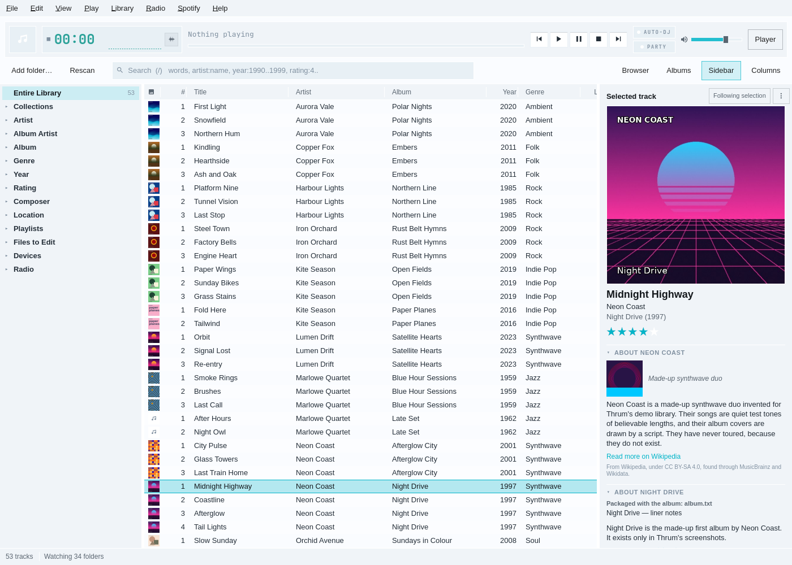
</picture>

**Notes packaged with the album.** Thrum reads text files in the album's
folder (and, for a `CD1` folder, the folder above): `album.txt`,
`about.txt`, `liner notes.*`, `notes.md`, `info.txt`, `credits.txt`,
`README*` and `.nfo` files, then the file's comment tag. Nothing leaves your
computer for these.

**Where the online summaries come from.** Thrum asks MusicBrainz for the
artist (by the MusicBrainz ID in the tags, or by an exact name match) and the
album's release group. It follows their links to Wikidata, then to the
Wikipedia article in your Omarchy language, or in English when there is
none. It shows Wikipedia's summary of the article, with its picture, under
Wikipedia's CC BY-SA licence. Each service gets its own polite pace and
Thrum's User-Agent, and the answers are kept for 30 days in
`~/.cache/thrum/http`. When a look-up fails or finds nothing, the section says
**No info found** with a **Retry** button. Turn the look-ups off in
**Settings → Appearance → Layout**; `net.offline` or `THRUM_OFFLINE=1` stops
them too.

### The large now playing bar

**View → Now playing bar** swaps the strip for a large bar like Spotify's,
and puts either one at the top or the bottom of the window. The large bar has
the cover, the title and artist with the rating (or Like, for a Spotify
track) on the left; shuffle, previous, a big play button, next and repeat in
the middle, with the position under them; and lyrics, Now Playing, the
sidebar, the mini player and the volume on the right. It takes its colours
from the deck style, and shows a visualiser behind the seek bar, along its
edge or beside the cover
([docs/now-playing.md](now-playing.md#in-the-large-now-playing-bar)).

<picture>
  <source media="(prefers-color-scheme: dark)" srcset="big-bar-bottom-dark.png">
  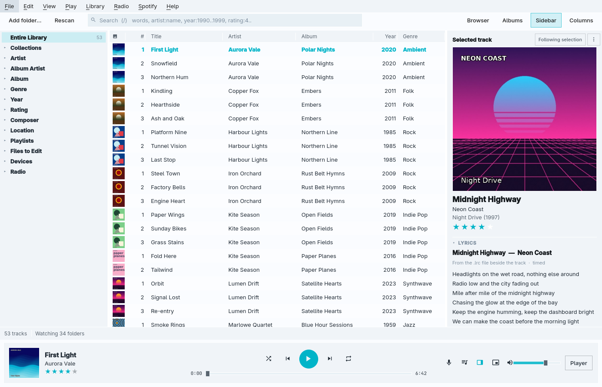
</picture>

### First-run setup

The first time Thrum opens, a small panel at the bottom of the window walks
through five steps. Each choice shows in the window behind it at once:

1. **Start**: the player (the Winamp-style deck) or the library.
2. **Look**: the player style (Omarchy, which follows your theme; Classic;
   Silver) and the visualiser, each with a moving preview. New visualisers
   appear here as they are added.
3. **Layout**: three starting points for the library. **Classic** has the
   tree, the column browser and the list, with the slim strip on top.
   **Spotify-like** has covers in the list, the sidebar and a large bar at the
   bottom. **Minimal** has the tree and the list. Switches below them turn
   the covers, the sidebar, the large bar and its place on and off.
4. **Your music**: add a music folder, and switch on Spotify (you sign in on
   the Spotify page after Finish). It also says that internet radio, with
   Nightride FM, is ready, and where to add a Navidrome server.
5. **Done**: `Tab`, `Ctrl+K`, `?` and `F10`, and a reminder that the View
   menu has everything you chose.

`Enter` moves to the next step. `Esc` or **Skip setup** asks first, then puts
everything back as it was when the setup opened. **Help → Run setup again…**
or **Run setup again…** in the command palette opens it at any time.

If you used Thrum before the setup existed, it doesn't open by itself. A
small banner offers it once instead, and its ✕ hides it for good. Your
settings stay as they are unless you run the setup and change them. The
sidebar is switched on once for everyone, because it is now on by default;
after that it stays as you leave it. The setup keeps its own state under
`[setup]` in `~/.config/thrum/window.conf`.

<picture>
  <source media="(prefers-color-scheme: dark)" srcset="setup-look-dark.png">
  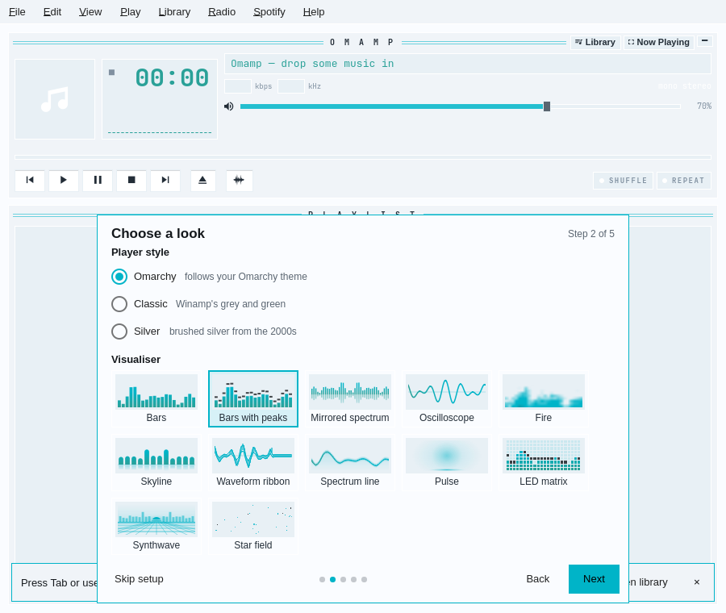
</picture>

<picture>
  <source media="(prefers-color-scheme: dark)" srcset="setup-layout-dark.png">
  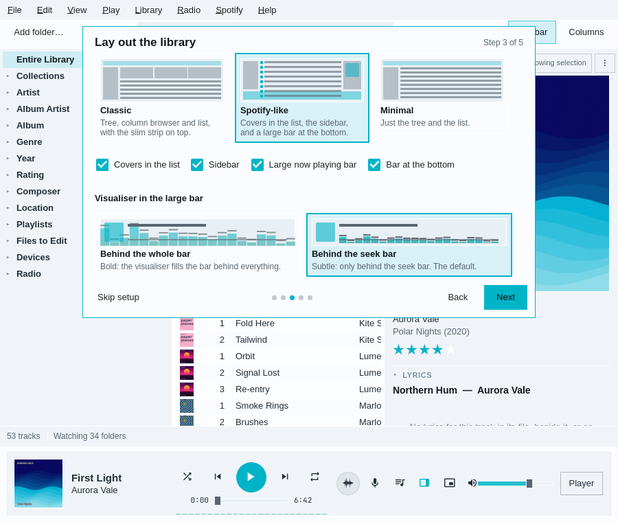
</picture>

### Layout settings

**Settings → Appearance → Layout** collects all of these: the Art column and
the row height, the sidebar, what it follows, its sections and the online
look-ups, and the bar's size and place. **Reset layout** puts the columns,
the sidebar and the bar back as they start, with the sidebar on. Everything is kept in
`~/.config/thrum/window.conf`, under `[layout]` and `[window]`.

It stays quick with big libraries. With 200,000 tracks, the library opens
in about a third of a second. A search, a sort, a choice in the column
browser and the album grid all reach the screen in under 150 ms, most in
under 100 ms. With the Art column on, scrolling 200,000 tracks draws a frame
in about 9 ms, as it does without the column.

## Tags, files and tidying up

- **Edit tags** (`Ctrl+E`, or right-click **Edit tags…**) opens the tag
  editor for the selected tracks: title, artists, album artist, album,
  genres, composers, year, track and disc numbers, BPM, comment, rating and
  five custom fields, with tabs for the artwork and the lyrics. With several
  tracks chosen, a field they disagree on shows **‹keep›**: each track keeps
  its own value unless you type a new one, and the **✕** empties it in all of
  them. Edited fields are marked. **Save** (`Ctrl+Enter`) writes only what you
  changed, safely (to a copy that replaces the file only once it checks
  out), and any file that fails is listed with the reason. The artwork tab
  shows the picture in the file, or the folder's `cover.jpg`, and takes a
  new one from a file, from the clipboard, or removes it.
- **`F2`** edits the title of the track under the cursor in place.
- **Organise files** (`Ctrl+Shift+O`) renames and moves the selected files by
  a mask such as `<Album Artist>/<Album> (<Year>)/<Track#:2> <Title>`, with a
  preview of every old and new place before anything moves. Type `<` or `$`
  for a list of fields and functions; a mistake in the mask says where it is.
  Double-click a new place to change it by hand. A name that is taken shows
  as a conflict and that file is left where it is; existing files are never
  replaced. Pictures and cue sheets can go with their folder, and folders
  left empty can be removed. [masks.md](masks.md) has the mask
  language.
- **Tag from file names** (right-click) reads tags out of the files' names
  and folders with a pattern such as `<Track#> - <Title>`, showing what each
  file would get before it writes anything.
- **Undo** (`Ctrl+Z`) takes back the last tag edit, tags from file names or
  organise, files and library together, and says what it undid; `Ctrl+Shift+Z`
  does it again. **Undo history** (from `Ctrl+K`) lists every change with
  what it changed, and can undo any of them.
- **Files to Edit**, at the bottom of the tree, lists the checks MediaMonkey
  has, with how many tracks each finds: unknown title, artist, album, genre
  or year, missing artwork, album artist, year or genre differing within an
  album, track-number gaps, not levelled, dead links, offline and more.
  Choose one to see its tracks.
- **Duplicates**, under Files to Edit, finds the same song more than once:
  by artist and title, by identical files, or by how it sounds (Chromaprint's
  `fpcalc`, so an MP3 and a FLAC of one recording match). Each group
  suggests the copy to keep and says why. Tick the others to take them out
  of the library, or move their files to the desktop's trash, after asking.
  Nothing is ever deleted outright.
- Dates read the same everywhere: "12 Jul 2026", not "7/12/26".

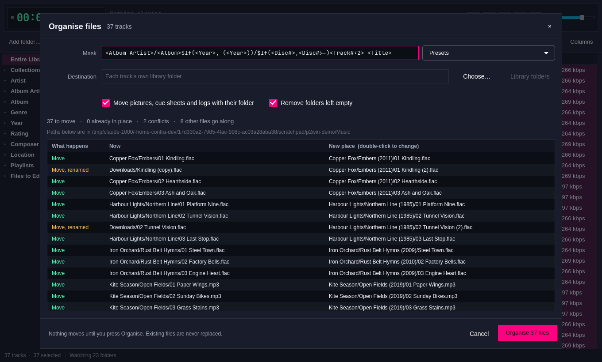

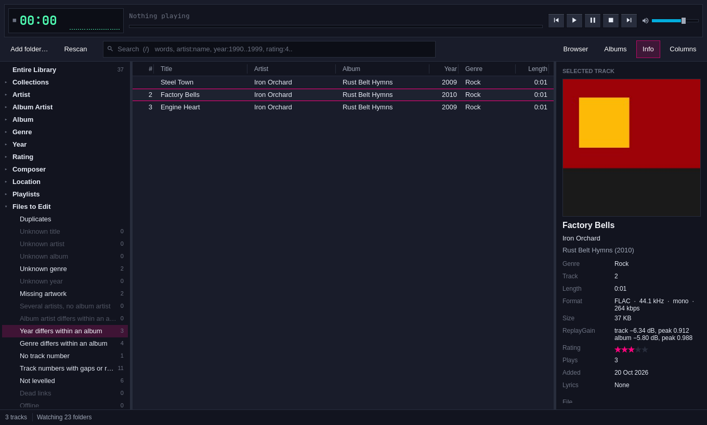

The masks used by organising and by tags from file names are in
[masks.md](masks.md). Identifying with MusicBrainz, covers and lyrics are in
[web-metadata.md](web-metadata.md).

## Settings

- **Settings** (`Ctrl+,`): the playback engine, crossfade, ReplayGain with
  preamp and clip prevention, a 10-band equaliser with presets; library
  folders, watching and the network rescan interval, ratings in files;
  ListenBrainz (paste a token and check it) and Last.fm; the AcoustID key,
  MusicBrainz preferences and cover size.

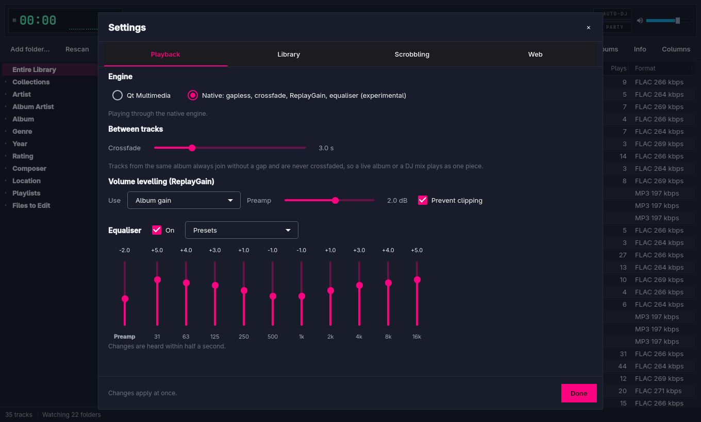
