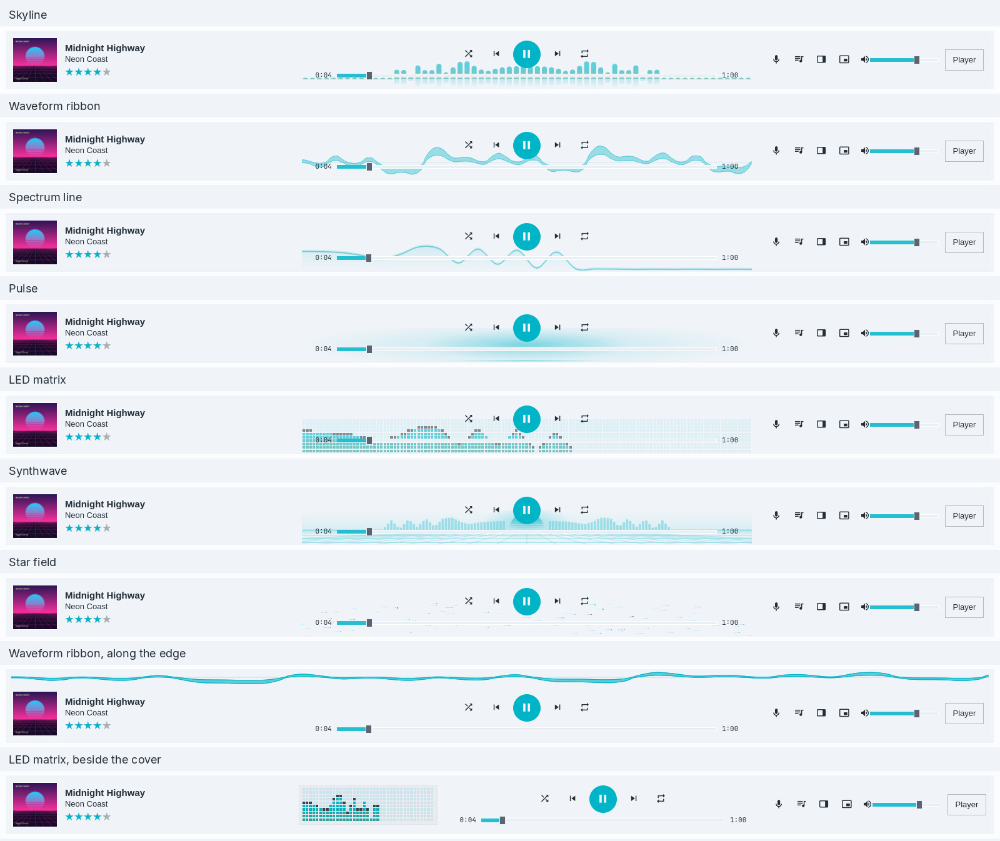
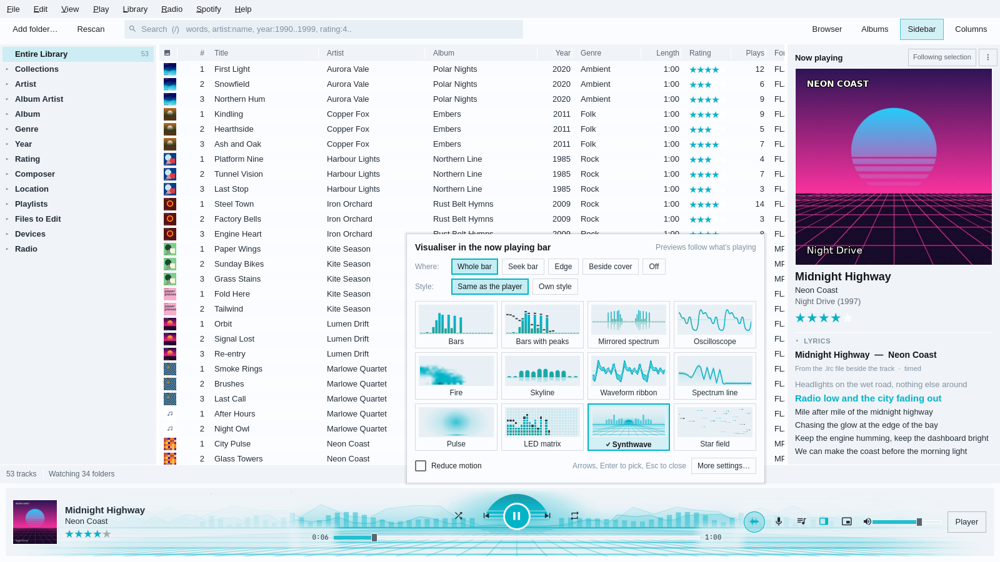
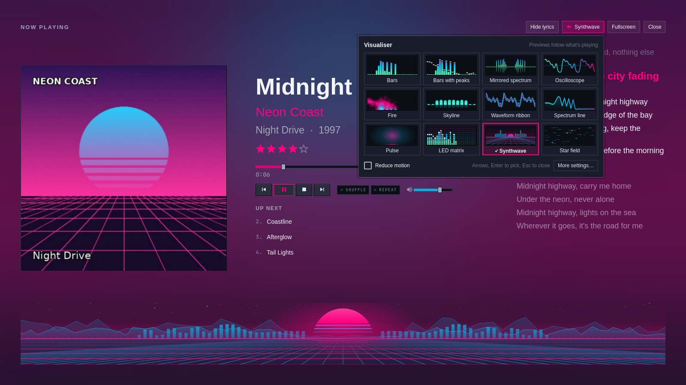
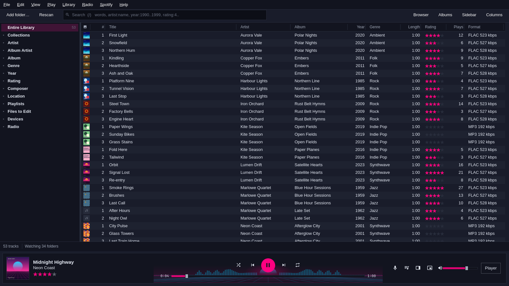
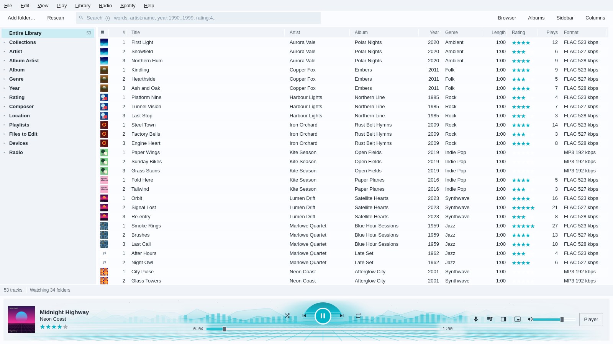
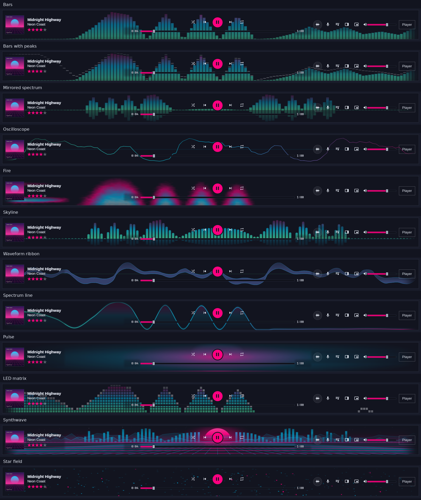
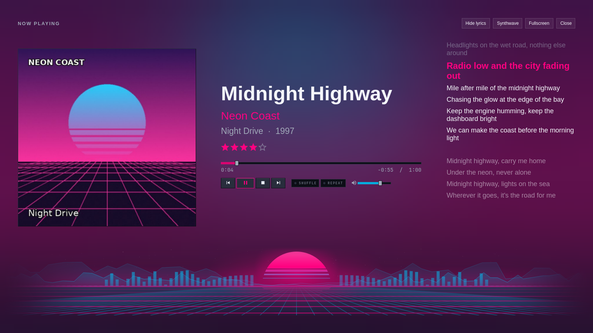

# Now playing

Omamp shows what is playing in five places: the deck, the strip at the top
of advanced mode, the Now Playing list, the info panel and the big Now
Playing view. Each shows the track's cover. The mini and micro players
shrink the window to a strip, and the deck can wear three styles.

<picture>
  <source media="(prefers-color-scheme: dark)" srcset="now-playing-big-dark.png">
  
</picture>

## The cover

The cover comes from the first of these that has one:

1. For a track in the library, the library's picture: the track's own
   embedded picture, else its album's (`cover.jpg`, `folder.jpg` or
   `front.jpg` beside the files, or a cover chosen from the Cover Art
   Archive).
2. For a Navidrome or Subsonic track, the server's cover.
3. For a file outside the library, the picture in its tags, else a cover,
   folder or front picture in its folder. A disc folder such as `CD1` also
   looks one folder up.

The deck finds covers without opening the library window. Pictures go into
the artwork cache, `~/.cache/omamp/art`, at 96, 256 and 600 pixels. When
nothing is found, a music note in the style's colours takes the cover's
place.

Omamp also sends the 600-pixel cover over MPRIS as `mpris:artUrl`, so the
Omarchy bar, `playerctl metadata` and other MPRIS clients show it.

## The big Now Playing view

Press `N`, click the cover on the deck or the strip, or choose **Big view**
in Now Playing. The view fills the window with:

- the cover, large;
- the title, artist, album and year;
- the rating, as five stars. Click a star to set it. The rating goes to the
  library, and to the file when **Settings > Library** says to write
  ratings;
- the position, with the time played, the time left and the length. Click
  or drag to seek;
- the transport, shuffle, repeat and volume;
- the next five tracks in the list. Double-click one to play it;
- timed lyrics, scrolling with the song, when the track has them (from a
  `.lrc` file, its tags, or LRCLIB once fetched in the sidebar);
- a visualiser along the bottom.

| Key | Does |
| --- | --- |
| `N` | Open or close the big view |
| `F11` | Fullscreen, and back |
| `Esc` | Leave fullscreen, then the big view |
| `Shift+V` | Next visualiser style; the waveform button at the top opens the [picker](#choosing-a-visualiser) |
| `Shift+L` | Lyrics on or off |

The background is the cover blurred, under a shade of the style's colour.
The blur is worked out once on the CPU and saved beside the cover, so it
needs no graphics card and looks the same with Qt's software renderer.
**Settings > Appearance** can use a plain colour instead.

Party mode's now-playing display is this view, without the buttons that
party mode locks.

## The mini and micro players

| Key | Does |
| --- | --- |
| `Ctrl+M` | The mini player, and back |
| `Ctrl+Shift+M` | The micro player, and back |

<picture>
  <source media="(prefers-color-scheme: dark)" srcset="mini-player-dark.png">
  
</picture>

The **mini player** is a 420 by 64 strip with the cover, the scrolling
title, the clock, a seek bar, the transport and the volume. It is
MediaMonkey's MiniPlayer.

<picture>
  <source media="(prefers-color-scheme: dark)" srcset="micro-player-dark.png">
  
</picture>

The **micro player** is a 275 by 28 bar with the play state, the clock,
the scrolling title, the transport and a thin position line along the
bottom. It is Winamp's windowshade mode.

Click the button at the right end, or double-click an empty part, to go
back to the full window. Each player remembers its own size.
`omamp mini` and `omamp micro` start Omamp in that player.

### Floating and pinning them in Hyprland

Wayland lets no window place itself or keep itself on top, so on Hyprland
Omamp asks Hyprland to do it. When you switch to a compact player, Omamp:

1. sets the window's title to `Omamp mini` or `Omamp micro`;
2. finds its own window in `hyprctl clients -j`, by its process ID;
3. asks Hyprland to float it, size it, move it to the top right of its
   monitor under the bar, and pin it to every workspace.

When you switch back, Omamp unpins the window and puts it back as it was
before the first compact player: a tiled window tiles again, and a floating
window returns to its old size and place. Going from the mini player to the
micro player keeps that earlier state.

The window's content stays hidden while Hyprland moves it, so you never see
the deck squeezed into a strip or the strip stretched across the deck. It
shows again when the new size arrives, or after one second.

Hyprland 0.56 reads dispatches as Lua, so Omamp sends one batch such as:

```sh
hyprctl --batch 'dispatch hl.dsp.window.float({ window = "address:0x…", action = "on" });
  dispatch hl.dsp.window.resize({ window = "address:0x…", x = 420, y = 64, exact = true });
  dispatch hl.dsp.window.move({ window = "address:0x…", x = 5700, y = 128, exact = true });
  dispatch hl.dsp.window.pin({ window = "address:0x…", action = "on" })'
```

The place is the rule's below: the monitor's width less the window's width
less 24 pixels across, and 5% of the monitor's height down, measured on the
window's own monitor.

If there is no `hyprctl`, or Hyprland refuses, the window asks for the
compact size itself. A window manager that keeps the window large gets the
strip along the top, full width, with the line "Your window manager keeps
this window large. Make it floating to shrink it." below it, never a small
strip in the middle of empty space.

#### A window rule for `omamp mini`

`omamp mini` and `omamp micro` open the window with its compact title and
size from the first frame, so a window rule can float and place it as it
opens. Omamp asks Hyprland as well, so the rule is optional. With the rule,
the player never shows tiled, even for a moment. On Omarchy 4 (Hyprland's
Lua configuration), put this in a file of your own in `~/.config/hypr/`,
such as `omamp.lua`, and add `require("omamp")` to
`~/.config/hypr/hyprland.lua`:

```lua
-- Omamp's mini and micro players: floating, on every workspace, top right
-- under the bar, without taking the focus.
o.window({ class = "^omamp$", title = "^Omamp mini$" }, {
  float = true,
  pin = true,
  no_initial_focus = true,
  size = { 420, 64 },
  move = { "(monitor_w-window_w-24)", "(monitor_h*0.05)" },
})
o.window({ class = "^omamp$", title = "^Omamp micro$" }, {
  float = true,
  pin = true,
  no_initial_focus = true,
  size = { 275, 28 },
  move = { "(monitor_w-window_w-24)", "(monitor_h*0.05)" },
})
```

On a Hyprland that still reads `hyprland.conf`, write the same rule in its
`windowrule` syntax: match the class `omamp` and the title, then float, pin,
size and move.

Hyprland applies a rule only when a window opens, which is why switching
asks Hyprland directly. A window opened with `omamp mini` goes back to
tiling when you leave the player, as a new window would.

## Visualisers


The deck, the strip, the mini player and the big view share one visualiser
style. Click a visualiser, or press `Shift+V`, to move on to the next; turn
the mouse wheel over it to go forwards (down) or back (up). The
[visualiser picker](#choosing-a-visualiser) shows every style at once. The
first five follow the analyser as it updates, about 30 times a second:

- **Bars**: the analyser's bars, rising from green through cyan to the
  accent.
- **Bars with peaks**: the same with a falling cap on each bar, Omamp's
  original analyser and the default.
- **Mirrored spectrum**: the bass in the middle, spreading to both sides,
  with a faint reflection below.
- **Oscilloscope**: the sound wave itself, as Winamp drew it.
- **Fire**: flames fed by the spectrum, a nod to Winamp's AVS and MilkDrop.

Seven more were made for the large now playing bar's wide, short strip, and
work everywhere else too. They run at 60 frames a second and ease between
the analyser's updates:

- **Skyline**: soft rounded bars with the bass in the middle and a
  reflection that fades below them.
- **Waveform ribbon**: the left and right channels as two smooth ribbons,
  thicker where the sound is louder.
- **Spectrum line**: the spectrum as one smooth, glowing line over a fading
  shade.
- **Pulse**: a soft glow in the middle that swells with the bass and
  brightens on the beat.
- **LED matrix**: Winamp-era lights, with a peak light above each column.
- **Synthwave**: a striped sun on the horizon, a city of spectrum bars
  either side, and a grid rolling towards you faster as the music builds.
- **Star field**: drifting stars that brighten with their part of the
  spectrum; the bass pushes them along.

<picture>
  <source media="(prefers-color-scheme: dark)" srcset="bar-visualisers-dark.png">
  
</picture>

All of them are drawn on the CPU with QPainter, and their colours come from
the deck style, so the Omarchy style follows the theme. On a 1,600 × 60
strip each costs well under a millisecond a frame; see
[the measurements](plan/progress.md#large-bar-visualisers-21-october-2026).

### Choosing a visualiser

Every place with a visualiser has a button with a waveform on it: among the
buttons on the right of the large now playing bar, beside **Hide lyrics** at
the top of the big view, after the eject button on the deck, and at the right
end of the strip's clock. Its tooltip says **Visualiser (Shift+V)**, and it
takes the accent colour when you point at it and while its picker is open.
**Choose visualiser…** in the palette (`Ctrl+K`) and in the **View** menu
opens the same picker in the middle of the window.

<picture>
  <source media="(prefers-color-scheme: dark)" srcset="visualiser-picker-dark.png">
  
</picture>

The picker shows each style as a small live preview with its name, the one
in use ticked. The previews follow what is playing; while nothing plays
through Omamp they play a made-up sample, so each style shows what it does.
Choosing a style applies it at once and keeps it, as **Settings >
Appearance** does.

| Key or action | Does |
| --- | --- |
| Click a preview | Use that style; the picker stays open |
| Arrow keys | Move between the previews |
| `Space` | Use the style under the outline; the picker stays open |
| `Enter` | Use the style under the outline and close |
| `Esc`, or click outside | Close |

Opened from the large bar, the picker also has the bar's places (**Whole
bar**, **Seek bar**, **Edge**, **Beside cover**, **Off**) and whether the bar
uses the **Same as the player** style or its **Own style**. With its own
style, the previews choose the bar's style only. **Reduce motion** and
**More settings…** (Settings > Appearance) are along the bottom of every
picker.



The previews exist only while the picker is open: they are made when it
opens and removed when it closes. Open, the twelve previews cost about five
per cent of one CPU core on the software renderer; see
[the measurements](plan/progress.md#visualiser-picker-21-october-2026).

### In the large now playing bar

When the library uses the large bar (see
[docs/library.md](library.md#the-large-now-playing-bar)), **Settings >
Appearance > Visualiser** places a visualiser in it:

| Place | Looks like |
| --- | --- |
| Behind the seek bar | A wide band across the middle, from the transport buttons down, faint enough to read the position through. The default |
| Behind the whole bar | The whole bar, edge to edge, under the cover, the words and every button, fading out towards the ends and the library. The bar grows by 16 pixels |
| Along the edge | A thin strip across the whole bar, on the edge that faces the library. The bar grows to make room |
| Beside the cover | A small panel after the title and artist, when the window is at least 1,000 pixels wide |
| Off | No visualiser |



#### Behind the whole bar

<picture>
  <source media="(prefers-color-scheme: dark)" srcset="fullbar-synthwave-dark.png">
  
</picture>

The visualiser fills the bar and fades out over the last sixth of its
width at each end, and towards the edge that faces the library, so it
melts into the window rather than stopping at a line. It centres on the
play button: Synthwave's sun rises behind it, with hills, a city of
spectrum bars and the rolling grid running out to both ends. Under the
title, the times and the controls on the right it is dimmed, so the words
stay readable; the play button gets a ring in the bar's colour.



Synthwave, Star field, Pulse and Spectrum line suit it best. The busier
styles show more faintly: Skyline and Fire at 60 %, and the bars, Bars with
peaks, Mirrored spectrum and LED matrix at 45 %, spread over thin columns,
with the LED matrix's unlit cells left out. A click on the bar's empty
space does nothing here, so `Shift+V` moves the style on.

The bar shares the player's style unless **Style in the bar** picks another.
Click the bar's visualiser, turn the mouse wheel over it, or press `Shift+V`
while the library shows, to move the bar's style on; with no style of its
own, that moves the shared style. The wheel works behind the whole bar too,
over any part that is not a button or a slider. The bar's waveform button
opens the [picker](#choosing-a-visualiser) with its places and its style. The palette (`Ctrl+K`) has **Large bar visualiser: Along the edge**
and the rest.

### Edge to edge in the big view

**Settings > Appearance > Big Now Playing view** has **Run the big view's
visualiser edge to edge, fading out at the sides and the top**. The
visualiser then spans the whole width of the view, a little taller, and
fades out at both ends and towards the cover and words above it.



### Paused, stopped, or Spotify

Spotify's sound never reaches Omamp, so there is nothing to analyse while a
Spotify track plays; the same goes for a paused or stopped player. The
seven new styles then show a slow, calm animation at 30 frames a second.
**Hide the large bar's visualiser** under **While nothing plays through
Omamp** hides the bar's instead.

**Reduce motion** slows every new style down, drops the beat flashes, runs
at 30 frames a second, and shows a still picture while idle.

## Deck styles

**Settings > Appearance** chooses how the deck, the mini players and the big
view look. The library in advanced mode always stays in the Omarchy theme.

| Style | Looks like |
| --- | --- |
| Omarchy | The current Omarchy theme, and changes with it. The default |
| Classic | Winamp 2: charcoal frame, grey bevelled panels and buttons, the green readout on black, gold title stripes |
| Silver | MediaMonkey in the 2000s: brushed silver panels, glossy buttons, a navy readout, blue accents |

 

The page also turns the cover on the deck on or off, picks the visualiser
and the large bar's, chooses the big view's background, and turns its
lyrics on or off. The
palette (`Ctrl+K`) has **Deck style: Classic** and the rest.

These settings live in `~/.config/omamp/window.conf`, under `[appearance]`
and, for the compact players' sizes, `[compact]`.
