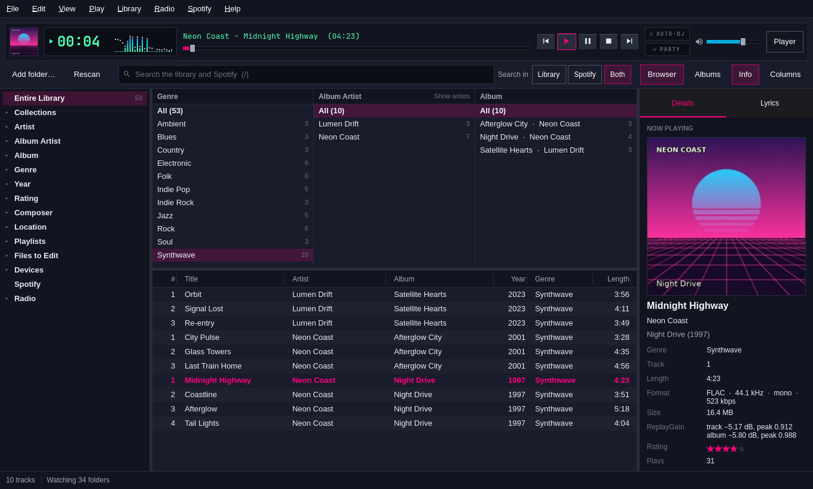
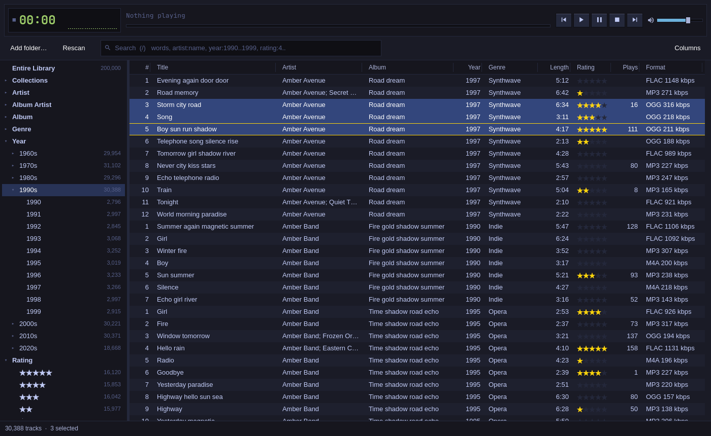
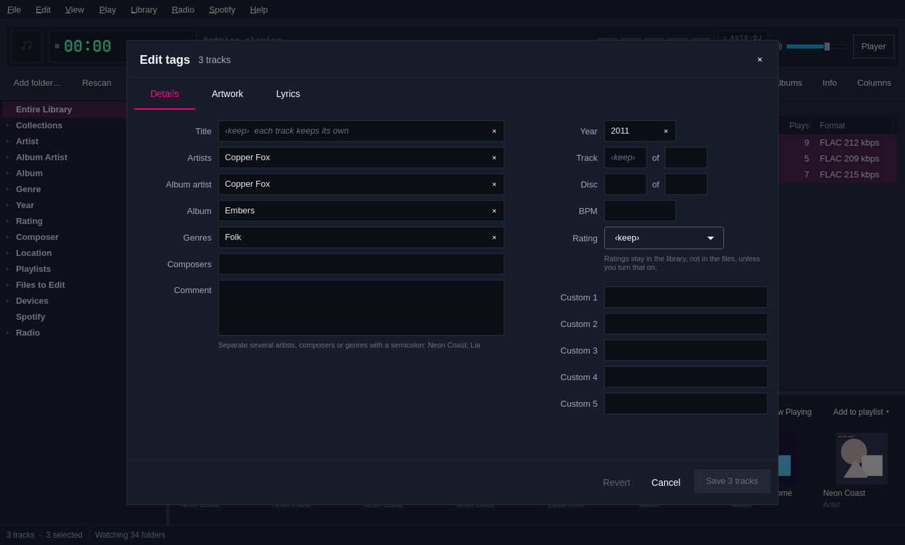
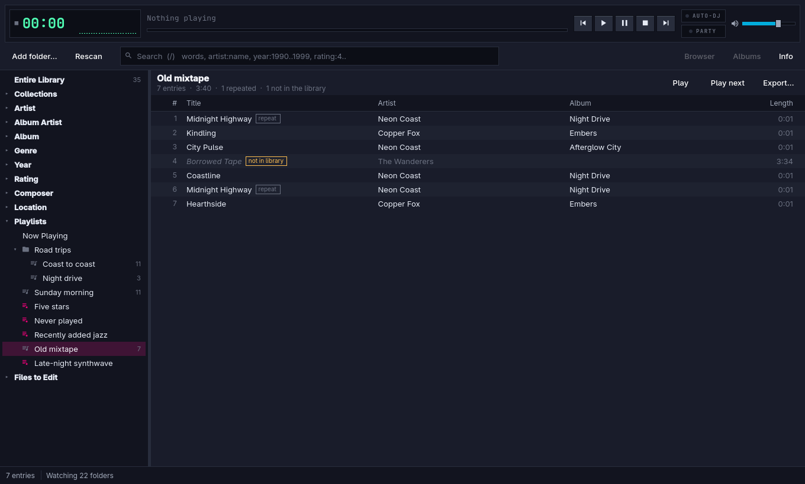
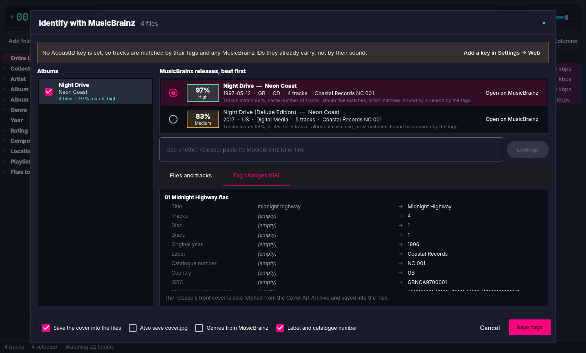
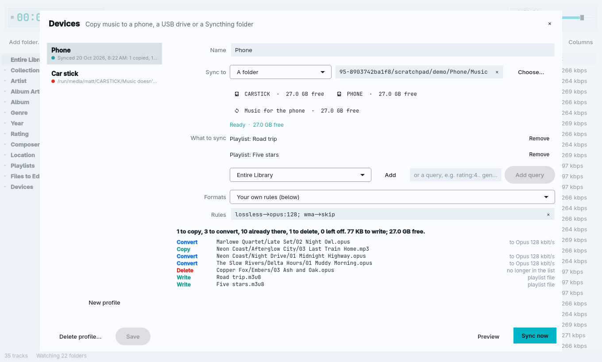

# Progress

## Phase 0: the core (20 October 2026)

Phase 0 is built. `omamp scan` fills a library, a rescan of an unchanged
library only checks sizes and modification times, `omamp query` searches it,
and the player works as before. All tests pass (11 player tests, 16 library
tests). Nothing is pushed; the work is on a branch for review.

### What was built

**Code layout.** The source is split as the plan says:

```text
src/core/    library.{h,cpp}     the database: open, WAL, migrations, backups, settings, stats
             migrations.{h,cpp}  the schema, as numbered steps
             volumes.{h,cpp}     mountinfo parsing, volume identity, where a volume is now
             tagreader.{h,cpp}   TagLib 2 reading, multi-value splitting, content type
             scanner.{h,cpp}     walk, compare, read on a thread pool, write in batches
             query.{h,cpp}       the query language: parser, field table, SQL compiler, runner
             job.{h,cpp}         progress and cancel for long work
             core.pri            Qt Core + Qt SQL + taglib (pkg-config)
src/engine/  player, playlist, spectrum (QMediaPlayer), engine.pri
src/app/     main.cpp, mpris, portal, theme, translator, the QML and resources
src/cli/     cli.{h,cpp}, cli.pri
tests/       omamp_tests.cpp (player), library_tests.cpp (core), main.cpp (runs both),
             make-fixtures, bench/
bin/bench    the performance run
```

`omamp.pro` includes `core.pri`, `engine.pri` and `cli.pri`; the tests
include the same files. The core needs no GUI module, so the benchmark links
only Qt Core and Qt SQL.

The player no longer includes the portal code. `Player::openFolder()` emits
`folderRequested()`, and `main.cpp` connects that to `FolderPicker` and the
picker's results to `Player::addPicked()`. This keeps D-Bus out of the engine.

**Database.** `~/.local/share/omamp/library.db` (it follows `XDG_DATA_HOME`;
every command takes `--db`). WAL mode, `synchronous=NORMAL`, foreign keys on,
a 5-second busy timeout, and the `REGEXP` function from Qt's SQLite driver.
Tables: `volumes`, `folders`, `tracks`, `artists`, `track_artists`, `genres`,
`track_genres`, `albums`, `playlists`, `playlist_items`, `collections` (with
Music, Classical, Audiobooks and Podcasts made at creation), `play_history`,
`tag_journal`, `artwork`, `jobs`, `settings`, and `tracks_fts`.

**Migrations.** `PRAGMA user_version` holds the schema version. Step 1 makes
the tables; step 2 adds the search index and its triggers and indexes any
existing rows. Before migrating a database that already has a version, Omamp
copies it with `VACUUM INTO` to `library.db.v<old>-<UTC time>.bak`. A
database from a newer Omamp is refused, not opened.

**Volumes.** See "Decisions" below for the rules. A local filesystem's key is
`uuid:<filesystem UUID>` (plus `:<subvolume root>` for a btrfs subvolume or a
bind mount), a network share's key is `marker:<id>` or `net:<source>`, and a
filesystem with no UUID (tmpfs, overlay) gets `mount:<type>:<source>:<root>@<mount point>`.
On this machine `/home` comes out as
`uuid:bccdb82b-…:/@home`. Track paths are stored relative to the volume
root. `Library::refreshVolumes()` checks every volume and marks its tracks
offline or back online; missing tracks stay missing until a scan finds them.

**Scanner.** POSIX `opendir`/`fstatat` walk (nanosecond modification times),
hidden entries skipped, linked files followed, linked folders not followed,
other filesystems mounted inside a root not crossed. Unchanged files (same
size and `mtime_ns`) are never opened. New and changed files are read with
TagLib on a `QThreadPool` of 4 to 8 threads and written in batches of about
500, one transaction each. Each scan is a row in `jobs`.

**Command line.** `omamp scan [folder...]` (no folder means rescan every
library folder), `omamp query <text>`, `omamp stats`, `omamp help`,
`omamp --version`. Each takes `--json`, prints results on stdout and errors
on stderr, and exits 0 or 1. Commands run under `QCoreApplication`, so they
need no display. `omamp`, `omamp <files>` and `omamp open <files>` open the
window as before.

**Fixtures.** `tests/make-fixtures <folder>` uses `ffmpeg` to make 14 small
files: a two-disc FLAC album with a guest artist and a composer; a
compilation across MP3, Ogg Vorbis and Opus with multi-value genres and a
Christmas track; Unicode folders, file names and tags (M4A, WAV); files with
no tags and with a title only; an M4B audiobook; a broken MP3; a JPEG; and a
hidden folder. The tests build them once per run in a temporary folder.

**Tests.** `bin/test` builds one binary that runs both test classes
offscreen. The library tests cover: a new database's schema and WAL mode; a
version 1 database upgraded with a working backup and the old rows indexed;
a newer schema refused; mountinfo parsing; a disk known by UUID wherever it
mounts, and btrfs subvolumes; a share known by its marker, a read-only share
falling back to its server name, and a share found after a remount
elsewhere; tag value parsing; a full scan of the fixtures; a rescan that
skips unchanged files (proved by changing a title in the database and
seeing it survive) and rereads a file whose time changed (the rating
survives); missing versus offline, including a rescan refused while the disk
is away and paths following a remount; multi-value artists, album artists,
composers and genres; search; the parser; and the CLI's JSON.

The volume tests use a fake `mountinfo` file and a fake `by-uuid` folder, so
they can plug, unplug and move disks.

### Test results

```text
Totals: 11 passed, 0 failed, 0 skipped, 0 blacklisted, 64ms     (player)
Totals: 16 passed, 0 failed, 0 skipped, 0 blacklisted, 493ms    (library)
```

### Benchmark

`bin/bench` on the development machine (Ryzen 9 7950X3D, btrfs on LUKS), with
another heavy job running. Database and files on disk under `build/bench`.
Times are the median of 7 runs with a warm page cache.

Generating 200,000 tracks (18,278 albums, 1,600 artists): 13.8 s, peak
memory 49 MB. The database is 191 MB.

| What | ms | Rows |
|---|---:|---:|
| Open the library | 0.6 | |
| First page: count + 100 sorted rows | 1.7 | 200,000 |
| `coast` (search index) | 11.7 | 14,591 |
| `midnight highway` (two words) | 22.3 | 1,144 |
| `go` (too short for the index; LIKE) | 77.7 | 43,858 |
| `artist:"neon coast" year:1997..2001` | 11.2 | 751 |
| `rating:4.. -genre:christmas` | 43.9 | 30,918 |
| `genre:rock OR genre:metal` | 9.7 | 17,443 |
| `artist:="Neon Coast"` (multi-value table) | 3.8 | 10,136 |
| `title:/^love/` (regular expression) | 49.3 | 3,542 |
| Every row, sorted, loaded into memory | 432.1 | 200,000 |
| `stats` | 40.6 | |

Each query time includes a page of 100 rows and the total count. Peak memory
for the whole run, including all 200,000 rows loaded at once: 216 MB.

Scanning 100,000 files (hard links of one small tagged MP3, on btrfs):

| What | ms |
|---|---:|
| First scan, TagLib on 8 threads | 5,842 |
| Rescan, nothing changed (stat only) | 401 |

Peak memory during the scan: 242 MB.

Against the plan's targets: opening is far under a second, every search and
filter is under 100 ms, and an unchanged 100,000-file rescan takes 0.4 s
against a 30-second target. Caveats: the page cache was warm, and the first
scan read the same few file contents over and over, so a real first scan of
a real library will be slower (disk reads, larger tags, artwork). A cold or
NAS rescan was not measured.

### Decisions

- **Volume identity follows the plan, with three additions.** A btrfs
  subvolume or bind mount adds its root to the UUID key, because one UUID
  can be mounted several times with different contents. A share's marker is
  looked for from the added folder up to the mount point, so adding a
  subfolder of a known share reuses that share's volume. A filesystem with no
  UUID gets a key from its mount, which is the best available.
- **A marker is written only by `omamp scan <folder>`** on a network
  filesystem, and only if the folder is writable. Looking up a path never
  writes. The marker is written atomically and names itself in a comment.
- **A marker counts at its last place only while a share is mounted there.**
  An unmounted mount point can still hold a stale copy of the folder.
  Otherwise Omamp tries the same subfolder under every network mount, which
  finds a share remounted somewhere else.
- **A scan never crosses into another filesystem** mounted inside a root (as
  `find -xdev`). It reports how many it skipped; add them as roots of their
  own. This keeps every track on the volume that really holds it.
- **What "offline" protects.** A scan fails outright if a root is missing or
  cannot be listed. Files under a subfolder that cannot be listed are not
  marked missing. Because tracks belong to a volume, an empty mount point
  (share not mounted) resolves to the local disk's volume and cannot mark the
  share's tracks missing.
- **Unreadable files are still added**, by file name, and counted as failed.
  Otherwise every rescan would try them again, and a rescan would no longer
  cost one stat per file.
- **Multi-value tags.** Separate values in the file (ID3v2.4, repeated Vorbis
  comments) are kept, and a single value is also split on `;`, MediaMonkey's
  separator. `&` and "feat." are not split, because they belong to names like
  "Simon & Garfunkel". The track row keeps the joined text (`A; B`) for
  display and search; `track_artists` holds each value with its role.
- **Genres get their own table** (`genres`, `track_genres`) instead of a role
  in `track_artists`, because a genre is not a person and the artist tables
  should list only people.
- **Albums** are keyed by album artist and title. A compilation with no album
  artist goes under "Various Artists". With no album artist at all, the
  folder stands in for it, so an album whose tracks each name a different
  guest stays one album.
- **Ratings** are stored 0 to 100 (20 per star; NULL means unrated), as
  MediaMonkey and the POPM and FMPS tags do. The query language works in
  stars: `rating:4` means 4 stars, give or take half a star.
- **The search index** covers title, artist, album, album artist, composer,
  genre and the file name (without its folder). The file name lets files
  with no tags be found. The folder path is left out, so a word like "music"
  doesn't match every track; `path:` searches it with LIKE.
- **Words shorter than three characters** fall back to LIKE over the same
  columns, since the trigram index cannot answer them. The LIKE fallback is
  case-insensitive for ASCII only and does not ignore accents; the index
  does both.
- **OR binds tighter than AND**, as in MediaMonkey: `rating:4..
  genre:rock OR genre:metal` means rating and (rock or metal). Regular
  expressions are case-insensitive unless they say otherwise.
- **An unknown field is an error** that lists the known fields, rather than
  being searched as a plain word. Scripts and agents get told instead of
  getting silently wrong results.
- **CLI errors** go to stderr, and with `--json` also to stdout as
  `{"ok": false, "error": "..."}`, so an agent reading stdout sees them.
- **Command words win over paths.** `omamp scan` is always the command. To
  open a file named `scan`, use `omamp ./scan` or `omamp open scan`. One
  change from before: a first argument of exactly `open` is now taken as the
  word, not a file.
- **`bin/build` and `bin/test` honour `JOBS`** (`JOBS=6 bin/build`); the
  default is still every core.
- **The PKGBUILD** now depends on `taglib` and `sqlite` and builds with
  `pkgconf`.

### Known gaps

- **No folder watching yet.** inotify is not wired up. A rescan is cheap
  (`omamp scan` with no folder rescans every library folder), so this can
  wait for the window, which will run it.
- **No scan in the window.** The window does not use the library yet. Phase 1
  runs the scanner on a worker thread with its own `Library` connection.
- **Folder modification times are stored but not yet used** to skip walking
  unchanged folders on a NAS (plan step 4 of scanning; Phase 5).
- **Artwork, lyrics, ratings and play counts in tags** are not read. The
  `artwork` table exists and is empty.
- **Query language gaps:** no dates (`added:<30d`, `played:`), no sort or
  limit clauses, no `field:none` for empty fields, no relative ranges. The
  parser and field table are ready for them (below).
- **A scan reads, then writes.** Each tag-reading task holds a copy of its
  file's details until it runs, which is why 100,000 files peak at 242 MB.
  Feeding the pool in chunks would flatten this.
- **Cancel** stops reading and skips the missing pass, but the job row and
  the `Job` only report it; nothing in the window can cancel yet.
- **A share with no marker that changes server name** gets a new volume.
  Re-pointing a volume by hand (MediaMonkey's "re-assign drive") is not built.
- **Files moved between folders** come back as one missing track and one new
  one; ratings and history don't follow. Matching by size and tags is a
  later job.
- **Not measured:** cold-cache scans, a real NAS, and a real library on this
  machine. `~/Music` here holds only two video clips.
- **The GUI was checked offscreen only** (it loads and draws with a muted
  player); it was not opened on screen.

### What Phase 1 needs to know

**Opening the library.**

```cpp
Library library;                       // or Library(path) in tests
QString error;
if (!library.open(&error)) { ... }     // creates, migrates, backs up
library.db();                          // the QSqlDatabase for this thread
library.refreshVolumes(VolumeResolver());
LibraryStats s = library.stats();
QString path = library.absolutePath(trackId);   // empty when offline
```

A `Library` is one connection and belongs to the thread that opened it. For
a scan in the window, open a second `Library` on the worker thread. WAL lets
the window keep reading while the scan writes.

**Scanning.**

```cpp
Job job("scan");                       // progressChanged(phase, done, total), finished()
Scanner scanner(library, VolumeResolver(), &job);
ScanResult r = scanner.scan({"~/Music"});   // or scanner.rescanAll()
job.cancel();                          // from any thread
Scanner::roots(library);               // the library folders, "" when offline
```

`scan()` blocks the calling thread. `ScanResult::toJson()` is what
`omamp scan --json` prints.

**Querying.**

```cpp
Query::Parsed p = Query::parse(text);  // a tree of Query::Node, or an error and position
Query::Compiled c = Query::compile(p.root);   // SQL condition over "tracks t" + parameters
Query::Options o;
o.limit = 100;                         // 0 = no limit; o.offset for later pages
Query::Result r = Query::run(library, text, o);
// r.tracks (Query::Track), r.total (count without the limit), r.error, r.elapsedUs
```

For the track list, use `Query::compile()` and build a SQL model that
selects only the visible columns, a page at a time, ordered by
`t.sort_artist COLLATE NOCASE, t.album COLLATE NOCASE, t.disc_no, t.track_no`
(the `tracks_order` index). Loading all 200,000 rows takes 430 ms; one page
takes under 2 ms.

To add a field, add a line to `Query::fields()`. To add an operator or a
value kind (dates, `none`), extend `Parser::parseValue()` and
`Compiler::term()`. To add a column to the search index, write a new
migration that drops and rebuilds `tracks_fts` and its triggers. Never edit
a released migration.

**Schema notes.** `tracks.availability` is `online`, `offline` or `missing`.
`tracks.sort_artist` is the album artist, or the artist, or "Various
Artists". `tracks.file_name` is the name without its folder or extension.
Times are Unix seconds except `mtime_ns`. `track_artists.role` is `artist`,
`album_artist` or `composer`.

**Running the benchmark.** `JOBS=6 bin/bench` (about two minutes; `--tracks`
and `--files` change the sizes). Everything goes in `build/bench`.

## Phase 1B: the query language and the command palette (20 October 2026)

The query language is complete, the command palette has a backend and a
popup, and `omamp query` takes the whole language. Nothing is wired into
`Main.qml` (agent 1A owns it); the steps are below. The schema is unchanged.

### What was built

- **`src/core/query.{h,cpp}`**: dates and ages (`added:<30d`, `added:2024`,
  `added:2024-01..2024-06`, `played:>1y`, `played:never`, `lastplayed:<7d`,
  `today`, `yesterday`); lengths and sizes with units (`length:>10m`,
  `length:3:00..5:00`, `size:>20mb`); `none` and `any` on every field;
  `+word` word starts; `;` and `|` as OR; `sort:` with several keys,
  descending keys, `random`, `random:<seed>` and `randomalbum`; `limit:` by
  count, playing time or size; short aliases (`aa`, `ar`, `al`, `ti`...);
  "did you mean" for misspelt fields; every error with its character
  position. New API: `Query::Context` (pinned clock and seed),
  `Compiled::orderBy`, `order()` and `limit`, `Query::ids()`,
  `Parsed::toJson()`, `Options::countOnly`, and `added`, `lastPlayed` and
  `size` on `Track`.
- **`src/core/palette.{h,cpp}`**: `Palette`, a `QAbstractListModel` that
  ranks actions, artists, albums and tracks together.
- **`src/app/CommandPalette.qml`**: the popup, keyboard-only, in the theme
  colours. Added to `resources.qrc`.
- **CLI**: `omamp query` takes `--count`, `--offset`, `--seed` and
  `--explain`, prints the total length and size, and puts `duration_ms` and
  `seed` in its JSON.
- **Docs**: [docs/query-language.md](../query-language.md), the full syntax
  with examples. Screenshots: `docs/command-palette.png` and
  `docs/command-palette-actions.png`, from the offscreen test with made-up
  data.
- **Tests**: `tests/query_tests.cpp` (parse, compile and run against a
  12-track library built in SQL with a pinned clock, plus the CLI),
  `tests/palette_tests.cpp` (ranking, actions, activation, library changes,
  and the QML popup driven by keys in an offscreen window that has Omamp's
  one-key shortcuts), and `tests/fixture_library.h`. `tests/main.cpp` now
  takes `OMAMP_TESTS=library,query,palette` to run some classes only, and
  `OMAMP_SCREENSHOTS=<folder>` makes the palette test save its screenshots.

### Test results

```text
Totals: 16 passed, 0 failed, 0 skipped, 0 blacklisted, 442ms   (library)
Totals: 24 passed, 0 failed, 0 skipped, 0 blacklisted, 21ms    (query)
Totals: 8 passed, 0 failed, 0 skipped, 0 blacklisted, 82ms     (palette)
```

The player tests were not run in this phase: they open audio devices
(muted), and this machine had to stay silent. Nothing in the player changed.

### Benchmark

`omamp_bench run` on the 200,000-track synthetic library, generated in a
temporary folder and deleted afterwards. Median of 7 runs, warm cache, with
another heavy job on the machine. Each query time includes a page of 100
rows and the total count. The Phase 0 rows were measured again and match.

| Query | ms | Rows |
|---|---:|---:|
| `"midnight highway"` (phrase) | 5.4 | 357 |
| `+love` (word start: index, then pattern) | 27.4 | 17,211 |
| `+go` (word start too short for the index) | 93.5 | 43,858 |
| `aa:"neon coast"` | 10.2 | 10,126 |
| `added:<30d` | 0.9 | 1,404 |
| `added:2024` | 24.9 | 21,250 |
| `added:2024-01..2024-06` | 4.4 | 10,510 |
| `played:>1y` | 24.8 | 68,839 |
| `played:never` | 24.6 | 100,288 |
| `lastplayed:<7d` | 54.4 | 188 |
| `plays:0` | 26.6 | 100,288 |
| `plays:10..` | 26.5 | 95,179 |
| `length:>6m` | 24.8 | 39,421 |
| `length:3:00..5:00` | 26.9 | 80,765 |
| `album:none` | 11.8 | 0 |
| `genre:any` | 25.6 | 200,000 |
| `-genre:none` | 26.7 | 200,000 |
| `sort:-rating,artist limit:50` | 66.1 | 50 |
| `sort:random limit:50` | 79.7 | 50 |
| `sort:random` (every row shuffled, first page) | 82.2 | 200,000 |
| `sort:randomalbum limit:100` | 73.8 | 100 |
| `limit:2h` (library order) | 0.1 | 24 |
| `limit:700mb` (library order) | 0.1 | 35 |
| `rating:4.. sort:random limit:2h` | 38.5 | 28 |
| `added:<1y plays:0 sort:-added limit:2h` | 0.2 | 25 |
| `genre:rock played:>1y sort:-plays limit:50` | 5.6 | 50 |

| Palette search | ms | Rows |
|---|---:|---:|
| First search, loading artist and album names | 63.5 | 17 |
| `coast` | 6.0 | 17 |
| `neon night` | 21.2 | 13 |
| `lov` | 7.6 | 13 |
| `re` | 1.7 | 10 |
| `midnight highway` | 11.3 | 14 |
| `artist:neon sort:-plays` | 14.8 | 9 |

Every query is under the 100 ms target. `+go` is the closest at 93.5 ms, for
the same reason the plain short word `go` takes 75 ms: no index can answer
two letters. Every palette search after the first is under the 50 ms target;
the first loads 1,600 artist and 18,278 album names once.

**Indexes for the coordinator.** I tried these two indexes on a copy of the
benchmark library. They are not in a migration, because 1C owns the schema.
They cut the play-history clauses by an order of magnitude:

```sql
CREATE INDEX tracks_last_played ON tracks(last_played);
CREATE INDEX tracks_play_count ON tracks(play_count);
```

| Query | Without (ms) | With (ms) |
|---|---:|---:|
| `played:>1y` | 24.8 | 1.3 |
| `played:never` | 24.6 | 1.6 |
| `lastplayed:<7d` | 54.4 | 0.3 |
| `plays:0` | 26.6 | 1.7 |
| `plays:10..` | 26.5 | 0.8 |

An index on `rating` would not speed up `sort:-rating,artist`: `NULLS LAST`
and the tie-breaking keys need a sort anyway.

### Decisions

- **Ages and dates read the way people say them.** With an age, `<` means
  more recent (`added:<30d`, "less than 30 days ago"), and `added:30d` means
  the same. With a calendar date, `<` means before. `m` means months in a
  date and minutes in a length; `min` always means minutes.
- **A calendar date covers its whole span** in local time: `added:2024` runs
  from 1 January 2024 00:00 up to 1 January 2025 00:00. A range runs from
  the earlier moment to the later, whichever order it is written in.
- **`played:>1y` leaves out never-played tracks.** A missing date is not a
  date long ago. The docs show `played:>1y OR played:never`.
- **NOT counts unknown as false.** `-rating:4..` used to drop unrated tracks,
  because SQL's NOT of NULL is NULL. Every NOT is now `NOT coalesce(x, 0)`.
  This deliberately changes Phase 0 behaviour.
- **`none`, `never` and `any` are keywords** only when unquoted;
  `album:"none"` searches for the word. `rating:none` means unrated, and a
  rating of 0 stars is a rating. For numbers, `none` means 0 or unset.
- **A value's precision is its last unit.** `length:4m` matches 4:00 to
  4:59, `length:3:00..5:00` includes 5:00.999, and `size:20mb` matches a
  whole megabyte. Sizes count in 1,024s, as MediaMonkey and file managers do.
- **`limit:` by time or size stops at the first track that does not fit**,
  rather than skipping ahead for a shorter one, so the result is a prefix of
  the sorted list and paging stays simple. When the order is the library
  index, it reads only the rows it keeps (0.1 ms).
- **The query's `limit:` applies first, then the page** (`Options::limit`,
  `--limit`). `total` is the count after `limit:`.
- **`sort:` and `limit:` live outside the tree** (`Parsed::sort`,
  `Parsed::limit`). Inside brackets, after `-` or next to `OR` they are an
  error with a position. Several `sort:` clauses add their keys; a second
  `limit:` is an error.
- **Empty values sort last both ways round.** Ties fall back to the library
  order and then the id, so a page never changes between runs.
- **The shuffle is SQL arithmetic**: a multiply, an xor-shift (written
  `(a | b) - (a & b)`, since SQLite has no XOR) and a multiply, all modulo
  2^32, on the track id plus the seed. Any connection can run a compiled
  query without registering a C function. `randomalbum` hashes the album id
  and keeps disc and track order. The core never picks a seed:
  `Context::seed` defaults to 0, and the CLI picks a random one per run and
  prints it.
- **`+word` narrows with the index, then checks the word start** with the
  pattern `(?<![\p{L}\p{N}])word`. When the word is too short for the
  index, `LIKE` narrows first. The pattern does not ignore accents.
- **Field names start with a letter**, so `3:20` and `12:00` are words.
  `-(` now starts a NOT; a lone `-` or `+` is a word.
- **The palette keeps artist and album names in memory**, folded for case
  and accents. It reloads them when a cheap count-and-max check on
  `artists`, `albums` and `tracks` changes (checked at most every 2 seconds)
  or on `refresh()`. Tracks come from the search index. Text with no word
  of three letters lists no tracks, because a full scan would take 75 ms
  per keystroke.
- **Palette ranking.** A name equal to the text scores 100; one that starts
  with it, 92; one where every word starts a word, 80; one that contains the
  text, 68; one that contains every word, 55; long names lose a little.
  Actions also match fuzzily from a word start ("pp" finds Play/Pause, "tam"
  finds Toggle advanced mode) and through keywords. Artists get 4 extra,
  albums 2, actions 3 (and 2 more once used), and tracks a little for their
  play count. Text with fields (`artist:neon sort:-plays`) lists the tracks
  it selects, in its order. `>` lists actions only. The last row is always
  "Search the library for ...", which emits `searchRequested`.
- **The popup takes every key while open** (`Keys.onShortcutOverride`), so
  Main.qml's one-letter shortcuts (Space, Q, Z, Up, Return...) do not fire
  while typing. Ctrl+K still reaches the window, so it toggles the popup.
  The test proves this with a window that carries those shortcuts.

### Integrating the palette (for 1A)

1. In `main.cpp`, create the model next to the library and hand it to QML:

   ```cpp
   #include "palette.h"
   Palette palette;                      // after the window's Library is open
   palette.setLibrary(&library);         // or leave unset for actions only
   engine.rootContext()->setContextProperty("commandPalette", &palette);
   ```

   The `Library` must outlive the palette (or call `setLibrary(nullptr)`
   first) and belong to the GUI thread. After a scan finishes, call
   `palette.refresh()`.

2. In `Main.qml`, add the popup and its key inside the `ApplicationWindow`:

   ```qml
   CommandPalette { id: palette; model: commandPalette }
   Shortcut { sequence: "Ctrl+K"; context: Qt.ApplicationShortcut; onActivated: palette.toggle() }
   ```

3. Register the actions once, with translated titles, for example in
   `Component.onCompleted`:

   ```qml
   commandPalette.addAction("play-pause", qsTr("Play/Pause"), ["pause", "resume"], "Space")
   commandPalette.addAction("next", qsTr("Next track"), ["skip"], "B")
   commandPalette.addAction("previous", qsTr("Previous track"), ["back"], "Z")
   commandPalette.addAction("add-folder", qsTr("Add folder…"), ["open", "import"], "O")
   commandPalette.addAction("rescan", qsTr("Rescan library"), ["scan", "refresh"], "")
   commandPalette.addAction("advanced", qsTr("Toggle advanced mode"), ["library"], "")
   commandPalette.addAction("shortcuts", qsTr("Show keyboard shortcuts"), ["help"], "?")
   commandPalette.addAction("quit", qsTr("Quit"), ["exit"], "Q")
   ```

   `setActionEnabled(id, false)` greys one out (for example Rescan while a
   scan runs); `removeAction(id)` drops it.

4. Connect what the user chooses:

   ```qml
   Connections {
       target: commandPalette
       function onActionTriggered(id) {
           if (id === "play-pause") backend.toggle()
           else if (id === "next") backend.next()
           // ...
       }
       function onTrackActivated(trackId) { /* play or show the track */ }
       function onAlbumActivated(albumId, title, albumArtist) { /* show the album */ }
       function onArtistActivated(artistId, name) { /* filter by artist:="name" */ }
       function onSearchRequested(text) { /* put the text in the search box */ }
   }
   ```

   The popup closes itself after a choice and also emits `chosen(item)` with
   the row's roles (`kind`, `itemId`, `title`, `subtitle`, `detail`,
   `shortcut`, `kindLabel`, `actionEnabled`).

5. Optionally, disable Main.qml's one-key shortcuts while `palette.opened`.
   The popup already takes the keys, so this is only a second guard.

The new strings to translate are in `CommandPalette.qml` (the placeholder,
the hint line, "Nothing matches") and in `palette.cpp` (`Action`, `Artist`,
`Album`, `Track`, `Search`, `%n tracks`, `Search the library for “%1”`).
Check that the app's `Translator` serves `tr()` in C++ as well as `qsTr()`.

### Known gaps

- **`+word` and words under three letters match accents exactly**, and the
  short-word `LIKE` ignores case only for A to Z.
- **Short word starts such as `+go` take 94 ms** on 200,000 tracks: under
  target, but the slowest clause.
- **`limit:` by time or size does not skip ahead** to fill the space. An
  Auto-DJ or sync list that wants the closest fit needs its own packing.
- **`played:` reads `tracks.last_played`**, not `play_history`, so "played
  more than three times this month" cannot be written yet.
- **No `present` or `now` in number ranges** (MediaMonkey's
  `year:1978..Present`). For dates, `added:2020..today` works.
- **The palette does not highlight the matched letters.**
- **The palette's fuzzy matching is greedy**, with a preference for word
  starts, so it can miss the best alignment in a long title. Only actions
  use it.
- **The first palette search costs about 60 ms** on 200,000 tracks while it
  loads the names.

## Phase 1C: watching, moved files, tag extras and artwork (20 October 2026)

Phase 1C is built, backend only. Local library folders are watched with
inotify and only the folders that change are rescanned. Network folders are
rescanned on a schedule, skipping folders whose modification time hasn't
changed. A moved or renamed file keeps its track. Scans read ratings, play
counts, ReplayGain, lyrics and artwork flags, MusicBrainz IDs, BPM and the
compilation flag. Album and track pictures are cached as small JPEGs, and
QML can show them through an image provider. All tests pass (11 player, 16
library, 16 Phase 1C). Nothing is pushed.

### What was built

**Schema 3** (`src/core/migrations.cpp`). Step 3 adds, to `tracks`:
`tag_version`, `has_embedded_art`, `has_lyrics`, `mb_release_group_id`,
`mb_album_artist_id`, `tag_rating`, `tag_play_count` and `quick_hash`, with
indexes on `size` and `quick_hash`; to `albums`: `mb_release_group_id` and
`art_checked`; to `artwork`: `added`. Phase 0 databases (schema 2) upgrade
with the usual `VACUUM INTO` backup first. Rows keep their ratings and play
counts; `tag_version` 0 marks them as read by the Phase 0 reader, so the next
full scan reads each file once more to fill the new fields, and rescans are
stat-only again after that.

**Tag extras** (`src/core/tagreader.*`). Ratings come from `FMPS_RATING`
(0.0 to 1.0), a plain `RATING` (0 to 5 stars, 0 to 100, or a POPM byte), and
ID3v2 `POPM` frames (Windows Media Player's and MediaMonkey's steps,
including MediaMonkey's half stars). Play counts come from `FMPS_PLAYCOUNT`,
`PLAYCOUNT`, the POPM counter and `PCNT`. Lyrics are present when any
`LYRICS*` property has text (USLT, Vorbis `LYRICS`/`UNSYNCEDLYRICS`, MP4
`©lyr`). Embedded artwork is present when TagLib lists a `PICTURE`. Tags are
now read through a read-only `FileStream`: TagLib's `FileRef` opened files
for writing when it could, so every scan "wrote" every file it read, which
the watcher saw as a change and a NAS saw as a write.

**Library stats win over tags.** A file's rating fills the library's only
while the library has none and the file's rating is new (different from the
stored `tag_rating`), so a rating the user cleared in Omamp stays cleared.
The play count fills only while the library's count is 0. Both file values
are kept in `tag_rating` and `tag_play_count`.

**Scanner** (`src/core/scanner.*`):

- It walks every root (or folder) first and marks vanished files missing,
  then reads and writes. A file moved between two folders of one scan is
  therefore already missing at its old place when its new place is read.
- **Moved files keep their tracks.** A new file that matches a missing track
  takes over that track's row (its path, volume and folder change), so its
  rating, play count, history and playlist entries follow it. A match is the
  same content hash and length, or the same size, length (within a second),
  title, artist and album, plus the same file name when the file has no
  tags. When several missing tracks match, the one with the same file name
  wins; if that still leaves several, the file is added as new rather than
  given the wrong history. `ScanResult` reports `moved` and the first 100
  `old -> new` paths.
- `quick_hash` is SHA-1 over the size and 64 KiB from the middle of the
  file, 16 hex digits. The middle avoids the tags at either end.
- **Locate** (`Scanner::locate`, `omamp locate <folder>`) is MediaMonkey's
  "Locate Moved/Missing Files": it searches any folder, inside the library
  or not, opens only files whose size matches a missing track, and repoints
  the tracks it finds. Nothing else is added.
- **Quick rescans** (`Scanner::Mode::ChangedFolders`, `omamp scan --quick`)
  skip listing a folder whose modification time matches the database.
  Subfolders are still visited (one `readdir` each, using `d_type`), so a
  quick rescan costs one stat per folder rather than per file. Folder times
  are stored only after a scan's files are written, so a cancelled scan
  never makes a later quick rescan skip a folder.
- **Incremental rescans** (`Scanner::rescanFolders`) take folders inside
  library roots, each recursive or not. A folder that no longer exists has
  its tracks marked missing, but only while its library root is still there.
- The walk now filters by name and `d_type` before any stat, so non-audio
  files cost nothing.
- **The tag pool is fed at most 2,000 files ahead of the writer**
  (`setInFlightLimit`), so neither the pool's queue nor the waiting results
  grow with the library.

**Watcher** (`src/core/watcher.*`). Raw inotify, one watch per folder, on
library roots whose volume is local. Measured on a 10,000-folder temporary
tree: adding the watches takes 15 ms and 0.6 MB with inotify, 240 ms and
2.4 MB with `QFileSystemWatcher`. Both would scale; inotify was chosen
because it also says which kind of change happened (close after writing,
moves, overflow) and reports the watch limit with `ENOSPC`.

- Events: a file counts once closed after writing, moved, deleted or
  touched, and only if it has an audio extension. A new or moved-in folder
  gets watches and a recursive rescan; a deleted or moved-out folder loses
  its watches and gets a recursive rescan (its tracks go missing, and are
  found again if it reappears inside the library). A queue overflow rescans
  every watched root in full.
- Changes are collected for 1.5 s after the last event, and never held back
  more than 10 s. Rescans run one at a time on a low-priority worker thread
  with its own `Library`; changes arriving meanwhile merge into the next one.
- Network roots (volume kind `network`, or a network mount now) are never
  watched. They are rescanned every 15 minutes in quick mode; every fourth
  scheduled run lists every folder, to catch files changed in place (which
  leave the folder's time alone).
- The watcher uses at most half of `fs.inotify.max_user_watches` (524,288 on
  this machine), leaving the rest for other programs. If that, or the
  kernel, runs out, the roots not fully watched join the scheduled rescans,
  `degraded` becomes true and `watchLimitReached` fires.
- `omamp watch` runs it in the foreground and prints each change and rescan
  (`--json` prints one JSON object per line, `--dry-run` only reports,
  `--interval <s>` sets the schedule). Ctrl+C or SIGTERM stops it cleanly.

**Artwork** (`src/core/artwork.*`, `src/app/artprovider.*`). A picture comes
from a file beside the album's tracks named `cover`, `folder` or `front` (in
that order, any case, as `.jpg`, `.jpeg`, `.png`, `.webp`, `.bmp` or `.gif`),
also one folder up from a `CD1`/`Disc 2` folder; failing that, from the first
track's embedded front cover. It is decoded once (JPEGs are decoded already
scaled down), flattened onto white if it has transparency, and saved on the
CPU at 96, 256 and 600 pixels as `~/.cache/omamp/art/<hash>-<size>.jpg`,
where the hash is of the original bytes. An album whose every track embeds
the same cover shares one set of files. `artwork` records each picture and
its source, `albums.artwork_id` and `tracks.artwork_id` point at it, and
`albums.art_checked` records the search, so an album without a picture isn't
searched again until the scanner changes one of its tracks. A cleared cache
is rebuilt from the recorded source. Nothing is made until asked for;
`ArtworkPrefetch` makes the rest on a lowest-priority thread, and
`omamp art all` does the same in the foreground.

### Test results

```text
Totals: 11 passed, 0 failed, 0 skipped, 0 blacklisted, 112ms    (player)
Totals: 16 passed, 0 failed, 0 skipped, 0 blacklisted, 472ms    (library)
Totals: 16 passed, 0 failed, 0 skipped, 0 blacklisted, 2566ms   (Phase 1C)
```

The Phase 1C tests (`tests/watcher_tests.cpp`) make their own files with
`ffmpeg` and TagLib: FLACs with FMPS, ReplayGain, MusicBrainz, lyrics, BPM
and compilation tags; an MP3 with a POPM rating and counter and USLT lyrics
written by TagLib; an MP3 with an embedded 500×300 PNG cover; and 800×800
and 500×300 images. They cover: the schema 2 to 3 upgrade with its backup;
rows from the old reader read once more, then stat-only; rating conventions;
every tag extra; library stats winning over tags, including a cleared rating
staying cleared; moved and renamed files (tagged, and untagged by hash)
keeping rating, play count, history and playlist entries with the pool fed
one file at a time; identical copies not guessed; `locate` outside the
library; quick rescans skipping unchanged folders; the watcher seeing
create, modify, move, a folder moved in from outside, a file in that new
folder, file and folder deletion, ignoring a JPEG, and not waking itself by
reading a file; the watch limit falling back to the schedule; a CIFS root
(fake mountinfo) never watched; artwork from an upper-case `Cover.JPG`, from
an embedded cover, none, track pictures, a cleared cache, and the image
provider; and the background prefetch plus the scanner clearing
`art_checked`.

### Benchmark

`omamp_bench files` on the development machine with another heavy job running: 100,000
hard links of one small tagged MP3 in 8,334 folders, on btrfs, warm cache,
8 reader threads. Phase 0 was rebuilt from `afddb5b` and run alternately
with Phase 1C.

| What | Phase 0 | Phase 1C |
|---|---:|---:|
| First scan | 5,666–6,147 ms | 7,142–7,745 ms |
| Rescan, nothing changed (stat only) | 396–473 ms | 395–449 ms |
| Quick rescan by folder time | — | 195–233 ms |
| Peak memory, first scan | 235–264 MB | 104–108 MB |
| Peak memory, whole run | 235–264 MB | 135–140 MB |

Phase 1C at other sizes: 10,000 files take 791 ms with a 43 MB peak, and
30,000 files take 1,985 ms with a 77 MB peak. Memory now grows far slower
than the library; most of what remains is SQLite's 32 MB page cache and the
walk's file list.

The first scan is about 1.3 s slower. Each file now also gets a content
hash (one more open and a 64 KiB read) and more tag work, and the writer,
which is the bottleneck, now shares the CPU with the readers for the whole
scan. With a 20,000-file limit instead of 2,000 the first scan took
6,397–6,462 ms but peaked at 189–194 MB; the smaller limit was kept.

### Decisions

- **Raw inotify, not QFileSystemWatcher**, for the reasons and numbers above.
- **Watch at most half the system's inotify limit**, so Omamp can't starve
  editors, Syncthing or file managers.
- **Debounce 1.5 s, at most 10 s.** A long copy keeps triggering
  close-after-write per file; the cap stops a busy folder holding a rescan
  back for ever.
- **Picture files before embedded pictures.** Folder images are usually the
  larger scan and cost no tag parsing. This matches foobar2000's default.
- **Every standard size is made at the first request** for a picture, since
  decoding the original is most of the cost.
- **A rescan rereads Phase 0 rows once** to fill the new fields. On a
  100,000-track NAS library this is one slow scan; the alternative was
  leaving every Phase 0 row without ratings, art flags or IDs until edited.
- **A file's rating fills an empty library rating only when the file's
  rating is new.** Without that, clearing a rating in Omamp would be undone
  by the next rescan.
- **Ambiguous moves are not guessed.** Handing one track's history to
  another is worse than adding a new row; `omamp locate` and later a
  "Locate Moved/Missing Files" window can resolve the rest.
- **Core now links Qt GUI** for `QImage` (CPU only). The benchmark and CLI
  still need no display.
- **TagLib reads are read-only** (see above).

### Known gaps

- **A move from outside the scanned folders.** If a file's old place isn't
  rescanned in the same run as its new place (for example, the old folder is
  on a different root that the watcher didn't see change), the new file is
  added as a new track and the old one goes missing later. `omamp locate`
  fixes it by hand only before that rescan adds the new file; merging two
  existing rows is not built.
- **Quick rescans miss files changed in place** on a share, because the
  folder's time doesn't change. Every fourth scheduled rescan is a full one
  to catch them. They also don't reread Phase 0 rows.
- **A share that comes back** isn't rescanned at once; the next scheduled
  run does it, or `Watcher::rescanScheduledNow()`.
- **Picture files changing** (a new `cover.jpg`) don't wake the watcher, and
  the artwork cache has no eviction or orphan cleanup.
- **Cancel:** `Watcher::stop()` cancels a running rescan; nothing else does.
- **`omamp watch` was tested by hand only.** The `Watcher` class has tests.
- **The image provider is not registered** in the window yet; that is 1A's
  `main.cpp` (one line, below).

### What the window needs to know

**Watcher.**

```cpp
#include "watcher.h"
Watcher watcher;                        // default library; Watcher(dbPath, resolver) in tests
watcher.start();                        // after the library opens; reload() after adding a root
QObject::connect(&watcher, &Watcher::libraryChanged, ...);   // reload the visible page
QObject::connect(&watcher, &Watcher::rescanStarted, ...);    // (kind, folders) for the jobs strip
QObject::connect(&watcher, &Watcher::rescanFinished, ...);   // ScanResult::toJson() + "kind"
QObject::connect(&watcher, &Watcher::watchLimitReached, ...); // (watched, limit): say so in the window
engine.rootContext()->setContextProperty("watcher", &watcher);
```

QML properties: `running`, `busy`, `degraded`, `watchedFolders`,
`localRoots`, `networkRoots`, `scheduledRoots`. Invokables: `reload()`,
`rescanScheduledNow()`, `rescanFolders(folders, recursive)`. Signals also
include `foldersChanged(folders)` (a debounced batch, before its rescan) and
`busyChanged()`. `rescanStarted`'s kind is `changes`, `scheduled` or
`overflow`. Settings: `setDebounce(ms)`, `setMaxDelay(ms)`,
`setNetworkInterval(seconds)` (0 is off), `setMaxWatches(n)`,
`setAutoRescan(bool)`.

**Pictures in QML.**

```cpp
#include "artprovider.h"
engine.addImageProvider(ArtImageProvider::name, new ArtImageProvider);   // "omamp-art"
```

```qml
Image { source: "image://omamp-art/album/" + albumId + "/256"; asynchronous: true }
Image { source: "image://omamp-art/track/" + trackId + "/96" }
Image { source: "image://omamp-art/album/" + albumId; sourceSize.width: 600 }
```

Sizes snap to 96, 256 or 600. A missing picture sets `status` to
`Image.Error`; show a placeholder. Text after `?` is ignored, so
`…/256?v=2` reloads a picture that changed. Pictures are made on two
low-priority threads, each with its own library connection.

From C++: `ArtworkCache(library).albumArtwork(albumId, 256)` or
`.trackArtwork(trackId, 96)` gives a file path (empty when there is none).
`ArtworkPrefetch prefetch; prefetch.start(256);` makes the rest in the
background and emits `finished(made)`.

**Scanner additions.** `Scanner::scan(roots, Scanner::Mode::ChangedFolders)`,
`rescanAll(mode)`, `rescanFolders({{path, recursive}})`, `locate(folder)`,
`libraryRoots(library)` (path, kind, fs type, volume, online). `ScanResult`
adds `moved`, `movedPaths`, `foldersListed`, `foldersSkipped` and
`changedLibrary()`.

**New columns for the query language** (1B): `tracks.has_embedded_art`,
`has_lyrics`, `tag_rating`, `tag_play_count`, `mb_release_group_id`,
`mb_album_artist_id`; `bpm` and `compilation` are now filled. Fields such
as `art:none` or `lyrics:yes` for Files to Edit can read these.

## Phase 1A: the advanced-mode window, tree and track list (20 October 2026)

`Tab` now switches between the deck and advanced mode. Advanced mode shows
the deck as a strip across the top and the library below it: the tree on the
left, the track list on the right, a search box above them, and a status
line with the running job below. The deck itself is unchanged. All tests
pass, including one that drives the real window offscreen from the keyboard.
Nothing is pushed.



### What was built

```text
src/app/librarycontroller.{h,cpp}  `library` in QML: opens the library on first use, owns the
                                   tree and the list, runs scans on a worker thread, hands
                                   tracks to the player
src/app/librarytree.{h,cpp}        the tree as a flat list model, children read on expand
src/app/tracklistmodel.{h,cpp}     the track list: ordered ids, rows read a page at a time
src/app/devhooks.{h,cpp}           OMAMP_PROFILE, OMAMP_SCREENSHOT, OMAMP_DEMO (below)
src/app/AdvancedView.qml           the layout: strip, actions and search, tree | list, status
src/app/DeckStrip.qml, Analyser.qml  the deck as one strip
src/app/LibraryTreePane.qml        the tree view and its keys
src/app/TrackTable.qml             TableView + HorizontalHeaderView, menus, keys
src/app/NowPlayingList.qml         Now Playing, chosen under Playlists
src/app/JobsBar.qml                track count, selection, job progress and Cancel, messages
src/engine/playlist, player        insertTracks/replaceTracks; playTracks, queueNext, appendTracks
tests/librarywindow_tests.cpp      the models, the controller, and the window from the keyboard
```

**The track list.** A change of node, search or sort runs one query that
returns only the matching track ids, in order (`SELECT t.id FROM tracks t
WHERE <node> AND <search> ORDER BY …`). The model keeps that id list (8 bytes
a track) and reads rows in pages of 128 with `WHERE t.id IN (…)` when the
view asks for them, keeping the 48 most recently used pages. So the view can
jump anywhere at once, and no query loads every row. Every sort ends with
the library order and the id, so ties keep albums together.

Selection is a set of track ids, so it survives a re-sort. Changes to the
selection and the playing mark are signalled for the rows on screen only:
TableView handles a `dataChanged` over every row one cell at a time, which
took 4 seconds at 200,000 rows. A reset first scrolls the view to the top,
then back to the cursor row. TableView left at the bottom of a list it no
longer had rebuilt itself row by row and hung for tens of seconds.

**The tree.** A flat list of the visible rows, each with a depth, drawn by a
plain ListView. Each node carries its scope as a SQL condition over
`tracks t` with parameters. Children are read when a node opens and dropped
when it closes. After a scan the tree reloads and reopens what was open.

| Node | Children | Scope |
|---|---|---|
| Entire Library | | everything (with the track count) |
| Collections | rows of `collections` | the collection's query, compiled |
| Artist | `track_artists` role `artist`, then that artist's albums | `track_artists` |
| Album Artist | distinct `sort_artist`, then albums | `t.sort_artist = ?` |
| Album | first letters (`#` for the rest), then albums | `t.album_id = ?` |
| Genre | `genres` | `track_genres` |
| Year | decades, then years; Unknown year | `t.year` ranges |
| Rating | 5 stars down to half a star; Unrated | `t.rating` ranges |
| Composer | `track_artists` role `composer` | `track_artists` |
| Location | volumes (offline ones dimmed), library folders, subfolders | `t.volume_id` and a `rel_path` range |
| Playlists | Now Playing, then rows of `playlists` | `playlist_items`, or the auto-playlist's query |

**Scanning.** `library.addFolder()` opens the portal folder picker. It is a
second `FolderPicker`, so its folders go to the library, not to Now Playing.
`addFolders()` and `rescan()` run `Scanner` on a `QThread` with its own
`Library` connection. The `Job`'s progress reaches the status line through
queued signals, and Cancel calls `Job::cancel()`. When the scan ends, the
tree and the list reload and the status line says what changed ("Scan
finished: 34 added").

**Playing.** Enter or a double-click is MediaMonkey's "play now": Now Playing
becomes the visible list and plays from that track. The tags come from the
library, so nothing is read from disk. Offline and missing tracks are left
out. A list of more than 5,000 tracks hands over 5,000, starting at that
track (or the last 5,000 when it is near the end), so Now Playing stays quick
to save in `state.json`. Play next inserts after the current track; Add to
Now Playing appends. Show in folder runs `xdg-open` on the track's folder.

**Window state.** `~/.config/omamp/window.conf` (QtCore `Settings`) keeps
the mode, each mode's window size, the tree width and the columns (which are
hidden, and widths set by hand). The library opens the first time advanced
mode shows, so the deck alone never touches the database.

**Keys.** Advanced mode turns off the deck's arrow, Enter and Delete
shortcuts, so the tree and the list get those keys. `O` adds a folder to the
library, `/` and `Ctrl+F` search, `F5` rescans. The `?` overlay shows the
player's keys and the library's side by side, and the README lists them all.

### Test results

```text
Totals: 11 passed, 0 failed, 0 skipped, 0 blacklisted, 95ms      (player)
Totals: 16 passed, 0 failed, 0 skipped, 0 blacklisted, 465ms     (library)
Totals: 12 passed, 0 failed, 0 skipped, 0 blacklisted, 783ms     (library window models)
Totals: 3 passed, 0 failed, 0 skipped, 0 blacklisted, 1438ms     (the window, offscreen)
```

The model tests cover paging (each of 1,000 rows matches its id), sorting
(ascending, descending, back to library order; ties in library order;
unrated first), filtering (counts checked against SQL; a half-typed query
keeps the last list), selection (Shift, Ctrl, Ctrl+Shift, the keyboard,
through a sort), the playing mark, every tree node's scope against a SQL
count, the chosen node following rows that open above it, play now, play
next, add to Now Playing, the 5,000-track window, and a scan on the worker
thread. The window test loads the real `Main.qml` offscreen and presses
keys: `Tab` in, `/`, typing a search and then a broken one, `Enter`, arrows,
`Shift+↓`, `Enter` to play, `←` to the tree, `→` and `←` to open and close a
node, a header click to sort, a header-edge drag to resize, `Esc`, `Tab` out,
and the saved settings.

### Performance

The Phase 0 generator made the 200,000-track library (`omamp_bench
generate`, 191 MB). The window ran offscreen with the software renderer, a
throwaway `HOME`, no session bus and no audio, on the development machine while another
heavy job ran. Times run from the change to the next frame on screen
(`OMAMP_PROFILE=1`), over three runs.

| What | ms to the screen | Query alone (ms) |
|---|---:|---:|
| Start straight into advanced mode, to the first frame | 270–420 | 14 (200,000 ids) |
| Start on the deck, to the first frame | 105–111 | |
| `Tab` into advanced mode (opens the library) | 127–135 | |
| Jump to the last row | 61–67 | |
| Sort by Title | 196–261 | 180–210 |
| Sort by Title, descending | 223–298 | 187 |
| Search `coast` (search index) | 71–79 | 18 |
| Search `go` (two letters: LIKE, no index) | 169–191 | about 150 |
| Search `artist:"neon coast" year:1997..2001` | 65–72 | 7 |
| Clear the search (200,000 rows, still sorted by Title) | 225–269 | 200–230 |

Peak memory for the whole run: 255 MB.

Against the plan's targets, the 200,000-track library opens well under a
second, and indexed searches and tree nodes reach the screen in under
100 ms. About 50 ms of each figure is the software renderer drawing a
1,400 × 860 window. Two things miss 100 ms:

- **Sorting by a text column** (Title, Artist, Album, Genre) costs about
  200 ms at 200,000 rows, all of it SQLite sorting. Number columns are fast.
  Indexes on `title`, `artist`, `album` and `genre` (each `COLLATE NOCASE`)
  would bring text sorts to about 20 ms; that is a schema change, so it is
  left for the coordinator and 1C (below). The other fix is to run the id
  query on a second connection on a worker thread so the window never waits,
  a contained change in `TrackListModel::reload()`.
- **One- and two-letter searches** fall back to LIKE (a Phase 0 decision) and
  take about 150 ms. That belongs to the query language (1B).

To rerun it, make the database with `bin/bench`, then:

```sh
mkdir -p /tmp/o/data/omamp /tmp/o/config/omamp
cp build/bench/library.db /tmp/o/data/omamp/
printf '[window]\nadvanced=true\n' > /tmp/o/config/omamp/window.conf
HOME=/tmp/o XDG_DATA_HOME=/tmp/o/data XDG_CONFIG_HOME=/tmp/o/config \
  QT_QPA_PLATFORM=offscreen QT_QUICK_BACKEND=software OMAMP_PROFILE=1 build/omamp
```

The benchmark's volume (`/bench`) doesn't exist, so its tracks show as
offline (dimmed). For the screenshot below, its tracks were moved onto a
volume that exists; the timings are the same either way.



### Decisions

- **The tree is a flat list model, not a QML TreeView.** Lazy loading, the
  keys and reopening after a reload all live in C++ and are tested, and the
  view is a plain ListView.
- **Album Artist uses `tracks.sort_artist`** (the album artist, else the
  artist, else Various Artists): one value per track, read off the
  `tracks_order` index. It is fast and matches how albums group, but a track
  with two album artists shows under the first only. Artist and Composer use
  the multi-value `track_artists` table.
- **Album groups albums by first letter** (`#` for the rest), because a flat
  list of 18,000 albums is no use. Artist stays flat (1,600 in the benchmark).
- **Location opens on each volume's library folders**, not its root, so
  `/home` doesn't start with a user name. A library folder that is the whole
  volume opens straight onto its subfolders. Folders show no track counts:
  each count would cost a query.
- **The search box is a plain `TextInput`**, not a Material `TextField`,
  whose floating label covers the hint. It applies 60 ms after typing stops,
  or at once on `Enter`.
- **A broken query keeps the last good list** and shows the error in red
  beside the search box, so typing `artist:` doesn't blank the list.
- **A new node or search clears the selection; a sort keeps it.**
- **Play now hands over at most 5,000 tracks** (above). MediaMonkey hands
  over the whole list; at 200,000 tracks `state.json` would be 20 MB.
- **Left and Right don't seek in advanced mode**, because the tree uses them.
  The strip's position bar seeks there.
- **`O` adds a folder to what is on screen:** the library in advanced mode,
  Now Playing on the deck.
- **Columns:** `#`, Title, Artist, Album, Year, Genre, Length, Rating (stars,
  with a half star dimmer), Plays, Added, and Format with bit rate. Added
  starts hidden so the rest fit 1,360 pixels. Title takes the width the
  others leave until it is resized by hand.
- **`Tab` belongs to the mode switch**, so it never moves focus between the
  tree, the list and the search. `/`, `Enter` and `←`, and `Esc` do that.
- **Dropping files in advanced mode** adds them to Now Playing, as on the deck.
- **Developer hooks in the binary**, off unless set: `OMAMP_PROFILE=1` (the
  timings above), `OMAMP_SCREENSHOT=<png>` (grab the window and quit), and
  `OMAMP_DEMO="expand:artists;node:genre:3;select:2;queue:0;filter:…;sort:7;help"`
  (steps run before the screenshot). The README screenshots come from these.
- **`playlist.*` and `player.*` gained small additions** (insert and replace
  with known tags; play, queue next, append) rather than the library writing
  through `addPaths`, which reads every file from disk.

### Known gaps

- **Text-column sorts take about 200 ms at 200,000 tracks** (above).
- **Queries run on the window's thread.** All but the text sorts finish in
  under 30 ms here, but a slow query would pause the window.
- **No column reordering** and no column sets per collection yet (the plan
  wants both; `collections.columns` exists for them).
- **Static playlists** show in the tree, but nothing creates them until
  Phase 3. Now Playing is the only playlist so far.
- **The track list refreshes when a scan ends**, not while it runs.
- **Files to Edit**, the column browser, the album-art grid, the info panel
  and the command palette belong to other parts of Phase 1 and to Phase 2.
- **Checked offscreen only.** Not opened on screen, not tried on Matt's
  library, and not looked at in themes other than the default palette.

### Integration points for 1B and 1C

**1B (command palette: `src/app/CommandPalette.qml`, `src/core/palette.*`).**
The query language needs nothing from me: the search box sets
`library.tracks.filter`, which calls `Query::compile(text)`. To put the
palette in the window:

- Add `CommandPalette.qml` to `src/app/resources.qrc`, and the palette
  sources to `omamp.pro` and `tests/omamp_tests.pro`.
- In `Main.qml`, add `Shortcut { sequence: "Ctrl+K"; context: Qt.ApplicationShortcut; … }`
  beside the advanced-mode shortcuts, and place the palette after the
  `advancedLoader` Loader and before the `?` overlay, so it draws over the
  library.
- What it can call: `win.setAdvanced(true)`, `advancedLoader.item.focusSearch()`,
  `library.tracks.filter = "<query>"`, `library.selectNode(row)` with
  `row = library.tree.rowOfKey(key)`, `library.playRow(row)`,
  `library.playSelection()`, `library.queueSelection()`,
  `library.appendSelection()`, `library.addFolder()`, `library.rescan()`,
  `library.tracks.selectAll()`. Node keys are `artist:<id>`,
  `albumartist:<lower-case name>`, `genre:<id>`, `decade:<year>`,
  `year:<year>`, `collection:<id>` and `playlist:<id>`. A node must be
  showing, so open its group first, for example
  `library.tree.expand(library.tree.rowOfKey("artists"))`.
- The palette's database reads should wait for `library.activate()`. If
  `palette.*` needs the connection, add a method on `LibraryController` that
  returns its `Library` (main thread only); I left none, to keep my files
  stable.

**1C (artwork, watcher, schema).**

- **Artwork in the list:** add a role to `TrackListModel` (read `t.artwork_id`
  or the album's in `fetch()`) and register an image provider in `main.cpp`
  (`engine.addImageProvider("artwork", …)`). The info panel and the
  album-art grid (Phase 1 part 3) would sit in `AdvancedView.qml`, in the
  `SplitView` beside the list pane.
- **Folder watching:** after the watcher writes a batch, call
  `library.tracks()->refresh()` and `library.tree()->reload()` on the main
  thread, or reuse `LibraryController::onScanFinished`. A watcher job can
  report in the same status line: `LibraryController` shows one job at a time
  (`busy`, `jobText`, `jobProgress`, `cancelJob()`); a queue would turn
  `m_job` into a list.
- **Schema request (I changed no schema):**
  `CREATE INDEX tracks_title ON tracks(title COLLATE NOCASE)`, and the same
  for `artist`, `album` and `genre`, for fast text sorts. With those, change
  the Title key in `TrackListModel::orderBy()` from
  `coalesce(nullif(t.title, ''), t.file_name) COLLATE NOCASE` to
  `t.title COLLATE NOCASE` so SQLite can use the index.

## Phase 1D: the column browser, album grid, info panel, palette and watching (20 October 2026)

Phase 1D puts the parts built in 1B and 1C into the advanced-mode window and
adds the rest of Phase 1. The command palette (`Ctrl+K`) is wired to every
main command and goes to artists, albums and tracks. A column browser
(Genre | Album Artist | Album) sits above the track list; an album-art grid is
a second view of the list; an info panel shows the chosen track. The folder
watcher starts with the library and refreshes the window without losing the
selection or the scroll position. Text sorts now read an index: sorting
200,000 tracks by title reaches the screen in 40–45 ms (it was 196–261 ms).
All tests pass. Nothing is pushed.


### What was built

```text
src/core/migrations.cpp           schema 5: text sort indexes
src/app/tracklistmodel.{h,cpp}    a third condition (the browser's), baseChanged and
                                  aboutToRefresh signals, orderBy() matched to the indexes
src/app/columnbrowser.{h,cpp}     ColumnBrowser and its three FacetModel panes
src/app/albumgridmodel.{h,cpp}    the albums of the current list
src/app/librarycontroller.{h,cpp} owns the browser, the grid, the palette and the watcher;
                                  trackInfo(), showArtist/Album/Track(), playAlbum(),
                                  refreshAll(), prefetchArtwork()
src/app/librarytree.{h,cpp}       reveal(keys), letterOf()
src/app/BrowserPanes.qml          the three lists
src/app/AlbumGrid.qml             the grid
src/app/InfoPanel.qml             the info panel
src/app/AdvancedView.qml          tree | (browser over list or grid) | info; the view switches
src/app/Main.qml                  Ctrl+K, Ctrl+B, G, I; palette actions; remembered layout
src/app/JobsBar.qml               watcher status and "Finding album covers…"
src/app/theme.{h,cpp}             listSelection: chosen rows that read in every theme
src/app/main.cpp                  registers the omamp-art image provider and the palette
src/app/devhooks.cpp              new demo verbs and profile steps
tests/make-demo-library           the made-up library behind the screenshots
```

**Schema 5.** Four indexes, `tracks_sort_title`, `tracks_sort_artist`,
`tracks_sort_album` and `tracks_sort_genre`. Each holds the sort key and then
the library order (`sort_artist`, `album`, `disc_no`, `track_no`, all
`NOCASE` where text), the tie-break `orderBy()` always adds, so SQLite walks
the index instead of sorting. The 1A notes asked for plain `title` indexes
and a change of the Title key to `t.title`; that would have sorted untagged
files (empty title) together at the top instead of by file name. The index
is on the expression `coalesce(nullif(title, ''), file_name) COLLATE NOCASE`
instead, exactly as `orderBy()` writes it, so behaviour is unchanged. Album's
key leaves `album` out of its tie-break. The step adds about 40 MB to a
200,000-track database (200 to 240 MB) and the upgrade, with its backup,
took 1.3 s on that database.

**Command palette.** `LibraryController` owns the `Palette` (it needs the
controller's `Library` on the GUI thread) and hands it the library when it
opens; `main.cpp` sets it as `commandPalette`. In deck mode before the
library opens, the palette lists actions only. Main.qml registers 29
actions: transport, shuffle, repeat, volume, time display, mode switch,
search, the three view switches, add folder, rescan, cancel scan, Entire
Library, Now Playing, play/queue/append the selection, select all, show in
folder, clear the browser, find covers, shortcuts and quit. Each time the
palette opens, actions that can't run now are greyed (Rescan during a scan,
selection actions in the grid). Choosing an artist opens Artist in the tree
and chooses that artist; an album opens Album, its letter and the album;
both clear the search and the browser. A track is selected and scrolled to
in the list, widening only as far as needed: the browser first, then the
search, then Entire Library. "Search the library for …" puts the text in the
search box. The palette's names reload after every scan and watcher rescan.

**Column browser.** Three panes over the track list, foobar2000-style:
Genre (the multi-value `track_genres`), Album Artist (`tracks.sort_artist`,
one value per track; a link in the pane header switches to Artist, the
multi-value `track_artists`), and Album. Each starts with "All (n)". Click
chooses, `Ctrl`+click adds or removes, `Shift`+click picks a range. From the
keyboard, `↑`/`↓` choose, `Shift` extends, `Ctrl` moves without choosing and
`Ctrl+Space` toggles, `←`/`→` move between panes (and to the tree), `Enter`
goes to the list. Each pane counts within the node, the search and the panes
to its left. Choices that survive a new node or search stay chosen; ones
that don't are dropped, so the list never goes empty for a value that isn't
there. While hidden, the browser runs no queries and filters nothing.

The panes count with `GROUP BY` queries. When the node and search select
everything, genres and artists are counted from their link tables alone.
Otherwise the node and search are run once into a temporary table
(`temp.omamp_browse_base`, on the window's connection, never in the library
file) and the panes and the track list read it by id. Without that, a
two-letter search, which can't use the search index, scanned the library
five times with the browser open; now it scans once and the browser adds
nothing measurable (see below). `TrackListModel::baseChanged` fires before
the list reloads, so the browser recounts and sets its condition first and
the list reloads once per change.

**Album grid.** `AlbumGridModel` reads the albums of the current list (node,
search and browser) with one `GROUP BY`, ordered by album artist, title and
year, and only while the grid shows. A sort doesn't re-read it. A refresh
that keeps the same albums updates in place, so the grid keeps its scroll
position. Tiles are 168 pixels; covers come through the image provider at
256 pixels (96 when tiles are 130 pixels or smaller, a setting for later), on
its two low-priority threads, as tiles come into view (`GridView` with
`reuseItems`). The first time the grid shows, `ArtworkPrefetch` makes the
rest on its lowest-priority thread; when it ends, the grid re-reads which
albums have pictures. Albums known to have none show their first letter
without asking the provider, which also keeps QML's "No picture" warnings
out of the journal. Click chooses an album (the info panel follows),
double-click or `Enter` plays it, `Ctrl+Enter` or the menu's Show tracks
opens it in the tree and goes back to the list.

**Info panel.** On the right, toggled with `I`. It shows the cover (the
track's own picture, else its album's), title, artist, album and year, then
album artist (when it differs), genre, composer, track and disc, length,
format with sample rate, channels and bit rate, size, ReplayGain (track and
album, with peaks, or "Not analysed"), rating as stars, plays, last played,
added, lyrics ("Yes, in the file" or "None"; the lyrics view is Phase 4),
BPM, and the path, which can be selected and copied. It shows the track
under the cursor, the first track of the album chosen in the grid, or the
track playing when nothing is chosen (`playingTrackId`, found from the
player's path). `LibraryController::trackInfo(id)` is one query.

**Watcher.** `LibraryController::activate()` starts a `Watcher` on the same
database. `libraryChanged` (queued to the window's thread after the rescan
commits) calls `refreshAll()`: the tree reloads and keeps what is open and
chosen; the browser recounts and keeps its choices; the list refreshes and
keeps the selection and the cursor; the grid and the palette re-read; a
revision number goes up so the info panel and covers re-read. The list and
the tree keep their scroll positions (`aboutToRefresh` lets the table note
the top track and its offset). Scans started from the window now refresh
the same way and reload the watcher for new roots. The status line shows
"Watching N folders", "…; the rest are checked every 15 minutes" when the
inotify limit ran out, "N shares checked every 15 minutes", "Updating changed
folders…" during a rescan, and "Finding album covers…".

**Theme.** Night Ride (Matt's current theme) sets `selection` equal to
`lighter_background`, so chosen rows in the library looked like the striped
rows around them. `theme.listSelection` is the theme's selection when it
stands out from the backgrounds, and otherwise the accent mixed 30 % into the
background. The library's lists, the browser, the grid and the palette use
it; the deck is unchanged. Both themes were checked offscreen: the deck, the
`?` overlay and advanced mode.

### Test results

```text
Totals: 11 passed, 0 failed, 0 skipped, 0 blacklisted, 217ms    (player)
Totals: 16 passed, 0 failed, 0 skipped, 0 blacklisted, 504ms    (library)
Totals: 24 passed, 0 failed, 0 skipped, 0 blacklisted, 22ms     (query)
Totals: 8 passed, 0 failed, 0 skipped, 0 blacklisted, 87ms      (palette)
Totals: 16 passed, 0 failed, 0 skipped, 0 blacklisted, 2501ms   (Phase 1C)
Totals: 17 passed, 0 failed, 0 skipped, 0 blacklisted, 887ms    (library window models)
Totals: 3 passed, 0 failed, 0 skipped, 0 blacklisted, 1401ms    (the window, offscreen)
Totals: 4 passed, 0 failed, 0 skipped, 0 blacklisted, 2957ms    (Phase 1D window parts)
```

New model tests: the browser's counts and narrowing (one genre, a second with
Ctrl, an album artist, an album, each checked against SQL; a search
recounting and keeping choices; All and clear(); artist mode; turning it
off), the browser following a tree node with one list reload and dropping a
choice the node lacks, the grid's albums (count against SQL, no re-read on
sort, the chosen album kept through a refresh), `trackInfo()` field by
field, the playing track found by path, `showArtist`/`showAlbum`/`showTrack`
(including widening to Entire Library), and `refreshAll()` keeping the node,
selection and cursor while picking up a new track.

New window tests drive the real `Main.qml` offscreen: `Ctrl+K`, typing an
artist and `Enter` chooses that artist in the tree; `> column browser` runs
the action; `↓` in the browser chooses a genre and the list narrows; `→` and
`Enter` move to the list; `I` shows the info panel with the cursor track's
title and path; `G` shows the grid, `→` chooses an album (the panel follows)
and `Enter` plays the whole album; a refresh keeps the table's exact scroll
position; the shown parts are saved. A second test scans real files, then
copies a new file into a watched folder: the watcher rescans and the window
shows one more track with the same selection and cursor.

### Performance

The 200,000-track library from the Phase 0 generator, upgraded to schema 5,
in the window offscreen with the software renderer, throwaway XDG folders,
no session bus and no audio, while other heavy jobs ran on the development machine.
`OMAMP_PROFILE=1`, three runs; times run from the change to the next frame
on screen, and the query columns are the work alone.

| What | ms to the screen | Query (ms) |
|---|---:|---:|
| Start straight into advanced mode, first frame | 331–385 | 15 (200,000 ids) |
| Sort by Title | 41–45 (was 196–261) | 22 (was 180–210) |
| Sort by Title, descending | 105–117 (was 223–298) | 63 |
| Sort by Artist / Album / Genre | 51–73 | 16–17 |
| Search `coast` | 63–77 | 17 |
| Search `go` (two letters, no index) | 285–364 | 229 |
| Clear the search (still sorted by Title, descending) | 103–112 | 63 |
| Show the column browser (200,000 tracks) | 52–58 | browser 45–50 |
| Browser: choose a genre | 39–53 | 4, browser 12–14 |
| Browser: then an album artist | 14–25 | 1, browser 3 |
| Browser: search `coast` | 60–85 | 2–5, browser 25–42 |
| Browser: search `go` | 309 | 40, browser 235 |
| Show the album grid (18,278 albums) | 61–70 | grid 58–65 |
| Grid: search `coast` (1,830 albums) | 65–91 | grid 13–18 |
| Grid: clear the search | 112–133 | 16–24, grid 57–61 |
| Show the info panel | 12–16 | |
| Refresh, as after a watcher rescan | 67–75 | 16 |

Peak memory for the whole run: 248–257 MB (255 MB in 1A).

Descending sorts keep the tie-break ascending (an album's tracks stay in
order), so SQLite sorts each run of equal keys: 63 ms rather than 10 ms.
Reversing the tie-break too would use the index both ways, but would list
albums' tracks backwards under a descending Artist sort.

**The worker-thread question.** Only the two-letter search (1B's `LIKE`
fallback, 285–364 ms) crosses 150 ms. With the browser open the same search
costs 309 ms, because of the temporary table. Moving the id query to a
worker thread would keep the window answering during that search but not
make the result arrive sooner, and it touches every caller that reads the
list straight after changing it (the controller, the browser, the grid, the
tests). It is left for when a slower query appears; the place is
`TrackListModel::reload()`, with a second `Library` on the worker and a
generation number so a late answer is dropped. Speeding up short words in
the query language is the better fix.

To rerun: make the database with `bin/bench`, copy it into a throwaway
`XDG_DATA_HOME/omamp/`, write `[window]` `advanced=true` into
`XDG_CONFIG_HOME/omamp/window.conf`, and run `build/omamp` with
`QT_QPA_PLATFORM=offscreen QT_QUICK_BACKEND=software OMAMP_PROFILE=1`, with
`QT_QPA_PLATFORMTHEME` unset (the GTK platform theme exits when it finds no
display).

### Screenshots

`docs/advanced-mode.png` (browser on Synthwave, info panel), `docs/album-grid.png`
and `docs/command-palette-live.png` come from `tests/make-demo-library`:
twelve albums by invented artists, tones of one second, covers drawn by
ffmpeg in plain colours (folder pictures, embedded ID3 pictures, and one
album without), with made-up ratings, play counts, ReplayGain, lyrics and
play dates. They were scanned into throwaway folders and captured with
`OMAMP_DEMO` and `OMAMP_SCREENSHOT`, offscreen and in software, in the
Night Ride theme (Matt's current Omarchy theme). The files sat in
`/tmp/omamp-demo/Music` so the info panel shows a short path.

### Decisions

- **`Ctrl+B` toggles the browser, not `B`.** `B` is Winamp's "next track"
  in both modes, and the README promises Winamp's keys. `G` (grid) and `I`
  (info) were free.
- **The browser's middle pane defaults to Album Artist**, as foobar2000's
  facets do: one value per track, read off the library-order index, and it
  keeps compilations under Various Artists. Artist (every performer) is one
  click away and remembered.
- **Choices survive a new node or search when they still apply**, rather
  than MediaMonkey's reset to All, so narrowing the tree while a genre is
  chosen keeps the genre.
- **The grid's "open" is the tree's album node.** Selecting a tile only
  chooses it (and the info panel follows); Show tracks chooses the album in
  the tree and switches to the list, which reuses the node everyone already
  knows rather than adding a hidden fourth filter.
- **A track from the palette is shown, not played**, so choosing from the
  palette never starts audio by surprise; `Enter` then plays it.
- **The info panel shows the playing track when nothing is chosen**, and
  says which it is ("Selected track", "Now playing", "Chosen album, first
  track").
- **One refresh path.** The watcher and the window's own scans both call
  `refreshAll()`, which keeps the selection; before, a scan's end reset the
  selection.
- **The image provider is registered in `main.cpp`** (1C left it out).
  Tests give it and `ArtworkPrefetch` temporary cache folders through
  `LibraryController::setArtCacheDir()`.
- **Night Ride's selection colour** is replaced in the library's lists only,
  and only when it can't be told from the row backgrounds.
- **The README screenshots use the current Omarchy theme** (Night Ride),
  since with `listSelection` it reads well; 1A's 200,000-track picture stays
  in the default theme.

### Known gaps

- **Two-letter searches take about 300 ms** at 200,000 tracks (above).
- **Grid tile size is fixed** at 168 pixels; the 96-pixel covers are used
  only by smaller tiles, which nothing sets yet. A zoom control is easy to
  add.
- **The browser has no "Unknown genre" value**: tracks without a genre show
  under All only.
- **Pictures that change on disk** (a new `cover.jpg`) still don't wake the
  watcher, and an album already searched isn't searched again until its
  tracks change (1C gaps).
- **The palette doesn't highlight matched letters** (a 1B gap).
- **Checked offscreen only**, in the default and Night Ride themes, never on
  screen and never on Matt's library.

## Phase 2 backend: masks, tag writing, organise, audits and duplicates (20 October 2026)

The core and the command line for Phase 2 are built; the window is not (1D
is working in `src/app/` at the same time). Omamp can now write tags safely
and undo them, rename and move files by a mask with a preview and undo, fill
tags from file names, list the Files to Edit checks, and find duplicates by
tags, by bytes and by Chromaprint fingerprint. All tests pass. Nothing is
pushed.

### What was built

```text
src/core/mask.{h,cpp}        the mask language: parser, evaluator, safe names, tag from file names
src/core/tagwriter.{h,cpp}   TagLib 2 writes with copy, check and rename; the journal; undo
src/core/organise.{h,cpp}    plan, apply and undo moves; companion files; undoBatch() for any batch
src/core/audit.{h,cpp}       the Files to Edit checks, as queries or SQL
src/core/duplicates.{h,cpp}  duplicates by tags, content and fingerprint; the fpcalc job
src/core/scanner.*           + Scanner::updateTrackRow(), the scanner's own row writer for one track
src/core/migrations.cpp      + step 6: the fingerprints table
src/cli/cli.cpp              + tag, tag-from-filename, organise, undo, journal, audit, duplicates
tests/mask_tests.cpp         the mask language (22 tests)
tests/tidy_tests.cpp         tag writing, undo, organise, audits, duplicates, schema 6, the commands (21 tests)
docs/masks.md                the mask reference, with examples
```

**Masks** (`docs/masks.md` is the reference). Every field the plan names,
`:n` padding, `@n` alphabetical groups, `<Folder:n>`, `<Path:n>`,
`<Auto Number>`, and the functions `$If` (with `=` and `!=`), `$IfEmpty`,
`$First`, `$Replace`, `$RemovePrefix`, `$MovePrefix`, `$Left`, `$Right`,
`$Mid`, `$Trim`, `$Upper`, `$Lower`, `$Title`, `$Len` and `$Pad`. `/` and
`\` written in the mask make folders; a slash inside a tag does not. Each
folder and file name is made safe (Windows' characters, trailing dots and
spaces, leading dots, reserved names, 255 bytes), and the rules are
settable. Parse errors carry the character position. Patterns for tagging
from file names reuse the parser and add `<Skip>`.

**Tag writing.** Each file is copied to `.omamp-<random>-<name>` beside
itself, written there with TagLib, read back field by field (and its audio
length checked), and renamed over the original only if the original has not
changed meanwhile. Then one transaction journals each change and rewrites
the track's row with the scanner's own writer, so the new size and
modification time are recorded and a rescan reads nothing. A failure
affects only its own file; the copy is removed and the original is left
exactly as it was. Fields: title, artist(s), album artist(s), album,
genre(s), composer(s), year, original year, track and disc numbers and
totals, comment, BPM, compilation, lyrics (USLT, `LYRICS`, `©lyr`), rating,
embedded pictures (set or remove, all of them), and custom1 to custom5
(database only). MP3s keep their ID3v2 version; multi-value fields are one
"A; B" string in ID3v2 and separate values in Vorbis comments and MP4.

**Ratings** stay in the database unless the setting `tags.write_ratings`
is `1`. Then MP3s get POPM (every existing POPM frame is updated, or one is
added with the e-mail in `tags.popm_email`, default MediaMonkey's
`no@email`) at MediaMonkey's steps, and other formats get `FMPS_RATING`.

**Journal and undo.** Every change is a row in `tag_journal`: batch, track,
field, old value, new value, source and time. Batches are named
`tag-…`, `organise-…` or `undo-…` with a UTC time. `undo(batch)` restores
the old values in the files and the database, marks the batch's rows undone
and journals itself as an `undo-…` batch whose source is `undo:<batch>`, so
undoing an undo redoes. `omamp undo` with no batch takes the newest batch
that is neither an undo nor undone. A picture's old value is kept whole
(JSON with base64 data); its new value only as a hash, since undo never
needs it.

**Organise.** `plan()` evaluates the mask per track and settles clashes
with " (2)", " (3)" against other files in the batch and files on disk,
without touching anything. `apply()` moves with `renameat2(RENAME_NOREPLACE)`
(or `link` and `unlink` where a filesystem can't refuse to replace), so it
never overwrites; across filesystems it copies beside the target, compares
SHA-1, keeps the modification time, renames into place the same way and
then deletes the original. Each move updates the track's volume, folder and
path (its id stays) and journals `path` as `volume:relative path` in one
transaction; if the database refuses, the file is moved back. A track's
`.lrc` moves with it; a folder whose every audio file moves to one place
takes its pictures, cue sheets, logs and playlists along. Emptied folders
are removed up to the library folder and journalled, so undo recreates
them. Undo moves everything back in reverse order.

**Audits.** Sixteen checks with ids, titles, a group for the tree and a
sentence each: unknown title, artist, album, genre and year; missing
artwork; several artists without an album artist; album artist, year or
genre differing within an album; no track number; track numbers with gaps
or repeats; not levelled; dead links; offline; not tagged from MusicBrainz.
Seven are query-language text, the rest SQL over `tracks t`; both compile
to a `Query::Compiled`.

**Duplicates.** By tags (artist and title with case, accents, punctuation
and a leading "The" ignored, and lengths within two seconds unless turned
off), by content (the scanner's `quick_hash`), and by fingerprint.
`Fingerprinter` runs `fpcalc -raw -json -length 120` four processes at a
time and stores the raw fingerprint per track with its size and
modification time, so it is computed again only when the file changes.
Fingerprints match when at least 85 % of their bits agree at the best offset
of up to three frames. Each group puts a suggested keeper first: online,
then lossless, then the highest bitrate, the most plays, the best rating,
the oldest in the library, with the reason. Nothing is deleted.

**Schema 6** adds `fingerprints (track_id, size, mtime_ns, duration,
fingerprint, computed)` and an index on `tag_journal(changed_at)`. It is
numbered 6 because 1D's sort indexes are step 5.

### Test results

```text
Totals: 11 passed, 0 failed, 0 skipped, 0 blacklisted, 100ms     (player)
Totals: 16 passed, 0 failed, 0 skipped, 0 blacklisted, 669ms     (library)
Totals: 24 passed, 0 failed, 0 skipped, 0 blacklisted, 24ms      (query)
Totals: 8 passed, 0 failed, 0 skipped, 0 blacklisted, 78ms       (palette)
Totals: 16 passed, 0 failed, 0 skipped, 0 blacklisted, 2576ms    (Phase 1C)
Totals: 12 passed, 0 failed, 0 skipped, 0 blacklisted, 825ms     (library window)
Totals: 3 passed, 0 failed, 0 skipped, 0 blacklisted, 1361ms     (advanced window)
Totals: 22 passed, 0 failed, 0 skipped, 0 blacklisted, 5ms       (masks)
Totals: 21 passed, 0 failed, 0 skipped, 0 blacklisted, 1379ms    (Phase 2: tags, organise, audits, duplicates)
```

The Phase 2 tests make their files with `ffmpeg` in temporary folders. The
tag writer and organiser are fenced into the test folder with
`setSandbox()`, every path in every result is checked to lie inside it, and
the tree of files is compared before and after dry runs and undos. They
cover: a round trip of every field in MP3, FLAC, Ogg Vorbis, Opus and M4A,
including ratings in the file, lyrics and a picture, with the database row
matching the file and a rescan finding nothing to do; ratings and custom
fields staying in the database by default; dry runs; a failure between
writing the copy and replacing the original, in the middle of a batch,
leaving that file byte-identical and no temporary files; a file changed by
something else during the write being left alone; undo of a batch with
pictures across FLAC and MP3, and redo; the sandbox; organise with clashes
in the batch and on disk, a `.lrc`, a cover, emptied folders, ratings and
playlist entries following, a clean rescan, and an undo back to the exact
tree; the copy path across filesystems (through the `setCrossDevice` seam);
a file appearing at a target after planning; destinations, `<Auto Number>`,
a mask error's position and a track outside every library folder; every
audit's count on the query tests' fixture library, before and after
changes; duplicates by tags (with and without lengths, with missing files),
by content and by fingerprint (pink noise as FLAC and as MP3, against other
noise); the schema 4 to 6 upgrade; and each new command with `--json`.

### Decisions

- **Ratings and play counts stay in the database** by default, as the plan
  says. Play counts are never written to files yet; nothing in Phase 2
  changes them.
- **A text field's `:n` cuts it to n characters.** MediaMonkey pads with
  spaces, which makes poor file names. Numbers are zero-padded.
- **`<Album Artist>` falls back** to "Various Artists" for a compilation and
  to the artist otherwise, matching the library's sort artist. A mask that
  needs the raw tag can test `$If(<Album Artist>=<Artist>,…)`.
- **`<Folder:n>` counts up from the file and `<Path:n>` down from the
  library folder.** MediaMonkey's documentation is vague here; these are the
  useful readings.
- **`<Auto Number>` is the track's place in the batch**, in the query's
  order, not per folder.
- **Empty folder names are dropped and an empty file name becomes
  "Untitled"**, rather than making folders called `_`.
- **Windows-safe names by default**, since a NAS is usually shared over SMB.
- **A leading dot is replaced**, because the scanner skips hidden files and
  a hidden file would drop out of the library.
- **Organise refuses a track that is in no library folder** unless a
  destination is given, so it can never file music at the root of a disk.
- **Unplannable tracks (offline, missing) are skipped, not failed**, and
  their folder's companion files stay with them.
- **A whole-folder move takes these extensions along:** jpg, jpeg, png, gif,
  webp, bmp, cue, log, nfo, txt, pdf, m3u, m3u8 and lrc (settable).
- **Organise keeps the album row.** A move changes only the path; an album
  grouped by folder (no album artist) keeps its old group until the next
  tag edit or full rescan of that file.
- **Journal values for paths are `volume id:relative path`**, so undo
  works after the volume is remounted elsewhere. Companion files and removed
  folders are journalled as absolute paths.
- **A picture edit replaces every embedded picture** with one front cover,
  and its undo restores all of them.
- **`tag_journal.source` tells batches apart** (`edit`,
  `tag-from-filename`, `organise`, `undo:<batch>`); no new columns.
- **Fingerprint pairs are prefiltered** by sharing at least three exact
  fingerprint values (ignoring values shared by more than 200 prints) and a
  length within five seconds, so the bit-by-bit comparison is not quadratic.
- **`tag --set rating=` takes stars** (0 to 5, halves allowed), like the
  query language; the API takes 0 to 100.
- **`omamp tag` requires a query**, so `omamp tag --set genre=X` can't
  silently rewrite a whole library.

### Known gaps

- **No window.** 1D owns `src/app/`; the APIs below are what it needs.
- **The temporary copy is a full copy.** Writing tags to a large FLAC on a
  NAS copies the whole file across the network twice (copy, then the
  rename is local to the share). Writing in place would be faster and less
  safe; the plan chose safety.
- **File ownership and extended attributes** are not kept by the copy; the
  written file belongs to the user who ran Omamp.
- **The watcher sees the temporary file** (it has an audio extension) and
  queues a rescan of its folder, which finds nothing new. Harmless, but a
  little work. *Fixed; see "Fix: own writes and the job slot" at the end.
  The temporary file was already hidden; the rename over the original was
  the event that started the rescan.*
- **A crash between a move and its database commit** leaves the file moved
  and the row pointing at the old place. The next scan's moved-file matching
  repairs it (same content hash), but it is not journalled.
- **Case-only renames on a case-insensitive share** ("abba" to "ABBA" over
  SMB) get " (2)", because the new name already "exists".
- **Missing artwork** counts albums the artwork cache has not looked at yet
  as missing; `omamp art all` settles them.
- **Fingerprints need some length.** fpcalc can't fingerprint the one-second
  fixture files; real songs are fine.
- **Synchronising tags** (MediaMonkey's "Update tags from the library")
  and **Clean Tags** are not built.
- **Per-row overrides** in the preview are an API (edit `OrganisePlan`
  before `apply()`), with no command-line form.
- **Not tried on Matt's library or a NAS.** Everything ran in temporary
  folders on tmpfs.

### What the window needs (tag editor, organise preview, audits, duplicates, undo)

All of these run on the calling thread and block it. Run them on a worker
thread with its own `Library` on the same file, as scans do, and pass a
`Job` for progress (`progressChanged(phase, done, total)`) and Cancel
(`job.cancel()` from the main thread). Reload the track list and tree when
they finish.

**Tag editor (Ctrl+E).**

```cpp
#include "tagwriter.h"
TagWriter writer(library, &job);
QMap<QString, QString> v = writer.currentValues(trackId);   // file + database values, per field
// Multi-select: read each track's values and show a field as "(several)" when they differ.
QList<TagEdit> edits = {{id, "title", "New"}, {id, "genre", "Rock; Pop"},
                        {id, "rating", "80"}, {id, "artwork", {}, pngBytes, "image/png"}};
TagBatchResult r = writer.apply(edits);          // r.batch, r.files[i].ok / .error / .changes
TagWriteOptions o; o.dryRun = true;              // a preview of exactly what would change
TagWriter::fields();                             // field names; canonicalField() takes aliases
TagReader::embeddedPicture(path);                // the current front cover for the Artwork tab
```

`currentValues()["artwork"]` is a JSON list of pictures (type, mime,
description, base64 data). `"lyrics"` holds the unsynchronised lyrics.
Ratings are 0 to 100; an empty value clears any field.

**Organise preview.**

```cpp
#include "organise.h"
Organiser organiser(library, &job);
OrganiseOptions options;                         // mask, destination, sanitise, moveCompanions,
options.mask = "<Album Artist>/<Album>/<Track#:2> <Title>";   // companionExtensions, removeEmptyFolders
OrganisePlan plan = organiser.plan(ids, options); // plan.error + plan.errorPosition for the mask field
// Show plan.items: oldPath, newPath, status (move, renamed, unchanged, offline, missing, error), note,
// and plan.folderCompanions. The user may edit item.newPath before:
OrganiseResult r = organiser.apply(plan, options);   // r.batch for undo; r.items[i].status moved/failed/skipped
```

Re-plan as the user types the mask: `plan()` only reads. For live
feedback on the mask alone, `Mask::parse(text)` gives `error` and
`position`, and `Mask::evaluate(parsed, Mask::fromTrack(library, id))`
gives one track's new path cheaply. `Mask::fieldNames()` and
`Mask::functionNames()` fill a completion list.

**Tag from file names.** `Mask::matchFilename(pattern, path)` gives
`values` (canonical field to text) or `error` and `position`; turn the
values into `TagEdit`s with `TagWriteOptions::source = "tag-from-filename"`.

**Files to Edit nodes.**

```cpp
#include "audit.h"
for (const Audits::Count &c : Audits::counts(library))   // c.audit.id, title, group, description; c.count
    ...;                                                  // one tree node per check, grouped by c.audit.group
Query::Compiled where = Audits::compile(*Audits::audit("unknown-artist"));
// Use it as the track list uses Query::compile(): where.where, where.params, where.order().
```

Node keys could be `audit:<id>`. Counts take a few milliseconds each on the
fixture library; on 200,000 tracks run them on the worker thread.

**Duplicates.**

```cpp
#include "duplicates.h"
Fingerprinter(library, &job).run();              // only for By::Fingerprint; needs fpcalc (findProgram())
Duplicates::Options o; o.by = Duplicates::By::Tags;   // Content, Fingerprint; matchLength, includeMissing
Duplicates::Report r = Duplicates::find(library, o);  // r.groups[i].tracks (keeper first), keeperId, reason
```

Show each group with its keeper ticked and the reason beside it; deleting
is the user's own action.

**Undo and the journal.**

```cpp
QString last = Journal::lastUndoable(library);   // for Ctrl+Z and an "Undo …" menu entry
QJsonObject r = undoBatch(library, last, &job);  // tag or organise, chosen from the batch
QList<Journal::Batch> recent = Journal::batches(library, 50);   // a history list: kind(), tracks, undone()
QList<Journal::Entry> changes = Journal::entries(library, batch);
```

**Settings** (in the `settings` table): `tags.write_ratings` (`1` writes
ratings into files) and `tags.popm_email`.

**Command line.**

```text
omamp tag <query> --set field=value ... [--set-mask field=<mask>] [--dry-run] [--json]
omamp tag-from-filename <query> --pattern '<Track#> - <Title>' [--dry-run] [--json]
omamp organise <query> --mask '<mask>' [--to <folder>] [--keep-folders] --dry-run|--apply [--json]
omamp undo [batch] [--json]
omamp journal [batch] [--limit n] [--json]
omamp audit [check] [--limit n] [--json]
omamp duplicates [--by tags|content|fingerprint] [--any-length] [--json]
```

## Phase 3 core: playlists, statistics, Auto-DJ and MediaMonkey (20 October 2026)

The library side of Phase 3, built overnight while other agents built the new
audio engine (`src/engine/`) and the window (`src/app/`). Nothing here
touches either; the hooks they need are listed at the end.

### What was built

- **Schema step 7.** `playlists` gains `position`, `seed`, `note` and
  `source`. `playlist_items` is rebuilt so `track_id` may be NULL (set to
  NULL when the track row goes) and each entry keeps its `path`, `title`,
  `artist`, `duration_ms` and `added`. `play_history` gains `source`, so an
  import's rows can be removed exactly. `import_journal` records every change
  an import makes.
- **Playlists** (`src/core/playlists.h`, `Playlists::`): static playlists,
  auto-playlists and folders, nested to any depth; create, rename, move
  (refusing loops), delete (cascading), resolve by id, name or
  `Folder/Name`; add at a position, remove by entry id or position, move a
  group of entries, reorder, clear. Duplicates are allowed. Missing, offline
  and unmatched entries stay in the list. Auto-playlists are query text,
  evaluated live; a random one keeps its stored seed until `reroll()`.
- **Collections** (`Collections::`): create, read, update and delete over the
  existing table, with columns and tree nodes as JSON arrays, sort as query
  sort text, view and visibility. `ensureDefaults()` puts back Music,
  Classical, Audiobooks and Podcasts; `trackIds()` applies the collection's
  sort.
- **Playlist files** (`src/core/m3u.h`, `PlaylistFiles::`): M3U, M3U8 and PLS
  import (byte-order mark, Latin-1 fallback, relative paths, `file://`,
  `#EXTINF`), a folder of playlists as nested folders, and M3U8 or PLS export
  with absolute or relative paths, written atomically. `Matcher` matches a
  path exactly, then ignoring case; a path's last two or three parts; or
  artist, title and length. The MediaMonkey importer reuses it.
- **Play statistics** (`src/core/stats.h`, `Stats::`): `recordPlay()` with
  the scrobbling rule (counted at 50 % or 4 minutes; skipped under 10 % or
  on a user skip; otherwise ignored); top tracks, artists, albums, years and
  genres for all time (from the counters) or since a time (from
  `play_history`); recent plays; never played; a summary; and
  `trackIdForPath()`.
- **Auto-DJ** (`src/core/autodj.h`, `AutoDj::Dj`): sources (library,
  collection, playlist, query); keeps `upcoming` tracks queued; artist
  separation; leaves out tracks played in the last X days; weights by rating
  and boosts never-played tracks; excludes audiobooks and podcasts; online
  tracks only; relaxes one rule at a time when nothing fits; repeatable from
  a seed. Settings live in the `settings` table under `autodj`.
- **Party mode** (`PartyMode::`): presets jukebox, dj and display; a list of
  allowed actions; an optional PIN stored as a salted SHA-256 iterated
  100,000 times and compared in constant time. Settings live under
  `party_mode`.
- **MediaMonkey import** (`src/core/mmimport.h`, `MmImport::`): copies
  `MM.DB` or `MM5.DB` to a temporary folder, opens the copy read-only with
  the SQLite C library and registers `IUNICODE` and `NUMERICSTRING`; any
  other unknown collation gets a case-insensitive stand-in through
  `sqlite3_collation_needed`. It reads only the columns that exist. It maps
  Windows paths with `--map` rules (drive letters from `Medias` for MM4's
  `:\` paths, and UNC prefixes), then matches by path tail, then by tags and
  length. A dry run is the default; `--apply` writes in one transaction,
  journalled under one batch, and `undo()` reverses it while keeping plays
  made since. It imports ratings, play and skip counts, last played, date
  added, custom 1 to 5, play history (without duplicates), static playlists,
  and AutoPlaylists, translated to the query language or kept as snapshots
  with their criteria in the note.
- **Commands**:
  `omamp playlist list|show|create|add|remove|move|rename|delete|clear|reroll|import|export`,
  `omamp autoplaylist create|set`,
  `omamp collection list|show|create|remove|restore-defaults`,
  `omamp stats --top … [--since …]`, `omamp stats --recent`,
  `omamp stats --never`, `omamp autodj --source … --count n --seed n`,
  `omamp import mediamonkey <db> --map … --dry-run|--apply [--overwrite]`,
  `omamp import undo [batch]`, and `omamp undo <mmimport batch>`. All take
  `--json`.
- **Docs**: [playlists.md](../playlists.md) and
  [mediamonkey-import.md](../mediamonkey-import.md).

### Test results

`bin/test` with `JOBS=4`, a throwaway `HOME`, no audio server and no session
bus:

```text
Totals: 11 passed, 0 failed, 0 skipped, 0 blacklisted, 57ms      (player)
Totals: 16 passed, 0 failed, 0 skipped, 0 blacklisted, 482ms     (library)
Totals: 24 passed, 0 failed, 0 skipped, 0 blacklisted, 25ms      (query)
Totals: 8 passed, 0 failed, 0 skipped, 0 blacklisted, 71ms       (palette)
Totals: 16 passed, 0 failed, 0 skipped, 0 blacklisted, 2489ms    (watcher, Phase 1C)
Totals: 17 passed, 0 failed, 0 skipped, 0 blacklisted, 879ms     (window)
Totals: 3 passed, 0 failed, 0 skipped, 0 blacklisted, 1410ms     (window)
Totals: 4 passed, 0 failed, 0 skipped, 0 blacklisted, 3094ms     (window)
Totals: 22 passed, 0 failed, 0 skipped, 0 blacklisted, 7ms       (masks)
Totals: 21 passed, 0 failed, 0 skipped, 0 blacklisted, 1248ms    (Phase 2: tags, organise, audits, duplicates)
Totals: 22 passed, 0 failed, 0 skipped, 0 blacklisted, 10534ms   (Phase 3 core: playlists, statistics, Auto-DJ, MediaMonkey)
```

The new class is the last line (`OMAMP_TESTS=playlists`). It covers:

- the schema 6 to 7 upgrade keeping old entries;
- static playlists end to end: duplicates, insert, move, remove, reorder,
  positions kept contiguous, name and path resolution, ambiguous names,
  folders, loops refused, cascading deletes, a deleted track's entry kept
  with its path, and a missing one shown as missing;
- auto-playlists: bad queries refused, live updates, and a random pick that
  holds until rerolled;
- collections: defaults, restoring them, a custom one with columns and tree
  nodes, its sort, and validation;
- M3U with a byte-order mark, relative, absolute and `file://` paths, a
  Windows path matched by its `#EXTINF` tags, a stream and a missing file;
  exported relative and absolute and read back identically; PLS both ways;
  a Latin-1 file with backslashes; and a folder tree;
- the play rule at its edges, and statistics by every grouping, for all time
  and since a date;
- Auto-DJ: repeatability, artist separation, the recently-played rule,
  relaxing on a two-track source, refill, each kind of source, rating
  weights and the never-played boost over hundreds of picks, and saved
  settings;
- party mode presets, PIN storage and checks;
- path mapping, OLE dates, and criteria translation including failures;
- a synthetic MM4 database (collated columns, `Medias`, `Played`, nested
  playlists, a translatable and an untranslatable AutoPlaylist) through a
  dry run (nothing written, exact report), apply, the original file left
  byte-identical, a second import changing nothing, undo keeping a later
  play, and `--overwrite`; an MM5-shaped database with missing columns; and
  files that are not MediaMonkey databases;
- every new command with `--json`.

### Decisions

- **Entries outlive tracks.** MediaMonkey drops dead links from playlists;
  Omamp keeps them as unmatched entries with their path, so an exported
  playlist is never shorter than the one imported, and a track that comes
  back can be matched again later.
- **An auto-playlist's sort and limit live in its query text**, not in the
  `sort` and `item_limit` columns from schema step 1, which stay unused.
  There is one place to read and edit.
- **A random auto-playlist stores its seed.** MediaMonkey re-rolls on every
  use, but playing the list must not reshuffle it; `reroll` asks for a new
  one.
- **All-time statistics read the counters; `--since` reads the history.**
  The counters include imported and tag-read counts that have no dates; the
  history is exact but only as old as Omamp (or the imported `Played`
  table). All-time listening time is plays times length, an estimate.
- **The import merges by default.** Ratings and custom fields only fill
  gaps; counts take the larger, last played the later, date added the
  earlier. Importing twice therefore changes nothing, and an import that
  changes nothing writes no batch.
- **The import has its own journal.** Undoing a `tag_journal` batch writes
  tags into files, and an import must never touch files. The import's undo
  takes back only what the import added to a count, and leaves alone any
  value changed after the import.
- **MediaMonkey's database is read with the SQLite C library**, linked
  through pkg-config (`sqlite3`), not through the Qt driver's handle. It is
  the same library QSQLITE uses on Arch, and it avoids depending on the
  driver's internals.
- **Path-tail matching and suggested maps.** Without `--map`, the importer
  still matches tracks whose last folders and file name are unique, and it
  suggests the `--map` rule those matches imply.
- **The PIN hash is iterated SHA-256 with a random salt**, not bcrypt or
  Argon2, to stay inside Qt without another library. A four-digit PIN can
  be guessed offline whatever the hash, so this keeps the PIN from a casual
  reader of the database, not from a determined one.
- **`--count n` takes a number only for `omamp autodj`**, so
  `omamp query --count` keeps its old meaning.

### Known gaps

- **Not yet tried on a real MediaMonkey database.** The column names follow
  MM4's published schema. `SkipCount`, `Custom1..5`, the encoding of
  `Medias.DriveLetter`, `Played`, and above all the format of
  `Playlists.QueryData` are unverified (see
  [mediamonkey-import.md](../mediamonkey-import.md)). OLE dates are read as
  UTC. Real AutoPlaylists will probably arrive as snapshots until the
  translator learns MediaMonkey's real format.
- **No rule builder yet.** The window's auto-playlist editor over
  `Query::parse()`'s tree is window work.
- **No `omamp party` command.** Party mode is backend only, as planned; a PIN
  typed on the command line would sit in the shell's history.
- **Not imported from MediaMonkey:** the classification fields (tempo, mood,
  occasion, quality), MM5's `Custom6..10`, album ratings, bookmarks and
  volume-levelling values.
- **Playlists inherit nothing from collections.** MediaMonkey shows a
  playlist with its members' collection columns; the window decides.
- **Editing a large playlist rewrites every position in it.** That is fine
  up to tens of thousands of entries; a 200,000-entry static playlist would
  want gapped positions.

### What the window and the player need

**Recording plays.** The player calls this once per playback of a track:
when the track ends, is skipped, or another track starts. `playedMs` is the
time actually heard; sum the position changes while playing, because a seek
forward is not listening. Call it on the thread that owns the window's
`Library`.

```cpp
#include "stats.h"
const qint64 id = Stats::trackIdForPath(library, path);   // 0: not in the library; record nothing
if (id)
    Stats::recordPlay(library, id, playedMs, durationMs, /*userSkipped=*/pressedNext);
```

Refresh any play counts on screen afterwards (the track list's model).

**Refilling the queue for Auto-DJ.** Keep one `AutoDj::Dj` while Auto-DJ is
on. Make a new one when the source or the settings change, and call
`reload()` after a scan.

```cpp
#include "autodj.h"
AutoDj::Settings s = AutoDj::Settings::load(library);
AutoDj::Dj dj(library, s);                        // or (library, s, seed) to repeat a run
// After each track change, with the ids played lately and queued, oldest first:
for (const AutoDj::Pick &p : dj.refill(historyAndQueueIds, queuedAfterCurrent))
    appendToQueue(library.absolutePath(p.trackId));
// dj.error() says why nothing came back (an empty source).
```

**Party mode.** Ask before every guarded action, and grey out or hide what
is not allowed.

```cpp
PartyMode::Settings party = PartyMode::Settings::load(library);
if (!PartyMode::allowed(party, PartyMode::Action::Skip))
    return;
PartyMode::enable(library, "jukebox", pin);       // pin may be empty
if (!PartyMode::disable(library, typedPin))
    showWrongPin();
```

The actions are `Play`, `Skip`, `Seek`, `Volume`, `AddToQueue`,
`RemoveFromQueue`, `Reorder`, `EditTags`, `EditPlaylists`, `Settings`,
`Library` and `Quit`.

**Playlists in the tree.** `librarytree.cpp` already reads the tables. It
should now order siblings by `position, name`, show folders
(`kind = 'folder'`) and any playlist with children as parents, and fill a
playlist node from `Playlists::items()` (which runs an auto-playlist's query
with its stored seed) rather than `track_id IN (SELECT …)`, so duplicates,
order and unmatched entries show. Dropping tracks on a playlist maps to
`Playlists::addTracks(…, at)`, dragging within one to `moveItems()`, and
Delete to `removeItems()`.

## Phase 3 engine: gapless playback, crossfade, ReplayGain and the equaliser (20 October 2026)

Playback now sits behind an interface with two engines. `QtEngine` is the
old `QMediaPlayer` path, unchanged in behaviour, and stays the default.
`NativeEngine` decodes with FFmpeg's libraries into one `QAudioSink` and
joins tracks sample for sample. Every gapless test passes for FLAC, MP3,
Opus and AAC. The native engine is ready to try, not yet the default.

### Design

```text
Player ──(AudioEngine interface)──┬── QtEngine: QMediaPlayer + QAudioOutput + QAudioBufferOutput
                                  └── NativeEngine
   main thread:   commands, markers, position, analyser tap (poll every 20 ms)
   worker thread: Source (Decoder → Resampler) for previous/current/next
                  → join or crossfade → ReplayGain → fade-in after a jump → EQ
                  → Ring (0.5 s of float stereo, with markers)
   sink thread:   Reader (pause ramp, volume, decay after a jump) → PcmSink
                  PcmSink = DeviceSink (QAudioSink, pull mode) | BufferSink (memory)
```

- **`src/engine/audioengine.h`**: `load`, `queueNext`, `play`, `pause`,
  `stop`, `seek`, `position`, `duration`, `state`, `setVolume`, `setMuted`,
  `metaData`, `setSettings`; signals `advanced` (the queued file took over),
  `endOfQueue`, `trackFailed`, `formatChanged`, `pcmTapped` (decoded PCM for
  the analyser) and the usual position, duration, state and metadata.
- **The Player owns the play order.** It loads the current row and queues
  the row after it (`requeue()` on every load, list change, move, and
  shuffle or repeat change). The engine moves on by itself and emits
  `advanced()`; the Player then makes the queued row current. `QtEngine`
  does what the Player used to do at `EndOfMedia`: load the queued file and
  play it.
- **`Decoder`** (`decoder.{h,cpp}`): libavformat, libavcodec and
  libswresample to interleaved float stereo at the file's own rate. Mono is
  copied to both sides at full level (swresample's upmix would lower it by
  3 dB); more than two channels are mixed down by swresample. Tags,
  ReplayGain (`REPLAYGAIN_*`, or Opus `R128_*_GAIN` + 5 dB) and bitrate come
  from the container or stream metadata. In lossy files a seek decodes from
  150 ms (or the stream's `seek_preroll`) before the target and drops
  samples up to the target by timestamp, so the first sample after a seek is
  exact.
- **Encoder delay and padding** are FFmpeg's job, and the tests prove it
  does it: the LAME/Xing header in MP3, Opus pre-skip and end trimming from
  the last Ogg granule, and the MP4 edit list (AAC priming) all come out
  sample-exact.
- **Joins**: when the current source runs out, the next one carries on in
  the same chunk. When both files share a rate that needs resampling, the
  current file's resampler passes to the next file instead of being flushed,
  so the filter runs straight across the join (`Source::handoff`).
- **Crossfade** (0–12 s, off by default): near the end the worker decodes
  the rest of the current track, so the fade starts exactly crossfade-length
  before its last sample, with equal-power (sine and cosine) curves. A fade
  is at most half of either track. Consecutive tracks with the same album
  and album artist join gaplessly instead (MediaMonkey's rule).
- **ReplayGain**: off, track or album (album falls back to track gain), a
  preamp for tagged files, and clip prevention from the tagged peak.
  Untagged files play unchanged.
- **Equaliser** (`equalizer.{h,cpp}`): ten RBJ peaking biquads from 31 Hz
  to 16 kHz (Q 1.41, ±12 dB, transposed direct form II in double), a preamp
  and ten presets. Switched off or flat, it is skipped and the signal is
  bit-exact.
- **Markers** travel in the ring with the audio. A track change, a failure
  or the end of the queue reaches the window when the sink takes that frame,
  not when it was decoded, so MPRIS and the window change track when the
  listener does.
- **No clicks**: pause and resume ramp over 10 ms in the reader, and the
  ramp consumes only the frames it plays. A seek, skip or stop flushes the
  ring; the reader lets the last sample decay to zero over about 1.5 ms
  while the new audio fades in over 256 frames. After an underrun the audio
  fades back in.
- **The next file opens on its own thread** (`std::async`), so a slow NAS
  can't stall the audio that is playing.
- **The output** is float stereo at the default device's preferred rate
  (48 kHz here); everything else is resampled to it.
- **Errors**: a file that won't open or decode is reported with
  `trackFailed`. The Player shows "Can't play <file>" and, on the native
  engine only, skips to the next row, giving up after one pass over the
  list. A sound output that won't open shows "Can't open the sound output".

### Choosing the engine and the settings

- `OMAMP_ENGINE=native|qt` wins; otherwise `playback/engine` in
  `~/.config/omamp/omamp.conf` (beside `state.json`); otherwise `qt`.
- New Player properties, saved in the `[playback]` group of the same file:
  `engineName` and `gapless` (both constant), `crossfadeSeconds`,
  `replayGainMode` (`off`, `track`, `album`), `replayGainPreamp`,
  `eqEnabled`, `eqPreamp`, `eqBands` (ten dB values), `eqFrequencies`,
  `eqPresets`; invokables `setEqBand(band, dB)` and `applyEqPreset(name)`;
  signal `playbackSettingsChanged`. There is no UI yet. Every existing
  property, invokable and signal is unchanged, so QML and MPRIS need
  nothing.

```qml
player.crossfadeSeconds = 3
player.replayGainMode = "album"
player.eqEnabled = true
player.applyEqPreset("Rock")        // player.eqPresets lists them
player.setEqBand(5, 4.5)            // band 5 is player.eqFrequencies[5], 1 kHz
```

### Tests without sound

`tests/engine_tests.cpp` (`OMAMP_TESTS=engine`) with
`tests/make-engine-fixtures`. `main()` sets `OMAMP_NO_AUDIO_DEVICE=1`: the
device sink then aborts instead of opening, the Qt engine leaves out its
audio output, and every native test asserts that its sink is the in-memory
`BufferSink`. That sink pulls only what is ready, as fast as the worker
decodes.

The gapless fixtures are one 6 s, 48 kHz signal (441 Hz left, 661.5 Hz
right) cut at sample 144,123, which is mid-frame for every codec, with each
half encoded separately. The output is compared with the uncut original.

| Codec | Total frames (expected 288,000) | Shift after the join | Largest error after the join | Largest step at the join (the signal's own: 0.043) |
|---|---|---|---|---|
| FLAC | 288,000 | 0 | 0 | 0.043 |
| MP3 (LAME, 192k) | 288,000 | 0 | 0.015 | 0.164 |
| Opus (128k) | 288,000 | 0 | 0.008 | 0.093 |
| AAC in M4A (FFmpeg's encoder, 192k) | 288,000 | 0 | 0.065 | 0.161 |
| FLAC at 44.1 kHz into a 48 kHz sink | 288,000 | 0 | 0.000004 | 0.043 |

Every codec is sample-exact in length and alignment, so there is no gap.
The larger steps at lossy joins are each encoder's own edge where the
signal was cut: `ffmpeg` decoding the second half alone shows the same
error. FFmpeg's AAC encoder is the worst, with a 0.38 transient in the
first 1024 samples of every file. Tolerances: length and shift exact for
all codecs; error after the join below 1e-4 (FLAC), 0.05 (MP3, Opus) or
0.1 (AAC); the step at the join is asserted only for FLAC.

| What | Result |
|---|---|
| Crossfade 1 s between two 3 s tracks | 240,000 frames, exactly 3 + 3 − 1 s; mid-fade each tone at 0.353 (0.5 × cos 45°); after the fade, nothing of the first |
| Crossfade between two tracks of one album | none: 288,000 frames, gapless |
| ReplayGain track −6 dB, album −3 dB, track with +2 dB preamp | −6.000, −3.000, −4.000 dB |
| Clip prevention: +12 dB with a 0.5 peak | +6.021 dB (1/0.5) |
| Untagged file, +6 dB preamp | 0.000 dB |
| EQ +6 dB at 1 kHz | 1 kHz +6.000 dB; 4 kHz +0.21 dB; 125 Hz +0.05 dB |
| EQ, every preset at every band centre | within 0.1 dB of the computed response |
| Seek in FLAC (a sawtooth that counts samples) | every sample exact after the 5 ms fade-in |
| Seek to 1500 ms in MP3, Opus, AAC | 0 samples off; error after it 0.015, 0.007, 0.0004 |
| Pause | 480-frame (10 ms) ramp to exactly 0; largest step 0.065, the 1 kHz tone's own |
| Seek while playing | largest step 0.065, the tone's own |
| Mono | both sides equal, at the file's level |

The Qt engine runs through the same interface where that makes sense
(load, queue, advance, end of queue, PCM tap, format, failure), in real
time with no audio output. Player tests on the native engine cover gapless
advance, skipping a broken file, and saving the playback settings.

### CPU

`OMAMP_ENGINE_BENCH=1 OMAMP_TESTS=engine build/tests/omamp_tests benchmarkCpu benchmarkRealtimeCpu`
on the Ryzen 9 7950X3D: three minutes of 44.1 kHz stereo FLAC (pink noise
under a chord), ReplayGain on.

| Run | CPU | Share of one core over 180 s |
|---|---|---|
| Decode only (44.1 kHz sink) | 0.12 s | 0.07 % |
| Decode and EQ "Rock" | 0.41 s | 0.23 % |
| Decode, EQ and resampling to 48 kHz | 0.48 s | 0.27 % |
| Real time for 10 s, pulled every 10 ms, everything above plus timers | 0.054 s | 0.54 % |

That is well inside the budget of a few percent of one core.

### Decisions

- **Link FFmpeg's libraries.** This is the deliberate exception to
  Omarchy's "call the `ffmpeg` command" rule that `advanced-mode.md`
  already records. `ffmpeg` is now in the PKGBUILD's `depends`.
- **The default stays `qt`** until the native engine has been lived with.
- **The Player keeps the play order**; engines know only "current" and
  "next". Shuffle picks the next row when a track starts, not when it ends.
- **The native engine applies volume in software**; the Qt engine keeps
  `QAudioOutput`'s stream volume.
- **ReplayGain values come from the file** through FFmpeg, not from the
  library database: the play queue's tracks don't carry them, and the file
  is the truth.
- **The preamp applies to tagged files only.**
- **A crossfade is at most half of either track**, and "same album" means
  the same album and album artist, ignoring case.
- **One worker, one 0.5 s ring.** Equaliser and ReplayGain changes are
  heard up to half a second late; pause, resume, volume and seeks act at
  once because they work at the reader or flush the ring.
- **Only the native engine skips unplayable files**, so the Qt path
  behaves exactly as before.
- **`BufferSink` never underruns**: it pulls only what is ready, like a
  device that keeps up, so the tests compare real audio.

### Known gaps

- **Nobody has listened to it.** Every test runs without a device. The
  `DeviceSink` path (QAudioSink pull mode on PipeWire) builds and is guarded
  but has not played a note.
- **Device latency is ignored**: position and track changes run about
  100 ms (the QAudioSink buffer) ahead of what is heard.
- **No device switching**: the rate is read once from the default device,
  and a new or lost default device isn't followed.
- **iTunes `iTunSMPB` isn't read.** FFmpeg trims AAC by the MP4 edit list,
  which iTunes and FFmpeg both write; a file with only `iTunSMPB` keeps its
  priming.
- **Crossfade needs a duration estimate** to start decoding the tail
  early; a file without one fades only if its tail arrives in time.
- **No crossfade on manual skips**: next and previous cut over with the
  5 ms fades.
- **Equaliser moves aren't smoothed** beyond keeping the filter state, so
  dragging a band fast may zipper slightly; a ReplayGain change mid-track
  steps the level.
- **Qt's FFmpeg plugin prints a VDPAU probe failure** when the Qt engine
  starts in tests. It comes from Qt's hardware probe, not from Omamp.

### What's needed to make native the default

1. A day of real listening with `OMAMP_ENGINE=native`: gapless albums,
   shuffle, the NAS, seeking, pause, Bluetooth and USB outputs.
2. Subtract the sink's latency from the position.
3. Follow the default device (`QMediaDevices::audioOutputsChanged`) and
   reopen the sink at the new rate.
4. A settings UI for crossfade, ReplayGain and the equaliser; the Player
   properties are ready.
5. Then change `playback/engine`'s default to `native`, keeping `qt` as the
   fallback.

## Phase 4 core: the web (20 October 2026)

The library side of Phase 4, built overnight while another agent worked on
the window. Omamp can now match tracks to MusicBrainz releases and write
their tags and covers, fetch covers for albums without one, find and write
lyrics, and queue and send scrobbles. Nothing here touches `src/app/` or
`src/engine/`; the hooks the window and the player need are at the end.
[web-metadata.md](../web-metadata.md) is the user's guide: services, keys,
rate limits and what leaves the machine.

### What was built

```text
src/core/net/http.{h,cpp}         blocking HTTP client: per-service pace, User-Agent, retries, file cache, offline
src/core/net/textmatch.{h,cpp}    normalising and fuzzy comparison of titles, names and lengths
src/core/net/musicbrainz.{h,cpp}  ws/2 JSON: release and recording look-ups and searches, parsed into structs
src/core/net/acoustid.{h,cpp}     fpcalc fingerprints and AcoustID look-ups (key from setting or environment)
src/core/net/coverart.{h,cpp}     Cover Art Archive front covers; fetch-art for one album
src/core/net/identify.{h,cpp}     cluster, candidates, scoring, file-to-track mapping, edits, apply
src/core/net/lyrics.{h,cpp}       LRC parser, lyrics on disk, LRCLIB, the lyrics cache, writing lyrics
src/core/net/scrobble.{h,cpp}     the scrobble queue, ListenBrainz, Last.fm and its auth helpers
src/core/tagwriter.cpp            + isrc, label, catalognumber, releasecountry, the MusicBrainz IDs, lrcfile
src/core/artwork.{h,cpp}          + ArtworkCache::setAlbumPicture()
src/core/migrations.cpp           + step 8: lyrics, scrobble_queue
src/cli/webcli.{h,cpp}            identify, fetch-art, lyrics, scrobble, net
tests/mockhttp.h                  a small HTTP server on 127.0.0.1 for the tests
tests/web_tests.cpp               26 tests (one live, off by default)
tests/fixtures/web/*.json         hand-written answers in each service's documented shape
docs/web-metadata.md              the guide
```

**HTTP.** `Net::HttpClient::send()` runs a local event loop until the answer
arrives, so it works on any thread with its own client. The pace per service
lives in one process-wide limiter: MusicBrainz 1000 ms, AcoustID 334 ms,
LRCLIB and the Cover Art Archive 500 ms, ListenBrainz 1000 ms (held back
further when `X-RateLimit-Remaining` reaches 0), Last.fm 200 ms. 503, 429,
502, 504 and time-outs are retried three times, waiting 1, 2 and 4 seconds
or the `Retry-After` value. A refused or unresolvable host, or the system
saying it has no network (`QNetworkInformation`), is reported as offline at
once. Answers to requests that ask for it are cached in
`~/.cache/omamp/http/<xx>/<sha1>.bin` (200 answers, and 404 answers for at
most a day); an offline request falls back to an expired copy. Every base
address can be moved by `OMAMP_<SERVICE>_URL` or the setting
`net.url.<service>`, which is how the tests reach the mock server.

**Schema 8** adds `lyrics (track_id, plain, synced, source, lrclib_id,
instrumental, fetched)` and `scrobble_queue (id, service, track_id,
listened_at, duration_ms, payload, state, attempts, last_error, created,
sent)`. It is numbered 8 as agreed; another agent takes 9. If 9 is merged
and run on a database before 8 exists, that database skips 8: merge 8 first.

### Test results

`bin/test` with `JOBS=4`, a throwaway `HOME` and XDG folders:

```text
Totals: 11 passed, 0 failed, 0 skipped, 0 blacklisted, 60ms      (player)
Totals: 16 passed, 0 failed, 0 skipped, 0 blacklisted, 487ms     (library)
Totals: 24 passed, 0 failed, 0 skipped, 0 blacklisted, 24ms      (query)
Totals: 8 passed, 0 failed, 0 skipped, 0 blacklisted, 77ms       (palette)
Totals: 16 passed, 0 failed, 0 skipped, 0 blacklisted, 2505ms    (watcher)
Totals: 17 passed, 0 failed, 0 skipped, 0 blacklisted, 831ms     (window)
Totals: 3 passed, 0 failed, 0 skipped, 0 blacklisted, 1427ms     (window)
Totals: 4 passed, 0 failed, 0 skipped, 0 blacklisted, 3123ms     (window)
Totals: 22 passed, 0 failed, 0 skipped, 0 blacklisted, 7ms       (masks)
Totals: 21 passed, 0 failed, 0 skipped, 0 blacklisted, 1208ms    (Phase 2)
Totals: 22 passed, 0 failed, 0 skipped, 0 blacklisted, 10347ms   (Phase 3 core)
Totals: 36 passed, 0 failed, 4 skipped, 0 blacklisted, 3855ms    (engine)
Totals: 25 passed, 0 failed, 1 skipped, 0 blacklisted, 1265ms    (Phase 4 core: the web)
```

The new class (`OMAMP_TESTS=web`) never leaves 127.0.0.1. It covers the
User-Agent and endpoint overrides; the shared pace across two worker
threads; ListenBrainz's rate headers; retries on 503 and 429 and none on 400;
the cache, refresh, forced offline with a stale answer, and a refused port
reported as offline without retries; MusicBrainz release, search and
recording parsing; text matching; AcoustID with no key (nothing sent), a bad
key and a good one; clustering; identify by search (the right release beats
the search's first choice), by the tags' MBIDs, by a chosen release, and by
AcoustID through a stand-in `fpcalc`; a dry run that changes no byte; apply
across FLAC, MP3 and M4A with every field read back, the library row, the
album's picture, `cover.png`, a second apply changing nothing, and undo; the
Cover Art Archive's sizes and release-group fallback; fetch-art for missing
albums with embed and undo; the LRC parser; LRCLIB get, search, the cache and
the 30-day "none"; `.lrc` and tag writing with undo, and reading SYLT; the
scrobble rule, ListenBrainz batches, now playing, offline waits, a bad listen
set aside, a refused token; Last.fm signatures, the auth steps, scrobbles and
a dead session; the schema 7 to 8 upgrade; and every new command with
`--json`.

**Live smoke test.** `OMAMP_LIVE_TESTS=1 OMAMP_TESTS=web` runs `liveSmoke`:
one MusicBrainz release search (Nirvana, Nevermind), one look-up of the top
result, and one LRCLIB get (the example in LRCLIB's documentation), at the
real pace with the real User-Agent. Run by hand on 20 October: all three
answered and parsed as the fixtures expect (a 12-track release with
recordings, lengths, two labels and a release group; LRCLIB id 3396226 with
47 synced lines), three requests in all. It is skipped otherwise.

### Decisions

- **The response cache is files, not a table.** Answers are disposable and
  can be large; the library database stays small and quick to back up.
  Lyrics and the scrobble queue, which matter, are tables.
- **A release ID in the tags counts only when at least half the files carry
  it**, so one stray ID doesn't steer a whole album.
- **Scores**: 45 % the file-to-track mapping (title 40, length 30, artist 10,
  position 20 within each pair; a fingerprint or recording ID match lifts a
  pair to at least 0.9), 12 % track count (a partial album pays the square of
  the fraction), 17 % album title, 13 % artist, 5 % date, 3 % each for country
  and format preference, 2 % status. High is 0.85 and up, medium 0.65.
  `--apply` writes only from 0.80 unless a release is chosen.
- **Several artists are written as Omamp's "A; B"** (the credited names), not
  MusicBrainz's "A feat. B" credit text, so the multi-value artist tables
  keep working. The scrobblers send "A, B".
- **Years, not full dates.** The tag writer keeps `year` and `originalyear`
  as numbers, so the release date's day and month are not written.
- **New tag writer fields** (`isrc`, `label`, `catalognumber`,
  `releasecountry`, `mbrecordingid`, `mbreleasetrackid`, `mbreleaseid`,
  `mbartistid`, `mbalbumartistid`, `mbreleasegroupid`) use TagLib's property
  names, which map to UFID and TXXX in ID3v2 and iTunes atoms in MP4, the
  keys Picard writes. Each is read back in FLAC, MP3 and M4A by the tests.
- **The `.lrc` sidecar is a tag writer field (`lrcfile`)**, written
  atomically after the audio file and journalled, so undo removes or restores
  it like any tag.
- **`cover.jpg` is never journalled and never overwrites anything**: it is
  written only when the folder has no picture file, and undo leaves it.
- **The cover is fetched only on `--apply`**, so a dry run makes no requests
  beyond the look-ups.
- **Tokens and keys live in the `settings` table** in plain text, as other
  settings do; the environment can supply them instead.
- **Network work happens only in `flush()` and the log-in helpers.** The
  player's hooks write to the database and return.
- **`omamp net set` only touches web settings** (keys starting `acoustid.`,
  `identify.`, `coverart.`, `lyrics.`, `scrobble.`, `listenbrainz.`,
  `lastfm.`, `net.`) and never prints a secret back.
- **The web commands parse their own options** (`src/cli/webcli.cpp`); one
  line in `cli.cpp` hands them over, so their flags can't collide with other
  commands'.

### Known gaps

- **No AcoustID key.** That path is tested against the mock only. Matt needs
  to register an application (free, non-commercial) and set `acoustid.key`,
  or Omamp should ship one.
- **Not tried on a real library.** Identify, fetch-art and lyrics ran only
  against fixtures, apart from the live smoke test.
- **Network on the build machine.** The agent's sandbox has no internet, and
  that night the machine's IPv6 route failed TLS (`curl -4` worked). The live
  test passed when run outside the sandbox, but a broken IPv6 path could
  stall a request until the 30-second time-out.
- **No "other versions" browser** as Picard has: candidates are only what the
  three sources found, at most five looked up per cluster.
- **Files without an album** are grouped by folder and artist and matched
  through a recording search on the first file; Picard's per-file look-up of
  unclustered files is not built.
- **Several discs**: a file pairs with whichever disc fits it best; a
  disc-number mismatch costs only the position points.
- **A cover fetched without `--save-cover` lives only in the artwork cache.**
  If a later scan resets the album's `art_checked`, the cache searches the
  files again and drops it; `omamp fetch-art` fetches it again.
- **SYLT is read, not written.** Synced lyrics go to a `.lrc` file, or as LRC
  text in the plain lyrics tag.
- **Secrets in the database.** Move tokens to the Secret Service
  (gnome-keyring) before release.
- **Scrobbles are not deduplicated** if the player calls `trackFinished()`
  twice for one play.

### What the window and the player need

All the web APIs block. Run them on a worker thread with its own `Library`
and its own `Net::HttpClient` (as scans do), pass a `Job` for progress and
Cancel, and reload the views when they finish. The pace is shared, so
several workers can't flood a service.

**Identify review dialog.**

```cpp
#include "identify.h"
Net::HttpClient http(&library);
Job job("identify");
http.setJob(&job);                                  // Cancel stops waits and transfers
Identify::Identifier identifier(library, http, &job);
Identify::Result result = identifier.identify(selectedTrackIds, Identify::Options::load(library));
// result.notes: once per run (no AcoustID key, offline). For each result.clusters[i]:
//   cluster.files (trackId, path, title, artist, track, disc, durationMs): the left pane
//   candidates, best first: release (title, credits, date, country, formats(), trackCount(),
//     labels, media), score, confidence() "high", "medium" or "low", sources, parts (each part
//     of the score), mapping[i] (trackId to track title, position, disc, lengthMs, score, via),
//     unmatched
//   notes, error
// "Use another release": Identify::Options o; o.forceRelease = mbid; identifier.identifyCluster(cluster, o);
Identify::ApplyOptions a = Identify::ApplyOptions::load(library);
a.dryRun = true;                                    // the diff: r.tags.files[i].changes (field, old, new)
Identify::ApplyResult r = Identify::apply(library, http, candidate, a, &job);
a.dryRun = false;                                   // Save: r.tags.batch for Ctrl+Z, r.cover
```

Colour each file by its `TrackMatch::score` as Picard does, and each
candidate by `confidence()`. `result.toJson()` is the same data as JSON.

**Lyrics view.**

```cpp
#include "lyrics.h"
Lyrics::Options o;
o.fetch = allowWeb;                                 // the window's own setting
Lyrics::Entry e = Lyrics::forTrack(library, &http, trackId, o);   // on a worker thread
Lyrics::Parsed p = e.parsed();                      // p.synced, p.lines[i].timeMs and .text
int current = p.lineAt(positionMs);                 // cheap: call on every position tick
// Plain lyrics (p.synced false): show p.lines without a highlight.
Lyrics::write(library, {e}, "lrc");                 // "Save lyrics": .lrc, or "tag"; undoable
```

**Scrobbling.** Keep one `Scrobble::Scrobbler` for the player's lifetime, on
the thread that owns its `Library`, and call it beside `Stats::recordPlay()`
with the same heard time (seeks not counted):

```cpp
#include "scrobble.h"
Scrobble::Scrobbler scrobbler(library, &http);
scrobbler.trackStarted(trackId);                    // when a track starts playing
scrobbler.trackProgress(trackId, heardMs);          // optional, now and then
scrobbler.trackFinished(trackId, heardMs);          // on end, skip or track change; queues if it counts
// Then on a worker, scrobbler.flush() after each finished track, every few
// minutes, and at start-up. Only the Scrobbler that saw trackStarted() sends
// "now playing", so flush that one (it needs an HttpClient made on the
// thread that calls flush()).
```

**Scrobble settings page.** `Scrobbler::status()` gives each service's
`configured`, `enabled`, `user`, `pending`, `sent`, `failed` and
`lastError`. To log in to ListenBrainz, call
`Scrobble::ListenBrainz::validateToken()`, then save `listenbrainz.token`
and `listenbrainz.user`. For Last.fm, call `getToken()`, open `authUrl()`
through the portal's OpenURI, then call `getSession()` and save
`lastfm.session_key` and `lastfm.user`. The switches are the settings
`scrobble.enabled`, `scrobble.listenbrainz` and `scrobble.lastfm`.

**Missing covers.** `CoverArt::albumsMissingArt(library)` lists the albums;
`CoverArt::fetchForAlbum(library, http, albumId, options, &job)` fetches one
and sets the album's picture, so the grid's `ArtProvider` shows it after a
refresh.

**Command line.**

```text
omamp identify <query> [--dry-run | --apply] [--release <mbid>] [--min-score 0.8] [--json]
omamp fetch-art <query> | --missing [--embed] [--save-cover] [--dry-run] [--json]
omamp lyrics <query> [--fetch] [--write lrc|tag] [--dry-run] [--json]
omamp scrobble status | flush | login listenbrainz --token <t> | login lastfm [--complete] [--json]
omamp net status | set <key> <value> | unset <key> | clear-cache [--json]
```

## Phase 2 window: the tag editor, organise, undo, Files to Edit and duplicates (20 October 2026)

The Phase 2 backend now has its window. `Ctrl+E` opens a tag editor for one
track or many, with MediaMonkey's ‹keep› for fields the tracks disagree on,
an Artwork tab and a Lyrics tab. `Ctrl+Shift+O` organises files with a live
preview that can be edited row by row. Tags from file names has its own
preview. `Ctrl+Z` and `Ctrl+Shift+Z` undo and redo any tag edit or organise,
with a toast saying what; the palette opens an undo history. Files to Edit
sits at the bottom of the tree with a count beside each check, and its
Duplicates node finds the same song by tags, bytes or sound and can take
copies out of the library or move them to the trash. Dates read "12 Jul
2026". All tests pass. Nothing is pushed.



### What was built

```text
src/app/librarycontroller.{h,cpp}   runJob(): any write runs on the job thread (scans use it too);
                                    owns the four models below; F2/Files to Edit/undo plumbing
src/app/librarycontroller_tidy.cpp  undo and redo targets, the journal for the history view,
                                    remove from library, move to trash, audit counts, dates
src/app/tageditor.{h,cpp}           the tag editor: tri-state fields, artwork, lyrics, save as a job
src/app/organisemodel.{h,cpp}       the organise preview: plan, hand edits, conflicts, apply, undo
src/app/tagfromname.{h,cpp}         tag from file names: pattern, live preview, apply
src/app/duplicatesmodel.{h,cpp}     the duplicates view: groups with keeper and reason, ticks
src/app/dates.h                     "12 Jul 2026" in English, the locale's date elsewhere
src/app/librarytree.{h,cpp}         Files to Edit: Duplicates and one node per audit, with counts
src/app/portal.{h,cpp}              the portal picker can pick one folder or picture files
src/app/ToolSheet.qml               the frame every editor uses: title, body, buttons, Esc, Ctrl+Enter
src/app/FormField.qml               a labelled field with ‹keep›, edited mark and ✕
src/app/TagEditorSheet.qml, OrganiseSheet.qml, TagFromNameSheet.qml, UndoHistorySheet.qml,
src/app/ConfirmSheet.qml, DuplicatesView.qml, PrimaryButton.qml, Toast.qml
src/app/Main.qml, AdvancedView.qml, TrackTable.qml, JobsBar.qml, InfoPanel.qml, LibraryTreePane.qml
tests/tidywindow_tests.cpp          the models on real files, and the window from the keyboard
```

**Jobs.** `LibraryController::runJob(kind, text, work, done)` runs `work`
on a worker thread with its own `Library` and a `Job`, shows its progress
and Cancel in the jobs bar, and calls `done` on the window's thread. Scans
were moved onto it, so one job runs at a time; starting another says "Wait
for the running job to finish". Tag edits, tags from file names, organise,
undo, redo, the duplicate search (with fingerprinting first, by sound) and
the trash all run there. Reading tags for the editor uses its own short
thread, since it only reads.

**Tag editor.** `TagEditor::load(ids)` reads each file with
`TagWriter::currentValues` on a thread and keeps, per field, the distinct
values. One value shows as text; several show as ‹keep›, with a tooltip of
what the tracks have. Typing replaces the value for every track; typing a
‹keep› field back to empty returns it to ‹keep›; the ✕ empties it for real.
Typing a value every track already has is no edit. Edited fields carry an
accent bar. Save sends only edited fields to `TagWriter::apply`, one batch;
a file that fails is listed with its error and the edits stay for another
try. Fields: title, artists, album artist, album, genres, composers,
comment, year, track and total, disc and total, BPM, rating (half stars, or
Unrated), custom 1 to 5 and lyrics. Artwork shows the first track's front
cover, else the folder's `cover.jpg` (said so), notes when the tracks have
different pictures, and takes a picture from the portal file picker, the
clipboard (an image, or a picture file copied in the file manager), or
removes them all. `F2` edits the title in place in the list and saves it as
its own undoable batch.

**Undo and redo.** The journal's batches form chains: an undo's source is
`undo:<batch>`. A batch's depth is 0 for a change, 1 for its undo, 2 for the
undo of that undo, and so on. `Ctrl+Z` undoes the newest batch still in
effect with an even depth; `Ctrl+Shift+Z` (or `Ctrl+Y`) undoes the newest
odd one, unless a new change came after it. So undo, undo, redo, redo works
as in any editor, across tags and organise. The toast says "Undone: tag edit
of 2 tracks (genre)". The Undo history sheet lists 200 batches, newest first,
with their changes (old → new) and can undo any one.

**Organise.** The model plans with `Organiser::plan` on the window's
connection whenever the mask, destination or options settle for 150 ms. The
table shows paths below their shared folder. A hand edit keeps the file's
type and, given a bare name, its planned folder; it re-checks every row, so
two rows with one name, or a name taken on disk, become **Conflict** and stay
put (`Organiser::apply` only moves `move` and `renamed` rows). A folder's
pictures stop following when its tracks no longer go to one place. After
Apply the rows show Moved, Left alone or Failed, and Undo (or `Ctrl+Z`)
puts everything back. The last mask is kept in the library's settings.

**Files to Edit.** A group at the bottom of the tree: Duplicates, then each
audit, its scope compiled by `Audits::compile`. Counts are made on a thread
when the group opens and after every refresh; a check with none is dimmed
rather than hidden. Each node has the audit's sentence as a tooltip.

**Duplicates.** Choosing the node shows its own view. Artist and title,
identical files, or sound (fpcalc, run as part of the job). Groups list the
keeper first, marked, with "Keep the first: lossless (flac)" and so on.
"Tick all but the keepers", then **Remove from library…** (database only;
albums, artists and genres left empty go too) or **Move to trash…**
(`QFile::moveToTrash`, the desktop's trash; the rows go once the files are
there). Both ask first. Nothing is deleted.

**Keys.** While any sheet is open, `win.sheetOpen` turns off every window
shortcut, so letters typed or pressed in a sheet never play, skip or quit.
`Esc` closes a sheet and asks first when there are unsaved edits;
`Ctrl+Enter` (or `Ctrl+S`) saves. Closing a sheet puts the keys back on the
list.

**Palette.** New actions: Edit tags, Rename the track (F2), Organise files,
Tag from file names, Undo, Redo, Undo history, Find duplicates (goes to the
node and searches by artist and title), and "Files to Edit: …" for each of
the sixteen checks. Selection actions are greyed when nothing is chosen.

**Dates.** Matt's `LANG` and `LC_TIME` are `en_US.UTF-8` and Omarchy's
language is English, so Qt formatted dates as 7/12/26. `Dates::text()`
gives English "12 Jul 2026" (Australian English "12 July 2026"), which can't
be misread either way, and other languages their own short date with a
four-digit year. The list's Added column, the info panel and the undo
history use it.

### Test results

```text
Totals: 11 passed, 0 failed, 0 skipped, 0 blacklisted, 59ms      (player)
Totals: 16 passed, 0 failed, 0 skipped, 0 blacklisted, 456ms     (library)
Totals: 24 passed, 0 failed, 0 skipped, 0 blacklisted, 21ms      (query)
Totals: 8 passed, 0 failed, 0 skipped, 0 blacklisted, 71ms       (palette)
Totals: 16 passed, 0 failed, 0 skipped, 0 blacklisted, 2508ms    (Phase 1C)
Totals: 17 passed, 0 failed, 0 skipped, 0 blacklisted, 888ms     (library window models)
Totals: 3 passed, 0 failed, 0 skipped, 0 blacklisted, 1438ms     (the window, offscreen)
Totals: 4 passed, 0 failed, 0 skipped, 0 blacklisted, 3175ms     (Phase 1D window parts)
Totals: 22 passed, 0 failed, 0 skipped, 0 blacklisted, 6ms       (masks)
Totals: 21 passed, 0 failed, 0 skipped, 0 blacklisted, 1188ms    (Phase 2 backend)
Totals: 9 passed, 0 failed, 0 skipped, 0 blacklisted, 523ms      (Phase 2 window models)
Totals: 4 passed, 0 failed, 0 skipped, 0 blacklisted, 10788ms    (Phase 2 window, from the keyboard)
```

The new tests make their music with `ffmpeg` in temporary folders, and the
controller's write sandbox (`setWriteSandbox`) fences the tag writer, the
organiser and the trash into them; the trash itself is a test seam
(`setTrashFunction`) that moves into the temporary folder. They cover: two
tracks' genre and year edited in FLAC and MP3, the files and the library
checked, then undo, redo and undo again, with the toast text and the undo
and redo labels; a new edit ending redo; the history's five batches and
their labels; artwork from the folder, from a file, removed, and lyrics;
organise with the default mask's missing year and disc, a mask error's
position, completions, a hand-edited name, two-row and on-disk conflicts,
apply (the conflict stays), and undo back to the exact tree; tags from file
names with a folder, a non-matching file, a bad pattern and undo; every
Files to Edit count against `Audits::count` and the list each node shows;
duplicates by content, remove from library (the file stays), trash (keepers
stay), and a missing track. From the keyboard in the real window: `Ctrl+A`,
`Ctrl+E`, typing "Q Jazz" into a field (the Q stays in the field),
`Ctrl+Enter`, `Ctrl+Z` with its toast, `Ctrl+Shift+Z`, `F2` rename, the undo
history from the palette, `Ctrl+Shift+O` and `Ctrl+Enter` to organise and
`Ctrl+Z` to move back; and the palette to a Files to Edit check and to Find
duplicates.

### Screenshots

`docs/tag-editor.png` (three tracks, two fields edited), `docs/organise.png`
(the whole made-up library, with two copies renamed "(2)") and
`docs/files-to-edit.png` ("Year differs within an album" with the info
panel). They come from `tests/make-demo-library` plus two copied files and
three tags changed with `omamp tag`, scanned into throwaway folders in the
scratchpad and captured offscreen in software with `OMAMP_DEMO` and
`OMAMP_SCREENSHOT`, in the Night Ride theme. New demo verbs: `action:<id>`
(any palette action), `selectall`, `mask:<text>`, `tagset:<field>=<value>`
and `audits`.

### Decisions

- **Sheets, not separate windows.** Each editor is a large modal panel over
  the library in the theme (one main button filled with the accent), so
  nothing opens a window of its own and every key stays in Omamp.
- **‹keep› goes back by emptying.** Typing a mixed field empty returns it to
  ‹keep› rather than blanking every track; the ✕ blanks on purpose.
- **Zero-count checks are dimmed, not hidden**, so Files to Edit keeps its
  shape as things are fixed.
- **Ctrl+Shift+Z and Ctrl+Y both redo.** Redo stops at the next new change,
  as editors do; older batches can still be undone from the history.
- **Undoing an older batch from the history is allowed** and restores that
  batch's old values even if later edits touched the same fields.
- **One job at a time.** Scans, saves, organise, undo and the duplicate
  search share one slot, so two writers never race on the same files.
- **The default organise mask leaves out a missing year and disc**
  (`$If(<Year>, (<Year>))`, `$If(<Disc#>,<Disc#>-)`); MediaMonkey's literal
  example made "Embers ()/-01 Kindling". The literal form is still a preset's
  pattern in spirit, and `docs/masks.md` shows both.
- **In the album grid, Ctrl+E edits the chosen album's tracks.**
- **Find duplicates from the palette searches straight away** by artist and
  title (quick); content and sound wait for Find.
- **English dates use month names**, whatever the region, as above.
- **Remove from library also drops albums, artists and genres left empty**,
  as a scan does.

### Known gaps

- **Not checked on screen or on Matt's library**; offscreen only, in Night
  Ride and the default palette, with the made-up library.
- **The editor reads every chosen file** before showing values. A thousand
  tracks on a NAS takes a while ("Reading the tags…" shows); there is no
  database-only fast path yet.
- **The trash on a share** uses the share's `.Trash-<uid>` if the desktop
  can make one, else fails per file with the reason; nothing falls back to
  deleting.
- **No "Remove from library" in the ordinary track list's menu** yet; it is
  in the duplicates view only.
- **Organise across library volumes** is planned and checked by the backend,
  but the destination picker only offers folders; a destination outside the
  library says so per row.
- **The column header resize test fails** if the tests run with no session
  bus at all (`DBUS_SESSION_BUS_ADDRESS` pointing nowhere); it passes in the
  normal `bin/test` environment, and nothing in this phase touches the
  header. Not investigated further.
- **Translations**: the new strings are in English only, with English plural
  forms in `src/app/i18n/en.json`.

## Phase 5 core: the NAS (20 October 2026)

Omamp can now keep a library on a NAS in two ways: a mounted SMB or NFS share
that it scans itself, hardened against shares that hang or vanish, or a
Navidrome (OpenSubsonic) server whose library it mirrors without scanning
across the network. The user guide is [docs/nas.md](../nas.md). The window
doesn't use any of it yet; the hooks are listed at the end.

### What was built

```text
src/core/mounts.{h,cpp}    PathProbe: stat with a timeout on a throwaway thread; MountMonitor;
                           the database-on-a-share guard
src/core/walker.{h,cpp}    the folder walk, parallel, behind a FileSystem seam
                           (POSIX, LatencyFileSystem, MemoryFileSystem)
src/core/volumes.{h,cpp}   locate() through probes; Volumes::list/find/reassign/forget/setScanWorkers
src/core/subsonic.{h,cpp}  SubsonicClient: token and API-key auth, the browse, cover, stream,
                           scrobble and rating calls
src/core/remote.{h,cpp}    RemoteSources (add, sync, remove, streamUrl, coverArt, scrobble,
                           setRating) and Secrets (secret-tool, or a 0600 file)
src/core/peaks.{h,cpp}     PeaksCache: the waveform cache's storage, keyed by volume, path, size, time
src/cli/clinas.cpp         omamp volume, omamp nas mount-guide, omamp remote
tests/nas_tests.cpp        19 tests: hung, stale and unmounted shares, the monitor, reassign, the walker
tests/subsonic_tests.cpp   9 tests against a mock Subsonic server (QTcpServer on 127.0.0.1)
```

**Schema 9** (exactly 9; Phase 4 takes 8, and neither depends on the other).
`volumes` is rebuilt so `kind` may be `subsonic`, and gains `scan_workers`
and `remote_source_id`. New tables: `remote_sources` (no secrets in it),
`remote_albums` (each album's fingerprint at the last sync) and
`remote_tracks` (a mirrored track's album and cover on the server). SQLite
can't change a CHECK constraint in place, so `Migration` gained a
`rebuildsTables` flag: that step runs with foreign keys off (otherwise
dropping `volumes` cascades into `folders`) and must pass
`PRAGMA foreign_key_check` before it commits. When Phase 4's step 8 is
merged, it goes before 9 in `migrations()`; the migration tests compare with
`Library::latestVersion()`, never a number.

**Network volumes.** cifs, smb3, smbfs, nfs, nfs4, fuse.sshfs, fuse.rclone,
davfs, fuse.davfs2, 9p and a few cluster filesystems count as network
shares. Identity is unchanged: the `.omamp-volume-id` marker, else server and
share. What changed is how a share is looked at:

- `PathProbe::probe()` runs `stat()` (and reads the marker) on a thread of its
  own and waits 1.5 s. A thread that doesn't return is abandoned and its path
  remembered, so later probes return `StillHung` at once. ESTALE reads as
  `stale`, EIO and other network errors as `io-error`, EACCES as `denied`,
  ENOENT as `absent`. All of them mean offline.
- `VolumeResolver::locate()` probes every place it looks on a network mount.
  `Library::refreshVolumes()` now returns a `VolumeCheck` per volume (state,
  before and after, library folders) and skips `subsonic` volumes.
- `Scanner::scan()` probes each root before touching it, so a hung share
  fails that root in 1.5 s with "offline" instead of blocking for minutes,
  and nothing is marked missing. `rescanFolders()` does the same.
- `MountMonitor` watches `/proc/self/mountinfo` (POLLPRI through a
  QSocketNotifier) and polls every 30 s for hung shares, which leave the mount
  table alone. Each check runs on a worker thread with its own `Library`.
  It reports `volumesWentOffline` and `volumesCameOnline(ids, roots)`.
- `Watcher::followMounts(monitor)` re-reads the roots and queues a `remount`
  rescan (quick mode) of just the roots that came back. `omamp watch` uses it.
- `Volumes::reassign()` (`omamp volume reassign`) points a volume at a new
  root after checking that the volume's tracks are there. A marker volume
  keeps its identity: the old marker id is written onto the new share.
  `forget` removes a volume and its tracks, and refuses an online volume
  without `--force`.
- `Library::open()` refuses a database on a network mount
  (`checkDatabaseIsLocal`). `OMAMP_MOUNTINFO` lets tests fake the mount table.

**Scanning tuned for latency.** The scanner's walk moved into `Walker`, with
the same rules (hidden entries skipped, only audio names stat'ed, linked files
followed and linked folders not, no crossing into other filesystems, folder
times for quick mode), now listing several folders at once. The default is 8
walkers on a network volume and 4 on a local one, set per volume with
`scan_workers` (`omamp volume workers`), or for one scanner with
`setWalkWorkers()`. Results are sorted by path, so the order no longer
depends on the walk. `Scanner::setFileSystem()` takes the seam; tests and the
benchmark put a `LatencyFileSystem` (a fixed wait per listing and per stat,
counted) in front of POSIX or of a `MemoryFileSystem`.

**Subsonic sources.** `SubsonicClient` signs every request with a fresh salt
and `t = md5(password + salt)`, or with an OpenSubsonic `apiKey`; it never
sends `p=`. Its error messages never quote the URL, which carries the token.
Calls: ping, getMusicFolders, getArtists (flattened), getAlbumList2 (paged),
getAlbum, search3, getCoverArt, stream URLs (maxBitRate, format), scrobble,
setRating. `RemoteSources::sync()`:

1. Pings; on failure the source's tracks go offline (never missing) and
   `last_error` says why.
2. Lists every album, 500 a page. A failed page stops the sync before
   anything is marked missing.
3. Fetches with getAlbum only the albums whose listing changed (name,
   artist, song count, length, year, genre, cover, created, changed); `full`
   fetches all of them.
4. Writes songs through `Scanner::writeTrackRows()`, the scanner's own
   writer, so artists (OpenSubsonic multi-artist lists included), genres,
   albums, ReplayGain and the search index come out the same as for files.
   The server's rating and play count fill empty library values, like a
   file's tags.
5. Marks songs no longer on the server missing; a song that returns gets its
   row, rating and history back.

Secrets go to the keyring through `secret-tool` (attributes
`application=omamp remote=<uuid>`) when it and a session bus are there,
otherwise to `~/.config/omamp/credentials.json` with mode 0600 in a 0700
folder. `OMAMP_SECRET_STORE=file` forces the file; the tests set it.

**`Library::playableUrl(trackId)`** gives a `file://` URL, or for a mirrored
track the signed stream URL with the source's bitrate and format.
`absolutePath()` returns empty for a mirrored track.

**Waveform cache.** `PeaksCache` stores and loads peaks under
`~/.cache/omamp/peaks/`, keyed by SHA-1 of volume key, relative path, size and
modification time, with `prune(maxBytes)`. Nothing computes peaks yet.

**Command line.** `omamp volume list|show|reassign|forget|workers`,
`omamp nas mount-guide --smb //nas/music | --nfs nas:/export --at /mnt/music
[--write-to dir] [--uid --gid --idle]`, and `omamp remote add subsonic <url>
--user u --password-stdin | --api-key-stdin`, `remote list|sync [--full]|set
--max-bitrate --format|remove [--keep-tracks]`. All take `--json`. Secrets are
refused on the command line. The mount guide prints a `.mount` and an
`.automount` unit, the equivalent fstab line, and the `sudo` commands; it
never runs them.

### Test results

`bin/test` with JOBS=4, every class passing:

```text
Totals: 11 passed, 0 failed, 0 skipped   player
Totals: 16 passed, 0 failed, 0 skipped   library
Totals: 24 passed, 0 failed, 0 skipped   query
Totals:  8 passed, 0 failed, 0 skipped   palette
Totals: 16 passed, 0 failed, 0 skipped   watcher
Totals: 17 passed, 0 failed, 0 skipped   window
Totals:  3 passed, 0 failed, 0 skipped   advanced window
Totals:  4 passed, 0 failed, 0 skipped   advanced parts
Totals: 22 passed, 0 failed, 0 skipped   mask
Totals: 21 passed, 0 failed, 0 skipped   tidy
Totals: 22 passed, 0 failed, 0 skipped   playlists
Totals: 36 passed, 0 failed, 4 skipped   engine
Totals: 19 passed, 0 failed, 0 skipped   nas
Totals:  9 passed, 0 failed, 0 skipped   subsonic
```

The NAS tests fake every share: a temporary folder that a fake `mountinfo`
calls cifs, and a `stat()` hook (`PathProbe::setStatHook`) that hangs until
released or fails with ESTALE, EIO or EHOSTDOWN. They cover: the migration
keeping volumes, folders and tracks (and the cascade still working after it);
which filesystem types count as shares; probes timing out within the limit
and returning `StillHung` at once afterwards; a hung, stale or failing share
going offline with no track missing and a scan of it failing fast; an
unmounted share surviving `rescanAll`; the monitor reporting a share going
and coming back, and a hung one with no mount table change; the watcher's
`remount` rescan finding a file added while the share was away; reassigning a
volume to a copied share without its marker, keeping ratings and finding
every file unchanged afterwards; the volume commands; the parallel walk
matching the serial one; the latency cost model; an unchanged rescan over a
slow share with every file unreadable (proving none is opened); per-volume
walkers; the database guard; the peaks cache; `playableUrl` for files; and
the mount guide for SMB and NFS.

The Subsonic tests run a mock Navidrome on 127.0.0.1 that checks every
request's token against its password. They cover: the token against the
example in the Subsonic documentation; a fresh salt per request and no
password on the wire; wrong passwords, API keys and a non-Subsonic server;
paging, albums, search, covers, stream URLs, scrobbles and ratings; and a
source's whole life: the secret in a 0600 file and not in the database,
syncing into searchable tracks, an unchanged sync costing two requests, a
renamed album fetched alone, a removed album's song going missing and coming
back with its rating and history, the server going offline and back, a full
sync, cached covers, and removal taking tracks and secret with it. The
command line is tested too.

### Benchmark

`omamp_bench nas --files 100000` walks 1,000 artists × 10 albums × 10 tracks
(100,000 files, 11,001 folders) held in memory, waiting a fixed time for every
listing and every stat. The model column is round trips × wait ÷ walkers.

| Rescan | Round trip | Walkers | Listings | Stats | Measured | Model |
|---|---|---:|---:|---:|---:|---:|
| Full | 0.5 ms | 1 | 11,001 | 111,000 | 67.6 s | 61.0 s |
| Full | 0.5 ms | 4 | 11,001 | 111,000 | 17.3 s | 15.3 s |
| Full | 0.5 ms | 8 | 11,001 | 111,000 | 8.9 s | 7.6 s |
| Full | 0.5 ms | 16 | 11,001 | 111,000 | 4.8 s | 3.8 s |
| Quick | 0.5 ms | 1 | 11,001 | 11,000 | 12.2 s | 11.0 s |
| Quick | 0.5 ms | 4 | 11,001 | 11,000 | 3.5 s | 2.8 s |
| Quick | 0.5 ms | 8 | 11,001 | 11,000 | 2.0 s | 1.4 s |
| Quick | 0.5 ms | 16 | 11,001 | 11,000 | 1.3 s | 0.7 s |
| Full | 2 ms | 8 | 11,001 | 111,000 | 33.2 s | 30.5 s |
| Full | 2 ms | 16 | 11,001 | 111,000 | 17.6 s | 15.3 s |
| Quick | 2 ms | 8 | 11,001 | 11,000 | 7.5 s | 5.5 s |
| Quick | 2 ms | 16 | 11,001 | 11,000 | 4.8 s | 2.8 s |

The gap to the model is `sleep_for` overshooting by about 60 µs per wait. End
to end (`omamp_bench files --files 100000 --latency-us 500 --walk-workers 8`,
hard links on tmpfs, database work included): first scan 4.8 s (no latency),
unchanged rescan 8.4 s, quick rescan 1.4 s, with 16,880 listings and 116,878
stats over the two; peak memory 185 MB. Without latency the unchanged rescan
takes 0.43 s with 1 walker (as in Phase 0), 0.33 s with 4 and 0.30 s with 8;
the quick one 0.18, 0.15 and 0.14 s.

These are upper bounds for a real share: the Linux SMB and NFS clients return
attributes with the listing and cache them for `actimeo`, so many stats never
reach the NAS. Parallel requests help as long as the server serves them
concurrently (SMB credits, NFS session slots); a NAS with one slow disk may
not. Nothing was measured against a real NAS.

### Decisions

- **Probe threads are abandoned, not cancelled.** A thread in uninterruptible
  sleep on a hard NFS mount can't be killed. One stuck thread per path, at
  most; the path then answers `StillHung` immediately.
- **1.5 s probe timeout.** A healthy share answers a stat in milliseconds; a
  hung one never does.
- **Local disks aren't probed** in `locate()`; only network mounts are. A
  failing USB disk can still hang a scan, as before.
- **Quick rescans keep the folder-time rule**: one listing per folder and one
  stat per subfolder. On SMB the folder time changes for entries added,
  removed or renamed, but the client caches it for `actimeo` (30 s in the
  guide), so a change shows a rescan later; files edited in place are caught
  by the full rescan every fourth schedule. This is reasoned and simulated,
  not checked on a real share.
- **8 walkers on shares, 4 locally.** At 0.5 ms a round trip, 8 cut a full
  rescan from 68 s to 9 s; 16 halve it again, but many NAS boxes serve only a
  few requests at once, so 8 is the default and the setting is per volume.
- **Subsonic tracks are mirrored, not queried live.** One code path for
  search, playlists, statistics and Auto-DJ. rel_path is the song id; the
  volume's root_path is `subsonic://<source id>`, which never names a real
  folder.
- **Incremental sync by album fingerprint.** The API has no "changed since"
  for songs; album listings are cheap (500 a request), and a changed song
  nearly always changes its album's listing. A retag that doesn't is caught
  by `--full`.
- **Token auth keeps the password** (the API needs it to sign requests). An
  API key is preferred where the server offers one.
- **Secrets: keyring first, a 0600 file otherwise**, and the tests force the
  file so they never touch the desktop keyring.
- **The mount guide uses `hard` for NFS** (safe tag writes) and relies on
  Omamp's probes for responsiveness; `vers=3.1.1` and `noserverino` for SMB;
  credentials in `/etc/samba/credentials/`, edited with `sudoedit` so the
  password never reaches a command line.
- **The NAS commands live in their own file**, `src/cli/clinas.cpp`, with a
  two-line hook in `cli.cpp`, to stay out of other phases' way.

### Known gaps

- **Nothing was run against a real NAS** or a real Navidrome. Matt's NAS
  model and protocol are still unknown.
- **The Player can't play a stream yet** (see below); `playableUrl` exists.
- **Peaks are stored, never computed.**
- **Ratings and plays aren't pushed to Subsonic automatically.**
  `RemoteSources::setRating` and `scrobble` exist; nothing calls them on a
  rating change or a play.
- **Tag writing, organise and the content duplicate finder** don't know about
  mirrored tracks; they fail on them as on an offline file. They should skip
  `subsonic` volumes outright.
- **A song in two albums** keeps only its latest album in `remote_tracks`.
- **Cover art for mirrored tracks** is fetched by `RemoteSources::coverArt`,
  but the artwork cache and the window's image provider don't call it yet.
- **`omamp watch` follows mounts; the window doesn't** until it creates a
  `MountMonitor`.
- **Probing local disks** (USB drives that hang) is left for later.

### What the window and the player need

1. **Volume panel.** `Volumes::list()` (or `omamp volume list --json`) for
   rows; each `VolumeRow::toJson()` has kind, state, root, tracks, offline
   and missing counts and the walker count. Actions: Rescan (scan that
   volume's `libraryRoots` in quick mode), Reassign (a folder picker through
   the portal, then `Volumes::reassign`), Forget (`Volumes::forget`, with a
   confirmation that names the track count), Walkers (`setScanWorkers`).
2. **Offline indicators.** Create one `MountMonitor(dbPath)` beside the
   `Watcher`, call `watcher.followMounts(&monitor)` and `monitor.start()`.
   On `volumesChecked` refresh the volume panel; on `volumesWentOffline` and
   `volumesCameOnline` reload the visible track lists, which already show
   `availability = 'offline'`. Show the state name from `volumesChecked`
   (`timed-out`, `stale`, `absent`) as the tooltip. Stop calling
   `library->refreshVolumes(VolumeResolver())` on the UI thread
   (`librarycontroller.cpp:78`); with a hung share it costs up to 1.5 s once.
3. **Remote source dialog.** Fields: address, user, password or API key,
   name. On OK call `RemoteSources::add` on a worker thread (it pings), then
   `RemoteSources::sync` on a worker with its own `Library` and a `Job` for
   the jobs bar. List sources with `RemoteSources::list()`, showing
   `lastSync` and `lastError`; offer Sync, Full sync, Streaming quality
   (`setStreaming`) and Remove (with "keep tracks").
4. **Playing mirrored tracks (src/engine, not touched here).**
   - Ask `Library::playableUrl(trackId)` instead of building
     `root_path + '/' + rel_path`. Keep track ids in the queue and resolve
     the URL when a track starts; never store the URL, which carries the
     token or API key, in the saved playback state.
   - `QtEngine::load`: use `QUrl(path)` for `http(s)://`, not
     `QUrl::fromLocalFile`.
   - `Decoder::open`: `avformat_open_input` takes the URL as it is; pass
     `rw_timeout` (for example 15 s) and `reconnect=1` in the options
     dictionary so a dropped stream fails instead of hanging the worker.
     Seeking needs the server to honour Range requests (Navidrome does for
     raw streams); transcoded streams may not seek or join gaplessly.
   - Report plays with `RemoteSources::scrobble(library, trackId, true,
     startMs)` and rating changes with `RemoteSources::setRating`.
5. **Artwork for mirrored tracks.** In the image provider, when a track's
   volume is `subsonic`, use `RemoteSources::coverArt(library, trackId,
   size)`, which returns a cached file path.

## Phase 3 window: playlists, auto-playlists, Auto-DJ, party mode and Settings (20 October 2026)

The Phase 3 core and engine now have their window. Playlists sit in the
tree in folders and in their own order, with a view that keeps repeats and
entries not in the library; tracks are dragged onto them from the list.
Auto-playlists have an editor that checks and counts the query as you type
and shows it as rules. Collections have their own tree nodes and columns.
The player counts plays and skips by what was heard and queues scrobbles.
`Ctrl+J` turns Auto-DJ on, party mode locks the window behind a PIN, and
`Ctrl+,` opens Settings with the engine, crossfade, ReplayGain and a
10-band equaliser. All tests pass. Nothing is pushed.



### What was built

```text
src/engine/player.{h,cpp}           play statistics hooks: playStarted, playProgress, playFinished (heard ms,
                                    length, user skip); finishPlay(); clipPrevention; preferredEngine; trackAt()
src/app/playrecorder.{h,cpp}        Stats::recordPlay and Scrobble::Scrobbler from those signals; flush on a worker
src/app/playlistscontroller.{h,cpp} library.playlists: create, rename, move, delete, add, play, import and
                                    export, Save Now Playing, query check, rules, collections
src/app/playlistitemsmodel.{h,cpp}  the playlist view: entries in order, repeats, unmatched, select, move, remove
src/app/rulebuilder.{h,cpp}         rows of field/operator/value to query text and back, checked by compiling both
src/app/djcontroller.{h,cpp}        library.dj: Auto-DJ refills, its settings, party mode
src/app/settingscontroller.{h,cpp}  library.appSettings: library settings, folders, ListenBrainz token check
src/app/librarytree.cpp             playlist folders, static and auto-playlists in position order;
                                    a collection's own nodes (cgroup, cvalue)
src/app/PlaylistView.qml            the playlist view
src/app/AutoPlaylistSheet.qml, CollectionSheet.qml, AutoDjSheet.qml, PartySheet.qml,
src/app/SettingsSheet.qml, NameSheet.qml, PartyDisplay.qml
src/app/Main.qml, AdvancedView.qml, LibraryTreePane.qml, TrackTable.qml, DeckStrip.qml, JobsBar.qml
tests/p3window_tests.cpp            17 tests: controllers on files and fixtures, and the window from the keys
```

**Counting plays.** The Player keeps the time actually heard: forward
position moves while playing count, a seek resets the mark, a jump back
does not count. When a track ends by itself the rest after the last
position report counts too. A play ends when the track ends, Next or
Previous is pressed, another track is chosen or played now (a user skip),
playback stops, or Omamp quits (`aboutToQuit` calls `finishPlay()`).
`PlayRecorder` turns that into `Stats::recordPlay()` and
`Scrobbler::trackStarted/trackProgress/trackFinished` on its own connection,
opened only if the library file exists, so the deck alone never makes a
library. The list's Plays and Last played columns refresh after a counted
play or a skip. The scrobble queue is sent on a worker thread after a play
that queued something and once at start-up, and only when a service has
credentials; with none, nothing touches the network.

**Playlists in the tree.** Under Playlists: Now Playing, then folders
(`plfolder`), static playlists (`playlist`, with their entry count) and
auto-playlists (`autoplaylist`, with an accent mark), nested, siblings by
position then name. Their track-list scope is empty; the playlist view reads
`Playlists::items()`, so order, repeats and unmatched entries show, and an
auto-playlist's `sort:` and `limit:` apply (the old tree compiled only its
WHERE). The tree's context menu (right-click or `Menu`) has new playlist,
auto-playlist and folder, import, Save Now Playing, play, play next, add to
Now Playing, edit, rename, move to folder, export and delete; `Delete` on a
node deletes it after asking. The palette has the same, working on the
chosen node.

**The playlist view.** Name, entries, length, repeats and entries not in
the library; Play, Play next, Edit… (auto), New shuffle (random auto),
Export…. `Alt+↑/↓` and a mouse drag move the chosen entries
(`Playlists::moveItems`), `Delete` removes them, `Enter` plays from the
cursor. Repeats are marked **repeat**; unmatched, offline and missing
entries are greyed, italic when unmatched, and marked.

**Dragging tracks.** Pressing on a chosen row keeps a multi-selection, so
several tracks drag together. The list reports the pointer's place in the
window, and the tree lights the static playlist under it and adds the
tracks on release. **Add to playlist** in the track menu does the same from
the keyboard, with a new playlist at the top.

**Import and export.** Import takes M3U, M3U8 and PLS through the portal's
file picker (several at once), and says how many entries matched. Export
picks a folder through the portal and writes `<name>.m3u8` there.

**The auto-playlist editor.** Name and query; a 150 ms pause after typing
runs `Query::parse` and `Query::run` (count and the first 40). The rules
are `RuleBuilder::fromQuery()` of the text: all or any, rows of field (with
"Any text" for bare words), operator (by field type) and value, sort with
descending or random, limit by tracks, time or size. Editing a row writes
the text but keeps the rows, so a half-filled row isn't lost. A query is
representable only if the rows give back one that compiles to identical
SQL, parameters, order and limit; otherwise the rows step aside with
"Advanced query" and the reason.

**Collections.** Editor for name, query (counted live), when to show it,
which nodes go under it and which columns it shows. A collection's node
opens onto those nodes, each listing values inside the collection (by the
track's own artist, album artist, album, genre, year, rating or composer
column). While a collection is chosen, the list shows its columns; hiding or
showing a column then saves to the collection, and the window's own column
layout comes back when leaving it.

**Auto-DJ.** `Ctrl+J`, the deck strip's **AUTO-DJ** lamp, or the palette.
After every track change or list change it tops Now Playing up to "keep N"
queued (`AutoDj::Dj::refill` with the last 50 played and everything
queued). Turning it on with an empty list fills it without playing. The
settings sheet chooses the source (library, a collection, a playlist or a
query), how many to keep, artist separation, days to avoid, rating weights
and the never-played boost. On/off is kept in the library (`autodj_enabled`)
and resumes at start.

**Party mode.** From the palette: a preset (jukebox, dj, display), an
optional PIN and an optional big now-playing display. While on, the
**PARTY** lamp is lit; every guarded action checks `PartyMode::allowed`
(edit-tags covers the tag editor, F2, organise, tag from file names, undo
and duplicates; edit-playlists every playlist and collection change;
settings covers Settings, Auto-DJ, adding folders and rescans; play, skip,
seek, volume, reorder, add and remove guard the transport and queue keys;
library guards Tab and search). Locked actions say "Locked in party mode";
`Q` and closing the window open the PIN sheet instead of quitting. Party
mode is read at start, before the library window opens.

**Settings** (`Ctrl+,`, four tabs). Playback: engine Qt or native
(experimental), crossfade 0 to 12 s, ReplayGain off/track/album with preamp
and clip prevention, the equaliser on/off, presets, preamp and ten vertical
band sliders. Library: folders with remove (after asking) and add, rescan,
watching on/off, the network rescan interval in minutes, ratings in files.
Scrobbling: on/off, a ListenBrainz token checked on a worker
(`validateToken`) and saved with the user name, per-service switches, a
Last.fm note. Web: AcoustID key, MusicBrainz countries, formats, genres and
label, cover size, embed and `cover.jpg`. Only known keys can be written
(`SettingsController::editable`).

**Keys.** `Ctrl+J` Auto-DJ, `Ctrl+,` Settings, `Alt+↑/↓` and `Delete` in a
playlist, `Delete` and `Menu` in the tree. The `?` overlay now has four
groups in two rows (Player, Library, Tags and files, Playlists). Demo
verbs for screenshots: `party:<preset>` and `playlist:<id>`.

### Test results

`bin/test` with `JOBS=4`, a throwaway `HOME` and XDG folders, offscreen in
software, `OMAMP_NO_AUDIO_DEVICE=1`:

```text
Totals: 11 passed, 0 failed, 0 skipped, 0 blacklisted, 83ms      (player)
Totals: 16 passed, 0 failed, 0 skipped, 0 blacklisted, 509ms     (library)
Totals: 24 passed, 0 failed, 0 skipped, 0 blacklisted, 24ms      (query)
Totals: 8 passed, 0 failed, 0 skipped, 0 blacklisted, 85ms       (palette)
Totals: 16 passed, 0 failed, 0 skipped, 0 blacklisted, 2598ms    (watcher)
Totals: 17 passed, 0 failed, 0 skipped, 0 blacklisted, 830ms     (library window models)
Totals: 3 passed, 0 failed, 0 skipped, 0 blacklisted, 1529ms     (the window, offscreen)
Totals: 4 passed, 0 failed, 0 skipped, 0 blacklisted, 3096ms     (Phase 1D window parts)
Totals: 22 passed, 0 failed, 0 skipped, 0 blacklisted, 7ms       (masks)
Totals: 21 passed, 0 failed, 0 skipped, 0 blacklisted, 1210ms    (Phase 2 backend)
Totals: 22 passed, 0 failed, 0 skipped, 0 blacklisted, 10341ms   (Phase 3 core)
Totals: 36 passed, 0 failed, 4 skipped, 0 blacklisted, 3865ms    (engine)
Totals: 25 passed, 0 failed, 1 skipped, 0 blacklisted, 1252ms    (web)
Totals: 9 passed, 0 failed, 0 skipped, 0 blacklisted, 501ms      (Phase 2 window models)
Totals: 4 passed, 0 failed, 0 skipped, 0 blacklisted, 10752ms    (Phase 2 window, from the keyboard)
Totals: 10 passed, 0 failed, 0 skipped, 0 blacklisted, 6787ms    (Phase 3 window: controllers)
Totals: 7 passed, 0 failed, 0 skipped, 0 blacklisted, 8200ms     (Phase 3 window: from the keyboard)
```

The new classes (`OMAMP_TESTS=p3window`) cover:

- **Counting plays**: two 2-second FLAC files made by `ffmpeg`, scanned,
  played from the list through the native engine into the in-memory
  `BufferSink` (20 times real time, never a device): both counted, heard
  at least 1.8 s each, play count 1, last played set, two history rows,
  the list's Plays column reading 1, nothing queued to scrobble (no
  service). Then Next straight after starting: a skip, skip count 1.
- **Rules**: all and any, aliases to field names, ranges, comparisons,
  `played:never`, random sort, limits by count and time; brackets, mixed
  AND/OR, `+word` and a broken query refused; rows to text with quoting,
  regex, a half-filled row left out, and back.
- **Playlists**: a folder and a playlist in it, the tree's parent and count,
  a repeat, `Alt+Down`, a drag of two rows to the end, the stored order,
  Delete, a removed track left as unmatched, export to M3U8 in a temporary
  folder and import back (one unmatched), rename, move to the top, a folder
  refused into itself, delete, and Save Now Playing with a file not in the
  library.
- **Auto-playlist count**: everything, `genre:pop` against SQL, the
  preview's size, `limit:1`, a broken query, create, the view read-only,
  save with a new query.
- **Auto-DJ keeps N**: three queued; after two Nexts still three; off adds
  nothing; settings and source back after a restart.
- **Party mode**: jukebox with a PIN locks edit-tags, edit-playlists,
  settings and quit, allows add; a wrong PIN keeps it; read at start; the
  right PIN unlocks.
- **Settings round trip**: library settings back after reopening, unknown
  keys refused, the token only through its check, folders; the Player's
  crossfade, ReplayGain, clip prevention, EQ and engine choice back from
  `omamp.conf`.
- **Collections**: own nodes and a value node's tracks, a bad query
  refused, columns remembered.
- **In the window**: a playlist from the palette and the name sheet, the
  playlist view replacing the list, `Down Down Alt+Up`, `End Delete`,
  export, delete from the palette through the confirm sheet; a real mouse
  drag of two selected tracks onto the playlist's node; the auto-playlist
  editor's count, rules and advanced note, a broken query's position,
  `Ctrl+Enter` to create; `Ctrl+J` on and off with the lamp; `Ctrl+,`;
  party mode: `Ctrl+E` blocked with the toast, `Ctrl+,` blocked, `Q` opening
  the PIN sheet with the window still up, a wrong PIN, the right one, and
  `Ctrl+E` working again.

### Screenshots

`docs/playlists.png` (an imported M3U with a repeat and an entry not in the
library), `docs/autoplaylist-editor.png` (three rules, sort by rating
descending, a two-hour limit) and `docs/settings-playback.png` (native
engine, 3 s crossfade, album gain, the equaliser on). They come from
`tests/make-demo-library` scanned into throwaway XDG folders in the
scratchpad, with playlists made by `omamp playlist` and `omamp
autoplaylist`, captured offscreen in software with `OMAMP_DEMO` and
`OMAMP_SCREENSHOT` in the Night Ride theme. No audio device was opened.

### Decisions

- **Signals from the Player, statistics in the app.** The Player (engine
  side) knows paths and heard time, not the library; `PlayRecorder` maps
  paths to tracks and writes. The hook's "the player calls" is kept in
  spirit: the calls happen on the window's thread, once per play.
- **Heard time counts forward moves while playing, plus the unreported
  tail of a track that ended by itself.** A seek resets the mark. The
  native engine's in-memory sink moves the position in large steps, so
  capping a step would undercount; tracking seeks is exact instead.
- **Choosing another track or playing something now is a skip; Stop is
  not.** Stop under a tenth of a track still counts as a skip by the core's
  rule.
- **Flushing scrobbles only with credentials,** on a worker with its own
  connection and HTTP client. That worker's Scrobbler never saw
  `trackStarted`, so "now playing" notices are not sent (see gaps).
- **Playlists get their own view,** not the track list: the list is a set
  of ids in a sort order and can't hold repeats, unmatched entries or a
  hand order. Auto-playlists use the same view, read-only, so their
  `sort:` and `limit:` apply.
- **The drag is the window's own,** not Qt's `Drag`/`DropArea`: an
  internal drag from the TableView never reached the tree's drop areas
  offscreen, so the list reports the pointer and the tree works out the
  row. It is tested with real mouse events.
- **Export picks a folder, not a file name.** The portal picker here opens
  files and folders; the file is `<playlist>.m3u8` in the chosen folder.
- **Same-album gapless is a note, not a switch.** The engine always joins
  tracks of one album without a crossfade; changing that would mean
  changing the engine, which this round doesn't own.
- **The engine choice applies at the next start.** The Player can't swap
  engines while playing; `preferredEngine` writes `playback/engine` and the
  page says so when it differs from the engine playing.
- **Turning Auto-DJ on doesn't start playback**; it fills the queue and
  `Space` plays. Auto-DJ left on opens the library at start.
- **Collection tree nodes use the track's own columns** (artist, genre…),
  not the multi-value tables, so they are simple GROUP BYs inside the
  collection's scope.
- **Party mode guards in the window**, through one `guard()` and `may()`,
  with the core's action names (`edit-tags`, `add`, `quit`…). The backend
  stays unguarded, so the command line and tests work as before.
- **Only known setting keys are writable** from the page; the ListenBrainz
  token only through its check.

### Known gaps

- **Not tried on screen, on Matt's library or with a sound card.** Play
  counting was tested only through the in-memory sink; the Qt engine's
  position reports in real use are untested for heard time.
- **No "now playing" scrobbles**, as above. Listens themselves queue and
  send.
- **Last.fm login** is still the command line (`omamp scrobble login
  lastfm`); the page says so.
- **No search inside a playlist view, no drag from the album grid, no
  dragging playlists in the tree** (move them with the menu).
- **A collection's own nodes** use one column per track, so a track with
  several artists files under its artist text as written ("A; B").
- **The auto-playlist preview** uses seed 0 for `sort:random`, so its
  order differs from the playlist's stored shuffle; the count is exact.
- **Removing a library folder** takes its tracks out of the library
  (ratings and counts with them); adding the folder again rescans them as
  new.
- **The equaliser preset menu** doesn't show which preset matches the
  current bands.
- **Translations**: English only, with the new plural forms in
  `src/app/i18n/en.json`. The tests run without the translator, so they
  check English plurals only where the count isn't 1.

## Fix: own writes and the job slot (20 October 2026)

`TidyWindowKeysTests::editTagsFromTheKeyboardAndUndo` failed about two runs
in five at a `finished.wait(30000)` line. The report blamed the folder
watcher: Omamp's own writes woke it, and its rescan took the window's single
job slot, so a `Ctrl+Z` pressed during the rescan was refused. Part of that
was true and is fixed below, but it was not what broke the test.

### What actually broke the test

The test turns the watcher off (`setWatching(false)`), so no rescan ever ran.
Logging the window's state at the failure showed the save, or the redo, had
already run and finished. `QSignalSpy::wait()` in Qt 6 counts only signals
that arrive while it waits. A two-file tag job on tmpfs can finish while
`QTest::keyClick` is still delivering the key, so `jobFinished` came before
`wait()` began and the wait timed out. The test now uses `seen(spy)`, which
returns at once when the spy already holds the signal. The `QTRY` on
`redoText` before the redo key stays: it is harmless and says what the
redo depends on.

### What was wrong in the app

- **Own writes woke the watcher.** The tag writer's temporary copy was
  already hidden (`.omamp-…`), and the watcher and scanner skip hidden names.
  But the rename over the original, the organiser's moves, the folders it
  makes and removes, and files sent to the trash were all inotify events, so
  each started a rescan 1.5 seconds later. The rescan found nothing new
  (the writers update the library rows themselves), but during a long
  organise it could run while files were half moved.
- **The window's jobs refused each other.** The watcher's rescans run on
  their own thread and never held the job slot, but the window's own jobs
  did: a save, an undo or an organise asked for while a rescan of
  everything (F5), a duplicate search or another save was running was
  refused with "Wait for the running job to finish". Undo, redo and the edit
  actions were also greyed out in the palette while anything ran.

### The fix

- **`src/core/ownwrites.{h,cpp}`**: a process-wide list of paths Omamp is
  changing itself. `OwnWrites::note(path)` marks a path as ours for five
  seconds; `noteFolder()` also marks each parent that `mkpath` is about to
  make. The tag writer notes the file before and after the rename and the
  `.lrc` sidecar; the organiser notes the source, the target and the target
  folder for every move (including undo), and each folder it removes or
  makes again; the trash notes each file. Temporary names come from one
  constant, `OwnWrites::temporaryPrefix`.
- **The watcher** checks `OwnWrites::isOwn()` for every event. An own event
  queues no rescan; a folder we made is still watched, so later changes in
  it count. An edit from outside to a file we wrote still counts once the
  note has run out.
- **The watcher yields.** `Watcher::setHeld(true)` holds rescans back while
  the window runs a job: changes are still collected, and a rescan already
  running is cancelled (by run number, so a cancel that arrives before the
  run begins still finds it) and runs again first when the hold ends. The
  controller holds the watcher whenever its job slot is busy.
- **Jobs wait their turn.** `LibraryController::runJob` no longer refuses
  while another job runs: the new job joins a queue and starts the moment
  the slot is free. `undo()` and `redo()` queue themselves rather than a
  fixed batch, so a `Ctrl+Z` pressed during a save undoes that save. The
  jobs bar shows "Waiting for the scan to finish…" (or "…the running job…",
  with "(2 jobs waiting)" when there are more), and a toast says the same.
  New properties: `queuedJobs`, `waitingText`. A second rescan of
  everything while one is running or waiting is still refused, since the
  first covers it.
- **The window**: undo, redo, edit tags, organise, tags from file names and
  the title edit stay enabled in the palette while a job runs, as does
  "Undo this change" in the undo history.

### Tests

- `editTagsFromTheKeyboardAndUndo` waits with `seen()`.
- `TidyWindowKeysTests::saveThenUndoAtOnceWhileTheWatcherWaits`: the real
  window with the watcher on. A file arrives from outside, then F2, a new
  title, Return and `Ctrl+Z` straight away. The undo runs after the save
  and puts the title back, and the only rescan is the one for the outside
  file.
- `OwnWritesTests::ownWritesStartNoRescan`: a tag save, its undo, an
  organise into new folders, its undo and the trash start no rescan
  (`Watcher::rescansStarted()` stays 0, `ownEventsIgnored()` rises). A file
  added from outside starts one, and so does an outside edit of a file we
  wrote earlier.
- `OwnWritesTests::ownWritesAreNotedForALittleWhile`: notes, parents and
  expiry.
- `OwnWritesTests::userJobsWaitTheirTurnAndRescansWait`: while a long job
  holds the slot, a title save and `Ctrl+Z` both queue with the right
  waiting text, and a change from outside waits too. Afterwards the order is
  scan, save, undo, rescan, and the undo undid the save.
- `OwnWritesTests::aRunningRescanGivesWay`: a job started the moment a
  rescan starts makes it give way (`"yielded": true` in `rescanFinished`);
  it reruns in full after the job.

Disabling the own-write check in the watcher makes
`ownWritesStartNoRescan` and the window test fail, so the tests detect the
bug.

### Results

Before the fix, 2 of 5 runs of the `tidywindow` tests failed (at lines 644
and 672). After it, with `QT_QPA_PLATFORM=offscreen`,
`QT_QUICK_BACKEND=software`, `OMAMP_NO_AUDIO_DEVICE=1` and a temporary
`HOME`:

- `OMAMP_TESTS=tidywindow`, 10 runs in a row: 10 passed (TidyWindowTests
  9/9, TidyWindowKeysTests 5/5, OwnWritesTests 6/6 each time).
- The full suite, twice: every class passed both times. The only skips are
  the opt-in ones (four engine CPU benchmarks, the live web smoke test).

## Phase 5 engine: streaming (20 October 2026)

The player can now play tracks mirrored from a Navidrome (Subsonic) server,
on both engines. The play queue holds the track's library reference,
`subsonic://<source>/<song>`; the Player asks a resolver for the signed
stream URL when it loads or queues the track, hands the URL to the engine,
and keeps it nowhere else. The native engine also gained what Phase 3 left
out: device latency in the position, following the default output, and
crossfades on manual skips. All tests pass except the known-flaky
`TidyWindowKeysTests::editTagsFromTheKeyboardAndUndo` (see Results).
Nothing has been heard and no real server was contacted.

### Design

```text
queue entry (path, trackId) ──Player::urlFor──> Resolver ──> QUrl with t=/s= (memory only)
        │                                                       │
        └── engine.load(path, url) / queueNext / skipTo ────────┘
            the engine opens url, reports and keeps path
```

- **Resolver** (`Player::Resolver`, `std::function<QUrl(path, trackId,
  QString *error)>`). The Player calls it only for paths with a scheme
  (`Playlist::isReference`); local files are unchanged. Without a resolver,
  http(s) entries play as they are and other references fail with a message.
  `src/app/streamresolver.{h,cpp}` is the app's resolver: its own `Library`
  connection (opened only when the library file exists, like the play
  recorder), `Stats::trackIdForPath` when the queue has no track id, then
  `Library::playableUrl`. It keeps resolved URLs in memory for ten minutes,
  because building one reads the keyring (`secret-tool`). The Player also
  reuses the queued row's URL while that row stays queued.
- **main.cpp**: one change. A `StreamResolver` is made before the Player and
  passed to the new `Player(statePath, resolver)` constructor, so a stream
  restored from the saved queue resolves on the first load.
- **No token anywhere it could stay.** `Playlist::Track` gained `trackId`.
  The saved state writes a reference as `{path, title, artist, durationMs,
  trackId}` (local files stay plain strings, so old files read as before)
  and never writes the URL; an entry whose path would need redacting is not
  saved or restored. `AudioEngine::redact()` blanks `t`, `s`, `p`,
  `apiKey`, `token` and similar query values and `user:password@` in every
  error the engines or the Player show. `trackFailed`, `source()`, markers
  and `trackAt()` carry the path. With `OMAMP_FFMPEG_LOG` set, FFmpeg's log
  goes through `redact()` too.
- **Engine interface**: `load(path, url = {})`, `queueNext(path, url = {})`,
  `skipTo(path, url = {})`, `buffering()` and `bufferingChanged()`.
- **Qt engine**: plays the URL (`QUrl`, not `fromLocalFile`), reports the
  path, treats `LoadingMedia` and `StalledMedia` while playing as
  buffering, and redacts Qt's error text.
- **Decoder over the network** (`streaming.{h,cpp}` holds the options):
  - `rw_timeout` and `timeout` 15 s; `reconnect=1`,
    `reconnect_on_network_error=1`, `reconnect_delay_max=4`,
    `reconnect_delay_total_max=12`; `user_agent` `Omamp/<version>`.
  - `reconnect_streamed=0`, deliberately. On a server that ignores ranges,
    FFmpeg's reconnect asks for the rest with a Range header, gets the whole
    file back, and plays it as the continuation. A test caught it. Such a
    stream now fails and the Player moves on.
  - Read-ahead: the URL is opened through FFmpeg's `async:` protocol, a
    4 MB buffer filled on FFmpeg's own thread, so a network stall is absorbed
    there rather than in the half-second ring.
  - An interrupt callback on every decoder. On the worker's thread a pending
    jump (load, seek, stop, skip) abandons a network wait at once; a
    background open gives up when it is dequeued; closing the engine stops
    them all. So a skip away from a hung server, or quitting, never waits
    out the timeout.
  - A stream that broke off is told from a clean end by its length: the
    server's `Content-Length` against the bytes read, else the audio's
    duration against what was decoded; knowing neither, only a real error
    counts. (FFmpeg reports the clean end of a chunked answer as an I/O
    error, and an early close as the end.) A broken stream gives
    `trackFailed` with the reason where its audio stops; the Player shows
    "Can't play Artist - Title: reason" and skips on.
  - Seeking uses byte ranges where the server serves them. Where it doesn't,
    the decoder reads on to a later point, or opens the stream again and
    reads up to an earlier one, still sample-exact.
- **Buffering**: the native engine reports buffering when it is playing and
  the sink has taken nothing for 250 ms with the ring empty (a stream
  connecting or stalling). The sink pads with silence and the position
  holds. `Player::buffering` and `Player::statusText` ("Buffering…") carry
  it to QML. The window doesn't show it yet.
- **Gapless and crossfade into streams**: the next track still opens on its
  own thread, so local to remote and remote to remote join sample for
  sample, and crossfades work as before when the stream gives a duration.
  `Worker::seek` no longer waits for the next track's open.
- **Device latency**: `PcmSink::queuedFrames()` is the audio taken but not
  yet heard. `DeviceSink` estimates it as frames pulled since the stream
  started less `QAudioSink::processedUSecs()`, clamped to half a second.
  The position subtracts it, and markers (track changes, failures, end of
  queue) fire when their frame is heard. After a seek the clock holds at the
  target until the new audio reaches the speakers.
- **Following the default output**: `DeviceSink` listens to
  `QMediaDevices::audioOutputsChanged` and, when the default device's id
  changes while a stream is open, opens a new `QAudioSink` on it at the same
  rate, carrying on from the same reader. The up to 100 ms in the old
  device's buffer is lost. If the new device won't open, the sink stops.
- **Crossfade on manual skips**: with crossfade on and the player playing,
  next, previous and picking a track call `skipTo`. The engine restarts the
  heard track from where the device has got to, opens the new one in the
  background (waiting up to 100 ms, enough for a local file), and fades
  between them with the usual equal-power curves over the crossfade length
  (at most half the new track). A stream that takes longer to open fades in
  when it arrives, with the old track playing on. With crossfade off a skip
  cuts over with the 5 ms fades, as before.
- **A crossfade bug fixed**: the Player requeues when the next track starts,
  which is during a crossfade, and the worker ignored queue commands during
  a fade, so a third track never played. The queue is now deferred to the
  end of the fade.

### Tests without sound or servers

`tests/streaming_tests.cpp` (`OMAMP_TESTS=streaming`), 27 tests.
`tests/audiohttp.h` is an HTTP/1.1 server on 127.0.0.1, one blocking thread
per connection, serving the engine fixtures at `/stream/<name>` with or
without byte ranges, in pieces with delays, chunked, after a delay, as 404,
or breaking off after N bytes (once or every time). It records each request.
The tests shorten the timeouts (`rw_timeout` 3 s, reconnect to 1 s) through
`Streaming::setOptions`. Every engine runs into a `BufferSink`, and
`OMAMP_NO_AUDIO_DEVICE=1` still makes a device sink abort.

| Test | What it shows |
|---|---|
| Redaction | `t`, `s`, `p`, `apiKey` and `user:password@` blanked; `id`, `u`, `f` and local paths untouched |
| Open a stream | Sample-identical to the file; `User-Agent: Omamp/…` sent; seekable with ranges |
| Server errors | 404 and a refused connection give a message without the token |
| Seek with ranges | Exact samples at 1500, 500, 2000, 0 and 2999 ms in the sawtooth |
| Seek without ranges | Exact samples forwards and backwards (read on, or reopen) |
| Slow, chunked, with and without read-ahead | Sample-identical, no error at the chunked end |
| Disconnect with ranges | Resumed with a Range request; sample-identical |
| Disconnect without ranges | Ends within seconds and reports "the stream broke off" |
| Gapless local → remote, remote → remote | 288,000 frames; largest difference from the uncut original below 1e-4 |
| Engine seek in a stream | Exact samples after the seek; position right |
| Player through the resolver | Two streams play gaplessly; resolver called with path and track id; saved state has the references and no token, URL or salt; restored with tags |
| Player skips failures | 404, unresolvable ("no longer in the library") and broken-off streams each skipped with "Can't play Artist - Title[: reason]", never the token |
| Buffering | A server answering after 1.2 s: buffering on while it waits, "Buffering…", position held at 0, then off and playing |
| Skip away from a hung server | The next track plays within 3 s while the server would hang for 20 s; closing doesn't wait |
| Qt engine | Plays a stream, advances to a queued stream, reports the path, fails a 404 without the token |
| Device latency | Estimate math; with 100 ms in a fake device the position is 100 ms behind, the track change waits until heard, and the clock holds after a seek |
| Skip with crossfade 1 s | Mid-fade both tones at 0.35 (cos 45°); after it only the new one; no jump where the old track restarts |
| Skip without crossfade | A cut within a few milliseconds |
| Three tracks with crossfade | The third plays (the bug above) |
| Player skip with crossfade | Stays playing; the new play is counted |

### Results

`bin/test` with JOBS=4:

```text
Totals: 11 passed, 0 failed, 0 skipped   player
Totals: 16 passed, 0 failed, 0 skipped   library
Totals: 24 passed, 0 failed, 0 skipped   query
Totals:  8 passed, 0 failed, 0 skipped   palette
Totals: 16 passed, 0 failed, 0 skipped   watcher
Totals: 17 passed, 0 failed, 0 skipped   window
Totals:  3 passed, 0 failed, 0 skipped   advanced window
Totals:  4 passed, 0 failed, 0 skipped   advanced parts
Totals: 22 passed, 0 failed, 0 skipped   mask
Totals: 21 passed, 0 failed, 0 skipped   tidy
Totals: 22 passed, 0 failed, 0 skipped   playlists
Totals: 36 passed, 0 failed, 4 skipped   engine
Totals: 25 passed, 0 failed, 1 skipped   web
Totals:  9 passed, 0 failed, 0 skipped   tidy window
Totals:  3 passed, 1 failed, 0 skipped   tidy window keys (editTagsFromTheKeyboardAndUndo)
Totals: 19 passed, 0 failed, 0 skipped   nas
Totals:  9 passed, 0 failed, 0 skipped   subsonic
Totals: 10 passed, 0 failed, 0 skipped   p3 window
Totals:  7 passed, 0 failed, 0 skipped   p3 window keys
Totals: 27 passed, 0 failed, 0 skipped   streaming
```

The one failure is `TidyWindowKeysTests::editTagsFromTheKeyboardAndUndo`,
known to be flaky on main and being fixed separately. Run alone twice, it
passed once and failed once (a tag write that doesn't finish in 30 s); it
touches no playback code. The streaming, engine and player classes passed
three runs in a row.

### Decisions

- **The queue keeps references, the engine gets URLs.** A stream URL is
  made when needed and dropped with the track; it never reaches the saved
  state, a playlist, the window or a log.
- **`reconnect_streamed` off**: resuming a stream without ranges plays the
  wrong audio, so it fails instead.
- **Read-ahead with `async:`** rather than a thread of our own: FFmpeg's
  wrapper keeps seeking and the interrupt callback working.
- **A broken stream is a failure, not an end**: the Player says why and
  moves on, as for a broken file.
- **A skip's crossfade uses the crossfade setting**; same-album skips fade
  too, since the listener asked for the change. Automatic transitions keep
  the same-album rule.
- **Latency from `processedUSecs`**, not `bytesFree`, since in pull mode
  the device buffer's free space doesn't say what has been heard. If a
  backend reports processed time as pulled time, the estimate is zero and
  nothing changes.
- **A new default output keeps the engine's rate**; PipeWire resamples.

### The native engine as the default

Recommendation: **make the native engine the default once someone has
listened to it for a day** on Matt's desktop: local FLAC and MP3, a
Navidrome stream, a headphone plug and unplug, pause, seek and a skip with
crossfade on. It now has everything the Qt engine has plus gapless playback,
crossfade, ReplayGain, the equaliser, skip on failure, streaming with
buffering and clean error handling, latency-corrected position and
following the default device. The Qt engine stays as the fallback
(`OMAMP_ENGINE=qt`). What still argues for waiting is only that no note has
gone through `DeviceSink` on real hardware.

### Known gaps

- **Nobody has listened to it**, and no real Navidrome was used. The latency
  estimate and the device switch rely on `QAudioSink` on PipeWire behaving
  as documented; neither is covered by a test.
- **The window doesn't show "Buffering…"** yet: `Player::statusText` is
  ready for the deck.
- **Plays and ratings aren't sent to Subsonic** (`RemoteSources::scrobble`,
  `setRating`); the play recorder counts them locally only.
- **The library controller sets no `trackId`** on queued tracks, so the
  resolver looks the id up by path (one indexed query). That file belongs
  to the window work.
- **Transcoded streams** (no length, no ranges) seek by reading on or
  reopening, and crossfade only if their tail arrives in time, as for any
  file without a duration.
- **A server that hangs on the next track** delays the join: when the
  current track ends the worker waits for the open (up to the 15 s
  timeout), playing silence and showing "Buffering…".
- **`StreamResolver`'s Subsonic path** is tested only through the core
  tests of `playableUrl`; the streaming tests use a resolver of their own.

## Phase 4/5 window: identify, covers, lyrics, scrobbling, volumes and servers (20 October 2026)

The Phase 4 (web) and Phase 5 (NAS) cores now have their window.
`Ctrl+I` identifies the chosen tracks with MusicBrainz, Picard-style, and
shows every tag change before anything is written; saving is one undoable
change per album. Missing covers are fetched as a job, and one album's
cover can be chosen from several. The info panel has a Lyrics tab whose
timed lyrics follow the playing track. Settings → Scrobbling logs in to
ListenBrainz and Last.fm and shows the queue. A Volumes page lists every
disk, share and server, checked on a worker thread so a hung NAS never
freezes the window; offline tracks are greyed with a tooltip naming their
share. **Connect a NAS…** writes out the mount units and commands, and
**Add Navidrome / Subsonic server…** tests, adds and syncs a server whose
tracks carry a cloud mark and the server's covers. All tests pass. Nothing
is pushed; no schema change.



### What was built

```text
src/app/webcontroller.{h,cpp}   library.web: identify (cluster, candidates, dry-run diff, use another
                                release, apply), covers (missing, one album with a chooser), lyrics
                                (load, fetch, lineAt, save)
src/app/nascontroller.{h,cpp}   library.nas: the MountMonitor, volume rows and actions, the mount guide,
                                Subsonic servers (test, add and sync, sync, remove, streaming quality)
src/app/settingscontroller.*    + Send now (flush), Last.fm log-in (token, page, session), lastfm.api_key/secret
src/app/librarycontroller.*     web(), nas(), artCacheDir(), setMountMonitoring(); volumes are checked on the
                                monitor's thread at start; the watcher follows the monitor
src/app/librarycontroller_tidy.cpp  undo labels for identify, lyrics and cover saves
src/app/tracklistmodel.*        roles remote (cloud mark) and offlineNote ("On music on nas, which isn't connected")
src/app/artprovider.cpp         Subsonic tracks and albums: the server's cover through RemoteSources::coverArt
src/app/devhooks.*              demo verbs set:<objectName>.<property>=<value> and click:<objectName>
src/app/IdentifySheet.qml, CoverChooserSheet.qml, LyricsView.qml, VolumesSheet.qml,
src/app/NasGuideSheet.qml, RemoteSourceSheet.qml
src/app/Main.qml, InfoPanel.qml, SettingsSheet.qml, TrackTable.qml, AlbumGrid.qml, LibraryTreePane.qml,
src/app/AdvancedView.qml, JobsBar.qml, TagEditorSheet.qml, resources.qrc (+ docs/nas.md compiled in), i18n/en.json
tests/p45window_tests.cpp       11 tests; tests/mocksubsonic.h (the mock Navidrome, moved out of subsonic_tests.cpp)
```

`src/app/main.cpp` is untouched: everything hangs off `library`, so the
streaming merge (its `StreamResolver` lines) went in without a conflict.

**Identify.** `Ctrl+I` (`I` is the info panel), the track and album-grid
menus, or the palette. The work runs through `runJob` (the queued job
slot), so it shows in the jobs bar, can be cancelled, and waits behind a
running scan. One job clusters, looks up and then dry-runs the best release
of every cluster, so the diff is there when the sheet fills. The sheet:

- notes at the top, in the window's words: no AcoustID key (with a button
  to Settings → Web, and that matching falls back to tags and MusicBrainz
  IDs), offline, and any other note from the core;
- albums on the left, each ticked when its best match is high or medium
  confidence (low ones wait for the user), with its score;
- releases best first: score, High/Medium/Low in green, yellow or red, date,
  country, format, track count, label, the reasons in a sentence ("Tracks
  match 99%, same number of tracks, album title matches, artist matches.
  Found by a search by the tags.") and **Open on MusicBrainz**;
- **Use another release**: a pasted MBID or musicbrainz.org link is looked
  up as a forced release and put first (replacing its own entry);
- **Files and tracks**: each file, the release track it was paired with,
  both lengths and a per-file score coloured as Picard does; files no track
  fits are said so and left alone;
- **Tag changes**: per file, field, old → new, the readable fields first
  (title, artist, album, track and disc numbers, years, genre, label…) and
  the MusicBrainz IDs last; a note says the front cover is fetched too;
- switches at the bottom (cover into the files, cover.jpg, genres, label),
  saved to the settings when used;
- **Save tags** / `Ctrl+Enter`: `Identify::apply` per ticked album, each a
  journal batch with source `identify`, so `Ctrl+Z` undoes the newest album
  and the undo history names it "MusicBrainz tags for 4 tracks".

**Covers.** **Find missing covers** (palette, album grid menu, and the
menu on Files to Edit → Missing artwork) runs `CoverArt::fetchForAlbum`
for every album `albumsMissingArt` lists, as a job with progress, and stops
at the first offline answer. **Find a cover…** (track and grid menus,
palette) gathers candidates for one album: the release its tags agree on,
then a MusicBrainz search, one per release group, at most six, each with a
250-pixel preview saved under the art cache. One candidate is saved at
once; several open a chooser of covers with their release's date, country
and format. Saving sets the album's picture and, when Settings → Web says
so, embeds it (journalled, source `fetch-art`) and writes cover.jpg.

**Lyrics.** The info panel has Details and Lyrics tabs; **Show lyrics** in
the palette opens it there. The tab shows the track's title and artist,
where the words came from (the `.lrc` beside it, its tags, or LRCLIB, not
saved yet) and the lines. Timed lyrics light the line `lineAt(position)`
gives while that track plays, keep it centred, grey the lines sung, and
seek on a click. Look-ups run on a lyrics thread of their own, never
queued behind a scan, and never touch the network unless **Fetch from
LRCLIB** (or **Search LRCLIB again**) is pressed. **Save as .lrc** and
**Save into the file** go through `Lyrics::write` as a job (journalled);
**Edit…** opens the tag editor on its Lyrics tab.

**Scrobbling page.** ListenBrainz as before, plus Last.fm: the API key and
shared secret (Last.fm wants each app to have its own account), **Log in to
Last.fm** (getToken on a worker, then the permission page through
`QDesktopServices::openUrl`, which on Omarchy is xdg-open), **Finish
logging in** (getSession, which saves the session key and user), **Open the
page again** and **Log out**. The queue: waiting, sent and refused per
service, the last error, and **Send now** (a flush on a worker, with what it
sent, refused and left). The Web page already had the AcoustID key,
MusicBrainz preferences and cover size; its note now says what happens
without a key.

**Volumes.** One `MountMonitor` per library, made by `NasController` when
the library opens (when watching is on; `setMountMonitoring` for tests).
`activate()` no longer calls `refreshVolumes` on the window's thread; the
monitor's first check does it on its own. `volumesWentOffline` and
`volumesCameOnline` refresh the lists; the watcher follows the monitor, so a
share that comes back gets its quick rescan, and the jobs bar says "music on
nas is back; looking for changes on it…" until the rescan ends (without a
watcher the controller runs the quick rescan as a job itself). The page
(palette, Settings → Library, or Location's menu in the tree) has a row per
disk or share: kind (local disk, SMB share, NFS share), where it is
mounted, its library folders, connected or why not ("Not answering (gave up
after 1.5 s)", "Stale: … remount it"…), tracks, offline and missing counts,
last seen; **Quick rescan**, **Rescan**, **Moved…** (the portal's folder
picker, then `Volumes::reassign`), **Forget…** (offline volumes only, with
a confirmation naming the track count), and folders read at once. Servers
have their own rows below. In the track list an offline track is greyed as
before and now says why on hover.

**Connect a NAS.** SMB or NFS, the share and the mount point; the steps fill
in as you type, from `omamp nas mount-guide` run in-process (`Cli::runNas`
with `--json`, never `--write-to`): the two unit files with their names, the
commands in order (each with Copy, and **Copy every command**), the fstab
line, and adding the folder. Its mistakes are reworded for a form. A second
tab shows docs/nas.md, compiled into the binary. Nothing is run.

**Servers.** Address (`nas:4533` becomes `http://nas:4533`), user and
password or API key, **Test the connection** (a ping on a worker: "Connected
to Navidrome 0.53.3 (API 1.16.1)" or the server's own error), an optional
name and the streaming quality (original, Opus 192/128, MP3 320/192).
**Add and sync** is one job: `RemoteSources::add` (the secret to the keyring,
or the 0600 file), `setStreaming`, `sync`. Each server row has **Sync now**,
**Full sync**, the quality and **Remove…**. **Sync Navidrome / Subsonic
servers** in the palette syncs them all. Mirrored tracks show a cloud before
the title, and the image provider fetches their covers from the server.
With the streaming merge, playing them goes through the engine's resolver.

**Keys and palette.** `Ctrl+I` identify. Palette: Identify with
MusicBrainz…, Find a cover for the chosen album…, Find missing covers, Show
lyrics, Volumes, NAS shares and servers…, Connect a NAS…, Add Navidrome /
Subsonic server…, Sync Navidrome / Subsonic servers, Web services…. Party
mode locks the tag-writing ones (`edit-tags`) and the NAS ones
(`settings`). The `?` overlay lists `Ctrl+I`.

### Test results

`bin/test` with `JOBS=4`, a throwaway `HOME` and XDG folders, offscreen in
software, `OMAMP_NO_AUDIO_DEVICE=1`, `OMAMP_SECRET_STORE=file`, after
merging main (streaming):

```text
Totals: 11 passed, 0 failed, 0 skipped    player
Totals: 16 passed, 0 failed, 0 skipped    library
Totals: 24 passed, 0 failed, 0 skipped    query
Totals:  8 passed, 0 failed, 0 skipped    palette
Totals: 16 passed, 0 failed, 0 skipped    watcher
Totals: 17 passed, 0 failed, 0 skipped    library window models
Totals:  3 passed, 0 failed, 0 skipped    advanced window
Totals:  4 passed, 0 failed, 0 skipped    advanced parts
Totals: 22 passed, 0 failed, 0 skipped    masks
Totals: 21 passed, 0 failed, 0 skipped    tidy
Totals: 22 passed, 0 failed, 0 skipped    playlists
Totals: 36 passed, 0 failed, 4 skipped    engine (the opt-in CPU benchmarks)
Totals: 25 passed, 0 failed, 1 skipped    web (the opt-in live smoke test)
Totals:  9 passed, 0 failed, 0 skipped    tidy window
Totals:  5 passed, 0 failed, 0 skipped    tidy window keys
Totals:  6 passed, 0 failed, 0 skipped    own writes
Totals: 19 passed, 0 failed, 0 skipped    nas
Totals:  9 passed, 0 failed, 0 skipped    subsonic
Totals: 10 passed, 0 failed, 0 skipped    Phase 3 window
Totals:  7 passed, 0 failed, 0 skipped    Phase 3 window keys
Totals: 11 passed, 0 failed, 0 skipped    Phase 4/5 window
Totals: 27 passed, 0 failed, 0 skipped    streaming
```

`OMAMP_TESTS=p45window` (MockHttp and MockSubsonic on 127.0.0.1 only, three
runs in a row, all passing) covers:

- **Identify, in the window**: three files made by ffmpeg, `Ctrl+A`-style
  selection, `Ctrl+I`; the AcoustID note shown; release A first with high
  confidence and a reason naming the search; every file paired and scored;
  the dry run's title and MBID changes while the file is unchanged; the
  other candidate ("Remastered" titles); a bad paste refused; release A
  pasted by link and put first; `Ctrl+Enter` saving three files with the
  cover embedded and the sheet closing; the undo label; `Ctrl+Z` putting the
  title and the MBID back in the file and the library.
- **Identify offline**: a refused port reads as offline, the album says so,
  and Save is refused.
- **Lyrics**: a `.lrc` beside a file found from the palette's Show lyrics;
  `lineAt` at 0.5, 1, 6 and 60 s; the view lighting nothing when not
  playing and lines 1, 2 and none at 6, 9.6 and 0.2 s when following; no
  request until **Fetch from LRCLIB**; the fetched lyrics saved as a `.lrc`
  (journalled) and `Ctrl+Z` removing it.
- **A hung share**: a fake cifs mount table and a `stat()` hook that hangs;
  `activate()` returns in under 250 ms and a 10 ms timer never stalls more
  than 200 ms while the probe waits; the volume reads as an SMB share, not
  answering, 3 tracks offline and none missing; the list's tooltip; the
  Volumes page from the palette showing it; a second check returning at
  once as still hung; released, it comes back, is rescanned as a job and
  the jobs-bar note clears.
- **Mount guide**: SMB and NFS units, commands and fstab, the form's error
  wording, the compiled-in guide.
- **A Navidrome server**: the test button with a wrong and a right password;
  the add sheet from the palette filled in and **Add and sync**; four
  tracks with a cloud; the secret in the 0600 file under the temporary XDG
  folder and nowhere in the settings; the server's cover through the image
  provider; a second sync with no changes in two requests; a refused sync
  shown as the server's last error; removal taking tracks and secret.
- **Scrobbling settings**: a bad and a good ListenBrainz token; Last.fm
  refusing without a key, `lastfm.session_key` refused as a setting, the
  log-in page captured (never opened) with the token and key, the session
  saved; Send now; both log-ins still there after reopening the library,
  and gone after logging out.
- **Find missing covers** as a job, finding one and then none.

### Screenshots

`docs/identify.png` (Night Drive against two made-up releases, the tag
changes tab), `docs/lyrics.png` (made-up timed lyrics following a forced
position), `docs/volumes.png` (the demo disk, an SMB share that isn't
connected, a Navidrome server) and `docs/remote-source.png` (the add sheet
after a successful test). They come from `tests/make-demo-library` in
throwaway XDG folders in the scratchpad, with a few tags changed by `omamp
tag`, one SMB volume written into the demo database, a server added with
`omamp remote add`, and a small Python server on 127.0.0.1 standing in for
MusicBrainz, the Cover Art Archive and Navidrome with made-up answers.
Captured offscreen in software, Night Ride theme, with `OMAMP_DEMO` and
`OMAMP_SCREENSHOT`. Looking at them led to a narrower album column, wider
release tracks, the readable tag changes first, equal old and new columns,
fixed-width icons, server volumes shown once, and a title line on the
Lyrics tab.

### Decisions

- **One journal batch per album, not per run.** `Identify::apply` makes a
  batch per release; merging them would mean reimplementing its cover work
  outside the core. Identifying one album (the usual case) is one `Ctrl+Z`;
  for several, each `Ctrl+Z` undoes one album and the undo history lists
  them all.
- **Low-confidence albums start unticked**; choosing one of their releases
  ticks them.
- **Identify and covers use the job slot; lyrics don't.** Writes and long
  look-ups belong in the jobs bar with Cancel; reading lyrics for the panel
  must not wait behind a scan.
- **The dry run is the diff.** It reads the files, so what is shown is what
  the tag writer would change, field by field; the cover is the only thing
  it can't preview, so a note says it.
- **`Ctrl+I`**: `I` toggles the info panel, `Ctrl+I` was free. Lyrics got a
  tab and a palette action, not `L` (taken by Add folder).
- **The mount guide runs the command-line code in-process** rather than
  duplicating it, so the window and `omamp nas mount-guide` can't drift.
- **Mount monitoring follows watching by default.** Tests that turn
  watching off keep the old synchronous volume check, so their fixtures
  (volumes forced online) aren't undone by a check arriving later.
- **Forget only offline volumes** from the page, as the core prefers; a
  connected one is rescanned instead.
- **Removing a server takes its tracks** (the page offers no "keep tracks";
  `omamp remote remove --keep-tracks` still does).
- **The Last.fm API key and secret are settings** like the other keys
  (Phase 4's decision); the page never shows the session key, and it can't
  be set by hand.
- **Lyrics fetched from LRCLIB aren't written until asked.** The panel says
  "not saved in the file yet".
- **Demo verbs `set:` and `click:`** let screenshots drive any named item,
  sheets included, without new code for each picture.

### Known gaps

- **Not tried on screen, on a real NAS, a real Navidrome or the real
  services.** Everything ran against mocks offscreen.
- **No AcoustID key** is shipped; the sheet says matching falls back to tags.
- **The lyrics screenshot** forces the following position: nothing can play
  in the sandbox, so the highlight was never seen with real playback.
- **"Moved…"** uses the portal's folder picker, which the tests can't
  drive; `reassignTo` is what they could test, and they don't yet.
- **Cover chooser** is tested only through the single-candidate path (the
  mock's two releases share a release group); several candidates were
  looked at in code, not on screen.
- **Translations**: English only; the new counted strings have their English
  plural forms in `src/app/i18n/en.json`.
- **A volume's local disk is named by its mount point** (`/`, `/home`) when
  it has no label.

## Phase 6: device sync, reports and the AUR package (20 October 2026)

Omamp now syncs music to a folder, a USB drive or a Syncthing folder, and
saves any list as CSV or HTML. A sync profile names its target, what to
sync (playlists, auto-playlists, collections, queries or the whole
library), format rules that convert with the `ffmpeg` command, and a file
name mask. A dry run lists every copy, conversion and delete before anything
is written. In the window this is the Devices page and a Devices node in the
tree; on the command line it is `omamp sync` and `omamp report`, both with
`--json`. The AUR package is ready in `aur/` and not published. The user
guide is [docs/sync.md](../sync.md). No schema change.



### What was built

```text
src/core/devicesync.{h,cpp}   profiles (in settings: sync.profiles), sources, format rules, target checks,
                              device detection, plan() (the dry run), apply(), the .omamp-sync.json manifest
src/core/report.{h,cpp}       CSV and HTML reports of a list of track ids, with chosen columns
src/cli/clisync.cpp           omamp sync list|devices|create|show|set|run|remove, omamp report
src/app/devicescontroller.*   library.devices: profiles, devices, sourceChoices, saveProfile, previewProfile
                              and syncProfile (both through runJob), the folder picker
src/app/librarycontroller_reports.cpp  exportList (folder picker) and exportListTo; listTrackIds
src/app/librarytree.cpp       the Devices group; a node per profile (kind "device")
src/app/librarycontroller.cpp a device node's scope is the profile's tracks (json_each over their ids)
src/app/DevicesSheet.qml      the page: profiles on the left, the form, then the preview
src/app/Main.qml, LibraryTreePane.qml  palette actions devices, sync-device, export-csv, export-html;
                              tree menus Sync now, Edit sync profile…, New sync profile…, Save the list as…
tests/sync_tests.cpp          SyncTests (11) and SyncWindowTests (4), OMAMP_TESTS=sync,syncwindow
aur/                          PKGBUILD, .SRCINFO, README (how it was checked and how to publish)
```

**Profiles** are JSON in the settings table, so `--db` picks them and no
migration was needed. `save()` checks the name (unique, ignoring case), the
kind, the target (never `/` or the home folder), at least one source, every
rule and the mask.

**Targets.** A folder is made if missing. A USB target must be on a mounted
filesystem that is neither `/` nor the home folder's (`setMountCheck` for
tests); if the drive isn't there the plan fails and nothing is made, so a
sync never fills the system disk under `/run/media`. A Syncthing target must
hold `.stfolder`. A target that is inside a library folder, or holds one, is
refused. `detectDevices()` lists the folders under `/run/media/$USER` and
`/media` that are mount points, and the folders in Syncthing's `config.xml`
(`XDG_STATE_HOME`, then `XDG_CONFIG_HOME`); `OMAMP_MEDIA_ROOTS` replaces the
media roots for screenshots.

**The plan** takes each source's tracks in order, once each. Offline and
missing tracks, Navidrome tracks and files a rule skips are "left off". A
track's target is the mask (the default adds the disc only when tagged)
plus the extension of its rule; two tracks with one name get "(2)". A file
is kept when the manifest records the same source path, the library's size
and modification time, and the same rule signature (`copy`, `opus:128`), or,
with no manifest entry, when a plain copy of the same size is no older than
the source. Files not planned are deleted when the manifest says Omamp wrote
them, or when "delete other files" is on; anything under a hidden name is
never listed. Conversions are estimated at duration × bitrate. A plan that
doesn't fit the free space (QStorageInfo; `OMAMP_SYNC_FREE_BYTES` in tests)
says so and `apply()` refuses it. A plan with conversions fails at once when
ffmpeg isn't installed.

**Applying** deletes first (and removes the folders it empties), then copies
and converts on up to four threads. Every file is written under
`.omamp-sync-<thread>` in its folder and renamed into place. ffmpeg runs as
`-map 0:a:0 -map_metadata 0 -c:a <encoder> -b:a <n>k`; MP3, AAC and FLAC also
map the cover (`0:v?`, attached_pic) and retry without it if that fails.
Cancel kills the running ffmpeg. Playlist files (`<name>.m3u8`, relative
paths, the playlist's order, only files that are there) come last, then the
manifest. Its sizes and nanosecond times are written as text: as JSON numbers
they lost precision and every file looked changed on the next run.

**Reports.** Columns title, artist, albumartist, album, disc, track, year,
genre, composer, length, rating (stars), plays, lastplayed, added, format,
bitrate, size and path. CSV is RFC 4180 with CRLF; a cell starting with `=`,
`+`, `-` or `@` (not a negative number) gets a leading apostrophe. HTML is
one page, no scripts, light and dark through `prefers-color-scheme`, a
sticky header, escaped throughout. The window saves the list on screen (a
playlist's entries in their order) as "<list name>.csv" in a folder the
portal picker gives, and respects the write sandbox.

### Test results

`bin/test` with `JOBS=8`, a throwaway `HOME` and XDG folders, offscreen in
software, `OMAMP_NO_AUDIO_DEVICE=1`: every class passed, 343 tests (328
before). The only skips are the opt-in ones (four engine CPU benchmarks, the
live web smoke test).

```text
Totals: 11 passed, 0 failed, 0 skipped    sync
Totals:  4 passed, 0 failed, 0 skipped    sync window
```

The sync tests make FLAC, MP3, M4A and WMA files with ffmpeg and cover:

- rules and sources read and written, and their errors;
- profiles checked, kept across connections, edited, run recorded, removed;
- a dry run that writes nothing, then a sync: one real Opus conversion
  (checked with ffprobe, tags included), two byte-identical copies, the WMA
  left off, the playlist file in order, no temporary files; a second run
  keeps all three;
- a changed source copied again, a track taken out deleted with its folder,
  a new mask renaming (old files removed), a foreign file kept until
  "delete other files", `.stfolder` never touched;
- a USB drive not plugged in (refused, nothing made), plugged in without
  the folder, ready; Syncthing without and with `.stfolder`; targets inside
  or around the library; too little room; no ffmpeg (conversions refused,
  copies still work);
- cancel before the start; device detection from fake roots and a Syncthing
  config;
- CSV quoting, the formula guard, columns, unknown columns and formats; HTML
  escaping, title, summary and rows;
- `omamp sync` create, a bad rule, dry run and run with `--json`, list with
  the last result, set, the text dry run, an unknown profile; `omamp report`
  to stdout and to an HTML file, and `--json` without `--out` refused.

The window tests open the Devices page from the palette (the drive under the
fake media root is offered), fill and save the form, refuse a bad rule with
its reason, preview as a job (five rows, the summary, nothing written), sync
with **Sync now**, show the profile's four tracks under Devices in the tree,
and sync again from the palette with everything kept. A second test saves the
whole library as CSV and a playlist as HTML in its order, and is refused
outside the sandbox.

Breaking the code on purpose (hidden files no longer skipped; the manifest
never matching) fails two sync tests, so they detect those bugs.

### Screenshots

`docs/devices.png` (the made-up demo library from `tests/make-demo-library`,
a "Road trip" playlist and the "Five stars" auto-playlist synced once, then
changed; the preview after **Preview**) and `docs/report.png` (an HTML
report, captured with headless Chromium). Captured offscreen in software
with `OMAMP_DEMO="action:devices;click:previewProfile"`,
`OMAMP_SCREENSHOT_DELAY=3000` and fake media roots. The first capture put
the preview below the fold; the form is now shorter (sources and the query
on one row, the two switches on one row) and the preview has the rest of the
page.

### Decisions

- **Profiles in settings, not a table.** A handful of rows; no migration,
  and `--db` works unchanged.
- **Files Omamp wrote and that left the list are always removed;** "delete
  other files" adds everything else. A sync that left stale copies would
  not be a sync; a sync that deleted a phone's other music by default would
  be worse.
- **A manifest on the device, not in the library,** so two machines, or a
  library rebuilt from scratch, still know what is on the drive.
- **The `ffmpeg` command for conversion,** as Omarchy's apps do, and as the
  plan says; playback stays the exception that links FFmpeg.
- **No conversion to the file's own lossy format;** a rule like
  `*->mp3:192` copies MP3s as they are.
- **USB means "a mounted drive",** not a particular device class: phones
  that mount over MTP through gvfs show under `/run/user`, which Omamp
  doesn't detect but accepts as a folder target.
- **Reports from the window use the list on screen,** not a separate
  dialog, so a query, a playlist or a collection all work the same way.
- **The AUR package builds the 0.2.0 tag.** Phase 6 is after it; the
  README in `aur/` suggests tagging 0.3.0 once this is merged.

### Known gaps

- **Not tried with a real phone, USB stick or Syncthing folder.**
  Everything ran against folders in a temporary directory.
- **MTP phones** (no mount point) are not detected; gvfs's mount under
  `/run/user/<uid>/gvfs` may work as a plain folder target; that is untested.
- **Covers in Opus and Vorbis copies** are left out: Omamp doesn't map the
  picture for those codecs.
- **The form's folder picker** (portal) and the report folder picker can't be
  driven by the tests; `exportListTo` and the profile's target property are
  what they test.
- **ReplayGain tags** travel only as far as ffmpeg's `-map_metadata 0` takes
  them.
- **The AUR package is not published,** and the `v0.2.0` tag is not on
  GitHub yet, so its source URL returns 404 until it is pushed. See
  `aur/README.md`.

## Now playing: covers, the big view, mini players, visualisers and deck styles (20 October 2026)

Matt asked for album art in now playing, a big dedicated now-playing screen,
mini players, and different views and themes, as MediaMonkey had. User
documentation is [docs/now-playing.md](../now-playing.md).

### What was built

```
src/app/nowplaying.{h,cpp}     the playing track's cover (QML: nowPlayingArt), off the window's thread
src/app/appearance.{h,cpp}     deck style, visualiser, big-view settings and palettes (QML: appearance)
src/app/visualiser.{h,cpp}     QQuickPaintedItem: bars, peaks, mirror, scope, fire (QML: Omamp 1.0)
src/app/DeckView.qml           the deck, moved out of Main.qml, in the deck style, with the cover
src/app/BigView.qml            the big Now Playing view; PartyDisplay.qml is now this view
src/app/BigLyrics.qml          timed lyrics for the big view
src/app/MiniPlayer.qml         the mini (420x64) and micro (275x28) players
src/app/NowPlayingModes.qml    mode logic, sizes, keys and palette actions, kept out of Main.qml
src/app/AppearancePage.qml     Settings > Appearance (page 4)
src/app/CoverArt.qml, Bevel.qml, TitleButton.qml   small parts
src/engine/spectrum.*          a time-domain tap: waveform(), 128 points, for the oscilloscope
src/app/mpris.*                mpris:artUrl
tests/nowplaying_tests.cpp     the tests below (OMAMP_TESTS=nowplaying)
```

- **Covers without the library window.** `NowPlaying` follows the player's
  current entry and resolves its cover on one low-priority thread with its
  own library connection, opened only when the library file exists (the
  deck alone never creates one). Order: the library's picture for a library
  track (`ArtworkCache::trackArtwork`, so a Cover Art Archive pick wins);
  `RemoteSources::coverArt` for a Subsonic track; else, for a loose file,
  its embedded picture, then `ArtworkCache::pictureBeside` (new: cover,
  folder or front, one level up for `CD1`-style folders). Loose files'
  covers go into the same cache with the same `<hash>-<size>.jpg` names, so
  they share files with the library's. `<hash>-blur.jpg` is a 64 px
  box-blurred copy (three passes, a little more saturation) for the big
  view's background.
- **MPRIS** sends `mpris:artUrl` (the 600 px file) once the cover for the
  current entry is known, and announces Metadata again when it arrives.
  `MprisPlayer::setAnnouncing` keeps an unregistered adaptor (tests) off the
  session bus.
- **The deck** gained a 100 px cover left of the LCD (narrowed to 144 px),
  title-bar buttons for the big view and the mini player, and the
  visualiser in place of the bar repeater. The strip and the Now Playing
  list header show the 96 px cover; the info panel shows a playing file
  that isn't in the library, and a Subsonic track by Now Playing's id.
- **Deck styles** are palettes of named roles (`panelTop`, `lcdText`,
  `buttonGlyph`…) that `Panel`, `DeckButton`, `ToggleLamp`, `Bar` and the
  new parts read through a `skin` property. Its default is
  `appearance.plain` (the Omarchy theme, the old look), so the advanced
  window is unchanged; the deck, the mini players and the big view pass
  `appearance.deck`.
- **The big view** lays out wide (cover left, words right, lyrics in a
  third column when the track has them and the window is wider than about
  1000 px) or narrow (cover above). Rating stars write through
  `TagEditor::quickSet(id, "rating", …)`, which now says "Saving the
  rating". It opens the library only when the playing track is in it.
- **`omamp mini` / `omamp micro`** start in a compact player.
- **Plugin**: `Service.artUrl` from Quickshell's `trackArtUrl`; the panel
  shows a 56 px cover beside the track details; `Model.coverSource()`
  accepts file, http(s) and inline pictures only.

### Test results

`bin/test`: 336 passed, 0 failed, 5 skipped (the existing skips). The new
class has 8, counting initTestCase and cleanupTestCase:

- the three styles name every colour, bad values are refused, settings
  persist in `[appearance]`;
- covers for a library track (folder picture), an embedded MP3, a folder
  PNG, a disc folder, a bare file (cleared), and no library file at all
  (none is created); the sizes and the 64 px blur exist and carry the
  cover's colour;
- a Subsonic track's cover from MockSubsonic, fetched once;
- `mpris:artUrl` appears once the cover is known and goes when the list is
  cleared;
- all five visualiser styles paint something in a software-rendered window;
- in Main.qml: the strip's cover; `N` opens the big view with three tracks
  up next and three timed lyric lines from a `.lrc`; `Shift+L`; `Shift+V`;
  a click on the fourth star saves a rating of 80; `Esc` closes; `Ctrl+M`
  gives 420x64 titled "Omamp mini"; a resized mini player comes back at its
  size; `Ctrl+Shift+M` gives 275x28 "Omamp micro"; both go back to the full
  size and the sizes reach `window.conf`; the Classic style from the
  palette reaches the deck and the window colour and persists; each
  visualiser draws on the deck; the Appearance page's Silver button works;
  and no QML warning comes from Omamp's files throughout.

Plugin: `node omarchy-plugin/tests/model.test.mjs` passes (two new cases);
`qmllint` reports only the kinds of warning the files already had;
`omarchy plugin validate` passes.

### Screenshots

`docs/deck-with-art.png`, `docs/now-playing-big.png`, `docs/mini-player.png`,
`docs/micro-player.png`, `docs/deck-classic.png`, `docs/deck-2000s.png` and
`docs/visualisers.png` (a contact sheet cut from five big-view captures) are
in the Night Ride theme; `docs/now-playing-big-default.png` is in Omarchy's
default theme. They come from `tests/make-demo-library` with the new
`DEMO_SECONDS=60`, which makes minute-long tracks with harmonics, a swell
and a tick, so the analyser and the oscilloscope have something to show.
They were captured offscreen in software with `OMAMP_DEMO`
(`action:big-view`, `action:mini-player`…) and `OMAMP_SCREENSHOT`, on the
native engine (which plays in real time into a buffer under
`OMAMP_NO_AUDIO_DEVICE`), with a throwaway HOME pointing at the Night Ride
theme and the session bus out of reach. Looking at them led to a narrower
LCD so the lamps fit beside the cover, the big-view and mini buttons moving
to the deck's title bar, a rewritten fire (the first smeared sideways),
gain for the oscilloscope, a framed clock in the mini player, and a lyrics
column only when there are lyrics.

### Decisions

- **Keys.** `N` (free in both modes) opens the big view; `F11` is
  fullscreen; `V` stays Winamp's stop, so the visualiser takes `Shift+V`
  and the lyrics `Shift+L`; `Ctrl+M` is the mini player, `Ctrl+Shift+M`
  the micro.
- **`nowPlayingArt`, not `nowPlaying`.** AdvancedView has a `nowPlaying`
  property, and QML looks names up through the creating component, so a
  context property of that name was shadowed inside the strip.
- **The blur is a file, not an effect.** MultiEffect needs the GPU scene
  graph; a 64 px CPU blur stretched with smooth scaling looks the same in
  every renderer and costs one small file per cover.
- **The compact mode isn't remembered** between runs, only each player's
  size: a mini player that Hyprland tiles is no use. `omamp mini` opens
  one, which is also when a window rule applies.
- **The advanced window stays plain.** The strip keeps the Omarchy look in
  every style; only the deck, the mini players and the big view change.
- **Up next is list order.** With shuffle on, the heading says so; the
  shuffled order isn't decided until a track ends.
- **Main.qml edits are grouped**: the size, title and colour bindings, a
  `NowPlayingModes` object, one line each in `rememberLayout`,
  `setAdvanced` and `runAction`, the new shortcuts, the deck block replaced
  by `DeckView`, three Loaders, and four help lines.

### Known gaps

- **Not seen on screen or heard.** Everything ran offscreen. The Hyprland
  rule in docs/now-playing.md follows Omarchy's own `pip.lua` and the
  `oneqode-space.lua` rule but has not been loaded. Hyprland applies
  `float`, `size` and `move` when a window opens, so switching an open,
  tiled window to the mini player needs `Super+T` (documented).
- **The plugin panel wasn't rendered**: there is no offscreen harness for
  the shell's `qs.*` modules here. It needs a look after merging.
- **The info panel's lyrics** still follow `library.playingTrackId`, which
  is 0 for a Subsonic track; the big view uses Now Playing's id and is fine.
- **Translations**: the new strings are English only.
- **Fire and the oscilloscope** were tuned on the demo tones, not on music.

### After merging

- Rebuild and reinstall Omamp (`bin/install` or `bin/install-user`). The
  running copy doesn't send `mpris:artUrl`, so the bar has no cover until
  then.
- The plugin changes only `Widget.qml`, `Service.qml` and `Model.js`, no new
  files, which the shell hot-reloads. If the panel shows no cover, run
  `omarchy restart shell` and check `journalctl --user --since '2 min ago'`.

## Spotify (20 October 2026)

Spotify can now sit beside the library, off until **Settings → Spotify →
Show Spotify in Omamp** is switched on. Omamp drives spotify_player (the full
integration) or Spotifast (control only) through their command lines and never
holds a Spotify credential. [docs/spotify.md](../spotify.md) is the user's
guide and the reasoning; this entry is the record. Nothing reached Spotify:
every test and screenshot ran against a fake `spotify_player`.

### What was built

- **Core** (`src/core/spotify/`): `Spotify::Item`, `Playback`, `Device`,
  `SearchResults`; parsers for spotify_player 0.25.1's JSON (its own `Track`,
  `Album`, `Artist`, `Playlist` from `state/model.rs`, and rspotify-model
  0.16.1's `CurrentPlaybackContext` and `Device`), checked against the
  source: ids are bare, a track's duration is `{"secs","nanos"}`, a
  playlist's owner is `["name","user id"]`, lists carry no pictures.
  `repair()` undoes the CLI's `\n` → newline rewrite. `Settings` in
  `~/.config/omamp/spotify.conf`. `Backend` with `SpotifyPlayerBackend` and
  `SpotifastBackend`; each command is a `QProcess` with stdin closed and a
  20 s limit.
- **Guards**: spotify_player's CLI starts a client of its own when no
  instance runs, and that client may stop to ask for a sign-in. Omamp runs a
  command only when the sign-in files exist (`credentials.json`,
  `*_token.json`, names only) and an instance runs (found in `/proc` by its
  executable or script path, without a CLI subcommand).
- **The handover** (`src/engine/handoffengine.{h,cpp}`): an `AudioEngine`
  in front of the real one that passes `spotify://track/<id>` entries to an
  `ExternalPlayback`. Local → Spotify: the real engine gets nothing to queue,
  so its `endOfQueue` starts Spotify. Spotify → local: `finished` makes the
  real engine load and play the next file. `Player::createEngine()` is the
  only Player change, so the deck, strip, big view, mini players, MPRIS and
  the bar plugin follow Spotify without changes. `StreamResolver` passes
  `spotify://` through.
- **`SpotifyPlayback`** (`src/app/spotifycontroller.cpp`): starts the track,
  reads the state every second (every 400 ms near the end), moves the
  position smoothly between reads, follows a pause or resume from another
  device, and counts the track as finished when Spotify stops at (or back to
  the start after) its end. A start not seen within 12 s fails with a reason
  (Premium or no Connect device). State reads that began before Omamp's own
  latest command, or within 1.5 s of it, don't change the play state.
- **`SpotifyController`** (QML `spotify`): settings, status (installed,
  signed in, running, account, Premium, device, devices), the view
  (sections, a playlist's, album's or artist's tracks, search, back), Play /
  Play next / Add to Now Playing / Add to playlist, Like for the playing
  track, links, the blend strip's search and the palette's. Work runs on two
  one-thread pools: control (playback, in order) and data (lists, search,
  status).
- **`SpotifyArt`**: pictures in `~/.cache/omamp/spotify`, from the playback
  state's album images or from Spotify's public oEmbed page, at most three at
  a time, each once. `NowPlaying::setReferenceArt()` lets the deck and MPRIS
  use them; a `track-<id>.jpg` link keeps a restored queue's cover.
- **Palette**: an `External` kind added with `setExternalResults(source,
  text, items)`, a `section` role ("Local", "Spotify") and
  `externalActivated(source, reference)`. Query-language text and `>` stay
  local. The palette shows 11 rows instead of 8 while Spotify has rows.
- **Tree**: `LibraryTree::setExtraNode(key, label, shown)`, a generic
  top-level node after Devices, used for `spotify`.
- **Window**: `SpotifyPage.qml` (Settings → Spotify, tab 5),
  `SpotifyView.qml` (the node's view), `SpotifyBlendStrip.qml` (under the
  track list while searching, with a "Local" heading over the list),
  `SpotifyHooks.qml` (palette actions `spotify` and `settings-spotify`,
  opening the node or the tab, toasts). JobsBar names the backend.
- **CLI**: `omamp spotify status|search|playlists|liked|albums|artists|
  tracks|play|now|pause|resume`, with `--json` and `--backend`.
- **DevHooks**: a `wait:<ms>` demo step, so screenshots can let a worker's
  answer land.

### Test results

`tests/spotify_tests.cpp` (`OMAMP_TESTS=spotify`), 17 tests against
`tests/fake-spotify/spotify_player` and `spotifast` on `PATH`, answering from
`tests/fixtures/spotify` (made-up data from `make-fixtures.py`):

| Test | What it shows |
|---|---|
| Shapes | Every recorded answer parses: playlists with owners, liked tracks with durations from `secs`, albums, search, devices, an album context without its album, the playback state with the largest picture; the CLI's raw newlines are repaired |
| References | URIs, links (with `intl-xx` and `?si=`), queue paths, a bare id only with a kind; shows and other sites refused |
| Instances | The binary or a script counts as running; CLI commands and other copies don't |
| Guards | Not signed in: no command runs, not even the daemon; signed in but stopped: no command runs |
| Commands | Daemon start, all four sections, tracks of a playlist and an artist, search text, play, seek by offset both ways, Like and Unlike, add to playlist, connect, account from playlist owners; the backend's own error, first line, and Premium worded for people |
| Device name | Read from `[device] name` in `app.toml` only |
| Spotifast | Control only; `now-playing --raw` parsed; play-uri, seek-to in seconds, Like toggles only when needed; "not running" passed on |
| Settings | Off by default, saved and read back, nothing secret |
| CLI | `status` before and after the daemon (Premium, account, devices, next step), `search --json`, `playlists`, `play` with a link and an album, `now`, a bad link |
| Enable and disable | Off runs nothing; on adds the tree node, starts the daemon, reads the account; sections, a playlist, back, Liked, search with headings; off again removes the node |
| Sign in | Runs `spotify_player authenticate` through the terminal launcher and waits; the fake is never asked to authenticate |
| Blending | Off: palette local only. On: "Local" then "Spotify" rows, 10 of them; a Spotify track plays; an album opens the view; `artist:` text stays local; the search strip fills and empties when switched off |
| Handover | Local → Spotify (the engine gets no queue, the start goes out, title, artist and length show, buffering ends), position from the state, pause and resume both ways, seek by offset, Spotify → local at the end |
| Elsewhere | Pause and resume on another device followed; Spotify → Spotify; something else started in Spotify pauses the queue with a message (with a 500 ms read interval, which caught a timer bug) |
| Free account | No Connect device: status says browse and search work; a start fails within the limit with "Premium" in the message; browsing still works |
| Spotify off | A Spotify entry is skipped with "Spotify is off", on to the next file, nothing run |
| Pictures | The playing track's largest album picture downloaded and found for its queue entry and by NowPlaying; a playlist's picture through oEmbed, asked once |

`bin/test` with JOBS=4: every class passed, the Spotify class last with
19 passed (its 17 tests plus Qt's set-up and tidy-up), 0 failed. The Spotify
class also passed three runs in a row on its own.

The window tests now give Main.qml a `spotify` (switched off) through
`installNowPlaying` and in the sync window test.

### Screenshots

`docs/spotify-panel.png` (Liked Songs, a Spotify track playing on the deck
with its cover), `docs/spotify-search-blend.png` (the palette's Local and
Spotify rows over the search strip) and `docs/settings-spotify.png`, in the
Night Ride theme, offscreen in software, with the demo library, a throwaway
HOME, made-up covers in the Spotify picture cache and the fake daemon. Looking
at them found two bugs: the poll timer never fired at the real one-second
interval (the position tick restarted it), and the backend radio buttons
lost their check to the device list's (one parent, one exclusive group).

### Decisions

- **spotify_player over linking librespot**: no credentials in Omamp, no Rust
  in the build, and a CLI that already answers in JSON.
- **The queue stays Omamp's**: each Spotify track starts on its own, so
  local and Spotify tracks mix in one order. The cost is about a second
  between Spotify tracks.
- **Everything through the CLI, nothing through spotify_player's UDP socket**
  directly: the socket protocol is internal and unversioned; the CLI is the
  documented surface.
- **Spotifast is control only**, and the official Spotify app is not a
  backend: neither offers a library or search on its command line.
- **Off by default**, the daemon started only when Spotify is on, signed in
  and "Start spotify_player" is ticked.
- **The tree node is generic** (`setExtraNode`) so the radio work can add its
  own the same way.

### Known gaps

- **Not tried against a real account.** The shapes come from the source of
  the installed version (0.25.1); a later spotify_player may change them.
- **Premium is inferred**: from the Connect device being there, or from a
  start that never shows up. spotify_player's CLI can't say directly.
- **The account name is inferred** from the owner of most of your playlists.
- **Like works on the playing track only**, and Omamp knows a track is
  liked only after Liked Songs has been opened.
- **Playlists show at most what spotify_player returns** for each section,
  read whole each time; there is no paging or caching.
- **No art for artists** where oEmbed has none; covers appear as rows are
  shown, so a long list fills in over a few seconds.
- **The Spotifast backend** was tested against a fake only; its
  `devices --raw` JSON shape isn't documented and is read leniently.
- **Translations**: the new strings are English only.

### After merging

- The radio branch also adds a tree node, a settings tab and palette
  actions. `SpotifyHooks.settingsPage` is 5 (after Appearance); if the radio
  tab lands first, bump it.
- Rebuild and reinstall. Then Settings → Spotify → switch on → Sign in…, and
  run `omamp spotify status`.

## Internet radio (20 October 2026)

Matt asked for internet radio, with Nightride FM and all its channels
handled well, as MediaMonkey had a Net Radio node. User documentation is
[docs/radio.md](../radio.md).

### What was built

```
src/core/radio.{h,cpp}         stations (migration 10), the Nightride catalogue and feed parser, ICY parsing,
                               station tiles, radio-browser.info search, .pls/.m3u lists
src/app/radiocontroller.{h,cpp} QML `radio`: tuning, live song, feed subscription, ICY reader for the Qt
                               engine, favourites, search, add, lists, catalogue refresh, scrobbling
src/cli/cliradio.cpp           omamp radio list|play|search|add|remove|favourite|unfavourite|import|export|heard
src/app/RadioView.qml          the channel picker (cards: colour, genres, live song, star)
src/app/RadioSheet.qml         the picker over the deck (Shift+R)
src/app/FindStationsSheet.qml, AddStationSheet.qml
src/app/RadioActions.qml       keys, palette entries (one per station), sheets; kept out of Main.qml
src/app/LiveBar.qml            the dial that replaces the position bar while a station plays
tests/radio_tests.cpp, tests/radiohttp.h
```

- **Schema step 10** (`internet radio stations`): `radio_stations` (key,
  name, network, JSON list of stream addresses best first, picture, colour,
  description, tags, country, codec, bitrate, metadata source, Nightride
  id, built-in, position, favourite, last played, time listened) and
  `radio_heard` (songs heard, with time heard and whether heard from the
  start). The Spotify work needs no step, so 10 is the radio's.
- **The queue holds `radio://<key>`**, never a URL. `StreamResolver` hands
  radio paths to `RadioController::resolve`, which picks the station's
  address and falls back along its list.
- **Live in the engine.** `Streaming::isLive(path)` is true for radio
  paths. The decoder then opens without the `async:` read-ahead (it hides
  FFmpeg's HTTP layer), asks for ICY (`icy=1`), turns on
  `reconnect_streamed` (a live stream has no position to get wrong), reports
  no length, refuses seeks, and polls `icy_metadata_packet` every 16
  packets. A changed title travels through the ring as a new `MetaChanged`
  marker, so the window hears of it with the audio.
- **Player**: `live` property; `seek` does nothing when live;
  `setLiveInfo(title, artist, album)` for the radio's song (the queue row
  keeps the station's name); engine titles are ignored for live rows; a
  live stream's failure emits `liveStreamFailed` instead of skipping on.
- **Nightride feed**: `RadioController` reads `<nightride>/meta`
  (server-sent events) with `QNetworkAccessManager` while a Nightride
  channel plays or the picker shows, and reconnects with a growing pause
  (2 s to 60 s). An unknown station id in the feed triggers a catalogue
  refresh.
- **ICY for other stations**: from the native engine's metadata; on the Qt
  engine, a second connection with `Icy-MetaData: 1` that reads only the
  titles (`Radio::IcyParser`).
- **MPRIS**: no `mpris:length` and `CanSeek` false for a live station;
  `xesam:url` is the queue reference; `OpenUri` takes `radio://` and
  `http(s)` addresses (so `omamp radio play` and `playerctl open` work). The
  bar plugin already handles a zero length, so it needed no change.
- **Covers**: `NowPlaying` gives a station its saved favicon (96 px or
  larger) or a tile in its colour with its name, through the usual sizes
  and blur.
- **Tree**: a Radio node with Nightride FM, Rekt Network, Favourites and My
  stations; choosing one shows the picker in the list's place.
- **Settings > Scrobbling**: "Send songs heard on the radio too", off by
  default (`radio.scrobble`).

### Checked against nightride.fm (20 October 2026)

A few requests with `User-Agent: Omamp/0.1`:

- The page lists seven stream channels: nightride, chillsynth, datawave,
  spacesynth, darksynth, horrorsynth, ebsm (and "archives", which is
  recorded shows, not a stream).
- The feed `https://nightride.fm/meta` sends one `data: [{station, title,
  artist, track_id, at}]` event per channel on connect: the seven above plus
  rekt, rektory, rektify and d-notive (the Rekt Network the site switches to
  with its logo). Rows with `live: true` (a DJ) carry no track and the site
  skips them.
- Every one of the eleven serves `https://stream.nightride.fm/<id>.mp3`
  (`audio/mpeg`, 320 kbps, 44.1 kHz, `icy-metaint: 16000`, in-stream titles
  such as `StreamTitle='Akyut - Heaven's Shadow'`) and `<id>.ogg` (Opus).
  `<id>.m4a` is 404; the site also has HLS under `/hls/<id>/<id>.m3u8`,
  which Omamp doesn't use.
- radio-browser.info: the SRV record `_api._tcp.radio-browser.info` named
  `de1.api.radio-browser.info`; `all.api.radio-browser.info/json/servers`
  didn't answer in 10 s, so it is only the second choice.

### Test results

`bin/test` with JOBS=4: **365 passed, 0 failed, 5 skipped** (the existing
skips). The new class `RadioTests` (`OMAMP_TESTS=radio`) has 14, counting
initTestCase and cleanupTestCase, and takes about 9 seconds. Nothing reaches
the internet: `tests/radiohttp.h` serves endless looped MP3 streams with ICY
titles every 8000 bytes, the Nightride feed (a snapshot on connect, then
pushed events), radio-browser.info's search and click endpoints, a home
page and a favicon.

- the eleven channels seed with their keys, names, addresses and groups;
  seeding again keeps favourites and time listened; finding by key, id,
  name, full name and part of a name, with ambiguity reported;
- the feed parser in pieces with CRLF, comments and keepalives; DJ rows
  skipped; the home page's channel list; ICY titles with apostrophes and
  Latin-1; the ICY stream parser fed a byte at a time;
- a new site channel joins Nightride FM, a feed-only one Rekt Network,
  archives never;
- adding, de-duplicating by address (Nightride's own address is the
  built-in channel), refusing non-http addresses and removing built-ins,
  renaming; PLS and M3U out and in;
- the decoder on a live stream: no length, no seek, two ICY titles in
  turn, `Icy-MetaData: 1` and Omamp's User-Agent sent;
- tuning Darksynth after a local track: it goes in after it; the feed's
  song as title, artist and album; seeks ignored while the clock runs;
  MPRIS without a length, with the reference as the address and the
  station's tile as the picture; a pushed song updates everything and
  `radio_heard`; `]` and `[` round the group with one radio row; ICY titles
  stand in on a channel the feed hasn't named; favourites; back to the
  track; no library plays;
- an ICY station of one's own on the native engine; a dead first address
  falling back to the second without a message; every address dead giving
  "Can't play Gone FM", stopped, still on the station;
- at 16 times real time, three 35-second songs: none scrobbled while off;
  turned on, the next whole song queued once; the song playing when tuned
  in never counts;
- radio-browser.info search (query and `hidebroken` sent, Nightride's
  stream marked known), adding with the favicon fetched, the click counted
  when it plays;
- the catalogue refreshed from the home page when the feed names a new
  channel; the feed let go when the picker closes and nothing plays;
- the CLI: list (JSON, groups), play through a fake launcher, ambiguous and
  unknown names, search, add, favourite, export, remove, import, an unknown
  command;
- the window, in deck mode: no library file until the radio is used; every
  channel in the palette; `Shift+R` opens the picker with live lines; `R`
  is still repeat; arrow keys and `Enter` tune in and close it; LIVE and
  the dial on the deck; `]` and `[`; a palette entry by name; `F` in the
  picker; Find stations from the palette; and no QML warning from Omamp's
  files.

### Screenshots

`docs/radio-channels.png` (advanced mode, Radio > Nightride FM, Darksynth
on air, Nightride FM a favourite), `docs/radio-deck-live.png` and
`docs/radio-find-stations.png`, in the Night Ride theme, offscreen in
software, from a pretend nightride.fm and radio-browser.info on
127.0.0.1 with made-up songs and stations. Looking at them led to the LIVE
badge moving below the play glyph (it covered the clock), wider cards
(three columns at 1360 px, so genres and songs fit), the ON AIR badge
hidden when stopped, and plain plurals.

### Decisions

- **Keys**: `Shift+R` opens the picker (`R` stays repeat, as `Shift+V`
  sits beside `V`); `[` and `]` change channel, and only while a station
  plays. `Z` and `B` stay previous and next track.
- **A station joins the queue after the current track** and plays; another
  station replaces it. Replacing the whole queue would throw away Now
  Playing; appending would make channel hopping grow the list.
- **Stations live in the library database**, as asked for (a migration),
  so the radio creates the database the first time it is used. Looking at
  the built-in channels doesn't: they show from memory until then.
- **MP3 first** for Nightride (what the site plays, 320 kbps), Opus as the
  fallback.
- **The feed only while needed**: a Nightride channel playing, or the
  picker open. Nothing touches the network otherwise.
- **The catalogue only grows.** A channel missing from the site is kept, so
  a site hiccup can't delete favourites.
- **Radio isn't a library play.** Songs heard go to `radio_heard`;
  scrobbling them is a separate switch, off by default, for songs heard
  whole (from their start, 30 s or more).
- **Main.qml edits are grouped**: one `RadioActions` object, a line each in
  `sheetOpen`, `Component.onCompleted`, `runAction` and `updateActions`, a
  toast connection, `onOpenRadio` on the deck and the big view, and the
  help lines. AdvancedView gained the Radio node's view; the tree one node.

### Known gaps

- **Nobody has listened to it.** The real Nightride streams and feed were
  only looked at with curl; playback, ICY titles and reconnecting were
  tested against the local server.
- **The Qt engine's ICY reader downloads the stream twice** (it is the only
  way to read titles beside QMediaPlayer). The native engine reads them
  from the one stream. Nightride channels use the feed on either engine.
- **A live stream has no read-ahead**: the `async:` wrapper would hide the
  ICY titles. A network stall longer than the half-second ring is heard as
  a gap; the window still doesn't show `Player::statusText`.
- **HLS** (Nightride's `/hls/` streams) and stations that only publish
  HLS are not supported.
- **Station pictures for radio-browser stations** are only their favicons;
  most are small, so most stations get a tile.
- **The plugin panel wasn't rendered** with a station playing; MPRIS
  sends what it needs (title, artist, album, artUrl, no length).
- **Translations**: the new strings are English only.

## Menu bar and view switching (20 October 2026)

Matt, using Omamp for real: "We don't really have a menu for Omamp that I
can see... I really need a menu to this app", and "I can't work out how to
search for Spotify". He was on the deck and didn't know `Tab` opens the
library; nearly everything was reachable only by key or through `Ctrl+K`.
He also saw `Tab` lay the library out small in the top-left corner of his
tiled window before it filled the tile.

### What was built

- **A menu bar** (`MainMenuBar.qml`, a Qt Quick `MenuBar` in the window's
  `menuBar` slot, Material style in the Omarchy palette) on the deck and in
  the library; hidden in the mini and micro players, the big view and party
  mode's display. Menus: File, Edit, View, Play, Library, Radio, Spotify,
  Help. Each entry shows its key on the right and a ✓ or ● on the left when
  it is on (shuffle, the panels, the view, the deck style, the playing
  station).
- **One set of action ids.** Every entry calls `win.runAction(id)`, the same
  function the keys and the palette call. New ids, also in the palette:
  `view-player`, `view-library`, `library-add-folder`, `open-folder`,
  `seek-back`, `seek-forward`, `toggle-menu-bar`, `palette`, `about`,
  `open-website`, `open-mediamonkey-guide`, `spotify-search`,
  `spotify-section:<playlists|liked|albums|artists>`, `spotify-like`.
- **Greyed entries.** `updateActions()` now records each action's state in
  `win.actionStates` as it tells the palette, and every menu works it out
  again as it opens. `win.actionEnabled(id)` adds party mode: the locks moved
  from inside `runAction` to `win.actionLocks` and `win.lockFor(id)`, used by
  both, and gained the ids that were missing (the panels, playlists,
  reports, radio and Spotify actions, deck styles).
- **Hiding it.** View → Show the menu bar (remembered in `window.conf`).
  While it is off, `F10` shows it and opens File, and `Alt` pressed alone
  shows or hides it.
- **View switching without the menu.** On the deck, labelled **Library** and
  **Now Playing** buttons in the title bar beside the mini-player button
  (`TitleButton` gained a `label`). In the library, an outlined **Player**
  button at the right of the strip. Tooltips name the keys.
- **A first-run hint** on the deck: "Press Tab or use View → Library to open
  your library", with Open library and ✕. It goes for good when closed or
  when the library opens (`libraryHintDone` in `window.conf`).
- **Spotify.** Spotify → Search Spotify… works from any view in one click:
  the library opens on the Spotify node with its search box taking the keys.
  Switched off, the Spotify menu has one entry, Turn on Spotify…, which opens
  Settings → Spotify. Beside the library search, **Search in: Library /
  Spotify / Both** (Both is the existing blend switch; Spotify goes to the
  Spotify node and searches there). On the Spotify node the library box says
  "Search Spotify (Enter)" and searches Spotify. Clicking the Spotify node,
  or `Enter` into it before anything is listed, focuses its search box.
- **Keys that now work from the deck too**: `/` and `Ctrl+F` (Find, opening
  the library), `Ctrl+B`, `G`, `I` and `F5`, as their menu entries do.
- **Help → About Omamp**: the version and the MIT licence.

### Tab into the library

Two causes. The window's `width` and `height` were bound to the mode, so
switching set the library's remembered 1,360 × 820 even on a tiled window;
Qt laid the content out at that size until Hyprland answered with the
tile's size. And the library view was built synchronously on the first
`Tab`.

- **`WindowPlacement`** (`windowplacement.{h,cpp}`) asks `hyprctl -j
  clients` in the background, on focus and size changes, whether this
  process's window is tiled or fullscreen. `win.resizeTo()` changes the size
  only when it isn't; the bindings are broken once at start-up, so nothing
  else resizes. The tile's size is never saved as a mode's floating size.
  Without Hyprland nothing is managed and sizes work as before.
- **The library view is built 1.5 s after start-up** while the deck sits
  idle, and an existing library database is opened then too
  (`LibraryController::hasDatabase()`), so no new file appears for a
  deck-only user. Built asynchronously, the track list's rows were still
  being made when the library opened and reset them (hundreds of "Object or
  context destroyed during incubation"), so it is built in one go: about
  60 ms once, off the user's path.
- Measured offscreen in software with the made-up library (35 tracks):
  `setAdvanced(true)` plus one rendered frame took 54–61 ms on a cold start
  (every first `Tab` before) and 19–21 ms after the idle build
  (`MenuTests::tabIsQuickAfterStartUp` prints both). `OMAMP_PROFILE=1`'s
  "Tab into advanced mode … to the screen" went from 71–103 ms to 24–86 ms
  with `OMAMP_PROFILE_WAIT=2500` (new: waits before profiling, as a person
  would); that figure includes the offscreen frame timer, so it is noisy.

### Tests

`tests/menu_tests.cpp` (`OMAMP_TESTS=menu`), offscreen, software, no audio
device, temporary folders, eleven cases:

- `WindowPlacement` reading `hyprctl` output (tiled, floating, fullscreen
  as a number and as a boolean, absent, not JSON);
- every entry of every menu, on the deck and then in the library: its id is
  in the palette; it is greyed exactly when `actionEnabled` says so; and
  each enabled one, clicked, runs its action (68 a pass). Entries that would
  reach the internet, open a file picker or a browser, or quit are checked
  for being listed and enabled only;
- View's Player / Library / Now Playing choice and its marks; the bar gone
  in the big view and the mini and micro players; hidden, `F10` shows it and
  opens File, `Alt` shows and hides it; the deck's Library and Now Playing
  buttons and the strip's Player button;
- party mode (jukebox) greying settings, tags, skipping, volume, organise,
  rescan, deck styles and the menu bar switch, leaving play, the library,
  search, party mode and the keys list; `volume-up` refusing too;
- the Spotify menu off (Turn on Spotify… opens Settings → Spotify) and on
  (against the fake `spotify_player`): Search Spotify… from the deck opens
  the Spotify node with its box focused; the scope buttons;
- the hint shown once (closed, then a new window), and gone after `Tab`;
- `Ctrl+,` opening Settings from the deck, the track list, the search box
  and the tree; `Ctrl+K` from the search box; Edit → Find from the deck;
- a tiled window (a pretend `hyprctl`) keeping its 1,700 × 1,000 through
  library, mini player and deck, with the floating sizes untouched, and a
  floating one taking 500 and 1,360;
- the `Tab` timing above.

### Screenshots

`docs/menu-deck.png` (the deck with the menu bar, the Library and Now
Playing buttons and the first-run hint), `docs/menu-open.png` (View open),
`docs/menu-library.png` (the library with Spotify on: Search in, the Player
button), in Matt's current light theme (OneQode Light Glass), and the same
three as `*-night-ride.png`; `docs/menu-spotify-search.png` (Search Spotify…
from the deck). Made-up library from `tests/make-demo-library`, a throwaway
HOME, a private D-Bus session, the fake `spotify_player`, offscreen in
software. Looking at them found that Material's menus stay 200 px wide and
cut long lines off (now as wide as the widest line), that their shadow is a
GPU effect that leaves them with no background in software (now a plain
panel with a border), and that the scope buttons' edge vanished in the
light theme.

### Decisions

- **Shortcuts stay the window's `Shortcut`s**; the menu only shows them, so
  a key never fires twice. While a menu is open the window's keys are off
  (`sheetOpen` includes `mainMenu.anyOpen`), so letters go to the menu.
- **Entries run after the menu closes** (`Qt.callLater`, and no exit
  transition), so Find and Search Spotify keep the keys they move.
- **No MediaMonkey import entry under File.** The import is a command-line
  tool (`omamp import mediamonkey`); Help links to its guide instead of a
  menu entry for a window that doesn't exist.
- **Equaliser** opens Settings → Playback, which holds it.
- **`Alt` toggles a hidden bar** rather than showing it while held, because
  Qt Quick has no "Alt released alone" event; the root item tracks it.
- **Pre-opening the library** only when its database already exists, and
  only after 1.5 s idle; the watcher starts then rather than on the first
  `Tab`.
- **The light theme for the README pictures**, since that is Matt's current
  theme; Night Ride copies sit beside them.

### Known gaps

- **Not seen on Hyprland.** The tiled-window fix was tested with a pretend
  `hyprctl`; nobody has watched the real switch on Matt's tiled window yet.
- **Why `Ctrl+,` failed for Matt is unknown.** It works from every focus in
  the tests, and `StandardKey.Preferences` is empty under his `gtk3`
  platform theme, so the two sequences can't clash. His `fcitx` input method
  is untested.
- **The menu's mnemonics** (`Alt+F` and the rest) come from Qt and were not
  tested; the underlines always show.
- **Library-only entries are greyed on the deck** (Edit tags, Organise…)
  because they need chosen tracks, which only the library has.
- **Translations**: the new strings are English only.

## Spotify: rate limits (20 October 2026)

**First real use hit Spotify's rate limit.** Matt signed in (spotify_player
0.25.1 daemon, Premium; Spotifast open on the same account). His playlists
listed, but opening "This Is Brian Fallon" (149 tracks) failed with
"spotify_player did not answer in time". spotify_player's log showed a burst
of `429 Too Many Requests` from the Web API just after start-up (me/player,
me/playlists, me/albums, me/following, devices), then
`retry_after_secs=19` for the playlist itself, with spotify_player waiting
and retrying on its own past Omamp's 20 s limit. Run alone, the same
`get item` took about 1.1 s.

Two causes. Omamp read `get key playback` every second while a Spotify track
played (one Web API request each time) and fired devices and the library in
a burst when switched on. And Matt's `app.toml` sets `client_id` to
Spotify's own desktop app ID (`65b708073fc…`), which every librespot-based
player shares; spotify_player 0.25.1's built-in default is ncspot's
(`d420a117…`), also shared. With a custom ID, spotify_player still reads
`me/playlists` and `playlists/` through ncspot's ID and falls back to it on
any 4xx (`client/spotify.rs`).

### What changed

- **Following playback over MPRIS** (`src/core/spotify/spotifympris.*`):
  `Spotify::MprisWatch` follows `org.mpris.MediaPlayer2.spotify_player`
  (found on Matt's bus; spotify_player refreshes it once a second, souvlaki
  underneath) or `org.mpris.MediaPlayer2.spotifast` through QtDBus: GetAll on
  appearing, PropertiesChanged, Seeked (spotify_player declares it with
  signature `s`, so the position is read back), and a Position read every
  2 s (500 ms near the end) while playing. Property reads only; no method is
  called. spotify_player's metadata has no id (`mpris:trackid` is `/`), so
  `SpotifyPlayback::isOurs()` matches by title and length (±3 s); Spotifast's
  `xesam:url` carries the URI. A track whose name Omamp doesn't know is
  confirmed by one command-line read. Without MPRIS the command line is read
  every 5 s while a Spotify track plays in Omamp (1.5 s while starting and
  near the end), and never otherwise. The view reads "playing now" once when
  shown, at most every 15 s, and only without MPRIS.
- **One request queue** (`src/core/spotify/spotifyrequests.*`):
  `Spotify::Requests` with a control lane (play, pause, seek, state, status)
  and a data lane (lists, search, devices), one command each, de-duplicated
  by key, the data lane spaced 300 ms and held back on demand. It replaces
  the two thread pools. Commands can be cancelled (`CancelScope`; `runProgram`
  waits in 100 ms steps and kills the process).
- **Cache and laziness** (`SpotifyController`): lists kept 10 minutes
  (searches 5) by view key, shown at once while a stale one is re-read;
  Refresh bypasses. Switching on reads devices and playlists only (the
  account comes from the playlists); sections load when the view is shown.
  After Omamp starts the daemon, the data lane waits 6 s. The library
  search strip, the palette and the view share one search request.
- **Rate limits**: lists get 60 s (`longTimeoutMs`, was 20 s).
  `Spotify::readLogNews()` reads new lines of spotify_player's newest log for
  "rate limit encountered" or "429 Too Many Requests" within two minutes and
  their `retry_after_secs`; `isRateLimitText()` checks errors. While
  rate-limited the data lane is held until Spotify's time; a failed list is
  retried twice automatically, then shows an error with Retry. The view
  shows "Spotify is rate-limiting requests. Retrying in N s…", "Still
  loading… Spotify is slow right now (N s)" after 4 s, Cancel, and a
  refresh button.
- **Your own client ID**: `SpotifyPlayerBackend::writeClientId()` backs up
  `app.toml` to `app.toml.omamp-backup-<time>`, replaces the top-level
  `client_id` line (multi-line strings and tables respected) or adds one
  above the first table, and saves atomically; it refuses an ID that isn't
  32 hex digits and a file with `client_id_command`. `signedIn()` now needs
  `<client_id>_token.json` when `app.toml` names an ID. Settings → Spotify →
  "Use your own Spotify app (recommended)" explains why, lists the dashboard
  steps, writes the ID, stops spotify_player (`stopInstances()`, SIGTERM then
  SIGKILL, only instances of the configured program) and leaves the restart
  to the sign-in. The Status box gains "Follows playback".

### Test results

`OMAMP_TESTS=spotify`: 31 passed (29 tests plus set-up and tidy-up), 0
failed; the new ones also passed three runs in a row. New tests:

| Test | What it shows |
|---|---|
| Queue | Three asks for one list run once; two lists run one at a time, spaced; the control lane doesn't wait behind a list; a hold delays the data lane; cancel while waiting and while running |
| Cancelled command | A slow `spotify_player` is killed within a second of the cancel |
| Log | Rate-limit lines from a 0.25.1 log are counted inside the window with `retry_after_secs`; read again, only new lines count |
| Slow and rate-limited | The title shows at once, "slow" after 300 ms, rate-limited with a countdown, the list arrives; reopened from the cache with no command; Refresh reads it again |
| Rate-limited failure | Retried after Spotify's wait and arrives; failing every time: three tries, then the error with Retry |
| Cancel | A 6 s load stops within 2 s with "Stopped loading"; Retry loads it |
| No burst | Switching on: `--daemon`, a 1.5 s wait, devices, playlists, nothing else; showing the view adds one state read and nothing on a second showing |
| Client ID writer | Only the top-level `client_id` changes (a look-alike inside a multi-line string and in `[device]` stay); backup equals the original; added above the first table; made when missing; bad IDs and `client_id_command` refused |
| Client ID flow | Writes the ID in the fake's config, stops the fake daemon, signed out until the new token appears, then started again |
| MPRIS | On a private `dbus-daemon`, a fake spotify_player MPRIS service (no id) confirms the start, a pause and resume from elsewhere and the end, with zero `get key playback` calls although the poll interval is 100 ms |
| No MPRIS | Default timings: at most two state reads in 6 s while playing, none when stopped |
| Shared search | Library search, palette and view: one `search` command |

`enableAndDisable` now shows the view before expecting the playlists and
checks `user-playlists` ran once. Every test points Omamp at a bus name that
doesn't exist, so Matt's real spotify_player MPRIS is never read.

`bin/test` with JOBS=4: every class passed (27 Totals lines, 0 failed).

### Checked on this machine (read only)

`busctl --user list`: `org.mpris.MediaPlayer2.spotify_player` (pid of the
daemon) and `org.mpris.MediaPlayer2.spotifast`. Introspected and read
properties only. spotify_player's Metadata: `xesam:title`, `xesam:artist`
(one joined string), `xesam:album`, `mpris:trackid` `/`, `mpris:length`,
`mpris:artUrl`. Spotifast adds `xesam:url` (`spotify:track:<id>`) and its
Position doesn't announce changes. Matt's daemon, config and Omamp were not
touched.

### Screenshots (not committed)

Offscreen, in a throwaway HOME on a `dbus-run-session` bus with the fake
daemon: Settings → Spotify (the new section and "Follows playback") and the
Spotify view rate-limited with its countdown and Cancel. The view's title
was squeezed by a text Refresh button, so it became an icon with a tooltip.

### Known gaps

- **Not tried against the real daemon.** MPRIS was read on Matt's bus but
  followed only against the fake; the title-and-length match is untested on
  real metadata (for example a track whose name Spotify writes differently
  in the playlist and the playback state).
- **No progressive playlist.** spotify_player's `get item` returns the whole
  playlist at once and has no paging, so a 149-track playlist still arrives
  in one piece. Omamp shows the old copy (when it has one) meanwhile.
- **spotify_player's own start-up burst** comes from spotify_player, not
  Omamp; Omamp only waits it out.
- **Your own client ID still shares some requests**: spotify_player 0.25.1
  reads `me/playlists` and `playlists/` through ncspot's ID whatever you set.
- **The view's playing-now line without MPRIS** updates only when the view
  is shown or while Omamp plays a Spotify track.
- **Translations**: the new strings are English only.

## Spotify: restricted endpoints (20 October 2026)

**With his own client ID, Matt's artists and Spotify's own playlists still
waited on rate limits.** Matt's spotify_player 0.25.1 daemon runs with his
own client ID (`c789e607…`) and `ncspot_only_get_endpoints = []`. His
playlists, Liked Songs, albums and search are fast. Opening the artist
"Brian Fallon" or the playlist "This Is Brian Fallon" showed "Spotify is
rate-limiting requests. Retrying in 16 s…". The daemon's log showed why:
Spotify refuses apps made after November 2024 some reads, spotify_player
then asks again with ncspot's shared ID, and that ID is rate-limited
(429, `retry_after_secs` 15–20).

### What the log and the probes showed

Five read-only CLI calls against Matt's daemon, at least 5 s apart, with
his log read after each. Nothing was started, stopped or reconfigured, and
nothing played.

| Request | Web API call | With his own ID |
|---|---|---|
| `get item … artist` (from his log) | `artists/<id>/top-tracks` | 403 Forbidden, then ncspot, 429 |
| | `artists/<id>/related-artists` | 403 Forbidden, then ncspot, 429 |
| | `artists/<id>/albums?include_groups=album,single` (limit 50) | 400 Bad Request, then ncspot, 429 |
| `get item … playlist` on "This Is Brian Fallon" (from his log) | `playlists/37i9dQZF1DZ06evO2aJbod`, `/items` | 404 Not Found, then ncspot, 429; 8 s |
| `get item … album` (from his log) | `albums/<id>`, `/tracks` | 200, 0.5 s |
| `search 'artist:"Brian Fallon"'` (probe 1) | `search` (limit 10) | 200, 0.66 s: 5 tracks, 10 albums, 2 artists, 0 playlists |
| `search 'Brian Fallon'` (probe 2) | `search` | 200, 1.0 s: 10 of each kind but playlists (7); no Spotify-made playlist among them |
| `get item --id <track> track` (probe 3) | `tracks/<id>` | 200, 0.2 s |
| `get item … playlist` on another user's public playlist (probe 4) | `playlists/<id>` | no answer in 90 s; the CLI was stopped; nothing more in the log |
| `get key playback` (probe 5, to check the daemon) | none from the daemon | answered in 1.6 s by a client the CLI started itself |

Reading spotify_player 0.25.1's source (`cli/client.rs`,
`client/mod.rs`, `client/spotify.rs`):

- The daemon handles CLI commands **one at a time**: its socket loop waits
  for each to finish. A request stuck on ncspot's rate limit holds up every
  later command, play and pause included.
- `playback start context --id <id> <kind> [--shuffle]` looks nothing up:
  it sends `PUT me/player/play` with the context, and `PUT me/player/shuffle`
  when a playback exists (so `--shuffle` does nothing before anything has
  played on the device). The command returns at once; the request runs in
  the background.
- `playback start track` reads `tracks/<id>` first (allowed, 0.2 s).
- `search` asks for 10 of each kind; Spotify answered 5 to 10.
- `playback start radio` reads `hm://` autoplay data and `tracks` in bulk;
  Omamp never used it.
- Any 4xx except a 429 from your own ID makes spotify_player log "Custom
  Spotify Web API request failed; retrying with ncspot client method=… url=…
  status=…" and ask again with ncspot's ID. Only ncspot's requests go
  through the rate-limit middleware, so only they log their URLs.

**After probe 4, the daemon's CLI socket was gone.** UDP port 8080 (his
`client_port`) has no listener, and the daemon (`spotify_player -d`, still
running) holds TCP sockets only. Probe 5 was answered by a client the CLI
started itself, which is what spotify_player does when nothing listens.
Until the daemon is restarted, every Omamp command starts a fresh
spotify_player client. The cause is unproven: the socket went quiet while
it waited on the other user's playlist, after `timeout` stopped the CLI.
Omamp also stops a CLI command on Cancel and on its time limit, so that
may do the same. The daemon was left alone, as the brief required.

### What changed

- **Artist pages from search** (`SpotifyPlayerBackend::artistPage`): two
  searches, the plain name (best-known tracks first) and `artist:"name"`
  (more albums), keeping only the artist's own items by id and dropping
  repeated names; albums newest first; headings "Popular tracks" and
  "Albums". An artist known only by id takes its name from your followed
  artists, Spotify's oEmbed page, or its own tracks. `tracksOf(artist)`
  and `omamp spotify tracks <artist>` use it too. Nothing in Omamp sends
  `get item … artist` any more.
- **A catalogue** (`Spotify::Catalogue`, `WebApiCatalogue`): artist pages
  and playlist tracks come through one interface, owned by the backend, so
  a better source replaces the Web API without touching the views.
- **Spotify's own playlists play as a whole.** `Item::spotifyMade()` (owner
  id `spotify`, or an id starting `37i9dQZF1`) or a refusal learned today
  marks a playlist restricted. Its view shows a bar with a sentence on why,
  **Play playlist**, **Shuffle**, **Play it next**, **Add it to Now
  Playing** and **Show tracks (slow)**, and reads nothing until asked.
  Artist views get the same bar (**Play artist**). Rows: an artist or a
  restricted playlist goes in as one entry.
- **Context entries in Now Playing**: `spotify://playlist/<id>`
  (`?shuffle=1` to shuffle), also album and artist.
  `SpotifyPlayback` starts one with `Backend::playContext` (`playback start
  context`). It counts the start as confirmed when the playback state names
  the context, or, through MPRIS (which names none), when something other
  than what played before starts, or after 6 s of playing. From then on the
  deck shows each track Spotify moves to: title, artist, album, length and
  position. The entry ends when Spotify stops at the end of a track, as a
  track entry does. `parsePlayback` reads `context.uri`; `parseReference`
  ignores the `?shuffle=1`. Context entries' pictures are the playlist's,
  album's or artist's.
- **Refusals remembered** (`Spotify::Refusals`, `refusalKey`):
  `readLogNews` collects today's refusal lines (a 429 there counts as a rate
  limit, not a refusal). The controller learns them per client ID for the
  day, in `~/.cache/omamp/spotify/refused.json`, and lists them in Settings
  → Spotify ("Refused today"). A playlist that turns out refused while it
  loads stops waiting within about a second (the next log read), opens
  restricted, and is not asked for again that day. The running request
  still finishes and fills the cache.
- **omamp-spotify-session** (`sidecar/omamp-spotify-session`, added at the
  coordinator's request after a study of Spotifast): a Rust helper on
  librespot-core 0.8.0 from crates.io. It signs in with spotify_player's
  `credentials.json` (read only, nothing stored), opens a session without
  Spotify Connect, and answers JSON lines: `playlist` (`GET
  /playlist/v2/playlist/<id>?decorate=…&from=…&length=…` in windows of 500,
  then `TRACK_V4` extended metadata in batches of 100) and `artist-top`
  (`ARTIST_V4`, the account's country, else worldwide, top ten). It also
  answers one request from its command line. `Cargo.lock` started from
  Spotifast's lock. The ten crates it has that Spotifast's lacks are
  older releases (the rustls 0.22 family, through librespot 0.8.0's
  hyper-proxy2), and none comes from git. `bin/build` builds it with
  `--locked` when `cargo` is installed and skips it otherwise.
  `bin/install-user` and `pkgbuild/PKGBUILD` (makedepends `cargo`) install
  it beside `omamp`.
- **Omamp's side** (`src/core/spotify/spotifysession.*`): `SessionReader`
  runs the helper on a thread of its own, one request at a time, started on
  first use and kept running; Cancel and time limits stop the wait, not the
  helper. `SessionCatalogue` reads every playlist through it (Web API on
  failure, except Spotify's own, which then open as a whole) and artist
  pages as top tracks plus albums from search. Settings: `session_reads`
  (on), "Read Spotify-made playlists and artists' top tracks the way
  Spotify's own app does", with a note that these are private endpoints.
  The CLI uses it too. `OMAMP_SPOTIFY_SESSION` names the helper (`off` for
  none); otherwise Omamp looks beside its own program, then on PATH.
- **Retry** on a playlist shown whole because reading it failed reads it
  again. A dev hook step `accept:<objectName>` presses Enter in a text
  field (for the screenshots).

### Smoke run of the helper (once, read only)

One `serve` session with Matt's credential, two requests, then `quit`:
signed in after 1.16 s; "This Is Brian Fallon" (owner `spotify`, 33 rows):
33 tracks 1.44 s later; Brian Fallon's top tracks: 10, 0.52 s later. No
429. `credentials.json` was unchanged and nothing else of his was touched.

### Test results

`OMAMP_TESTS=spotify`: 39 passed (37 tests plus set-up and tidy-up),
0 failed. The fake `spotify_player` now logs refusals as 0.25.1 does and
answers late for `get item … artist` and for playlists listed in
`restricted`. It also starts contexts (`context-track`). A fake
`omamp-spotify-session` answers from the fixtures (`session-fail`,
`session-signin`, `session-slow`). Every test sets
`OMAMP_SPOTIFY_SESSION=off` unless it brings the fake.

| Test | What it shows |
|---|---|
| Refusals kept | `refusalKey` for each kind; today's refusal lines from Matt's real log lines, not yesterday's, not a 429; kept per client ID, in a file, for the day only; `spotifyMade()`; context queue paths |
| Artist page | `search -- Neon Coast` and `search -- artist:"Neon Coast"` and nothing else, under 1.5 s; 4 tracks then 1 album with headings; Play artist is one `spotify://artist/<id>` entry and `playback start context … artist`; no `get item … artist` anywhere; an artist link by id gets its name |
| Spotify's own playlist | Opens at once with no `get item`; Play is one entry played by context; the deck follows its track and the next one (polling, context URI); the end moves on to a local file; Shuffle adds `--shuffle`; Show tracks reads it once, slowly |
| Refused while loading | Someone else's playlist refused today: restricted within 3.5 s of a 5 s answer, listed in `refused`, not asked again, still restricted in a new controller |
| Context through MPRIS | Not confirmed while the old song shows; confirmed when a new one plays; the deck follows a track change; no state reads |
| Another catalogue | A swapped-in catalogue lists Spotify's own playlist and the artist page; no `get item`, no search |
| Session reader | Spotify's own playlist and an artist's top tracks through the reader, one process for all; reader failing: your playlist falls back to the Web API, Spotify's opens whole with the error, Retry reads it; switched off: whole again, saved; `omamp spotify tracks` uses it |
| Reader can't sign in | The artist page still comes from search |

`cargo test`: 3 passed (track shape, Spotify's status kept, bad ids
refused). `runsCommandsAgainstTheDaemon` now also checks that an artist's
tracks never use `get item … artist`.

`bin/test` with JOBS=4: every class passed (28 Totals lines, 0 failed; the
5 skips are the existing opt-in benchmarks and live web test).

### Screenshots (not committed)

Offscreen, in a throwaway HOME with the fake daemon: a Spotify-made
playlist opened whole (with the helper failing to sign in on the fake
credential, and without the helper) and an artist page from search.

### Known gaps

- **The daemon's CLI socket on Matt's machine is gone** (above). Restart
  spotify_player (Omamp's Settings → Spotify → Start after stopping it, or
  log out and in). Whether Omamp's own Cancel can cause the same is not
  known; if it can, Cancel should stop waiting without stopping the CLI
  process.
- **Playing a Spotify-made playlist by context is unverified on the real
  account**: no playback was allowed. spotify_player's source shows only
  player requests; if Spotify refused the start, spotify_player retries
  with ncspot's ID in the background, and Omamp says the start failed
  after 12 s.
- **Shuffle may be ignored** when nothing has played on the device since
  spotify_player started (spotify_player sets shuffle only with an existing
  playback).
- **Through MPRIS, a context entry can't tell its own tracks from
  something started elsewhere**, and Spotify's autoplay after the
  playlist's end may keep it going as the same entry.
- **The deck's cover for a context entry** is the playlist's picture, not
  the playing track's album.
- **Someone else's public playlist** hung on Matt's daemon (probe 4) and is
  not treated as restricted until a refusal shows in the log. With the
  helper installed, every playlist goes through it instead.
- **The helper is not on Matt's machine yet**: it needs `bin/install-user`
  or the package. The AUR PKGBUILD builds the released v0.2.0 tarball and
  gains the helper and `cargo` at the next release.
- **Translations**: the new strings are English only.

## Spotify multi-select and mixed playlists (20 October 2026)

Matt asked for two things after using the Spotify view for real: to hold
Shift (or Ctrl) and click several Spotify tracks, then add them all to a
playlist; and to add Spotify tracks to Omamp's own playlists, so one
playlist can mix Spotify and local songs. Both are built.

### What was built

- **Choosing rows in the Spotify lists.** `SpotifyItemsModel` now keeps a
  selection, a cursor and an anchor with the same rules as
  `TrackListModel`: click, `Shift`+click, `Ctrl`+click, `Shift+↑/↓`,
  `Ctrl+Space`, `Ctrl+A`, and `Esc` to let go. The view's rows use the
  library's selection colour and cursor lines; the heading and the status
  bar say "N selected". The Spotify strip under the library search chooses
  tiles the same way (`←`/`→` move). `Esc` now also lets go of the library
  track list's selection, so the two lists behave alike.
- **Acting on the chosen rows.** `SpotifyController::playChosen`,
  `addChosenToSpotifyPlaylist`, `addChosenToNewSpotifyPlaylist`,
  `addChosenToOmampPlaylist` and `copyChosenLinks` take the list (the
  view's or the strip's). One chosen row behaves as before (an album or
  playlist row means all its tracks); several mean the tracks among them,
  in list order. The header buttons and the row menu call them.
- **Add to playlist ▸** (`SpotifyAddMenu.qml`) has two groups: Omamp
  playlists, with **New Omamp playlist…**, and your Spotify playlists, with
  **New Spotify playlist…**. spotify_player 0.25.1 has `playlist new
  [name] [description]` (checked with `--help`), so the backend gained
  `createPlaylist`; the new playlist's id is found by reading the playlist
  list again, since the command's output is not a contract. The window asks
  for names through the existing name sheet (`SpotifyHooks`).
- **Dragging** the chosen Spotify tracks onto a playlist node in the tree
  adds them (`LibraryTreePane.dropSpotifyAt`).
- **Mixed playlists.** A Spotify entry is a `playlist_items` row with no
  `track_id` and the path `spotify://track/<id>`, the path Now Playing
  already uses. Schema step 11 adds `album` and `art` (the Spotify album id,
  or a picture URL) so an entry shows and finds its cover without asking
  Spotify. `Playlists::Item` reports availability `spotify`; such entries
  are not counted as "not in the library".
- **The playlist view** marks Spotify entries with Spotify's glyph, counts
  them in the summary ("4 from Spotify"), and greys them with a tooltip
  while `spotify.unavailableReason` is set (Spotify off, not installed, not
  signed in, or Spotifast closed). Moves, removal and repeats work as for
  any entry.
- **Playing.** `PlaylistsController::playable` keeps Spotify entries while
  Spotify can play and tells `SpotifyController` each track's stored name,
  length and album, so the handover and the deck's cover need no lookup.
  The HandoffEngine does the rest, as for any Spotify track in Now Playing.
  While Spotify can't play, its entries are left out and one toast says how
  many and why; a playlist of only Spotify tracks says why and plays
  nothing.
- **M3U and PLS.** Export writes `https://open.spotify.com/track/<id>`
  after the usual `#EXTINF`; import turns those links and `spotify:track:`
  URIs back into Spotify entries and never matches them to local files.
  `ImportResult` counts them as `spotify`.
- **The command line.** `omamp playlist add <playlist> <links…>` takes
  Spotify URIs and links. It asks spotify_player for names only when
  Spotify is on in Omamp and spotify_player is signed in and running, and
  otherwise adds the ids and says so. `playlist show` prints the link and
  `[Spotify]`; JSON entries carry `spotify` and `url`.
- **Saving Now Playing as a playlist** keeps its Spotify tracks' album and
  art.
- **Demo verbs** `spotifysection:<section>` and `spotifyselect:<rows>` for
  screenshots.

### Tests

`tests/mixed_tests.cpp` (11 with set-up), against the fake spotify_player
and offscreen in software:

- links and URIs recognised;
- storing Spotify entries with their album and art, `Alt+↓`, a drag to the
  top, removal, repeats and the model's counts;
- an M3U round trip, and a hand-written file with a `spotify:` URI and a
  shared link;
- `playlist add` with Spotify off (ids only, a note, no call to the fake)
  and on (names from `get item`), and `playlist show` in text and JSON;
- a mixed playlist handing over to the fake device and back, with the
  track's name known only from the stored entry;
- Spotify off: two Spotify entries left out, one notice, and a
  Spotify-only playlist refused with the reason;
- in the real window: `Shift+↓`, `Ctrl+A`, `Esc`, click, `Shift`+click and
  `Ctrl`+click in Liked Songs, `Enter` playing just the chosen rows, a
  double-click playing the list, and Copy Spotify links;
- the header's **Add to playlist** menu showing both groups and adding a
  four-track range to an Omamp playlist with names, albums and art; a new
  Spotify playlist made through the name sheet with the four tracks;
- three Spotify tracks dragged onto a playlist node, then the playlist view
  showing the mark and "(off)" once Spotify is switched off.

`bin/test` with JOBS=4: 29 Totals lines, 426 passed, 0 failed, 5 skipped
(the existing opt-in benchmarks and live web test).

The Spotify fakes moved from `spotify_tests.cpp` to `tests/spotify_fakes.h`
so both files use them. The fake spotify_player gained `playlist new`. The
radio test's schema check now accepts later steps.

### Screenshots

`docs/spotify-multiselect.png` (five Liked Songs chosen, the Add to
playlist menu open with both groups) and `docs/mixed-playlist.png` (an
Omamp playlist of five local files and four Spotify tracks), in Matt's
light theme (OneQode Light Glass), with `*-night-ride.png` copies.
Offscreen in software, in a throwaway HOME on a `dbus-run-session` bus, with
the made-up demo library, made-up covers and the fake spotify_player; the
mixed playlist was filled with `omamp playlist add`. Looking at them found
that Material's menu items were 48 pixels tall with 16-pixel text, and the
menu had no background in software rendering; the menu now has compact
lines, a plain panel and the width of its widest line, as the menu bar's
do.

### Decisions

- **No schema rebuild:** Spotify entries reuse the trackless entries step 7
  made for missing files, plus two columns.
- **Left out, not failed:** while Spotify is off, a mixed playlist plays its
  files and says once what it left out, rather than stopping at each
  Spotify track.
- **Several rows mean tracks.** With several rows chosen, albums, artists
  and playlists among them are ignored; one chosen album still means all
  its tracks.
- **The command line never starts spotify_player** to look names up, and
  asks it only when Spotify is on in Omamp.

### Known gaps

- **Like for chosen tracks**: spotify_player's command line can only like
  the playing track, so there is no Like for a selection.
- **Add to Spotify playlist for local tracks** (matching by artist and
  title) is not built: it needs a search per track and a confirmation
  list, which did not fit this change.
- **Spotify entries added from the command line with Spotify off** keep
  only their id; nothing fills the name in later.
- **Adding to a Spotify playlist** sends one command per track, so a long
  selection takes a while; spotify_player has no batch add.
- **Not tried on Matt's account**: every run used the fake spotify_player.
- **Translations**: the new strings are English only.

## Layout: art column, sidebar, big bar (20 October 2026)

Matt asked for album art as the first column of the track lists, a sidebar
like Spotify's with lyrics and information about the artist and the album,
and the option of a much larger now playing bar at the top or the bottom.
"The key here is customisability." All three are built, with a Layout
section in Settings to choose them. User documentation is in
[docs/library.md](../library.md#the-art-column).

### What was built

```
src/app/layoutprefs.{h,cpp}     the choices, as appearance.layout, in window.conf [layout]
src/core/net/about.{h,cpp}      packaged album notes; MusicBrainz → Wikidata → Wikipedia; credits
src/app/aboutcontroller.{h,cpp} library.about: the sidebar's look-ups on a low-priority thread
src/app/SidePanel.qml           the sidebar (InfoPanel.qml is gone)
src/app/SideSection.qml, SectionOrder.qml   a folding section; the list that hides and orders them
src/app/BigBar.qml              the large now playing bar
src/app/LayoutSettings.qml      Settings > Appearance > Layout
src/app/ArtThumb.qml            a list row's cover, by track id or queue entry
tests/layout_tests.cpp          OMAMP_TESTS=layout
```

- **The Art column.** `TrackListModel::Art` is the last model column, so
  every other column keeps its number, and the view shows it first. Its
  `ArtRole` is the album's picture (`image://omamp-art/album/<id>/96?v=<artwork>`),
  so an album's tracks share one request; an album searched and found bare
  asks for nothing. Settings saved before the column existed get it at the
  start, once. Dragging a header moves a column (`movableColumns`), and the
  order is saved with the widths in `window/columns`. The playlist view, Now
  Playing and the Spotify lists show the same thumbnail; a playlist's Spotify
  entry shows its Spotify cover and a radio station its tile, through the
  new `entry/<base64 path>` picture, which uses `NowPlaying::resolve`.
- **Thumbnails.** `?r=<px>` asks the picture provider for a square crop with
  rounded corners at the requested size, made on its worker threads, so rows
  need no clipping effect. A request for a row scrolled past before a thread
  was free is dropped (`cancel()`). A thumbnail with no picture comes back as
  a clear square, so the row's placeholder shows and nothing is logged.
- **Row height**: compact (24 px), comfortable (32) or large (44), with
  covers of 20, 28 and 40 px. Every list follows it.
- **The sidebar** replaces the info panel and keeps its key (`I`), its
  width setting and its object names. Sections: cover (a click opens the big
  view), title with rating, lyrics (the existing `LyricsView`), about the
  artist, about the album, credits, up next and track details. Each folds,
  hides and moves; it follows the selection or the playing track. Radio shows
  the station and its song; Spotify and files outside the library show what
  the player knows.
- **About.** `About::Client` finds the artist on MusicBrainz by the MBID in
  the tags, or by a search that scores 100 with the same name; the album by
  its release's release group, or by a search. It follows the `wikidata`
  url relation, asks Wikidata (`wbgetentities`, sitelinks only) for the
  article in the Omarchy language or English, and reads Wikipedia's REST
  summary. Disambiguation pages count as nothing. Wikidata and Wikipedia are
  two new `Net::Service`s at five requests a second, cached for 30 days;
  MusicBrainz keeps its one a second and week. `OMAMP_WIKIDATA_URL` and
  `OMAMP_WIKIPEDIA_URL` (with `{lang}`) point them elsewhere for tests.
- **Packaged notes** come first in About the album: `album.txt`,
  `about.txt`, `liner notes.*`, `notes.md`, `info.txt`, `credits.txt`,
  `README*` and `.nfo` files in the album's folder (or above a `CD1` folder),
  read as UTF-8 or else Latin-1, then the comment tag.
- **Credits**: composer, label, year and ISRC from the tags, then producers,
  engineers, ISRCs and labels from MusicBrainz when the track has its
  recording and release MBIDs.
- **The large bar** (`BigBar.qml`) in the deck style's palette: the cover,
  title and artist with rating or Like, shuffle, previous, a 44 px play
  button, next and repeat over the position, then lyrics, Now Playing,
  sidebar, mini player and volume. The strip or the bar sits at the top or
  the bottom of the library.
- **View menu**: Sidebar, Art column, Now playing bar (compact, large, top,
  bottom) and Row height. **Settings → Appearance → Layout** has all of them,
  the sidebar's sections, what it follows, the online look-ups and **Reset
  layout**.
- **Main.qml** changed in one block (a `Binding` and a `Connections` on
  `appearance.layout`) and one line (the sidebar's default width, 340).
  `main.cpp` and the test harnesses needed nothing: the layout hangs off
  `appearance` and About off `library`.

### Fixes found on the way

- **A fake cover ended the program.** A `cover.jpg` holding text reached
  KDE's raw image plugin, which threw from a worker thread. Pictures are now
  decoded only in the formats their first bytes name (JPEG, PNG, WebP, GIF,
  BMP): `ArtworkCache::pictureFormat`, used by the artwork cache, Now
  Playing and the About pictures.
- **Saved columns were never restored** when Omamp started in the library:
  the window's settings arrive after the view is made. The view now applies
  them when they come.
- **Qt 6.12**: after a column moves, `TableView` sizes its row order once
  and reads past it when the list grows (`std::out_of_range` from
  `getRowHeight`). The list clears the row order on every reset. One move
  also sends `columnMoved` for every column that shifts, not once.

### Tests

`tests/layout_tests.cpp`, offscreen in software with no audio device, against
a `MockHttp` for MusicBrainz, Wikidata and Wikipedia:

- `LayoutPrefs` defaults, every choice persisted, refused values, unknown and
  missing sections, Reset;
- packaged notes (order, Latin-1, a disc folder), language codes, Wikidata
  links, picture formats;
- the whole route against the mock: the summary, its picture, the
  User-Agent, a German reader falling back to English, the cache answering
  the second time, and a name with no match;
- in the window: old column settings gaining the Art column at the start with
  the other widths kept, thumbnails loaded, the column off and on, large
  rows; `I` showing the sidebar with the album's `album.txt` and both
  Wikipedia summaries; a section hidden, moved and folded and all three
  saved; the palette's Lyrics unfolding the lyrics; the large bar at the
  bottom, saved; its sidebar button; Reset layout;
- a column moved by a header drag (`moveColumn`), saved, and back after a
  restart.

`p45window_tests` now leaves the Art column's cover requests out of the
Navidrome sync's request count, and `librarywindow_tests` measures the header
from the third column.

`bin/test` with JOBS=4: 30 Totals lines, 434 passed, 0 failed, 6 skipped (the
existing opt-in benchmarks and live web test, and the new opt-in layout
benchmark).

### Performance

`OMAMP_LAYOUT_BENCH=1 OMAMP_TESTS=layout build/tests/omamp_tests artColumnAt200k`
builds a library of 199,991 tracks in 18,181 albums, each with its own
`cover.png`, then scrolls the list three rows a frame for 400 frames in a
1,400 × 860 window, offscreen in software, on the development machine with
other work running. `OMAMP_LAYOUT_BENCH_ART=0` runs it without the column.

| | Art column off | Art column on |
|---|---:|---:|
| Scroll, covers not made yet: median / 95th / worst frame | 8.8 / 10.6 / 20.8 ms | 9.0 / 10.1 / 23.2 ms |
| The same scroll again: median / 95th / worst | 8.9 / 10.4 / 30.0 ms | 9.3 / 11.3 / 23.8 ms |
| Jump to anywhere in the list: median / worst | 18.0 / 66.3 ms | 19.9 / 64.8 ms |

The scroll asked for 113 pictures for 1,200 rows (one per album) and all of
them were on screen 2 ms after it stopped. The column costs no measurable
frame time.

### Screenshots

`docs/art-column-{light,dark}.png`, `docs/sidebar-{light,dark}.png` and
`docs/big-bar-bottom-{light,dark}.png`, in OneQode Light Glass and Night
Ride, from `tests/make-demo-library`, offscreen in software in a throwaway
HOME. The sidebar's Wikipedia text came from a local server with made-up
answers; Night Drive's `album.txt` was written for the shot. Looking at them
led to the sidebar's buttons being drawn by hand (Material's flat buttons
drew no text there in software rendering) and a square, lightly rounded
artist picture.

### Decisions

- **Art stays last in the model.** Tests, reports and the sort code use the
  column numbers; the view owns the order.
- **One picture per album** in the list, not per track: a track with its own
  embedded cover shows its album's in the list, and its own in the sidebar.
- **Look-ups follow links, not names alone.** A name search must score 100
  and match, and the article comes through MusicBrainz's Wikidata link, so a
  common name doesn't land on the wrong page. More artists show "No info
  found" as a result; that is the safer mistake.
- **On by default**, as the request asked, with a switch in Layout and
  respect for `net.offline`. The look-up waits until the cursor rests for
  350 ms, and runs only while an About or Credits section shows.
- **The sidebar is the info panel's successor**: same key, same width
  setting, same object names, so nothing else had to change.

### Known gaps

- **Not seen on a real screen**, and the online look-ups ran only against
  the mock and the made-up server. No live Wikipedia check was run.
- **Artist pictures** come from the Wikipedia summary's thumbnail, which is
  often absent or a logo.
- **Navidrome albums' covers** in the Art column come from the server on
  first sight, one request per album.
- **Up next** follows list order, as the big view does, even with shuffle on.
- **Translations**: the new strings are English only.
