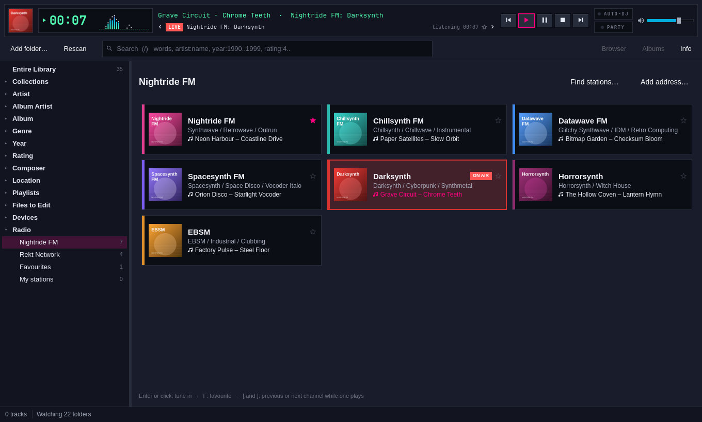
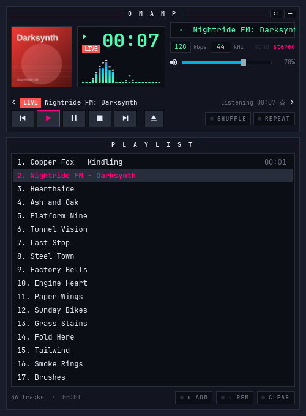
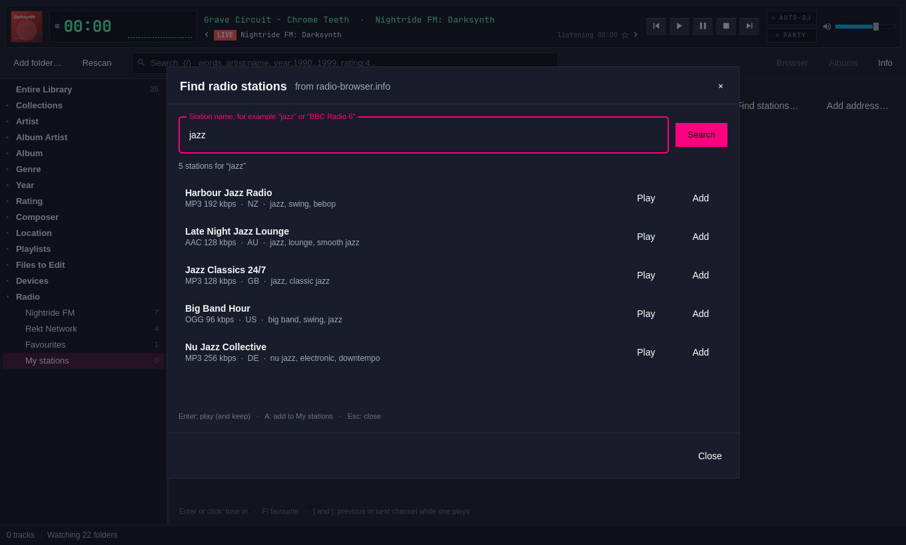

# Internet radio

Omamp plays internet radio. Every Nightride FM and Rekt Network channel is
built in, with what each one is playing right now. Any other station can be
found on radio-browser.info or added by its stream address.

## Tune in

- **On the deck**, press `Shift+R`. The Radio sheet opens on the channel
  playing, or on Nightride FM.
- **In advanced mode**, choose **Radio** in the tree, then a group:
  Nightride FM, Rekt Network, Favourites or My stations. `Shift+R` goes
  there too.
- **From the palette**, press `Ctrl+K` and type a channel's name, for example
  `darksynth`. Every station has an entry such as "Nightride FM: Darksynth".
- **From a terminal**, run `omamp radio play darksynth`.

In the picker, each card shows the channel's colour, its genres and the song
it is playing now. Click a card, or move with the arrow keys and press
`Enter`. `F` marks the channel under the cursor as a favourite, and so does
its star. `Delete` removes a station of your own. Right-click a card for the
same commands and for saving or importing a station list.

A station goes into Now Playing after the current track, so the rest of the
list stays. Choosing another station replaces it, so channel hopping leaves
one radio row in the list.

## While a station plays

A station has no length, so Omamp treats it as live:

- The deck, the strip, the big view and the mini players show **LIVE**.
- The clock counts how long you have listened. `T` has no time left to show.
- Seeking does nothing. In its place the deck shows the dial: the arrows
  step to the previous or next channel, the star keeps the channel as a
  favourite, and the station's name opens the picker.
- `[` and `]` step through the channels of the station's group while a
  station plays. They do nothing otherwise.
- The song's title and artist show wherever the playing track shows, with
  the station as the album. They go out over MPRIS too, so the Omarchy bar
  and `playerctl metadata` show them, with the station's picture as the
  cover. MPRIS sends no length and says the player can't seek.
- The visualisers work as for any track.

## Where the song names come from

**Nightride FM and Rekt Network** publish a live feed of what every channel
plays (`https://nightride.fm/meta`, server-sent events). Omamp listens to it
while one of their channels plays, and while the picker is open, so every
card stays current. The feed gives the artist and the title separately. Until
it speaks, Omamp uses the title inside the stream.

**Other stations** send their song names inside the stream, as ICY titles
("Artist - Title"). On the native engine, Omamp reads them from the stream it
plays. On the Qt engine, which can't hand them over, Omamp opens a second,
lightweight connection to the same address and reads only the titles. That
connection downloads the audio again, so it costs the station's bitrate
twice; switch to the native engine (**Settings > Playback**) to avoid it.

A station that sends no titles shows its own name.

## Pictures

A station found on radio-browser.info keeps its icon when the icon is at
least 96 pixels square. Every other station gets a tile in its colour with its
name. The pictures go into the artwork cache like album covers.

## The Nightride channels

Checked against nightride.fm on 20 October 2026:

| Group | Channels |
|---|---|
| Nightride FM | Nightride FM, Chillsynth FM, Datawave FM, Spacesynth FM, Darksynth, Horrorsynth, EBSM |
| Rekt Network | Rekt, Rektory, Rektify, D-Notive |

Each streams MP3 at 320 kbps from `https://stream.nightride.fm/<channel>.mp3`
and Opus from `<channel>.ogg`. Omamp plays the MP3, as the site does, and
falls back to the Opus stream if the MP3 won't open.

Once a day, while the picker is open, Omamp reads nightride.fm's channel list.
A new channel on the site joins Nightride FM; a channel only the feed names
joins Rekt Network. Omamp never removes a channel. The live DJ archives stay
on the website.

Omamp is not affiliated with Nightride FM. If you listen a lot, support the
station on [Patreon](https://www.patreon.com/nightridefm).

## Find stations and add your own

**Find stations…** (in the picker, or `Ctrl+K` > "Find radio stations")
searches [radio-browser.info](https://www.radio-browser.info), the open
directory of internet radio, by name. Results come most-listened first,
without stations the directory has found broken. Each shows its format,
bitrate, country and tags.

- **Play** (or `Enter`) keeps the station under My stations and plays it.
- **Add** (or `A`) keeps it without playing.

When a station from the directory plays, Omamp tells the directory, as it
asks its clients to.

**Add address…** keeps any `http` or `https` stream address under My
stations and plays it. An address ending in `.pls`, `.m3u` or `.m3u8` is read
for the stream inside it.

A station with several addresses falls back along them: when one fails, the
next one plays. When none works, the deck says so and playback stops; the
list doesn't move on.

### Station lists

Right-click a card and choose **Import stations from a list** to read `.pls`,
`.m3u` or `.m3u8` files; each web address becomes a station. **Save the
stations as a list** writes every station to `Omamp radio.m3u8` in a folder
you choose.

## Plays and scrobbling

Radio is not counted as library plays: no play counts, no skips, no play
history. Omamp keeps its own record instead:

- each station's time listened and when it last played;
- each song heard, with how long it was heard (`omamp radio heard`).

Scrobbling radio songs is off. To turn it on, open **Settings > Scrobbling**
and tick **Send songs heard on the radio too**. Only a song heard from its
start, for 30 seconds or more, is sent, and only to services you have set up.
The song playing when you tune in never counts.

## From the command line

Every command takes `--json` and `--db <file>`.

| Command | What it does |
|---|---|
| `omamp radio list [--group g]` | Lists the stations. Groups: `nightride`, `rekt`, `favourites`, `mine`, `recent`, `all` |
| `omamp radio play <station>` | Tunes the running Omamp in over MPRIS, or starts Omamp with the station |
| `omamp radio search <words> [--limit n]` | Searches radio-browser.info |
| `omamp radio add <url> [--name n]` | Keeps a stream address under My stations |
| `omamp radio remove <station>` | Removes one of your stations |
| `omamp radio favourite <station>` | Marks a favourite (`unfavourite` unmarks it) |
| `omamp radio import <file>` | Reads a `.pls` or `.m3u` station list |
| `omamp radio export <file> [--group g]` | Writes the stations as `.pls` (by extension) or M3U |
| `omamp radio heard [--limit n]` | Lists the songs heard on the radio, newest first |

A station can be named by its name (`Darksynth`), its full name
(`Nightride FM: Darksynth`), its Nightride id (`darksynth`) or its key
(`nightride/darksynth`). Part of a name works when only one station matches.

`playerctl open radio://nightride/darksynth` tunes in too, and so does
`omamp radio://nightride/darksynth`.

## Keys

| Key | Action |
|---|---|
| `Shift+R` | The channel picker |
| `[` `]` | Previous or next channel, while a station plays |
| `Enter` | In the picker: tune in |
| `F` | In the picker: favourite or not |
| `Delete` | In the picker: remove one of your stations |
| `A` | In Find stations: add without playing |

## Where things live

Stations are in the library database (`~/.local/share/omamp/library.db`,
tables `radio_stations` and `radio_heard`, schema step 10). Using the radio
creates the database if you have no library yet. Tiles and icons are in
`~/.cache/omamp/radio`.

For tests, `OMAMP_NIGHTRIDE_URL`, `OMAMP_NIGHTRIDE_STREAM_URL` and
`OMAMP_RADIOBROWSER_URL` point Omamp at other servers.
