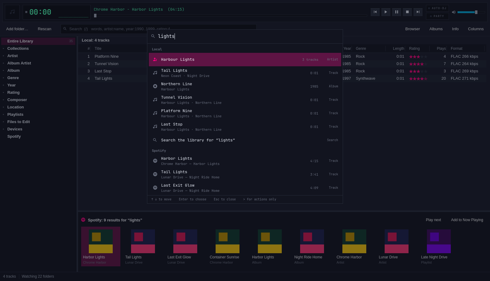
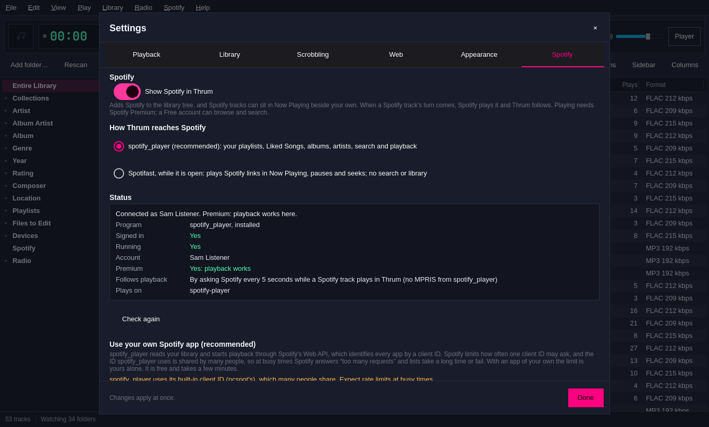
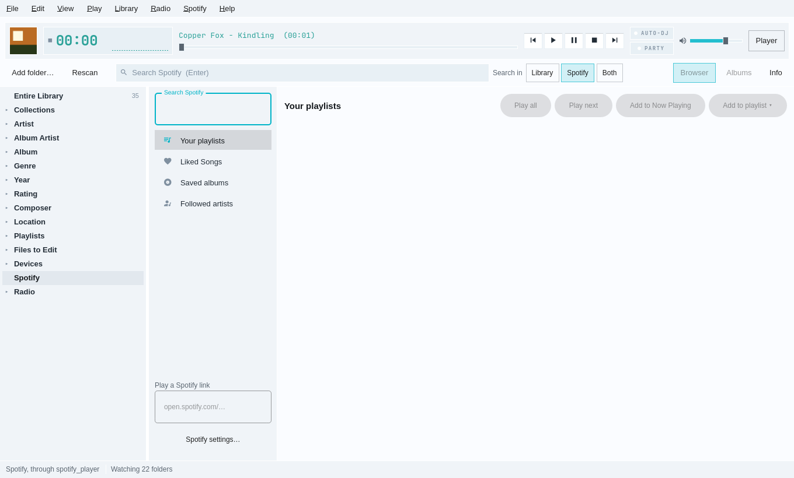

# Spotify in Thrum

Thrum can show Spotify beside your own music. Switch it on in **Settings →
Spotify**. A **Spotify** node then appears at the bottom of the library tree
with your playlists, Liked Songs, saved albums and followed artists, and a
search. Spotify tracks can sit in Now Playing between your own files. When a
Spotify track's turn comes, Spotify plays it and Thrum follows: the deck, the
strip, the big view, the mini players, the media keys and the Omarchy bar show
the track, its cover and its position.

It is off until you switch it on. Playing a track needs Spotify Premium; a
Free account can browse and search.








## Signing in

Thrum never asks for your Spotify password and keeps no Spotify token. A
separate program talks to Spotify and keeps its own sign-in; Thrum runs that
program's command line.

With **spotify_player**, the recommended backend:

1. Install it if it is missing: `omarchy-pkg-add spotify-player`.
2. In Settings → Spotify, switch on **Show Spotify in Thrum** and press
   **Sign in…**. A terminal opens running `spotify_player authenticate`.
3. Your browser opens on Spotify's permission page. Allow it. spotify_player
   then asks a second time, for playback; allow that too.
4. Close the terminal. Thrum notices the sign-in within a few seconds, starts
   `spotify_player --daemon` in the background, and fills in the status.

spotify_player keeps the sign-in in `~/.cache/spotify-player`. Thrum only
checks that its files are there (`credentials.json` and a
`<client id>_token.json`) and never opens them. To sign out, delete those two
files or run `spotify_player authenticate` again.

With **Spotifast**, sign in inside Spotifast's own window. Thrum can use it
only while it is open.

## Rate limits and your own client ID

spotify_player reaches your library, and starts playback, through
Spotify's Web API. The Web API knows each app by a *client ID* and limits
how often one client ID may ask. When it is asked too often it answers
"429 Too Many Requests", and spotify_player waits and tries again. A list
that takes a second can then take half a minute.

spotify_player's client ID is shared. Its built-in one is ncspot's, and many
setups put Spotify's own desktop app ID (`65b708073fc…`) in
`~/.config/spotify-player/app.toml`, which every player built on librespot
uses. Both are busy. An app of your own gives you a limit of your own:

1. Open [developer.spotify.com/dashboard](https://developer.spotify.com/dashboard)
   and sign in with your Spotify account.
2. Press **Create app**. Any name and description will do, for example
   "Thrum".
3. Under **Redirect URIs**, add exactly `http://127.0.0.1:8989/login`.
4. Where it asks which APIs you will use, tick **Web API**. Accept the terms
   and press **Save**.
5. Open the app's **Settings** and copy its **Client ID**: 32 letters and
   digits.
6. In Thrum, open **Settings → Spotify**, paste the ID under **Use your own
   Spotify app**, and press **Use this client ID**.
7. Sign in again: press **Sign in…**, or run `spotify_player authenticate`
   in a terminal. Your browser asks you to allow access, once for your app
   and again for each client spotify_player keeps. Allow each one.

In step 6 Thrum copies `app.toml` to `app.toml.thrum-backup-<date>-<time>`,
replaces the `client_id` line (or adds one above the first `[table]`), and
changes nothing else in the file. It then stops spotify_player, because
spotify_player needs a sign-in for the new ID, and started without one it
would wait for a browser. When the sign-in finishes, Thrum starts it again.
If `app.toml` sets `client_id_command`, which spotify_player uses instead of
`client_id`, Thrum refuses and says so.

spotify_player 0.25 still uses ncspot's ID for two things: reading your
list of playlists and opening a playlist (`me/playlists` and `playlists/`),
and any request your own ID is refused. So your own ID removes most of the
waiting, not all of it.

While Spotify is rate-limiting, the Spotify view says so and counts down to
the next try. A list that takes more than a few seconds says it is still
loading, and **Cancel** stops it. A list that fails shows why, with **Retry**.
Thrum reads spotify_player's log (`~/.cache/spotify-player/spotify-player-*.log`)
to tell a rate limit from a fault; it never writes to it.

## What Spotify lets your own app do

Spotify limits what a Web API app made after November 2024 may read. Your
own client ID is such an app. With it, spotify_player reads your playlists,
Liked Songs, saved albums, followed artists, albums and search quickly, and
plays anything. Spotify refuses it:

- **an artist's top tracks, related artists and full album list**
  (403 Forbidden, 400 Bad Request);
- **the details and tracks of playlists Spotify makes**: "This Is …", the
  Daily Mixes, Discover Weekly and the editorial lists (404 Not Found);
- recommendations and radio.

When Spotify refuses your ID, spotify_player asks again with ncspot's shared
ID, which is nearly always rate-limited, so the answer takes up to a minute.
spotify_player answers one command at a time, so while it waits, play and
pause wait too. Thrum therefore avoids those requests:

- **An artist's page comes from search**: the artist's best-known tracks,
  then their albums. **Play artist** asks Spotify to play the artist, which
  needs no reading.
- **A playlist Spotify made opens as a whole.** It shows **Play playlist**,
  **Shuffle**, **Play it next** and **Add it to Now Playing**. Each puts one
  entry in Now Playing (`spotify://playlist/<id>`). When its turn comes,
  Spotify plays the playlist on its device and the deck follows whichever
  track plays, through MPRIS. **Show tracks (slow)** lists the tracks
  anyway, the slow way.
- **Thrum learns what Spotify refused.** It reads the refusals in
  spotify_player's log, for your client ID, and does not ask for them again
  that day. A playlist that turns out to be refused while it loads stops
  waiting and opens as a whole instead. Settings → Spotify lists what was
  refused today. The list is kept in `~/.cache/thrum/spotify/refused.json`.

### Reading them the way Spotify's own app does

Spotify's own apps read those playlists and top tracks through Spotify's
private endpoints, which have no per-app limit. Spotifast does the same.
Thrum comes with a small helper, `thrum-spotify-session`, that does it too:

- It signs in with the sign-in spotify_player already keeps
  (`~/.cache/spotify-player/credentials.json`). It only reads that file and
  stores nothing.
- It is Thrum's one Spotify session: the same process decodes the Spotify
  tracks Thrum plays, saves tracks to Liked Songs, and, when you switch it
  on, is Thrum's Spotify Connect device ([below](#spotify-connect)). Thrum
  starts it the first time it is needed and keeps it running while Thrum
  runs.
- Through it, every playlist lists quickly, Spotify's own included, an
  artist's page shows their top tracks (albums still come from search), and
  an album lists its tracks.
- If it can't sign in or answer, Thrum falls back to the Web API, and a
  playlist Spotify made opens as a whole again.

Switch it off in Settings → Spotify: **Read Spotify-made playlists and
artists' top tracks the way Spotify's own app does**. It is on by default
when the helper is installed. These are Spotify's private endpoints:
Spotify's developer terms don't cover them, and Spotify can change them at
any time.

The helper is built from `sidecar/thrum-spotify-session` (Rust, librespot)
when `cargo` is installed, and installed beside `thrum`. It also answers on
its own:

```text
thrum-spotify-session playlist <id>      a playlist's name, owner and tracks
thrum-spotify-session artist-top <id>    an artist's top ten tracks
thrum-spotify-session album <id>         an album's tracks
thrum-spotify-session liked <track id>   whether a track is in Liked Songs
thrum-spotify-session like|unlike <id>   saves a track to Liked Songs, or takes it out
```

## What you can do

In the Spotify node:

- **Your playlists, Liked Songs, Saved albums, Followed artists** on the left.
- **Search Spotify**: tracks, albums, artists and playlists, under headings.
- **Play**, **Play next**, **Add to Now Playing** and **Add to playlist** act
  on the chosen rows (below). A track row plays the list from that track, as the
  library does. A playlist or album row plays all of its tracks. So do an
  artist (their ten best-known tracks) and a playlist Spotify made, when
  Thrum plays Spotify itself; without the helper they go in as one entry
  that Spotify plays. Enter or a double-click opens the row instead.
  Backspace or **‹ Back** returns.
- **Play a Spotify link**: paste an `open.spotify.com` link or a `spotify:`
  URI. A track plays next; an album, playlist or artist opens.
- The line along the top shows what plays on Spotify, with **Like** for
  Liked Songs: the Spotify track Thrum plays itself ("Playing in Thrum"),
  else what spotify_player plays, whoever started it.

### Choosing several rows

<picture>
  <source media="(prefers-color-scheme: dark)" srcset="spotify-multiselect-dark.png">
  
</picture>

Every Spotify list (your playlists' tracks, Liked Songs, an album, an
artist's page, search results) and the Spotify strip under the library
search choose rows as the library's track list does:

| Do | To |
|---|---|
| Click | choose one row |
| `Shift`+click, `Shift+↑` `Shift+↓` | choose a range from the last plain or `Ctrl` click |
| `Ctrl`+click, `Ctrl+Space` | add or take away one row |
| `Ctrl+A` | choose every row |
| `Esc` | let go of them all |
| `Enter`, double-click | play (several chosen rows: just those) |

The list's heading and the status bar say how many are chosen ("5
selected"). With one row chosen, the buttons and the row menu act on that
row as before: an album or playlist row plays all its tracks. With several,
they act on the tracks among them, in list order:

- **Play**, **Play next** and **Add to Now Playing**.
- **Add to playlist ▸** in two groups. **Thrum playlists** puts the tracks
  in one of Thrum's own playlists, which then mixes them with your files
  ([playlists.md](playlists.md#mixed-playlists)); **New Thrum playlist…**
  makes one first. **Spotify playlists** adds them to one of your Spotify
  playlists (`spotify_player playlist edit … add`, one track at a time);
  **New Spotify playlist…** makes a private one first
  (`spotify_player playlist new`).
- **Copy Spotify links** puts their `open.spotify.com` links on the
  clipboard, one a line.
- **Dragging** the chosen tracks onto a Thrum playlist in the tree adds
  them, as dragging library tracks does.

**Like** acts on the playing track. While Thrum plays the track itself,
Thrum saves it by its id through the helper, as Spotify's own app does
(`/collection/v2/write` on Spotify's private endpoints, with the Web API's
`/v1/me/tracks` as the fallback), and asks the same way whether it is
already liked. Otherwise it goes through `spotify_player like`, which saves
whatever spotify_player plays.

Elsewhere:

- **The library search** shows Spotify's answers in a strip under the track
  list, with the library's tracks headed "Local". Double-click a track tile
  to play it next, or anything else to open it.
- **The command palette** (`Ctrl+K`) lists Spotify's answers after the
  library's, under "Local" and "Spotify". Choosing a track plays it next and
  starts it; choosing an album, playlist or artist opens it.
- **Spotify tracks in Now Playing** stay there between runs, like Navidrome
  tracks. Their entries read `spotify://track/<id>`.

Both kinds of blending can be switched off in Settings → Spotify.

## The command line

`thrum spotify` works without the window and takes `--json`, like every
command:

```text
thrum spotify status              installed, signed in, running, account, Premium, devices
thrum spotify search <text>       tracks, albums, artists and playlists
thrum spotify playlists|liked|albums|artists
thrum spotify tracks <uri>        a playlist's or album's tracks, an artist's best-known tracks
thrum spotify play <uri or link>  play it on the backend's Spotify Connect device
thrum spotify now                 what is playing
thrum spotify pause|resume
          [--backend spotify_player|spotifast]
```

`status` prints the next step when something is missing, for example
`sign in, in a terminal: spotify_player authenticate`.

## Who plays Spotify

**Thrum plays Spotify tracks itself** when `thrum-spotify-session` is
installed (it is built with Thrum when `cargo` is there). The helper's
`audio` mode signs in with the sign-in spotify_player keeps
(`~/.cache/spotify-player/credentials.json`, read only), fetches each track
as librespot's own player does, at 320 kbps Ogg Vorbis when Spotify has it,
and hands Thrum the decoded sound. Thrum's native engine opens a Spotify
track like a file. So Spotify tracks get everything local tracks get:

- **Gapless joins and crossfades** between Spotify tracks and local tracks,
  in either direction. The next Spotify track is opened while the current
  one plays.
- **The visualisers, the volume slider, mute, the equaliser and the output
  device** behave as for any file.
- **ReplayGain** uses Spotify's own loudness figures for the track and its
  album. Spotify's normalisation is otherwise off.
- **Quitting Thrum stops Spotify**, because the sound is Thrum's.

With the Qt engine chosen (Settings → Playback), Spotify tracks play in a
native engine of their own beside it, without gapless joins across the
change. Playing Spotify in Thrum needs Spotify Premium; a Free account gets
a message saying so.

**A whole playlist, album or artist** goes into Now Playing as its tracks,
which Thrum then plays itself: a playlist's tracks in order, an album's, an
artist's ten best-known. **Shuffle** shuffles them as they go in. An entry
for a whole playlist that was already in Now Playing (from an older Thrum,
or a Thrum playlist) is read into its tracks when its turn comes. So
Thrum's queue, shuffle and repeat hold for all of it, and spotify_player
plays nothing.

**spotify_player plays the rest:** every Spotify track when the helper isn't
installed (a build without `cargo`) or can't sign in, and a whole playlist,
album or artist whose tracks the helper couldn't read. Then Spotify plays on
its own Spotify Connect device (spotify_player's, named `spotify-player`
unless its `app.toml` says otherwise) and Thrum pauses its own engine:

- **No gapless join, crossfade, ReplayGain or equaliser** across the
  change, and starting each track takes about a second.
- **The visualiser rests**; it has no sound to draw.
- **The volume slider** sets spotify_player's volume over MPRIS.
- **Quitting Thrum pauses spotify_player** if it is playing Thrum's entry,
  over MPRIS (`Pause`, waiting up to a second). Spotify playing something
  you started elsewhere is left alone.
- **Position and pauses** come from the backend's MPRIS service:
  `org.mpris.MediaPlayer2.spotify_player` (spotify_player, with
  `enable_media_control = true`, its default on Linux) or
  `org.mpris.MediaPlayer2.spotifast`. That costs Spotify nothing. Without
  MPRIS, Thrum asks the backend every 5 seconds, and only while a Spotify
  track plays in Thrum.
- **A pause from another device** shows as paused in Thrum, as soon as
  spotify_player hears of it. If someone starts something else in Spotify,
  Thrum pauses its queue and says so.

**spotify_player is still needed** for signing in (the helper reads its
credential), your library, your playlist list, search and playlist edits,
all through its daemon and command line.

## Spotify Connect

Thrum can be a Spotify Connect device, so the Spotify app on your phone (or
any other Spotify app signed in to the same account) can play on it. Switch
it on in Settings → Spotify: **Let your phone and other Spotify apps play on
Thrum**, and give it a name (`Thrum` unless you change it). It needs the
helper and Spotify Premium.

- **Thrum appears in the phone's device list** as soon as the helper has
  signed in, while Thrum runs. Choose it there and the phone's music plays
  in Thrum, through Thrum's engine: its volume, equaliser, visualiser and
  output device.
- **In Now Playing it is one live entry**, *Spotify Connect*, put after
  what was playing. The deck, the big view, MPRIS and the Omarchy bar show
  the phone's track as it changes, like a radio station's song; the line
  in the Spotify view says "Thrum, from" the phone, and **Like** saves the
  phone's track.
- **Thrum's buttons reach the phone:** play, pause, next and previous (the
  media keys too). Seek on the phone; Thrum's position counts from when
  Connect began. The phone's pause, skip, seek and volume reach Thrum.
- **Moving on in Thrum** (choosing another entry) pauses the phone's
  playback and takes the entry out of Now Playing.
- If the device can't start (a Free account, say), Settings → Spotify says
  why, and Thrum carries on without it: Spotify tracks still play.

How it works: the helper started with `--connect <name>` signs in through
librespot-connect 0.8's `Spirc`, which speaks Spotify Connect and drives
librespot's own `Player`, exactly as the `librespot` program does. The
Player's sink is not a sound card: it hands the decoded sound to Thrum,
which pulls it as the stream `spotify://connect`, and the sink waits while
Thrum hasn't taken what it has (a quarter of a second), so the Player goes
at Thrum's pace. What happens on the device comes to Thrum as event frames.
The device is found through the account (Spotify's dealer), not mDNS
zeroconf, so it appears only on your own account's apps, and the helper
keeps no credential of its own. Turning it on or off, or renaming it,
restarts the helper, which stops a Spotify track playing at that moment.

### The helper's protocol

`thrum-spotify-session --credentials <file> [--connect <name>] serve` reads
one JSON request a line on stdin and writes frames on stdout. (`audio` is
the same mode by its old name.) A frame is a little-endian
`u32` length, then that many bytes: a JSON header, a newline, and for a read
the samples. Its first frame is `{"ready":true,"rate":44100,"channels":2,…}`,
or `{"ready":false,"error":…}`.

```
{"id":1,"cmd":"open","stream":7,"track":"<base62>","position_ms":0}
   → {"id":1,"ok":true,"duration_ms":…,"bitrate":320,"format":"OGG_VORBIS_320",
      "title":…,"artists":[…],"album":…,"track_gain_db":…,"track_peak":…, …}
{"id":2,"cmd":"read","stream":7,"frames":4096}
   → {"id":2,"ok":true,"frames":n,"end":false} + n × 2 float32 LE samples
{"id":3,"cmd":"seek","stream":7,"position_ms":60000} → {"id":3,"ok":true,"position_ms":…}
{"id":4,"cmd":"close","stream":7}                    → {"id":4,"ok":true}
{"id":5,"cmd":"ping"}                                → {"id":5,"ok":true}
{"id":6,"cmd":"playlist","playlist":"<id>"}          → {"id":6,"ok":true,"playlist":{…},"tracks":[…]}
{"id":7,"cmd":"artist-top","artist":"<id>"}          → {"id":7,"ok":true,"artist":{…},"tracks":[…]}
{"id":8,"cmd":"album","album":"<id>"}                → {"id":8,"ok":true,"album":{…},"tracks":[…]}
{"id":9,"cmd":"like","tracks":["<id>"],"on":true}    → {"id":9,"ok":true,"via":"collection"}
{"id":10,"cmd":"liked","tracks":["<id>"]}            → {"id":10,"ok":true,"liked":[false]}
{"id":11,"cmd":"open-connect","stream":8}            → {"id":11,"ok":true,"live":true,…}
{"id":12,"cmd":"connect","action":"pause"}           → {"id":12,"ok":true}
{"cmd":"quit"}
```

The catalogue's answers (playlist, artist-top, album, like, liked) run on
the session's own runtime, so a slow list never holds up a read. A
`connect` action is `play`, `pause`, `next`, `previous`, `seek` (with
`position_ms`) or `volume` (0 to 1). A read of the Connect stream returns
what the device has decoded (none while the phone is between tracks; Thrum
plays silence then) and never ends. A frame with `"event"` in place of
`"id"` is the device's news, sent when it happens:

```
{"event":"connect","track":{"id","uri","title","artists","album","duration_ms","art"}}
{"event":"connect","state":"playing"|"paused"|"stopped","position_ms":…}
{"event":"connect","position_ms":…}       a seek
{"event":"connect","volume":0.5}
{"event":"connect","client":"Sam's phone"}
```

Liked Songs, as Spotify's desktop app reaches it: `POST
/collection/v2/write` and `/collection/v2/contains` on spclient, with
`Content-Type: application/vnd.collection-v2.spotify.proto`. The messages
are `collection2v2.proto`'s, which librespot doesn't compile, so the helper
writes them itself: `WriteRequest {1 username, 2 set = "collection",
3 repeated CollectionItem {1 uri, 2 added_at, 3 is_removed}}`, and for
`contains` the same username and set with each track as a `CollectionItem`
at field 3 (a bare URI string there is refused with 400); the answer is a
packed `repeated bool found = 1`. Checked against a real account on
24 October 2026.

Thrum pulls: it reads when its engine wants sound, so pausing is not
reading, and the helper never touches a sound card. Each stream runs on a
thread of its own, so a track opened ahead never holds up the one playing.
A refused open has `"ok":false`, `"error"` and, when known, `"reason"`:
`"premium"` or `"unavailable"`. Thrum starts one helper for all streams
(`src/engine/spotifyaudio.{h,cpp}`), as a child of a thread that lives
exactly as long as it, with `PR_SET_PDEATHSIG`, and quits it (killing it
after 1.5 seconds) when Thrum quits. The catalogue (`SessionReader`) and the
Connect device go through the same process, so Thrum holds one librespot
session, not one per job.

## The two backends

| | spotify_player | Spotifast |
|---|---|---|
| Your playlists, Liked Songs, albums, artists | Yes | No |
| Search | Yes | No |
| Spotify tracks in Now Playing | Yes | Yes, from links you paste |
| Pause, resume, seek, Like | Yes | Yes |
| Runs | In the background, started by Thrum | Only while its window is open |

## Why it is built this way

**Thrum drives a program that already speaks to Spotify, and spotify_player
is the main one.** Spotify allows playback in third-party apps only through
librespot (a reverse-engineered Spotify Connect client) and only for Premium
accounts. Thrum could link librespot itself, but then it would have to hold a
Spotify sign-in and its tokens, keep up with every change Spotify makes, and
carry a Rust library in a C++ app. spotify_player already does all of that,
is packaged for Arch, runs as a daemon, and answers on its command line in
JSON: library, search, playback state, play, pause, seek, Like, add to a
playlist and choose a device. That gives the whole feature without Thrum ever
touching a credential.

**Since October 2026 Thrum plays Spotify tracks itself.** Handing sound to
another program cost the visualiser, the equaliser, gapless joins, and
control of what happens when Thrum quits. librespot now lives in the Rust
helper beside Thrum, not in Thrum, and it reads spotify_player's credential
rather than keeping one, so Thrum still holds no sign-in of its own.
spotify_player stays for the library, search and sign-in, and as the player
when the helper can't play.

**Spotifast is a second choice, for control only.** It is a good Spotify app,
but its command line plays a link, pauses, seeks and
reports what is playing; it has no search or library. Thrum uses it for
exactly that. The official Spotify app offers only MPRIS, so it isn't a
backend.

**The queue stays Thrum's.** Each Spotify track is a Now Playing entry, and
Thrum starts it on Spotify when its turn comes (`playback start track`), so
local and Spotify tracks mix in one list in your order. Handing whole
playlists to Spotify would have been simpler, but then Thrum's queue, shuffle
and repeat would stop meaning anything.

**One seam in the player.** `HandoffEngine` (`src/engine/handoffengine.h`)
sits in front of the real engine. It passes `spotify://` entries to
`SpotifyPlayback` and everything else to the engine. When Spotify plays next,
the engine is given nothing to queue, so it ends with "end of queue"; that is
the moment Spotify starts. When Spotify's state shows the track finished, the
engine loads and plays the next file. The Player itself is unchanged, so
everything that shows or controls the Player (the deck, the big view, the
mini players, MPRIS and the bar plugin) follows Spotify for free.

**Ask Spotify as little as possible.** Every spotify_player command is a Web
API request, and the client ID is shared, so Thrum:

- follows playback through MPRIS, and reads the state through the command
  line only when MPRIS isn't there;
- sends every command through one queue with two lanes, each running one
  command at a time. Play, pause and seek go on one lane, so a button never
  waits behind a long list. Lists and searches go on the other, at least
  300 ms apart. Two requests for the same list share one command;
- keeps lists for ten minutes (searches five) and shows the kept copy at
  once while reading a fresh one. The refresh button beside a list's title
  reads it again now;
- loads a section only when you look at it. Switching Spotify on reads the
  devices and your playlists, nothing more;
- waits six seconds after starting spotify_player before asking anything,
  because spotify_player reads your whole library as it starts;
- holds back lists while Spotify has said to wait.

**Careful with spotify_player.** Three of its habits shape the code:

- When no instance is running, its command line starts a client of its own
  to answer, and that client may stop to ask for a sign-in. Thrum therefore
  runs a command only when spotify_player is signed in and running, and
  closes the command's input so nothing can wait for a reply.
- With an instance running, `playback start` returns at once and reports a
  failure (such as "Premium required") only in its log. Thrum counts a start
  as failed when Spotify's state hasn't shown the track playing after twelve
  seconds, and then says why it probably failed: a Free account, or no
  Spotify Connect device on this computer.
- It prints its JSON after turning every `\n` escape into a real line break.
  Thrum puts the escapes back before reading it.

**Pictures.** spotify_player's lists carry no pictures. The playing track's
cover comes from Spotify's playback state; covers for list rows come from
Spotify's public oEmbed page (`open.spotify.com/oembed`), which needs no
sign-in, as each row is shown. All of them are kept in
`~/.cache/thrum/spotify`. A row without a picture shows an
icon.

**MPRIS has no track id in spotify_player.** Its `mpris:trackid` is `/`, so
Thrum matches the playing track by title and length. Spotifast's metadata
has the Spotify URI in `xesam:url`.

**Settings and files.** The switches live in `~/.config/thrum/spotify.conf`:
whether Spotify is on, the backend, the two kinds of blending and whether to
start spotify_player. Nothing about the account is stored. The only file
outside Thrum's own that Thrum writes is spotify_player's `app.toml`, when you
press **Use this client ID**. It sets `client_id` and sets
`ncspot_only_get_endpoints = []`, after backing the file up. spotify_player
0.25 otherwise sends every playlist request through ncspot's shared client ID,
which is rate-limited across everyone who uses it. With the empty list, playlist
requests use your ID first and fall back to ncspot's only when Spotify refuses
yours (Spotify's own playlists, such as "This Is…", for apps made after late 2024).
On 20 October 2026 this took listing playlists from 26 s to 0.5 s.

## Testing

`tests/spotify_tests.cpp` runs against a fake `spotify_player` and a fake
`spotifast` (`tests/fake-spotify`) put first on `PATH`. They answer from
recorded JSON in `tests/fixtures/spotify`, made by `make-fixtures.py` from the
structs in spotify_player 0.25.1's source and rspotify-model 0.16.1, with
made-up artists and albums. The tests never reach Spotify, never start the
real programs and play no sound.

The fake can be slow (`slow-<verb>`) and can write spotify_player's
rate-limit warning to a log (`ratelimit`). It also behaves as Spotify does
with your own client ID: `get item … artist` logs the three refusals and
answers late, and so does `get item` on a playlist listed in `restricted`.
A fake `thrum-spotify-session` (`tests/fake-spotify/thrum-spotify-audio`,
Python) answers the helper's whole protocol: the catalogue from the same
fixtures, Liked Songs from a file, the sound as tones, and Connect events a
test writes to a file. The real helper's own tests run with `cargo test`. MPRIS is tested with a fake
spotify_player MPRIS service on a private `dbus-daemon`, so nothing appears
on the desktop's session bus; every other test points Thrum at a bus name
that doesn't exist. The client ID writer is tested on `app.toml` files in
temporary folders. `tests/mixed_tests.cpp` covers choosing rows, adding them
to Thrum playlists, dragging them onto the tree, mixed playlists, playing
them and the command line, against the same fake.

`tests/spotifyaudio_tests.cpp` covers Thrum playing Spotify itself, against
`tests/fake-spotify/thrum-spotify-audio` (Python), which speaks the audio
protocol and "decodes" every track to a sine tone: one helper for all
tracks, a refused sign-in remembered, the visualiser moving and resting,
pause, seek, a Spotify track followed by a local file and by another Spotify
track opened ahead, the Premium message, the Qt engine's side engine, and no
helper process left afterwards. It also covers Like and the "playing now"
line following Thrum's own track, one helper process for the catalogue,
Liked Songs and the sound, whole playlists going into Now Playing as their
tracks (and an old whole-playlist entry read into its tracks when it
plays), and the Connect device: a phone's track playing as the live entry
with its title, Thrum's pause, play and next reaching the phone, the
phone's pause reaching Thrum, the entry going when Thrum moves on, and a
device that can't start leaving Spotify tracks playing.

## Things to check by hand

The command shapes have not met a real Spotify account. After signing in,
check:

1. `thrum spotify status` shows your account, `Premium: yes` and the
   `spotify-player` device.
2. Play a playlist mixed with local files and listen to the change-overs.
3. Pause on your phone; Thrum should show paused within a second or two.
4. Open a long playlist. With a shared client ID it may say Spotify is
   rate-limiting; with your own it should open in a second or two.
5. Settings → Spotify → Status shows **Follows playback: Through MPRIS**.
6. Open an artist: the page shows tracks and albums at once, with no
   rate-limit message.
7. Open a "This Is …" playlist and press **Play playlist**: with the helper
   installed, its tracks go into Now Playing and Thrum plays them; without
   it, Spotify plays it and the deck shows each track as it changes.
8. Switch on Spotify Connect, then on your phone open the device list:
   "Thrum" is there. Play on it; Thrum plays the phone's music, pauses when
   the phone pauses, and its Next skips on the phone. (Not yet tried with a
   real phone.)
