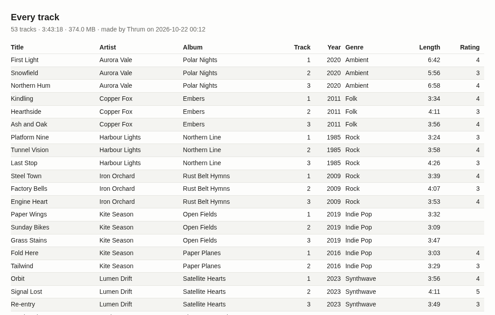

# Device sync and reports

Thrum copies music to a phone, a USB drive or a Syncthing folder, converting
the formats you choose with `ffmpeg`. It can also save any list of tracks as
a spreadsheet (CSV) or a web page (HTML).


## Sync profiles

A sync profile says four things:

- **Where the music goes.** A folder, a USB drive (or a phone mounted as
  one), or a Syncthing folder.
- **What goes there.** One or more playlists, auto-playlists, collections or
  queries, or the whole library. A track named by two of them is copied once.
- **Which formats to convert.** Format rules, described below.
- **How files are named.** A mask, as in Organise (see [masks.md](masks.md)).
  The default is `<Album Artist>/<Album>/$If(<Disc#>,<Disc#>-)<Track#:2> <Title>`.

Open the page from the palette (**Devices: sync to a phone, USB drive or
Syncthing…**) or from the **Devices** node in the library tree. Each profile
is a node under Devices; choosing it lists the tracks it syncs, and its menu
has **Sync now** and **Edit sync profile…**.

USB drives that are plugged in and the folders Syncthing shares appear under
the target as buttons, so you rarely type a path.

### Targets

| Target | Thrum checks first |
|---|---|
| A folder | Nothing. The folder is made if it doesn't exist. |
| A USB drive | The folder is on a mounted drive, not on the system disk. A drive that isn't plugged in is refused, and its folder is never made on the system disk by mistake. |
| A Syncthing folder | The folder holds `.stfolder`, the marker Syncthing writes. Add the folder in Syncthing first. |

Thrum refuses a target inside a library folder, or one that holds a library
folder, because the next scan would add the copies as new tracks.

### Format rules

The first rule that fits a file wins. A file no rule fits is copied as it is.

| Rule | Meaning |
|---|---|
| `flac,wav->opus:128` | Convert FLAC and WAV to Opus at 128 kbit/s |
| `lossless->mp3:256` | Convert every lossless format (FLAC, WAV, AIFF, ALAC, APE, WavPack…) to MP3 |
| `*->aac:256` | Convert everything to AAC in `.m4a` |
| `wma->skip` | Leave WMA files off the device |
| `*->copy` | Copy everything else unchanged |

Thrum converts to `opus`, `mp3`, `aac`, `vorbis` (`.ogg`) and `flac`. Without
a bitrate, Opus gets 128 kbit/s, MP3 and AAC 256, and Vorbis 192. A rule that
would convert a file to its own lossy format (MP3 to MP3) copies it instead.
Tags travel with the music. MP3, AAC and FLAC copies try to keep the
embedded cover (and drop it if the format won't take it); Opus and Vorbis
copies have none.

The page offers the common choices in a list ("Lossless to Opus 128 kbit/s,
the rest as it is" and so on). Rules typed by hand are separated by `;`.

## Preview, then sync

**Preview** is a dry run. It reads the library and the device and lists
what a sync would do, file by file, without writing anything:

- **Copy**: new on the device, or changed in the library since the last sync.
- **Convert**: the same, through a format rule.
- **Delete**: a file an earlier sync put there that is no longer in the list,
  or, with **Delete other files** on, anything else in the folder.
- **Leave off**: a track whose disk isn't connected, a missing file, a track
  on a Navidrome server, or a file a rule skips.
- **Write**: an `.m3u8` for each playlist, with paths relative to the
  device folder, so a phone's player finds the playlists too.

It also says how much will be written and how much room is free. A sync that
won't fit is refused before it starts.

**Sync now** runs as a job in the jobs bar, with progress and Cancel. Up to
four conversions run at once. Files are written under a hidden temporary
name and renamed into place, so a cancelled or failed sync never leaves half
a file under a real name.

### What Thrum remembers on the device

The device folder holds `.thrum-sync.json`: each file Thrum wrote, the
library file it came from (its size and modification time), and the rule
used. A file whose source and rule haven't changed is kept, so syncing the
same list again copies nothing. Change a rule or a mask and the affected
files are made again, and the old ones are removed.

Thrum never touches hidden files and folders (`.stfolder`, `.stignore`,
`.Trashes` and the like). Files Thrum didn't put there stay unless the
profile says **Delete other files**.

## From the command line

```sh
thrum sync devices                                  # USB drives and Syncthing folders found now
thrum sync create Phone --to /run/media/$USER/PHONE/Music --kind usb \
    --source 'playlist:Road trip' --source 'collection:Audiobooks' \
    --rule 'lossless->opus:128' --rule 'wma->skip'
thrum sync run Phone --dry-run                      # what would happen; writes nothing
thrum sync run Phone                                # do it
thrum sync set Phone --delete-others --clear-rules --rule '*->mp3:192'
thrum sync list --json
thrum sync remove Phone                             # the profile only; the device is untouched
```

`--source` takes `playlist:<name>` (static or auto), `collection:<name>`,
`query:<text>` or `library`. `--kind` is `folder` (the default), `usb` or
`syncthing`. `--mask` sets the file names. `--no-playlists` stops the
`.m3u8` files. `sync run --dry-run --json` lists up to `--limit` actions
(all by default); `--all` includes the files that are already there.
Profiles live in the library database, so `--db` picks them as it picks
everything else.

## Reports

Any list in the window can be saved as a report: the tree's menu has **Save
the list as CSV…** and **Save the list as a web page…**, and the palette has
the same. Thrum asks for a folder and names the file after the list
("Road trip.csv"). A playlist's report keeps the playlist's order.



- **CSV** opens in LibreOffice Calc or Excel. A cell that starts with `=`,
  `+`, `-` or `@` gets a leading apostrophe, so a title can't run as a
  formula.
- **HTML** is one self-contained page with no scripts. It follows the
  desktop's light or dark mode and prints cleanly.

From the command line:

```sh
thrum report 'rating:5' --out five-stars.csv
thrum report --playlist 'Road trip' --format html --out road-trip.html
thrum report --collection Music --columns artist,album,year,length --format csv > music.csv
```

Columns: `title`, `artist`, `albumartist`, `album`, `disc`, `track`, `year`,
`genre`, `composer`, `length`, `rating` (stars), `plays`, `lastplayed`,
`added`, `format`, `bitrate`, `size` (bytes) and `path`. The default is
title, artist, album, track, year, genre, length and rating. Without
`--out` the report goes to standard output; `--format` follows the file's
extension when it isn't given.
