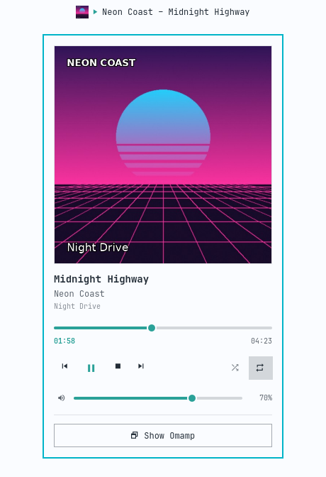
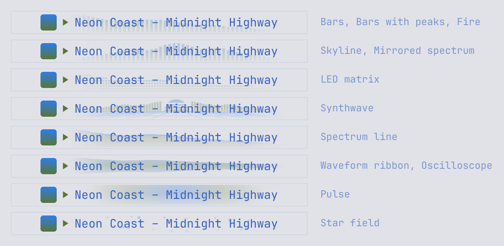

# Thrum in the Omarchy bar

A bar widget and panel for Thrum, plugin id `contra.thrum`.

<picture>
  <source media="(prefers-color-scheme: dark)" srcset="../docs/omarchy-plugin-dark.png">
  
</picture>

The picture is rendered off-screen from `Widget.qml` with a made-up track and cover.

While Thrum is running, the bar shows a small cover, its play state and
"Artist – Title". A long line pans slowly inside a fixed width. The play
glyph turns the theme's green while music plays. With no cover, the glyph
stands alone. When Thrum closes, the widget disappears.

Click it to open the panel. The cover fills the top of the panel, with the
title, artist and album under it, then a seek bar, previous, play or pause,
stop and next, shuffle and repeat, Thrum's own volume, and a **Show Thrum**
button that brings the window forward.

The cover is the picture Thrum sends over MPRIS as `mpris:artUrl`, so local
files, Spotify tracks, radio station tiles and Navidrome albums all show
theirs. When the track changes, the old cover stays until the new one has
loaded, then fades across. A music note on the theme background stands in
when there is no cover.

| On the widget | Does |
| --- | --- |
| Left click | Open the panel |
| Right click | Play or pause |
| Middle click | Next track |
| Scroll | Previous or next track |

The time under the seek bar is Thrum's green clock. Click it to switch
between time played and time left, as in Thrum. Thrum's full LCD, with the
large clock and the scrolling title strip, is a setting (`showLcd`).

## The visualiser behind the track

<picture>
  <source media="(prefers-color-scheme: dark)" srcset="../docs/omarchy-plugin-visualiser-dark.png">
  
</picture>

While music plays through Thrum, a small, faint copy of Thrum's visualiser
runs behind "Artist – Title" in the bar, and a larger one behind the title,
artist and album in the panel. It fades out towards both ends and towards
the bottom, so the words stay easy to read. It follows the style chosen in
Thrum: Synthwave in Thrum gives a small sun, city and grid in the bar.

| Thrum's style | In the bar |
| --- | --- |
| Bars, Bars with peaks, Fire | Bars |
| Skyline, Mirrored spectrum | Bars with the bass in the middle |
| LED matrix | Small lit cells |
| Synthwave | A sun on the horizon, a city of bars either side, a grid |
| Spectrum line | A line with a shaded fill |
| Waveform ribbon, Oscilloscope | A band about the middle |
| Pulse | A glow that swells with the bass |
| Star field | Stars that brighten with their part of the spectrum |

It fades away when Thrum pauses or stops, and while Spotify plays, because
Spotify's sound never reaches Thrum. Thrum's **Reduce motion**, or the
shell's, makes it calmer: eased levels, no drift and no fades.

The bar has no sound of its own; MPRIS carries none. Thrum sends the levels
on a local socket, `$XDG_RUNTIME_DIR/thrum-levels.sock`, at up to 20 frames
a second, and only while the bar is connected and music is playing. The
widget connects only while it shows a track. In Thrum, **Settings >
Appearance > Share the visualiser with the Omarchy bar** turns the socket
off. The widget tries to connect when it first shows, when music starts and
when the track changes, so after you turn sharing back on it appears with
the next track or the next press of play.

## Why it is not the built-in media widget

Omarchy's `omarchy.media` widget follows whichever player is active. It
offers play or pause, previous and next. This widget follows Thrum only.
It adds seek, stop, shuffle, repeat, Thrum's volume and raising the window,
all over Thrum's MPRIS interface (`org.mpris.MediaPlayer2.thrum`).

## Settings

In Setup > Bar, or inline on the `contra.thrum` entry in
`~/.config/omarchy/shell.json`:

| Key | Default | What it does |
| --- | --- | --- |
| `showThumbnail` | `true` | Shows the small cover in the bar |
| `showVisualiser` | `true` | Shows the faint visualiser behind the track in the bar and the panel |
| `visualiserStyle` | `Same as Thrum` | Or `Bars`, or `Line`, whatever Thrum shows |
| `visualiserStrength` | `Subtle` | Or `Normal`, which shows it more |
| `coverSize` | `Large` | The cover in the panel: `Large` fills the top, `Medium` sits beside the track, `Hidden` leaves it out |
| `showLcd` | `false` | Adds Thrum's green clock and scrolling title strip to the panel |
| `maxLabelWidth` | `220` | The width past which the line pans instead of growing |
| `showClock` | `false` | Shows the elapsed time, in green, after the line |
| `showWhenClosed` | `false` | Keeps a dimmed icon while Thrum is closed; clicking it opens Thrum |
| `scrollAction` | `Previous/next track` | Or `Volume` (Thrum's), or `Nothing` |

The widget hides while Thrum is closed, as Omarchy's media widget does, so
the bar carries no dead icons. Turn on `showWhenClosed` if you would rather
have a launcher there.

## Install

```sh
omarchy-plugin/install                  # link the plugin and put it on the bar
omarchy-plugin/install --no-bar         # link only
omarchy-plugin/install --section left   # choose the section
omarchy-restart-shell
```

The install links `~/.config/omarchy/plugins/contra.thrum` to this folder,
so pulling the repo updates it. It puts the widget after `contra.nightride`
when that is on the bar, and in the right section otherwise.
`omarchy-plugin/uninstall` takes it off the bar and removes the link.

## Scripting it

```sh
omarchy-shell contra.thrum status        # JSON: state, track, artUrl, cover, position, volume, shuffle, repeat, visualiser
omarchy-shell contra.thrum playPause     # also stop, next, previous, shuffle, repeat, raise, launch
omarchy-shell contra.thrum volume 40     # Thrum's volume, in percent
omarchy-shell shell toggle contra.thrum  # open or close the panel
```

## Tests

```sh
node omarchy-plugin/tests/model.test.mjs
/usr/lib/qt6/bin/qmllint omarchy-plugin/*.qml
omarchy plugin validate "$PWD/omarchy-plugin"
```

The visualiser pictures come from `tests/render-visualiser.qml`, which draws
the pill with made-up levels and a made-up track:

```sh
for mode in dark light; do
  QT_SCALE_FACTOR=2 QT_QPA_PLATFORM=offscreen QT_QUICK_BACKEND=software \
    /usr/lib/qt6/bin/qml omarchy-plugin/tests/render-visualiser.qml -- $mode "$PWD/docs/omarchy-plugin-visualiser-$mode.png"
done
```
